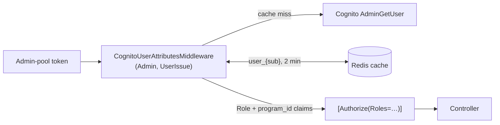

# X-15 · Authorization layers 2–3: staff roles

> **Bangla name:** অথরাইজেশন স্তর ২–৩: স্টাফ রোল
>
> [← 60 · Cross-cutting](README.md) · [Contents](../README.md) · [Open queries](../99-open-queries.md)

## 1. Name and purpose

**Staff roles.** Admin-pool users carry their roles in the Cognito attribute `custom:role` (comma-separated). The Admin and
UserIssue services turn that attribute into role claims on each request (layer 2) and controllers allow or deny by role with
`[Authorize(Roles = …)]` (layer 3). This file explains the mechanism and gives the **role × controller matrix** of the Admin
service.

## 2. Trigger and actor

Every request with an Admin-pool token to the Admin or UserIssue service.

| Role value | Code constant | Meaning (from menus and controllers) |
|---|---|---|
| `admin` | `Role.Admin` | Full administrator |
| `event_manager` | `Role.EventManager` | Programs, venues, events, notices, raffle, gate assignment |
| `ticket_manager` | `Role.TicketManager` | Events, ticket layouts/attributes, ticket checkers, reserved-ticket generation |
| `ticket_operator` | `Role.BCBPersonnel` | BCB personnel: dashboard, events, reports, reserved-ticket generation |
| `customer_support` | `Role.CustomerSupportAdmin` | Customer issues |

## 3. Business flow

An administrator gives a staff member one or more roles (and programs) in the admin portal ([X-05](X-05-admin-provisioning.md)).
From then on the staff member sees the matching menu ([X-17](X-17-authz-client-side.md)) and the backend allows only the
matching endpoints.

## 4. Technical flow

| # | Step | Detail |
|---|---|---|
| 1 | Authenticate | Default scheme `admin` validates the token ([X-14](X-14-authz-pool-policies.md)) |
| 2 | Enrich | `CognitoUserAttributesMiddleware` (registered in Admin and UserIssue only): reads `sub`; picks the pool from the `scope` claim (`aws.cognito.signin.user.admin` → Admin pool); calls Cognito `AdminGetUser(pool, sub)` through the cache `User`, key `user_{sub}`; adds one `ClaimTypes.Role` claim per comma-separated value of `custom:role`, and one `program_id` claim per value of `custom:program_ids` |
| 3 | Authorize | `[Authorize(Roles = "a,b")]` passes if the user has any listed role. Class and method attributes both apply (logical AND) |
| 4 | Failure | Missing role → 403. Enrichment errors are logged and swallowed, so the request continues without roles and ends in 403 |

**Cache:** `ICacheManager` is a distributed (Redis) cache with a default absolute expiry of **2 minutes** for every cache
(`Core/ETP.Core/Configuration/CacheConfig.cs:13`, `:40-43`). The Admin service removes `user_{id}` when it updates or deletes a
staff user ([X-05](X-05-admin-provisioning.md)).

### Role × controller matrix (Admin service)

✔ = allowed by the controller attribute; ✔* = see note; — = not allowed; "open" = no authorization in code ([X-18](X-18-endpoints-without-auth.md)).

| Controller (route) | admin | event_manager | ticket_manager | ticket_operator | customer_support | Notes |
|---|---|---|---|---|---|---|
| `activity-log` | ✔ | ✔ | — | — | — | |
| `admin-users` | ✔ | — | — | — | — | `forget-password`, `set-forget-password` open |
| `agent-users` | open | open | open | open | open | no `[Authorize]` |
| `block-level-entry-gate` | ✔ | — | — | — | — | called by other services ([X-19](X-19-service-to-service.md)) |
| `currency` | open | | | | | unreferenced (Appendix A) |
| `dashboard` | ✔ | — | — | ✔ | — | plus `[AuthorizeProgram]` ([X-16](X-16-authz-program-scope.md)) |
| `discount` | ✔ | — | — | — | — | `program/{p}/{e}/{g}` open |
| `events` | ✔ | ✔ | ✔ | ✔ | — | `[AuthorizeProgram]` commented out |
| `event-settings` | open | | | | | |
| `eventsVenueDetails` | ✔ | ✔ | ✔ | ✔ | — | |
| `gallery` | ✔ | — | — | — | — | unreferenced (Appendix A) |
| `general-notice` | ✔ | ✔ | — | — | — | `public` open |
| `header-footer` | open | | | | | GET and PUT |
| `landing-page-image` | ✔ | ✔ | — | — | — | `public` open |
| `portal-users` | open | | | | | internal ([X-19](X-19-service-to-service.md)) |
| `program` | ✔ | ✔ | ✔ | ✔ | ✔ | |
| `program-settings`, `programVenue`, `programVenueDetails`, `teams`, `venues` | ✔ | ✔ | — | — | — | |
| `promo-codes` | ✔ | — | — | — | — | |
| `raffle-draw` | ✔ | ✔ | — | — | — | |
| `social-media-settings`, `system-settings` | ✔ | — | — | — | — | |
| `ticket-attributes`, `ticket-layout` | ✔ | ✔ | ✔ | ✔ | — | |
| `ticket-checker` | ✔ | ✔ | ✔ | ✔ | — | `search`: admin, event_manager only |
| `ticket-checker-gate` | ✔ | ✔ | — | ✔ | — | schemes `admin,ticket-checker`; role `ticket-checker` also allowed ✔*; `GET {eventId}` and `POST` admin/event_manager only; `event-info` checker only |
| `ticket-pricing` | open | | | | | admin content managed without a token |
| `token` | open | | | | | service token issuer (unused path) |
| `user-issue` | ✔ | — | — | — | ✔ | legacy (Appendix A) |
| `user-issue-chat` | open | | | | | legacy (Appendix A) |

✔* **Checker tokens on `ticket-checker-gate`:** the class attribute accepts the TicketChecker scheme and role `ticket-checker`, so
a checker's token can call every method of this controller that has no stricter method attribute, including `force-assign`,
`force-unassign`, `update-download-status`, `remove-user`, `report`, `export`, `duplicate-tickets` and `manual-entry-tickets`.

**Outside the Admin service** roles are not checked: Booking, Ticketing and UserIssue use `Policy = admin`, which accepts any
Admin-pool user ([X-14](X-14-authz-pool-policies.md)).

## 5. Components

| Kind | Component |
|---|---|
| Code | `Core/ETP.Core/Middleware/CognitoUserAttributesMiddleware.cs`, `Core/ETP.Core/Constant/AppConstant.cs:49-62`, controllers under `Services/Admin/ETP.Admin.Service/Api/` |
| AWS | Cognito Admin pool (`AdminGetUser` with static IAM keys) |
| Cache | Redis, cache `User`, key `user_{sub}`, 2 minutes |

## 6. API contracts

Not an endpoint. The role claims are visible only on the server.

## 7. Data and side effects

One Cognito `AdminGetUser` call per user every 2 minutes per cache miss.

## 8. Code references

| What | Where |
|---|---|
| Middleware (pool from scope, attribute → claims) | `rvl-gobcb-backend/Core/ETP.Core/Middleware/CognitoUserAttributesMiddleware.cs:34-140` |
| Registration (Admin) | `rvl-gobcb-backend/Services/Admin/ETP.Admin.Service/Program.cs:90` |
| Registration (UserIssue) | `rvl-gobcb-backend/Services/UserIssue/ETP.UserIssue.Service/Program.cs:75` |
| Cache expiry | `rvl-gobcb-backend/Core/ETP.Core/Configuration/CacheConfig.cs:13-45` |
| Checker gate controller attributes | `rvl-gobcb-backend/Services/Admin/ETP.Admin.Service/Api/TicketCheckerGateController.cs:23-24`, `:72` |

## 9. Handover notes

1. **Pool selection by scope works by accident.** `aws.cognito.signin.user.admin` is the standard scope of every Cognito access
   token from SDK sign-in, so the middleware always looks in the Admin pool. That is correct only because the default scheme
   is `admin`: tokens from other pools are never authenticated by the default scheme, so the middleware never sees them
   (architecture §2.5, observation 2).
2. **Role changes take effect within 2 minutes** (cache), immediately on the Admin instance that made the change, and only after
   the portal refreshes its own 55-minute cache ([X-17](X-17-authz-client-side.md)).
3. **`ticket_manager` cannot manage gates** (`ticket-checker-gate` omits it), although the menu groups gates with events.
4. **Checker tokens are accepted on admin gate operations** (✔* above). Review whether that is intended.
5. Middleware order in Admin: `UseAuthentication` → `UseAuthorization` → `ProgramIdMiddleware` → `CognitoUserAttributesMiddleware`
   → … → `UseRouting` → `UseAuthentication` → `UseAuthorization`. Endpoint authorization runs in the second pair, after the claims
   were added. Keep that order if you touch `Program.cs`.

## 10. Component relationships

**Depends on:** [X-05](X-05-admin-provisioning.md), [X-14](X-14-authz-pool-policies.md), [X-25](X-25-redis.md).
**Affects:** every `A-xx` feature; [X-16](X-16-authz-program-scope.md) (uses `program_id` claims).

## 11. Developer test guide

**Local testability: Full.**

| Item | Detail |
|---|---|
| Test data and accounts | The five Admin-pool users, one per role (`floci/seed-users.ps1`) |
| Browser | Log in as each role at `http://localhost:4200` and compare the menu with the matrix |
| Emulator | Not applicable |
| Postman | `postman/etp-cognito-auth.postman_collection.json` folder "05 - Role-based access (custom:role -> Role claim)" (allow/deny per role for `admin-users`, `ticket-checker/search`, `ticket-checker`, `user-issue`); "03 - Token lifecycle" → "AdminGetUser (what CognitoUserAttributesMiddleware calls)" |
| Visual Studio debug | Attach to `ETP.Admin.Service`; breakpoint at `CognitoUserAttributesMiddleware.cs:63` and inspect `context.User.Claims` |
| Verify | Change a role with "Update role to customer_support" (folder 06) and call an endpoint the old role could use: 403 after at most 2 minutes. `docker exec etp-redis redis-cli --scan --pattern "*user_*"` shows the cache entries |
