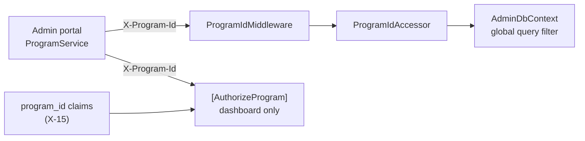

# X-16 · Authorization layer 4: program scope

> **Bangla name:** অথরাইজেশন স্তর ৪: প্রোগ্রাম স্কোপ
>
> [← 60 · Cross-cutting](README.md) · [Contents](../README.md) · [Open queries](../99-open-queries.md)

## 1. Name and purpose

**Program scope.** Staff other than `admin` should work only on the programs (series/tournaments) assigned to them in
`custom:program_ids`. The code has two separate mechanisms that use the `X-Program-Id` header:

1. a **data filter**: an EF Core global query filter in the Admin service that limits program-owned rows to the program in the
   header;
2. an **access check**: `[AuthorizeProgram]`, which compares the header with the user's `program_id` claims, used only on the
   dashboard.

## 2. Trigger and actor

| Item | Value |
|---|---|
| Actor | Admin-portal users after choosing a program ([A-01](../10-admin-portal/A-01-program-selection.md)) |
| Client | Admin portal `ProgramIdInterceptor` sends `X-Program-Id` on every request ([X-04](X-04-admin-session.md)) |
| Service | Admin only |

## 3. Business flow

A staff member picks a program; from then on lists (events, promo codes, discounts, notices, ticket layouts, …) show only that
program's data. Choosing "back to global menu" sets the program to 0, which shows the global menu ([X-17](X-17-authz-client-side.md)).

## 4. Technical flow

| # | Step | Detail |
|---|---|---|
| 1 | `ProgramIdMiddleware` | Parses `X-Program-Id`; stores it in `HttpContext.Items["ProgramId"]` (0 when missing, not a number, or ≤ 0) |
| 2 | `ProgramIdAccessor` | Scoped service that reads `Items["ProgramId"]` |
| 3 | `AdminDbContext` query filter | For every entity implementing `IHasProgramId`: `ProgramId <= 0 OR entity.ProgramId == ProgramId` |
| 4 | `[AuthorizeProgram]` (dashboard only) | Role `admin` → pass. Role `user` → pass ("portal user … not defined yet"). Otherwise: header missing/invalid/negative → **400** "Missing or invalid X-Program-Id header."; header not in the user's `program_id` claims → **403** "User does not have permission for program with Id {id}." |

**Entities filtered** (`IHasProgramId`): `Event`, `EventVenueDetails`, `ProgramTeam`, `ProgramVenue`, `ProgramVenueDetails`,
`ProgramSettings`, `PromoCode`, `PromoCodeAssign`, `Discount`, `DiscountAssign`, `GeneralNotice`, `TicketCheckerGate`,
`TicketAttributes`, `TicketLayoutConfig`, `UserIssue`, `UserIssueChatMessage`.

## 5. Components

| Kind | Component |
|---|---|
| Client | Admin portal `ProgramService` (`localStorage.globalProgramId`), `ProgramIdInterceptor` |
| Service | Admin: `ProgramIdMiddleware`, `ProgramIdAccessor`, `AdminDbContext`, `AuthorizeProgramAttribute`, `DashboardController` |
| Claims | `program_id` from `custom:program_ids` ([X-15](X-15-authz-roles.md)) |

## 6. API contracts

| Header | Values | Effect |
|---|---|---|
| `X-Program-Id` | integer; `0` or absent = no program | Admin service data filter on every request; access check on `GET /admin/api/v1/dashboard/*` |

```json
// 403 from [AuthorizeProgram] (plain text body, not ProblemDetails)
User does not have permission for program with Id 2.
```

## 7. Data and side effects

None; the filter only narrows queries.

## 8. Code references

| What | Where |
|---|---|
| Middleware | `rvl-gobcb-backend/Services/Admin/ETP.Admin.Service/Middleware/ProgramIdMiddleware.cs` |
| Accessor | `rvl-gobcb-backend/Services/Admin/ETP.Admin.Storage/Repositories/ProgramIdAccessor.cs` |
| Global query filter | `rvl-gobcb-backend/Services/Admin/ETP.Admin.Storage/DbContexts/AdminDbContext.cs:595-617` |
| Access check | `rvl-gobcb-backend/Services/Admin/ETP.Admin.Service/Attributes/AuthorizeProgramAttribute.cs` |
| Usage | `rvl-gobcb-backend/Services/Admin/ETP.Admin.Service/Api/DashboardController.cs:18`; commented out at `EventsController.cs:19` |
| Client side | `rvl-gobcb-admin-portal/src/app/interceptors/program-id.interceptor.ts`, `src/app/core/services/program.service.ts` |

## 9. Handover notes

1. **The data filter is not an access control.** It trusts the header. A user limited to program 1 who sends
   `X-Program-Id: 2` sees program 2's rows; sending `0` (or no header) removes the filter entirely. Only the dashboard checks
   the header against the user's programs.
2. **The 403 branch does not stop the action.** `AuthorizeProgramAttribute` writes the 403 response but does not set
   `context.Result`; for an `IAsyncAuthorizationFilter` MVC then continues and runs the action, which fails when it tries to
   write to a response that has already started. For the dashboard (read-only) the effect is an error log, but do not reuse
   the attribute for write endpoints as it is.
3. **Only the Admin service** has the middleware and filter. Booking, Ticketing and UserIssue receive the header and ignore it;
   their admin endpoints take `programId` as a query parameter instead (e.g. reports, [A-22](../10-admin-portal/A-22-reports.md)).
4. **`user` role passes `[AuthorizeProgram]`**, but the dashboard's class attribute requires `admin` or `ticket_operator` with
   the Admin pool, so customers cannot reach it.

## 10. Component relationships



**Depends on:** [A-01](../10-admin-portal/A-01-program-selection.md), [X-15](X-15-authz-roles.md). **Affects:** every program-scoped `A-xx` list; [A-21](../10-admin-portal/A-21-dashboard.md).

## 11. Developer test guide

**Local testability: Full.**

| Item | Detail |
|---|---|
| Test data and accounts | `+8801700000004` ticket_operator with programs `1`; `+8801700000002` event_manager with `1,2`; seeded programs 1 (Bangladesh vs India Series) and 2 (BPL) (`docs/local-dev.md` §7) |
| Browser | Log in as `1700000004`, choose program 1, open Dashboard: DevTools shows `X-Program-Id: 1` and 200 |
| Emulator | Not applicable |
| Postman | `postman/services/etp-admin.postman_collection.json` folder "Dashboard": run "Login as ticket_operator" (`postman/etp-login-all-pools.postman_collection.json`), set the request's bearer token to `{{access_token_ticket_operator}}` (the service collections default to `{{access_token_admin}}`) and send header `X-Program-Id: 2` → 403 text; `X-Program-Id: 1` → 200; no header → 400. Then folder "Events" "GET /api/v1/events" with `X-Program-Id: 0` and `2` to see the filter change the result |
| Visual Studio debug | Attach to `ETP.Admin.Service`; breakpoints in `AuthorizeProgramAttribute.OnAuthorizationAsync` and `ProgramIdMiddleware.InvokeAsync` |
| Verify | Compare row counts: `select "ProgramId", count(*) from etp."Events" group by 1;` against the API results per header value |
