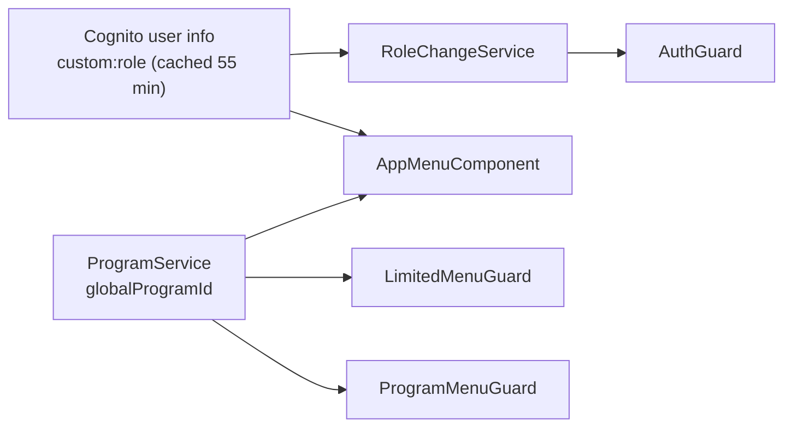

# X-17 · Client-side authorization (menus and guards)

> **Bangla name:** ক্লায়েন্ট-সাইড অথরাইজেশন (মেনু ও গার্ড)
>
> [← 60 · Cross-cutting](README.md) · [Contents](../README.md) · [Open queries](../99-open-queries.md)

## 1. Name and purpose

**Client-side authorization.** The portals hide menu items and block routes depending on the signed-in user's role and the
selected program. This is **convenience, not security**: anything a route guard blocks can still be called directly on the API,
where only the server-side layers count ([X-14](X-14-authz-pool-policies.md)–[X-16](X-16-authz-program-scope.md)).

## 2. Trigger and actor

| Item | Value |
|---|---|
| Actor | Admin-portal staff; user-portal customers |
| Client | Admin portal: `AppMenuComponent.buildMenu`, `AuthGuard` + `RoleChangeService`, `ProgramMenuGuard`, `LimitedMenuGuard`. User portal: `AuthGuard`, `UnAuthGuard`, `LanguageGuard` |

## 3. Business flow

**Admin portal.** Two menus exist: the **global menu** (no program selected, program id 0) and the **program menu** (a program
selected). After login the user lands on the global page for the role ([X-01](X-01-admin-login.md)); choosing a program in
Program management switches to the program menu ([A-01](../10-admin-portal/A-01-program-selection.md)); "back to global menu" sets
the program to 0.

| Role (first match wins) | Global menu (program 0) | Program menu (program selected) |
|---|---|---|
| `admin` | Venue Management, Prog. Managem., Site Settings (Media Configuration, Content Editor), Users (Regular Admins, Ticket Checkers, Seller Agents), Activity Log | Dashboard, Events, Generate Tickets, Reports (Booking Orders, Payment Discrepancy, Ticket Checker: Detailed / Duplicate Entry Count, Sales: Event-Wise / Summary, Revenue: Day-wise / Event-wise / Summary), Promo & Discount (Promo, Discount), Issues (Issue List, Reconciliation) |
| `customer_support` | Home | Issues (Issue List, Reconciliation) |
| `event_manager` + `ticket_manager` | Venue Management, Prog. Managem., Site Settings | Events, Generate Tickets |
| `ticket_manager` | Home | Generate Ticket |
| `ticket_operator` | Home | Dashboard, Generate Ticket, Reports (same sub-items as admin) |
| `event_manager` | Venue Management, Prog. Managem., Site Settings | Events |

**User portal.** `tickets/*` and `issues/*` need a login; `auth/*` is only for signed-out visitors; `user-profile` has no guard.

## 4. Technical flow

**Admin portal route guards** (`app-routing.module.ts`):

| Guard | Routes | Rule |
|---|---|---|
| `ProgramMenuGuard` | `''` (dashboard), `events`, `promo-management`, `ticket-layout`, `issues`, `report` | Needs program id > 0, else redirect to `/program-management` |
| `LimitedMenuGuard` | `users`, `ticket-checker`, `settings`, `agent-user`, `venue-management`, `program-management` | Needs program id == 0, else redirect to `/` |
| `AuthGuard` | `activity-log`, `home`, and inside each feature module | Signed in (`Auth.currentSession`), then `RoleChangeService.handleRoleTransition(url)` |
| none | `change-password`, `media-configuration`, `content-editor` | — |

`RoleChangeService.isRouteAllowedForRole` (URL prefixes allowed per role):

| Role | Allowed URL prefixes |
|---|---|
| `admin` | everything |
| `customer_support` | `/home`, `/issues` |
| `event_manager` + `ticket_manager` | `/program-management`, `/venue-management`, `/media-configuration`, `/content-editor`, `/events` |
| `ticket_manager` | `/home`, `/events/event-ticket`, `/events/generate-ticket` |
| `ticket_operator` | `/home`, `/`, `/events/event-ticket`, `/report`, `/events/generate-ticket` |
| `event_manager` | `/program-management`, `/events`, `/venue-management`, `/media-configuration`, `/content-editor` |

Role-change detection: the role string is compared with `sessionStorage.lastKnownUserRole`; on a change the program resets to 0,
a toast "Your role has been changed…" appears and the user is redirected to the role's default page. The role comes from
Amplify user info cached for 55 minutes ([X-01](X-01-admin-login.md)).

**User portal guards:** `AuthGuard` checks only the local flag `localStorage.rvl_cognito_auth == "true"`; `UnAuthGuard` lets the
OneID popup through and otherwise redirects signed-in users home; `LanguageGuard` handles the `/:lang` segment
([P-13](../20-user-portal/P-13-language-switch.md)).

## 5. Components

| Kind | Component |
|---|---|
| Admin portal | `src/app/layout/app.menu.component.ts`, `src/app/core/guard/{auth,program-menu,limited-menu}.guard.ts`, `src/app/core/services/role-change.service.ts`, `src/app/core/services/program.service.ts` |
| User portal | `ETP-Web/src/app/modules/core/guards/{authentication,unAuthentication,language}.guard.ts`, `app-routing.module.ts` |

## 6. API contracts

None.

## 7. Data and side effects

Browser storage only: `localStorage.globalProgramId`, `sessionStorage.lastKnownUserRole` (admin portal); `localStorage.rvl_cognito_auth`
(user portal).

## 8. Code references

| What | Where |
|---|---|
| Admin menu per role | `rvl-gobcb-admin-portal/src/app/layout/app.menu.component.ts:39-262` |
| Admin routes and guards | `rvl-gobcb-admin-portal/src/app/app-routing.module.ts:14-33` |
| Role allow-list and role-change handling | `rvl-gobcb-admin-portal/src/app/core/services/role-change.service.ts:31-201` |
| User portal routes | `rvl-gobcb-user-portal/ETP-Web/src/app/app-routing.module.ts:8-71` |
| User portal guards | `rvl-gobcb-user-portal/ETP-Web/src/app/modules/core/guards/authentication.guard.ts`, `unAuthentication.guard.ts` |

## 9. Handover notes

1. **Menus and server rules disagree in places.** Examples: `ticket_manager` sees "Generate Ticket" but the backend reserved-ticket
   endpoints accept any Admin-pool user ([X-14](X-14-authz-pool-policies.md)), so `customer_support` could call them directly;
   the Site Settings routes (`media-configuration`, `content-editor`) have no route guard at all.
2. **The `/settings` module is routed but not in any menu.** It holds notices, landing page, programs, program teams, program
   venues and footer settings screens ([A-31](../10-admin-portal/A-31-general-notices.md), [A-30](../10-admin-portal/A-30-header-footer-social.md)).
3. **Role string matching.** The menu uses `roles.includes('admin')` on the comma-separated string, which is a substring check:
   any future role containing "admin" would also match. `isRouteAllowedForRole` splits the string correctly.
4. **User portal `AuthGuard` trusts a local flag**; the real check happens when the token interceptor or the API rejects the call.

## 10. Component relationships

**Depends on:** [X-01](X-01-admin-login.md), [A-01](../10-admin-portal/A-01-program-selection.md). **Affects:** what each role can reach in the UI for every `A-xx` feature.

## 11. Developer test guide

**Local testability: Full.**

| Item | Detail |
|---|---|
| Test data and accounts | The five Admin-pool users (`docs/admin-portal-local.md` §5) |
| Browser | Log in as each role on `http://localhost:4200`; compare the menus with §3; type a forbidden URL (e.g. `/users` as `ticket_operator`) and observe the redirect. Change a user's role in Postman (below), wait, navigate: the "Role Updated" toast appears after the 55-minute user-info cache expires or after a reload |
| Emulator | Not applicable |
| Postman | `postman/etp-cognito-auth.postman_collection.json` folder "06 - Admin user lifecycle", "Update role to customer_support" |
| Visual Studio debug | Not applicable (browser only); use DevTools Sources on `role-change.service.ts` |
| Verify | DevTools → Application → Session Storage `lastKnownUserRole`; Local Storage `globalProgramId` |
