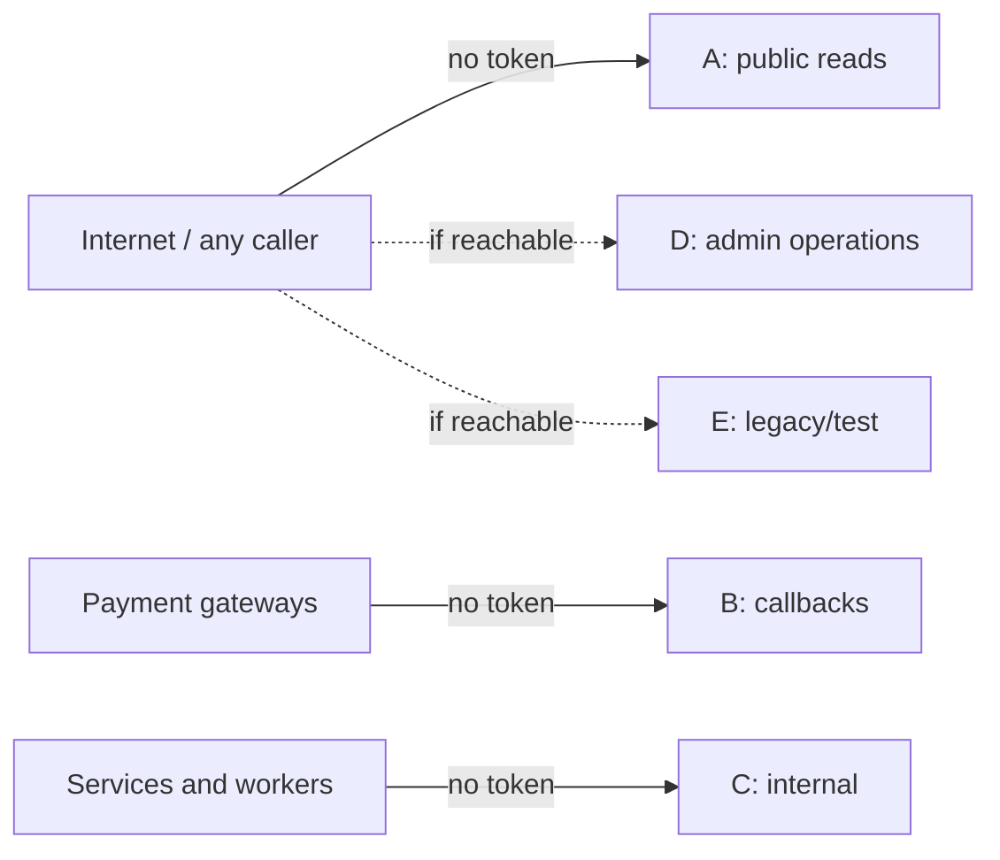

# X-18 · Endpoints without authorization

> **Bangla name:** অথরাইজেশন ছাড়া endpoint
>
> [← 60 · Cross-cutting](README.md) · [Contents](../README.md) · [Open queries](../99-open-queries.md)

## 1. Name and purpose

**Endpoints without authorization.** `BaseController` has its `[Authorize]` commented out, so a controller action is anonymous
unless the controller or the action has an `[Authorize]` attribute. **137 of the 354 endpoints** in the backend have none, or have
`[AllowAnonymous]`. Some are public on purpose (event lists for visitors, payment callbacks), some are internal calls between
services and workers (which cannot carry a user token, [X-19](X-19-service-to-service.md)), and some are admin-portal operations
that look like they were meant to be protected. This file lists all of them by category so you can decide what to fix.

Whether API Gateway, the NLB or the ingress blocks any of these from the internet is not visible in the repos
(architecture Q1b) `[UNCONFIRMED: Q-04]`.

## 2. Trigger and actor

Any HTTP client that can reach the service.

## 3. Business flow

Not a user feature. The categories below say who is meant to call each endpoint.

## 4. Technical flow

| Cause | Where |
|---|---|
| `// [Authorize]` commented out in the base class | `rvl-gobcb-backend/Core/ETP.Core.Web/BaseController.cs:14` |
| Controllers with no `[Authorize]` at all | Admin: `AgentController`, `CurrencyController`, `EventSettingsController`, `HeaderFooterController`, `PortalUsersController`, `TicketPricingController`, `TokenIssuerController`, `UserIssueChatController`. Booking: `BookingReportController`, `CapacityController`, `EventCapacityAdjustmentController`, `ReportController`, and most actions of `SeatReservationController` and `UserBookingOrderController`. Event: all. PushNotification: all. Ticketing: several actions of `BookingOrderTicketController`. TicketChecker: `TestingController`. UserIssue: `ReportIssueChatController` |
| `UseAuthentication`/`UseAuthorization` commented out in `Program.cs` | Platform, PushNotification, UserAuth |
| `[AllowAnonymous]` on purpose | listed in category A and B below |

### Category A — public by design (visitors, portals, app)

| Endpoint | Used by |
|---|---|
| `GET /event/api/v1/*` (9 `events/*`, `header-footer`, `landing-page-image/public`, `events/programs`, `events/programs/programId/{id}`, `ticket-pricing/list`, `ticket-pricing/program-pricing`) | User portal, user app, other services ([P-01](../20-user-portal/P-01-home-content.md), [P-02](../20-user-portal/P-02-browse-events.md), [P-03](../20-user-portal/P-03-info-pages.md)) |
| `GET /admin/api/v1/landing-page-image/public`, `GET /admin/api/v1/general-notice/public`, `GET /admin/api/v1/header-footer` | Portals/app ([P-01](../20-user-portal/P-01-home-content.md)) |
| `GET /admin/api/v1/discount/program/{programId}/{eventId}/{galleryId}` | Portal/app seat selection ([P-04](../20-user-portal/P-04-seat-selection.md)) |
| `GET /admin/api/v1/ticket-pricing`, `/list`, `/{id}` | Content pages ([A-14](../10-admin-portal/A-14-ticket-pricing-content.md)) |
| `GET /booking/api/v1/capacity/level-user-portal-seats` | Seat map ([P-04](../20-user-portal/P-04-seat-selection.md)) |
| `GET /ticketing/api/v1/booking-order-ticket/shared` | Shared ticket link, protected by a signature parameter ([P-09](../20-user-portal/P-09-ticket-details-downloads.md)) |

### Category B — payment-gateway callbacks

| Endpoint | Notes |
|---|---|
| `GET /booking/api/v1/user-booking-order/dgepay/payment-status` | DgePay redirect after payment ([P-06](../20-user-portal/P-06-booking-payment.md)) |
| `POST /booking/api/v1/user-booking-order/sslcommerz/payment-success`, `-fail`, `-cancel`, `-ipn` | SSLCommerz callbacks (Appendix A) |
| `GET /booking/api/v1/user-booking-order/payment-status-bypass` | Takes `rawData` and processes it like a callback; see [P-06](../20-user-portal/P-06-booking-payment.md) — high risk if reachable |

### Category C — internal calls from other services or workers

| Endpoint group | Caller (typed client) |
|---|---|
| Booking `capacity/*` GETs and `POST capacity`; `event-capacity-adjustment/by-event`, `count/{eventId}`; `seat-reservation/by-event`, `count`, `remainingReserveCount`, `reservations-count`, `update-*-status`, `merge-status`, `zip-status`, `update-reservation-ticket-preview`, `event-id`; `user-booking-order/public-id/{id}`, `generate-ticket-request/{publicId}`, `update-status`, `not-notified-list`, `update-notification-status`, `promo-code/{code}`, `booked-user-record/{id}` | `Core/ETP.Core/ServiceClient/BookingClient/BookingClient.cs` (Admin, Ticketing, Scheduler, Utility) |
| Ticketing `booking-order-ticket/initiate`, `initiate-user-ticket`, `generate-request/{publicId}`, `ticket-counts`, `by-gallery-block-level`, `ticket-numbers`, `GET booking-order-ticket?id=`, `booking-order-id`, `reserved-urls` | `Core/ETP.Core/ServiceClient/TicketingClient/TicketingClient.cs` (Booking, Admin, Utility); `generate-request` also from portal/app ([P-08](../20-user-portal/P-08-ticket-generation-request.md)) |
| Admin `portal-users/{phoneNo}` | `Core/ETP.Core/ServiceClient/AdminClient/AdminClient.cs` |
| PushNotification: all endpoints except `bulk-status` (8) | `PushNotificationClient` (Admin, Scheduler) and the user app (device tokens, [U-09](../30-user-app/U-09-device-token.md)) |

### Category D — admin-portal operations without authorization (review)

| Endpoint | Screen |
|---|---|
| Admin `agent-users/*` (8) | [A-26](../10-admin-portal/A-26-agent-users.md) |
| Admin `admin-users/forget-password`, `admin-users/set-forget-password` | [X-02](X-02-admin-forgot-password.md) |
| Admin `ticket-pricing` POST/PUT/DELETE/publish/unpublish, `attribute/{id}` DELETE | [A-14](../10-admin-portal/A-14-ticket-pricing-content.md) |
| Admin `header-footer` PUT | [A-30](../10-admin-portal/A-30-header-footer-social.md) |
| Admin `event-settings/{eventId}` GET/PUT | [A-08](../10-admin-portal/A-08-event-settings.md) |
| Booking `dashboard/*` (4) | [A-21](../10-admin-portal/A-21-dashboard.md) |
| Booking `report/admin/*` (8) | [A-22](../10-admin-portal/A-22-reports.md) |
| Booking `POST seat-reservation`, `GET seat-reservation/by-event-level` | [A-11](../10-admin-portal/A-11-seat-reservation.md) |
| Booking `POST event-capacity-adjustment`, `GET by-event-level` | [A-10](../10-admin-portal/A-10-capacity-adjustment.md) |
| UserIssue `user-issue-chat/*` (8) | [A-24](../10-admin-portal/A-24-user-issues-admin.md), [P-12](../20-user-portal/P-12-issues-chat.md) |

### Category E — legacy, test or unreferenced (Appendix A)

Admin `currency`, `token`, `user-issue-chat/*` (8, Admin copy), `user-issue/user-detail/{orderId}`; TicketChecker
`testing/re-initiate-data`, `testing/sync-data`; root `GET /event`, `/platform`, `/ticketChecker`, `/ticketing`; PushNotification
`push-notification/bulk-status/{requestId}`. See [Appendix A](../90-appendix-a-legacy.md).

## 5. Components

All services; the per-endpoint auth value is in [Appendix B](../91-appendix-b-endpoint-index.md).

## 6. API contracts

Unchanged; this file only classifies.

## 7. Data and side effects

Several category-D endpoints write data (agent accounts, passwords, content, event settings, seat reservations, capacity).
`testing/re-initiate-data` in TicketChecker regenerates test data ([Appendix A](../90-appendix-a-legacy.md)).

## 8. Code references

| What | Where |
|---|---|
| Commented-out base attribute | `rvl-gobcb-backend/Core/ETP.Core.Web/BaseController.cs:14-15` |
| Commented-out pipeline (example) | `rvl-gobcb-backend/Services/PushNotification/ETP.PushNotification.Service/Program.cs` |
| Typed clients that call internal endpoints | `rvl-gobcb-backend/Core/ETP.Core/ServiceClient/{BookingClient,TicketingClient,AdminClient,PushNotificationClient}/` |

## 9. Handover notes

1. **Decide per category.** A: keep anonymous. B: keep anonymous but validate the gateway's signature/data server-side (the DgePay
   callback re-checks the transaction, [P-06](../20-user-portal/P-06-booking-payment.md)); remove `payment-status-bypass` from
   production. C: protect with a service identity or network policy; today the only protection is that the paths are not meant
   to be published (architecture §2.3 B). D: add `[Authorize]` with the roles the portal menu implies. E: remove.
2. **Adding `[Authorize]` to C endpoints breaks workers**: workers send no token. Introduce a service credential first (the
   unused `service` scheme is a starting point, [X-14](X-14-authz-pool-policies.md)).
3. Re-run the endpoint extractor used for [Appendix B](../91-appendix-b-endpoint-index.md) after every change to keep this list true.

## 10. Component relationships

**Depends on:** network exposure (architecture Q1b). **Affects:** security of [A-08](../10-admin-portal/A-08-event-settings.md),
[A-10](../10-admin-portal/A-10-capacity-adjustment.md), [A-11](../10-admin-portal/A-11-seat-reservation.md), [A-14](../10-admin-portal/A-14-ticket-pricing-content.md),
[A-21](../10-admin-portal/A-21-dashboard.md), [A-22](../10-admin-portal/A-22-reports.md), [A-26](../10-admin-portal/A-26-agent-users.md), [X-02](X-02-admin-forgot-password.md).

## 11. Developer test guide

**Local testability: Full.**

| Item | Detail |
|---|---|
| Test data and accounts | None needed (that is the point) |
| Browser | `http://localhost:5102/booking/swagger` → call `GET /booking/api/v1/report/admin/booking-metrics` without Authorize: 200 |
| Emulator | Not applicable |
| Postman | Any request of the categories above with auth type "No Auth", e.g. `postman/services/etp-booking.postman_collection.json` "GET /api/v1/report/admin/booking-metrics" (add the `/booking` prefix, [Appendix D](../93-appendix-d-local-test-reference.md)) |
| Visual Studio debug | Not needed |
| Verify | Recount with the method described in [Appendix B](../91-appendix-b-endpoint-index.md) (expect 137 at the evidence baseline) |
