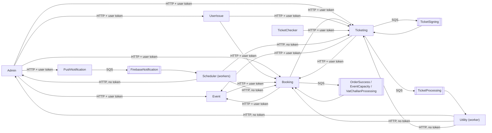

# X-19 · Service-to-service communication

> **Bangla name:** সার্ভিস-থেকে-সার্ভিস যোগাযোগ
>
> [← 60 · Cross-cutting](README.md) · [Contents](../README.md) · [Open queries](../99-open-queries.md)

## 1. Name and purpose

**Service-to-service communication.** The services call each other synchronously over HTTP with typed clients, and hand off
slow work through SQS queues. This file is the reference for **who calls whom, with which credentials**. Concepts:
[token forwarding](../00-platform-primer.md#explainer-token-forwarding), [queue-driven processing](../00-platform-primer.md#explainer-queue-driven),
[background workers](../00-platform-primer.md#explainer-background-workers). The architecture document §2.3 describes the same
three mechanisms.

## 2. Trigger and actor

A controller action (user request) or a background worker that needs data or work from another service or an external system.

## 3. Business flow

Invisible to users. Examples: placing an order makes Booking read event data from Event and later ask Ticketing to create
tickets; a worker in Scheduler asks Booking which orders still need a notification.

## 4. Technical flow

**Mechanisms**

| Tag | Mechanism | Credential |
|---|---|---|
| **[HTTP + user token]** | Typed `HttpClient` with `DelegatedBearerAuthenticationHandler` called inside a request | The caller's Cognito access token, copied from the `AppClaimTypes.AccessToken` claim |
| **[HTTP, no token]** | Same client called from a worker (no `HttpContext`) | none; works only against endpoints without `[Authorize]` ([X-18](X-18-endpoints-without-auth.md) category C) |
| **[HTTP, static key]** | Client with a fixed `Authorization` header from configuration | `Notification:Authorization`, `Serverless:Authorization`, gateway/TSP/NBR/OneID credentials |
| **[SQS: Key]** | `SqsPublisher` → queue → polling worker | AWS static keys `AWS:AccessKey`/`AWS:SecretAccessKey`; no token in the message |

**Typed HTTP clients registered per service** (`Configuration(s)/DependencyConfig.cs` of each service):

| Caller | Client interface | Base URL key | Forwards user token | Static header |
|---|---|---|---|---|
| Admin | `IEventClient`, `IEventProvider` | `Services:Event` | yes | |
| Admin | `IBookingClient` | `Services:Booking` | yes | |
| Admin | `ITicketingClient` | `Services:Ticketing` | yes | |
| Admin | `IUserIssueClient` | `Services:UserIssue` | yes | |
| Admin | `IPushNotificationClient` | `Services:PushNotification` | yes | |
| Admin | `INotificationClient` | `Notification:Endpoint` | | `Notification:Authorization` |
| Admin | `IServerlessClient` | `Serverless:BaseUrl` | | `Serverless:Authorization` |
| Booking | `IEventClient` | `Services:Event` | yes | |
| Booking | `ITicketingClient` | `Services:Ticketing` | yes | |
| Booking | `IUserClient` (`user/my-profile`) | `Services:AppBase` | yes | |
| Booking | `IServerlessClient`, `INotificationClient` | `Serverless:BaseUrl`, `Notification:Endpoint` | | static |
| Booking | `IDgePayPaymentManager`, `ISSLCommerzPaymentManager`, `INBROpenApiManager` | from `PaymentSettings:*` / NBR settings | | gateway credentials ([P-06](../20-user-portal/P-06-booking-payment.md), [S-10](../50-system-initiated/S-10-vat-challan.md)) |
| Event | `IBookingClient` | `Services:Booking` | yes | |
| Scheduler | `IBookingClient` | `Services:Booking` | yes (none in workers) | |
| Scheduler | `IEventClient` | **`Services:Admin`** | yes (none in workers) | |
| Scheduler | `ITicketingClient`, `IAdminClient` | `Services:Ticketing`, `Services:Admin` | yes (none in workers) | |
| Scheduler | `INotificationClient` | `Notification:Endpoint` | | static |
| TicketChecker | `ITicketingClient` | `Services:Ticketing` | yes | |
| Ticketing | `IEventClient` (two registrations) | `Services:Event` | yes | |
| Ticketing | `IBookingClient` | `Services:Booking` | yes | |
| Ticketing | `IUserClient` | `Services:AppBase` | yes | |
| Ticketing | `IAuthProvider`, `ITspSignedTicketProvider` | `TSP:AuthUrl`, `TSP:SignUrl` | | TSP client certificate ([S-08](../50-system-initiated/S-08-ticket-signing.md)) |
| Ticketing | `IServerlessClient` | `Serverless:BaseUrl` | | static |
| Ticketing | `IOneIdManager` | `OneIdSettings:*` | | `OneIdSettings:AuthorizationToken` ([P-10](../20-user-portal/P-10-oneid-ticket-sync.md)) |
| UserIssue | `IBookingClient`, `ITicketingClient` | `Services:Booking`, `Services:Ticketing` | yes | |
| UserIssue | `IServerlessClient` | `Serverless:BaseUrl` | | static |
| Utility | `IAdminClient`, `IBookingClient`, `ITicketingClient` | `Services:Admin`, `:Booking`, `:Ticketing` | yes (none in workers) | |

Most HTTP clients retry transient errors 3 times with exponential back-off (Polly), some with a plain 3-retry policy.

**Queues** (keys under `AWS:Queue:*`)

| Queue key | Published by | Consumed by | Feature |
|---|---|---|---|
| `OrderSuccess` | Booking `UserBookingOrderManager`, `CapacityManager` | Booking `LevelCapacityUpdateService` | [S-01](../50-system-initiated/S-01-level-capacity-update.md) |
| `EventCapacity` | Booking `CapacityManager` | Booking `EventLiveCapacityUpdateService` | [S-02](../50-system-initiated/S-02-event-live-capacity.md) |
| `VatChallanProcessing` | Booking `UserBookingOrderManager` | Booking `VatChallanProcessingService` | [S-10](../50-system-initiated/S-10-vat-challan.md) |
| `TicketSigning` | Ticketing `TicketManager` | Ticketing `TicketGenerationService` | [S-08](../50-system-initiated/S-08-ticket-signing.md) |
| `TicketProcessing` | Ticketing `TicketManager` | Utility `TicketProcessingService` | [S-09](../50-system-initiated/S-09-ticket-merge-zip.md) |
| `FirebaseNotification` | PushNotification `NotificationManager` | Scheduler `FirebaseNotificationService` | [S-11](../50-system-initiated/S-11-firebase-notification.md) |

## 5. Components

| Kind | Component |
|---|---|
| Code | `Core/ETP.Core.Web/Security/DelegatedBearerAuthenticationHandler.cs`, `Core/ETP.Core/ServiceClient/*`, `Services/*/ETP.*.Client/*`, `Core/ETP.Core/Queue/Services/SqsPublisher.cs` |
| Config | `Services:*`, `Notification:*`, `Serverless:*`, `AWS:Queue:*`, `AWS:AccessKey`, `AWS:SecretAccessKey` |

## 6. API contracts

The endpoints called internally are listed in [X-18](X-18-endpoints-without-auth.md) (category C) and, with their callers, in
[Appendix B](../91-appendix-b-endpoint-index.md).

## 7. Data and side effects

None of its own.

## 8. Code references

| What | Where |
|---|---|
| Token forwarding handler | `rvl-gobcb-backend/Core/ETP.Core.Web/Security/DelegatedBearerAuthenticationHandler.cs` |
| Token stored as claim | `rvl-gobcb-backend/Core/ETP.Core/Configuration/DefaultAuthenticationConfig.cs:52-53` (and per scheme) |
| Client registrations | `rvl-gobcb-backend/Services/Admin/ETP.Admin.Service/Configurations/DependencyConfig.cs:123-195`; `Services/Booking/ETP.Booking.Service/Configuration/DependencyConfig.cs:83-200`; `Services/Scheduler/ETP.Scheduler.Service/Configurations/DependencyConfig.cs:71-110`; `Services/Ticketing/ETP.Ticketing.Service/Configurations/DependencyConfig.cs:151-255`; `Services/UserIssue/ETP.UserIssue.Service/Configurations/DependencyConfig.cs:55-80`; `Services/Utility/ETP.Utility.Service/Configurations/DependencyConfig.cs:51-75`; `Services/Event/ETP.Event.Service/Configurations/DependencyConfig.cs:66`; `Services/TicketChecker/ETP.TicketChecker.Service/Configurations/DependencyConfig.cs:49` |
| Shared typed clients | `rvl-gobcb-backend/Core/ETP.Core/ServiceClient/` (`AdminClient`, `BookingClient`, `TicketingClient`, `EventClient`, `NotificationClient`, `PushNotificationClient`, `ServerlessClient`, `UserClient`, `UserIssueClient`) |
| Queue publisher | `rvl-gobcb-backend/Core/ETP.Core/Queue/Services/SqsPublisher.cs` |

## 9. Handover notes

1. **Forwarding couples the caller's pool to the callee's policy.** A customer request that makes Booking call an Admin-only
   endpoint would fail; that is why the internal endpoints are anonymous.
2. **Scheduler's `IEventClient` points at `Services:Admin`**, not `Services:Event`. The client's paths decide which service answers
   ([S-04](../50-system-initiated/S-04-scheduler-capacity-update.md)).
3. **`Services:AppBase`** is the base URL of `IUserClient`, which calls `user/my-profile` with the forwarded token, i.e. the
   identity API `[UNCONFIRMED: Q-01]`. Locally it is set to `http://localhost:5120/` (`scripts/user-secrets.example.json`), the
   `mock-identity` server, which answers `GET user/my-profile`. It was previously `http://localhost:4200/` (the admin portal), which
   made order creation fail with "connection refused".
4. **Token expiry mid-request**: the services do not refresh tokens (architecture §2.3 A).
5. **MassTransit is registered but unused** ([Appendix A](../90-appendix-a-legacy.md)).

## 10. Component relationships

**Depends on:** configuration ([X-26](X-26-configuration.md)), network placement (architecture §4.1). **Affects:** every multi-service feature.

## 11. Developer test guide

**Local testability: Full** for HTTP and SQS (Floci); external systems are dummies.

| Item | Detail |
|---|---|
| Test data and accounts | Any; seed data from `pwsh ./scripts/Seed-EtpData.ps1` |
| Browser | Aspire dashboard → **Traces**: one trace follows a request across services (`docs/local-dev.md` §4 "During the day") |
| Emulator | — |
| Postman | Trigger a cross-service call, e.g. `postman/services/etp-admin.postman_collection.json` "POST /api/v1/events" (Admin → Event/Booking) |
| Visual Studio debug | Attach to two services at once (`docs/local-dev.md` §6.1 tips), breakpoint in `DelegatedBearerAuthenticationHandler.SendAsync` in the caller and in the controller of the callee |
| Verify | `aws --endpoint-url http://localhost:4566 sqs list-queues` lists the six queues; `aws --endpoint-url http://localhost:4566 sqs receive-message --queue-url <url>` peeks a message (`docs/local-dev.md` "Look at fake AWS") |
