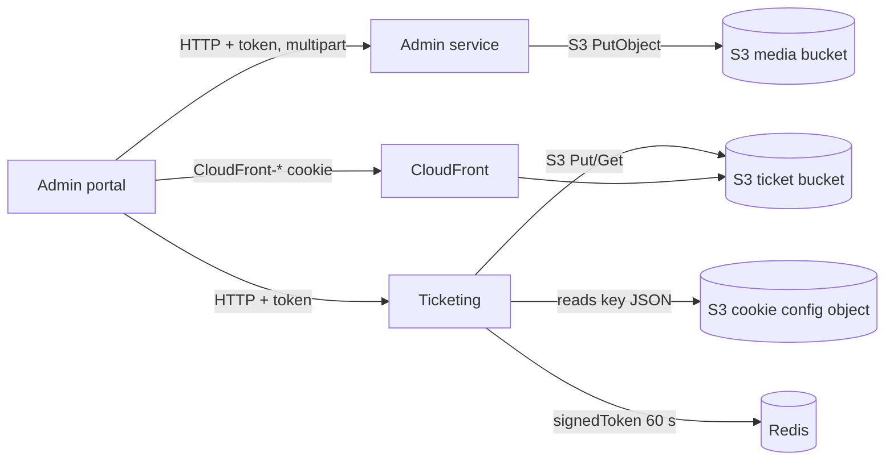

# X-20 · File storage (S3, CloudFront)

> **Bangla name:** ফাইল স্টোরেজ (S3, CloudFront)
>
> [← 60 · Cross-cutting](README.md) · [Contents](../README.md) · [Open queries](../99-open-queries.md)

## 1. Name and purpose

**File storage.** Everything the platform keeps as a file lives in Amazon S3: uploaded images (event covers, banners, logos, venue maps), the PDF ticket layouts, and the generated tickets (blank, signed, merged, zipped). Reserved tickets are protected with a CloudFront **signed cookie**. Concept background: [shared database](../00-platform-primer.md#explainer-shared-database) (files are the one thing that is *not* in the database) and the architecture document's storage section.

## 2. Trigger and actor

- Admin portal users uploading images or ticket layouts (**admin** pool).
- Ticketing managers and workers writing generated tickets ([S-08](../50-system-initiated/S-08-ticket-signing.md), [S-09](../50-system-initiated/S-09-ticket-merge-zip.md)).
- Admin portal users downloading reserved tickets, which needs the signed token and cookie described below.

## 3. Business flow

An admin uploads a picture or a ticket template; the platform stores it and saves its path in the database row. For complimentary or partner (reserved) tickets, the admin generates the tickets, then downloads them as merged PDFs or a zip; the browser first receives a short-lived cookie that lets it read the protected files ([A-12](../10-admin-portal/A-12-reserved-tickets.md)).

## 4. Technical flow

Two S3 buckets are configured through `AWS:*` settings:

| Setting | Used for | Manager (interface) |
|---|---|---|
| `AWS:Bucket:Name` | Media: images and chat attachments | `AwsSimpleStorageMediaManager` (`ICloudFrontMediaManager`) |
| `AWS:Ticket:Bucket:Name` | Ticket layouts and generated tickets | `AwsSimpleStorageTicketMediaManager` (`ITicketMediaManager`) |

Locally both settings point at the single bucket `etp-local` in Floci (`scripts/user-secrets.example.json`, created by `scripts/Seed-EtpFloci.ps1`).

**Key layout.** `UploadContentAsync(directory, parentId, name, ...)` builds the object key as `{directory}/{parentId}/{name}`, or `{directory}/{name}` when `parentId` is empty, and returns that key. The managers then store a **full URL**, `{AWS:Bucket:BaseUrl}/{key}`, in the owning row (for example `ProgramManager.UploadImageAsync`); ticket-layout and ticket code splits such URLs on the folder name to recover the key before deleting an object.

**Media folders** (`AWS:Bucket`):

| Folder | Written by |
|---|---|
| `eventcover/{eventId}` | `EventManager` |
| `eventsegmentcover/...` | event segment cover upload |
| `header-footer/{id}` | `HeaderFooterManager` |
| `landing-page/{type}` | `LandingPageImageManager` |
| `program/{programId}` | `ProgramManager` |
| `teams-logo/{id}`, `teams-flag/{id}` | `ProgramTeamManager` |
| `venueimage/...` | `VenueManager` (SVG map and gallery images) |
| `chat-attachments/{userIssueId}` | `UserIssueChatManager` |

**Ticket-bucket paths** (`AWS:Ticket:*`; a doubled `//` is collapsed to `/`):

| Path | Content |
|---|---|
| `ticekt-layout/{layoutId}/{layoutType}/...` | Uploaded PDF layouts (the spelling `ticekt` is in the code) |
| `ticekt-layout-preview/{layoutId}/{layoutType}/...` | Preview renders of the layouts |
| `back-page-ticekt-layout/{layoutId}/...` | Back-page layout |
| `{BlankBase}/user/{userId}/{orderPublicId}` and `{BlankBase}/reserved/{orderPublicId}` | Unsigned tickets |
| `{SignedBase}/user/{createdBy}/{orderPublicId}` and `{SignedBase}/reserved/{createdBy}/{orderPublicId}` | Tickets after TSP signing |
| `{MergeBase}/{reservationId}/{prefix}_{i}.pdf` and `.zip` | Merged and zipped reserved tickets, chunked by `MergeSize` |
| `{TemplateBase}/{fileName}.pdf` | Template read when building a ticket |

**Signed access to reserved tickets** (calls on Ticketing `/ticketing/api/v1/booking-order-ticket/`):

1. `POST generate-signed-token` **[HTTP + user token]**, admin policy. `TicketManager.GenerateSignedTokenAsync` computes an HMAC-SHA512 of the caller's bearer token and stores it in **one global Redis key `signedToken` for 60 s**.
2. `GET signed-cookie` **[HTTP + user token]**, admin policy. `TicketingCookieManager.GetCloudFrontSignedCookie` reads a JSON object from S3 (`CloudfrontTicketValidator:BucketName` / `ObjectKey`) holding `KeyPairId`, `ResourceUrl`, `Expiration` and `PrivateKey` (base64 PEM). It builds a policy (`AWS:EpochTime` less than now + `Expiration`), signs it with RSA **SHA1** and returns the text `CloudFront-Policy=...; CloudFront-Signature=...; CloudFront-Key-Pair-Id=...`.
3. The admin portal (`event.service.ts`, `setSignedCookie`) splits that text and writes each `CloudFront-*` part with `document.cookie` for `environment.cloudFront.mainDomain`; later file requests to CloudFront carry the cookie.

**Shared tickets.** A shared ticket link stores a presigned S3 URL in Redis under `sharedTicket:{ticketNumber}_{signature}` for `AWS:Ticket:ShareExpiryMinutes` ([P-09](../20-user-portal/P-09-ticket-details-downloads.md)).

## 5. Components

| Kind | Component |
|---|---|
| Code | `Core/ETP.Core.BlobStorage/*` (`AwsSimpleStorageMediaManager`, `AwsSimpleStorageTicketMediaManager`, `S3CloudFrontStroge`, `TicketingCookieManager`) |
| Services using it | Admin, Booking, Ticketing (each registers the managers in its `DependencyConfig.cs`) |
| AWS | S3 buckets, CloudFront distribution and key pair |
| Redis | `signedToken`, `sharedTicket:*` ([X-25](X-25-redis.md)) |
| Config | `AWS:Region`, `AWS:AccessKey`, `AWS:SecretAccessKey`, `AWS:Bucket:*`, `AWS:Ticket:*`, `CloudfrontTicketValidator:*` ([X-26](X-26-configuration.md)) |

## 6. API contracts

| Method | Path | Auth | Response | Notes |
|---|---|---|---|---|
| POST | `/ticketing/api/v1/booking-order-ticket/generate-signed-token` | `admin` policy | `string` (the hash) | Overwrites the single `signedToken` key |
| GET | `/ticketing/api/v1/booking-order-ticket/signed-cookie` | `admin` policy | `string` (cookie text) | The portal strips surrounding quotes and splits on `; ` |
| GET | `/ticketing/api/v1/booking-order-ticket/reserved-urls?reservationId=` | none in code | list of URLs | No caller in the portal found ([A-12](../10-admin-portal/A-12-reserved-tickets.md)) |

Image uploads are part of each owning feature's multipart endpoint (for example event create/update), not separate storage endpoints.

## 7. Data and side effects

- S3 objects as listed in §4; the owning row stores the full URL `{AWS:Bucket:BaseUrl}/{key}` (for example the event's `EventCoverImage` or the program's `Logo`).
- Replacing an image deletes the old object first (`DeleteContentAsync`), see `EventManager` and `TicketLayoutConfigsManager`.
- Redis keys `signedToken` and `sharedTicket:*`.

## 8. Code references

| What | Where |
|---|---|
| Media manager | `rvl-gobcb-backend/Core/ETP.Core.BlobStorage/AWSS3/AwsSimpleStorageMediaManager.cs` |
| Cookie signing | `rvl-gobcb-backend/Core/ETP.Core.BlobStorage/AWSS3/TicketingCookieManager.cs` |
| Cookie config read | `rvl-gobcb-backend/Core/ETP.Core.BlobStorage/AWSS3/S3CloudFrontStroge.cs` |
| Endpoints | `rvl-gobcb-backend/Services/Ticketing/ETP.Ticketing.Service/Api/BookingOrderTicketController.cs:488` (`generate-signed-token`), `:521` (`signed-cookie`) |
| Signed token | `rvl-gobcb-backend/Services/Ticketing/ETP.Ticketing.Domain/Managers/TicketManager.cs:1995` |
| Shared-link cache | `rvl-gobcb-backend/Services/Ticketing/ETP.Ticketing.Domain/Managers/TicketManager.cs:1904` |
| Registrations | `rvl-gobcb-backend/Services/Admin/ETP.Admin.Service/Configurations/DependencyConfig.cs:209-228` |
| Portal cookie code | `rvl-gobcb-admin-portal/src/app/features/events/services/event.service.ts:230-250` |
| Options class | `rvl-gobcb-backend/Core/ETP.Core/Options/AwsOptions.cs` |

## 9. Handover notes

1. **`generate-signed-token` uses one global Redis key.** Two admins calling it within 60 s overwrite each other. Nothing in the backend reads `signedToken` back; what consumes the value is not in this repository `[UNCONFIRMED: Q-06]`.
2. **The cookie signing key is an S3 object.** Rotating the CloudFront key pair means editing that JSON object, not a configuration value. The object holds the private key, so access to that bucket is sensitive.
3. **`ticekt` is a typo that is now part of the data.** Existing objects and database values carry it; do not "fix" it without migrating the keys.
4. The database stores **full URLs** built from `AWS:Bucket:BaseUrl`; changing the bucket or CDN domain therefore needs a data migration of those URLs (or keeping the old base URL alive).
5. `ICloudFrontMediaManager.CdnBaseUrl` is declared but never set in `AwsSimpleStorageMediaManager`; the public URL is composed by each manager from `AWS:Bucket:BaseUrl`, and what that setting points at (S3 or a CloudFront domain) is a deployment value `[UNCONFIRMED: Q-06]`.

## 10. Component relationships

**Depends on:** configuration ([X-26](X-26-configuration.md)), admin login ([X-01](X-01-admin-login.md)). **Affects:** event, program, team, venue, ticket-layout and reserved-ticket features, ticket downloads.

## 11. Developer test guide

**Local testability: Partial.** Uploads and generated tickets work against Floci S3 (bucket `etp-local`). The signed cookie cannot work locally: `CloudfrontTicketValidator` is `local-dummy`, so `GET signed-cookie` fails with "Failed to get file".

| Item | Detail |
|---|---|
| Test data and accounts | Admin login ([X-01](X-01-admin-login.md)); `pwsh ./scripts/Seed-EtpData.ps1` |
| Browser | Admin portal `http://localhost:4200`, upload an event cover; DevTools Network shows the multipart request to `/admin/api/v1/...` |
| Emulator | — |
| Postman | `postman/services/etp-admin.postman_collection.json` multipart upload requests; `etp-ticketing` collection for `signed-cookie` (expect the failure above locally) |
| Visual Studio debug | Breakpoint in `AwsSimpleStorageMediaManager.UploadContentAsync`; for the cookie, `TicketingCookieManager.GetCloudFrontSignedCookie` |
| Verify | `aws --endpoint-url http://localhost:4566 s3 ls s3://etp-local --recursive` lists keys such as `eventcover/<id>/...` |
