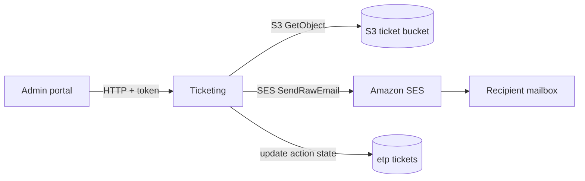

# X-21 · Email (SES)

> **Bangla name:** ইমেইল (SES)
>
> [← 60 · Cross-cutting](README.md) · [Contents](../README.md) · [Open queries](../99-open-queries.md)

## 1. Name and purpose

**Email through Amazon SES.** The platform sends exactly one kind of business email from its own code: an admin emails a ZIP of **reserved tickets** to a recipient. Other emails seen by users (registration OTP by email, account notices) come from outside this repository ([X-06](X-06-user-registration.md), [X-22](X-22-sms-notification.md)).

## 2. Trigger and actor

An admin-portal user (**admin** pool policy) chooses reserved tickets and clicks *Send* ([A-12](../10-admin-portal/A-12-reserved-tickets.md)).

## 3. Business flow

The admin selects ticket numbers, enters the recipient, and optionally a subject and message. The recipient receives an email with a ZIP file; each PDF inside is named `{ticketNumber}.pdf`. Each ticket's action state is updated to `emailed: {recipient}`.

## 4. Technical flow

1. Admin portal `event.service.ts` `sendReservedTickets(payload)` **[HTTP + user token]** → `POST /ticketing/api/v1/booking-order-ticket/send-reserved`.
2. `TicketManager.SendReservedTicketsAsync` builds the ZIP in memory (`GetZippedTicketStreamAsync`): for each ticket it reads the signed PDF from S3 and, when the ticket has a back page, appends the back-page PDF ([X-20](X-20-file-storage.md)).
3. `EmailService.SendEmailWithZipAttachmentAsync` assembles a raw MIME message (`CreateRawEmail`, boundary `NextPartBoundary`, HTML body plus base64 ZIP attachment) and calls SES `SendRawEmail`.
4. `UpdateReservedTicketActionState` writes `emailed: {recipient}`; a failure here is only logged as a warning.

Defaults when the caller leaves them out: subject `Get your tickets`, body `<p>Please find your reserved tickets attached as a ZIP file.`, ZIP name `tickets.zip`. The sender is `AWS:Ticket:EmailSender`.

## 5. Components

| Kind | Component |
|---|---|
| Services | Ticketing (`IEmailService` is registered in Ticketing and in Admin; only Ticketing calls it) |
| Code | `Core/ETP.Core.Email/Services/EmailService.cs`, `Services/Ticketing/ETP.Ticketing.Domain/Managers/TicketManager.cs` |
| AWS | SES (`IAmazonSimpleEmailService`), S3 ticket bucket |
| Config | `AWS:Ticket:EmailSender`, `AWS:Region`, `AWS:AccessKey`, `AWS:SecretAccessKey` ([X-26](X-26-configuration.md)) |

## 6. API contracts

| Method | Path | Auth | Request | Response | Errors |
|---|---|---|---|---|---|
| POST | `/ticketing/api/v1/booking-order-ticket/send-reserved` | `admin` policy | `TicketRequest` | `200` empty | 500 if SES or S3 fails |

`TicketRequest` (camelCase on the wire): `ticketNumbers` (required, string array), `fileName` (optional), `email` object with `recipient`, `subject`, `body`.

```json
{
  "ticketNumbers": ["RSV-0001", "RSV-0002"],
  "fileName": "partner-batch-1",
  "email": { "recipient": "partner@example.com", "subject": "Your tickets", "body": "<p>Attached.</p>" }
}
```

(`ticketNumbers` values are illustrative; the property names come from `TicketRequest.cs`.)

## 7. Data and side effects

- One SES `SendRawEmail` call per request; the whole ZIP is held in memory and sent as one attachment, so very large selections can hit SES message-size limits `[UNCONFIRMED: Q-06]`.
- Ticket rows: action state `emailed: {recipient}`.

## 8. Code references

| What | Where |
|---|---|
| Endpoint | `rvl-gobcb-backend/Services/Ticketing/ETP.Ticketing.Service/Api/BookingOrderTicketController.cs:330-339` |
| Request model | `rvl-gobcb-backend/Services/Ticketing/ETP.Ticketing.Service/Models/TicketRequest.cs` |
| Send logic | `rvl-gobcb-backend/Services/Ticketing/ETP.Ticketing.Domain/Managers/TicketManager.cs:1608-1630` |
| SES wrapper | `rvl-gobcb-backend/Core/ETP.Core.Email/Services/EmailService.cs:367-402` |
| Registration | `rvl-gobcb-backend/Services/Ticketing/ETP.Ticketing.Service/Configurations/DependencyConfig.cs:124-125` |
| Portal call | `rvl-gobcb-admin-portal/src/app/features/events/services/event.service.ts:175-178` |

## 9. Handover notes

1. **There is no email for customers' tickets.** Customers download tickets in the app or portal ([P-09](../20-user-portal/P-09-ticket-details-downloads.md)); only admins email reserved tickets.
2. `EmailService` is mostly the AWS sample wrapper (identity listing, verification, templates); only `SendEmailWithZipAttachmentAsync` is used. The `SendGridEmailSender` class exists but is never registered ([Appendix A](../90-appendix-a-legacy.md)).
3. The sender address must be a **verified SES identity**, and the SES account must be out of the sandbox to mail arbitrary recipients `[UNCONFIRMED: Q-06]` (the code cannot show the SES account state).
4. The email subject and body are taken from the request unchanged: the body is sent as HTML without escaping, so it comes from a trusted admin only.

## 10. Component relationships



**Depends on:** reserved-ticket generation and signing ([A-12](../10-admin-portal/A-12-reserved-tickets.md), [S-08](../50-system-initiated/S-08-ticket-signing.md)). **Affects:** nothing downstream.

## 11. Developer test guide

**Local testability: Partial.** Floci provides SES and `scripts/Seed-EtpFloci.ps1` verifies `noreply@etp.local`, which matches `AWS:Ticket:EmailSender` in `scripts/user-secrets.example.json`. No real mail is delivered.

| Item | Detail |
|---|---|
| Test data and accounts | Admin login ([X-01](X-01-admin-login.md)); reserved tickets generated and signed first ([A-12](../10-admin-portal/A-12-reserved-tickets.md)) |
| Browser | Admin portal `http://localhost:4200` → event → reserved tickets → send; Network shows `POST .../booking-order-ticket/send-reserved` |
| Emulator | — |
| Postman | `postman/services/etp-ticketing.postman_collection.json`, request for `POST /api/v1/booking-order-ticket/send-reserved` with an admin token (`{{access_token_admin}}`) |
| Visual Studio debug | Breakpoints in `TicketManager.SendReservedTicketsAsync` and `EmailService.SendEmailWithZipAttachmentAsync` |
| Verify | Aspire logs for Ticketing; ticket row action state `emailed: ...` in the Ticketing database; Floci SES sent-message listing (`docs/local-dev.md` does not describe how to read it `[UNCONFIRMED: Q-06]`) |
