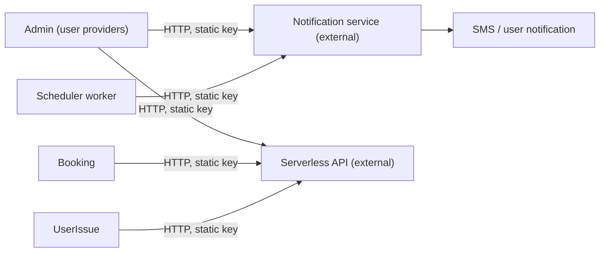

# X-22 · SMS and the external notification service

> **Bangla name:** SMS ও বাহ্যিক নোটিফিকেশন সার্ভিস
>
> [← 60 · Cross-cutting](README.md) · [Contents](../README.md) · [Open queries](../99-open-queries.md)

## 1. Name and purpose

**SMS and the external notification service.** The backend does not send SMS itself. It posts JSON to an **external notification service** (`Notification:Endpoint`, not part of this repository `[UNCONFIRMED: Q-05]`) through `INotificationClient`. That service sends the SMS and the "ticket generated" and "issue resolved" user notifications. A second external API, the **Serverless API**, is used to look up user names and phones by id. Do not confuse this with push notifications ([X-23](X-23-push-firebase.md)), which the platform itself sends through Firebase.

## 2. Trigger and actor

| Message | Triggered by | Actor |
|---|---|---|
| SMS "account created" with user name and password | Admin creates an admin, agent or checker user ([X-05](X-05-admin-provisioning.md)) | Admin user |
| SMS "password changed" with the new password | Admin resets a user's password ([X-02](X-02-admin-forgot-password.md), [X-05](X-05-admin-provisioning.md)) | Admin user or the user |
| `ticket_generated` notification | Scheduler worker after tickets exist ([S-12](../50-system-initiated/S-12-ticket-generated-notification.md)) | System |
| `issue_resolved` notification | Admin marks an issue Resolved, **only in the legacy Admin copy** of user issues | Admin user |

## 3. Business flow

Staff receive their credentials by SMS when an account is created or reset. Customers are told when their tickets are ready. Customers were to be told when a support issue is resolved, but see the note in §9.

## 4. Technical flow

`NotificationClient` (`Core/ETP.Core/ServiceClient/NotificationClient/NotificationClient.cs`) sends **[HTTP, static key]**:

| Method | Path on `Notification:Endpoint` | Body type | Used for |
|---|---|---|---|
| `SendSMSAsync` | `POST /notification/send-message` | `SMSNotification` | credentials SMS |
| `SendTicketGeneratedNotification` | `POST /notification/request` | `TicketGeneratedNotification` | ticket ready |
| `SendIssueResolvedNotification` | `POST /notification/request` | `IssueResolvedNotification` | issue resolved |

The client sets `Authorization` to the value of `Notification:Authorization` on every call and retries transient HTTP errors three times with exponential back-off (Admin registration; Booking and Scheduler register the same client). A non-success status throws `ArgumentException`, so the calling operation fails.

Registered in Admin, Booking and Scheduler. Callers: `AdminUserProvider`, `AgentUserProvider`, `TicketCheckerUserProvider` (all Admin), `UserIssueManager` (Admin), and `SendNotificationAfterGeneratedTicketServiceTaskManager` (Scheduler). In Booking, the calls `notificationClient.SendSMSAsync` in `UserBookingOrderManager` and `InitiateUserTicketGenerationTaskManager` are **commented out**.

**Serverless API** (`IServerlessClient`, `Serverless:BaseUrl`, `Serverless:Authorization`): `GET user/get-bulk-users?user_ids=...` returns user records (`CognitoUser`). Used by Admin (user issues, raffle draw), Booking (orders list and detail, ticket-generation and VAT workers) and UserIssue (report issue). The admin-portal OTP calls to the same API are in [X-01](X-01-admin-login.md).

## 5. Components

| Kind | Component |
|---|---|
| Services | Admin, Booking, Scheduler, UserIssue (Serverless only) |
| External | Notification service `[UNCONFIRMED: Q-05]`, Serverless API `[UNCONFIRMED: Q-03]` |
| Code | `Core/ETP.Core/ServiceClient/NotificationClient/*`, `Core/ETP.Core/ServiceClient/ServerlessClient/*`, `Core/ETP.Core/Models/Notification.cs` |
| Config | `Notification:Endpoint`, `Notification:Authorization`, `Serverless:BaseUrl`, `Serverless:Authorization` ([X-26](X-26-configuration.md)) |

## 6. API contracts

These are calls the backend **makes**; the backend exposes no endpoint for them.

| Method | Path | Auth | Request | Response |
|---|---|---|---|---|
| POST | `{Notification:Endpoint}/notification/send-message` | static `Authorization` | `SMSNotification` | status only |
| POST | `{Notification:Endpoint}/notification/request` | static `Authorization` | `TicketGeneratedNotification` or `IssueResolvedNotification` | status only |
| GET | `{Serverless:BaseUrl}/user/get-bulk-users?user_ids=` | static `Authorization` | — | `CognitoUser` list |

Property names are fixed with `[JsonPropertyName]` (snake_case), not the camelCase of the platform's own APIs.

```json
{ "message_destination": "+8801700000000", "message_type": "sms", "the_message": "Your account has been created successfully. Your user name is ... and password is ..." }
```

```json
{
  "notification_type": "ticket_generated",
  "user_id": "<cognito sub>",
  "notification_data": {
    "order_id": "<order number>", "ticket_id": "T1,T2", "program_event": "<event name>",
    "event_venue": "<venue>", "seating_gallery": "<gallery>", "seating_block": "<block>",
    "seating_level": "<level>", "entry_gate": "<gate>", "mini_gate": "<mini gate>"
  }
}
```

The values are placeholders; the property names come from `Notification.cs` and `SMSNotification.cs`. `ticket_id` is the ticket numbers joined with commas. The `issue_resolved` body has `notification_data` with `order_id` and `issue_id`.

## 7. Data and side effects

- No database writes of its own.
- SMS text contains the **plain-text password** for account creation and reset (see §9).
- Messages are not logged or stored by the backend beyond normal request logging, and the activity log does not cover them ([X-24](X-24-activity-logging.md)).

## 8. Code references

| What | Where |
|---|---|
| Client | `rvl-gobcb-backend/Core/ETP.Core/ServiceClient/NotificationClient/NotificationClient.cs` |
| Models | `rvl-gobcb-backend/Core/ETP.Core/Models/Notification.cs`, `.../NotificationClient/Models/SMSNotification.cs` |
| Credentials SMS | `rvl-gobcb-backend/Services/Admin/ETP.Admin.Integration/Services/AdminUserProvider.cs:79-86, 235-243, 570-579`; `AgentUserProvider.cs:74, 197`; `TicketCheckerUserProvider.cs:70, 193` |
| Ticket-ready notification | `rvl-gobcb-backend/Services/Scheduler/ETP.Scheduler.Service/Workers/TaskManagers/SendNotificationAfterGeneratedTicketServiceTaskManager.cs:76-97` |
| Issue resolved | `rvl-gobcb-backend/Services/Admin/ETP.Admin.Domain/Managers/UserIssueManager.cs:199-217` |
| Registrations | `Services/Admin/ETP.Admin.Service/Configurations/DependencyConfig.cs:131-137`; `Services/Booking/ETP.Booking.Service/Configuration/DependencyConfig.cs:163`; `Services/Scheduler/ETP.Scheduler.Service/Configurations/DependencyConfig.cs:107` |

## 9. Handover notes

1. **Passwords travel by SMS in clear text** (`... password is {password}`), and the notification service is external and unconfirmed. This is the credential-delivery design for staff accounts; see the risk notes in [X-05](X-05-admin-provisioning.md) and [X-02](X-02-admin-forgot-password.md).
2. **"Issue resolved" is only sent by the legacy Admin copy.** The live support feature is the UserIssue service (`/userissue/...`, [A-24](../10-admin-portal/A-24-user-issues-admin.md)); its manager does not call `INotificationClient`. So with the current clients, resolving an issue in the admin portal sends **no** notification `[UNCONFIRMED: Q-05]`. See [Appendix A](../90-appendix-a-legacy.md).
3. SMS to customers (order or ticket SMS) was written but is commented out in Booking; customers only get the `ticket_generated` notification.
4. Local runs set both endpoints to `https://*.invalid/`, so every SMS or notification call fails with a connection error. For admin user creation this means the **Cognito user is created but the request fails after it** (the SMS is sent after `AdminCreateUser`/`AdminSetUserPassword`), leaving an account the admin has no password for.
5. The Scheduler worker catches and logs a failed send per booking, so a failure is not retried inside the same run; whether it is retried later depends on the worker's own booking filter ([S-12](../50-system-initiated/S-12-ticket-generated-notification.md)).

## 10. Component relationships



**Depends on:** account provisioning ([X-05](X-05-admin-provisioning.md)), ticket generation ([S-07](../50-system-initiated/S-07-initiate-user-ticket-generation.md), [S-08](../50-system-initiated/S-08-ticket-signing.md)). **Affects:** staff onboarding, customer ticket-ready message.

## 11. Developer test guide

**Local testability: Not locally.** The notification and Serverless endpoints are `https://notification.invalid/` and `https://serverless.invalid/` (`scripts/user-secrets.example.json`); no stub replaces them (`docs/local-dev.md` lists these as dummies).

| Item | Detail |
|---|---|
| Test data and accounts | Admin login ([X-01](X-01-admin-login.md)) |
| Browser | Admin portal → Users → add user: the request fails after the Cognito user is created (§9 note 4) |
| Emulator | — |
| Postman | `postman/services/etp-admin.postman_collection.json` create-user requests; expect a 500 on the SMS step locally |
| Visual Studio debug | Breakpoint in `NotificationClient.SendSMSAsync`; to test the payload, temporarily point `Notification:Endpoint` to a local listener through user-secrets (outside the submodules) |
| Verify | Aspire logs (Admin) show the failed POST; to confirm payload shape use a local HTTP listener as above |
