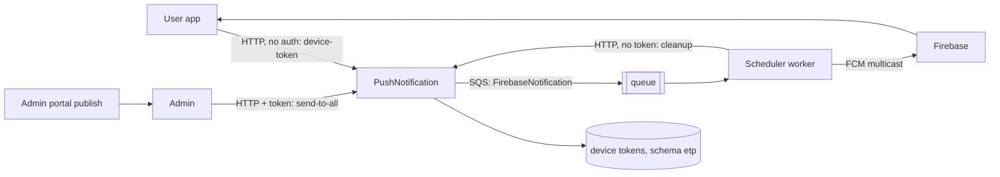

# X-23 · Push notifications (PushNotification service, Firebase)

> **Bangla name:** পুশ নোটিফিকেশন (PushNotification সার্ভিস, Firebase)
>
> [← 60 · Cross-cutting](README.md) · [Contents](../README.md) · [Open queries](../99-open-queries.md)

## 1. Name and purpose

**Push notifications to the mobile app.** The **PushNotification service** stores each user's device tokens (FCM tokens) and turns a "send" request into batches of at most 200 tokens on the `FirebaseNotification` queue. A worker in the **Scheduler** service reads the queue and sends the batches through Firebase Cloud Messaging. The only caller that sends push in the current code is the admin event publish. Concepts: [queue-driven processing](../00-platform-primer.md#explainer-queue-driven), [background workers](../00-platform-primer.md#explainer-background-workers).

## 2. Trigger and actor

- **Register, replace, delete a token:** the user app, on start-up and token refresh ([U-09](../30-user-app/U-09-device-token.md)).
- **Send to all:** Admin service when an admin publishes an event ([A-07](../10-admin-portal/A-07-events.md)).
- **Clean up old tokens:** Scheduler worker ([S-13](../50-system-initiated/S-13-device-token-cleanup.md)).
- **Deliver:** Scheduler `FirebaseNotificationService` ([S-11](../50-system-initiated/S-11-firebase-notification.md)).

## 3. Business flow

When an event is published, every user who has the app installed sees "New Event Available!" with the event name. Users who never opened the app after installing, or who revoked notification permission, have no token and receive nothing.

## 4. Technical flow

**Token registration** (user app → `TicketBanglaApiClient`): `POST/PUT/DELETE pushnotification/api/v1/device-token` with `{userId, fcmToken, osType}` (PUT: `{userId, oldToken, newToken, osType}`). `osType` must be `android`, `ios` or `web` (case-insensitive), otherwise 400.

**Event publish → push**

1. Admin `EventManager` (publish path, `EventManager.cs:~722`) builds `PushNotificationRequest { Title = "New Event Available!", Body = "'<name>' is now available for booking. Get your tickets now!", Data = { eventId, eventName, type = "event_published" } }`.
2. `IPushNotificationClient.SendNotificationToAllAsync` → `POST pushnotification/api/v1/push-notification/send-to-all` **[HTTP + user token]** (Admin forwards the admin token; PushNotification ignores it, see §9).
3. `NotificationManager.SendNotificationToAllUsersAsync` reads active tokens in pages of 200 and publishes one `FirebaseNotificationRequest` per page **[SQS: FirebaseNotification]** with `GroupId = requestId` and `OrderId = "{requestId}-batch-{n}"`. The HTTP reply is `202 Accepted` with the `requestId`.
4. Scheduler `FirebaseNotificationService` **[Worker]** waits 1 minute after start, then loops; `FirebaseNotificationTaskManager` long-polls the queue (5 messages, 10 s wait, visibility 60 s), calls `FirebasePushNotificationService.SendNotificationToMultipleAsync` (`SendEachForMulticastAsync`) and **always deletes the message**, whether or not the send worked.
5. If the `send-to-all` call fails, `EventManager` logs the error and the publish still succeeds.

The same service also offers `send-to-users` (list of user ids) and `send-to-user/{userId}`; nothing in the five repositories calls them (§9 note 5).

## 5. Components

| Kind | Component |
|---|---|
| Services | PushNotification (API, DB), Admin (caller), Scheduler (worker) |
| Queue | `FirebaseNotification` ([X-19](X-19-service-to-service.md)) |
| Tables | `UserDeviceTokens` via `IUserDeviceTokenRepository` in the PushNotification DbContext (schema `etp`) |
| External | Firebase Cloud Messaging |
| Config | `FirebasePushNotificationConfig:*` (service-account JSON fields), `AWS:Queue:FirebaseNotification`, `Services:PushNotification` ([X-26](X-26-configuration.md)) |
| Code | `Services/PushNotification/*`, `Core/ETP.Core/PushNotification/FirebasePushNotificationService.cs`, `Core/ETP.Core/ServiceClient/PushNotificationClient/*` |

## 6. API contracts

Base path `/pushnotification/api/v1/`. **None of these endpoints has authorization** (§9).

| Method | Path | Request | Response | Errors |
|---|---|---|---|---|
| POST | `device-token` | `DeviceTokenRequest {userId, fcmToken, osType}` | `200 {message, tokenId}` | 400 invalid `osType` |
| PUT | `device-token` | `UpdateDeviceTokenRequest {userId, oldToken, newToken, osType}` | `200 {message}` | 400, 404 token not found |
| DELETE | `device-token` | body `{userId, fcmToken}` | `200 {message}` | 404 |
| GET | `device-token/{userId}` | — | list of token rows | — |
| DELETE | `device-token/cleanup?retentionDays=30` | — | `200 {message, deletedCount, cutoffDate, retentionDays}` | 400 if `retentionDays <= 0`, 500 |
| POST | `push-notification/send-to-all` | `PushNotificationRequest {title, body, data}` | `202 {message, requestId}` | 500 |
| POST | `push-notification/send-to-users` | `PushNotificationRequest` with `userIds` | `202 {message, requestId}` | 400 no `userIds`, 500 |
| POST | `push-notification/send-to-user/{userId}` | `PushNotificationRequest` | `202 {message, requestId}` | 500 |
| GET | `push-notification/bulk-status/{requestId}` | — | constant `{requestId, status:"processing", message}` | — |

Primary sample (what the Admin service sends on publish; values illustrative, property names from `PushNotificationRequest.cs`):

```json
{
  "title": "New Event Available!",
  "body": "'<event name>' is now available for booking. Get your tickets now!",
  "data": { "eventId": "<event id>", "eventName": "<event name>", "type": "event_published" }
}
```

Queue message (`FirebaseNotificationRequest`): `title`, `body`, `data`, `deviceTokens` (≤ 200), `createdAt`, `groupId`, `orderId`.

## 7. Data and side effects

- Table of device tokens (add/update/delete/cleanup); no record of sent notifications, and `bulk-status` always answers "processing".
- SQS messages on `FirebaseNotification`; FCM delivery.

## 8. Code references

| What | Where |
|---|---|
| Controllers | `rvl-gobcb-backend/Services/PushNotification/ETP.PushNotification.Service/Api/DeviceTokenController.cs`, `.../NotificationController.cs` |
| Batching and publish | `rvl-gobcb-backend/Services/PushNotification/ETP.PushNotification.Domain/Managers/NotificationManager.cs` |
| Auth commented out | `rvl-gobcb-backend/Services/PushNotification/ETP.PushNotification.Service/Program.cs:75-76` |
| Publish trigger | `rvl-gobcb-backend/Services/Admin/ETP.Admin.Domain/Managers/EventManager.cs:722-745` |
| Client | `rvl-gobcb-backend/Core/ETP.Core/ServiceClient/PushNotificationClient/PushNotificationClient.cs:23, 42, 61` |
| Worker | `rvl-gobcb-backend/Services/Scheduler/ETP.Scheduler.Service/Workers/BackgroundServices/FirebaseNotificationService.cs`, `.../TaskManagers/FirebaseNotificationTaskManager.cs` |
| FCM sender | `rvl-gobcb-backend/Core/ETP.Core/PushNotification/FirebasePushNotificationService.cs` |
| App token calls | `rvl-gobcb-user-app/data/lib/remote/api_service/firebase_api_service/firebase_api_service_impl.dart:21, 38, 48` |

## 9. Handover notes

1. **No authentication on the whole service.** `UseAuthentication()` and `UseAuthorization()` are commented out in `Program.cs`, and the controllers carry no `[Authorize]`. Anyone who can reach `/pushnotification/...` can add or delete tokens, read the tokens of any `userId` (`GET device-token/{userId}`), trigger `send-to-all`, and run `cleanup`. The architecture document records the same facts (§9 items 3 and 6); whether the ingress exposes it is open `[UNCONFIRMED: Q-04]`.
2. **The user id in a token registration is taken from the body**, not from a token, so a client can register a token under another user's id.
3. **Delivery is fire-and-forget.** The worker deletes each message even when Firebase failed or returned partial failures (`SendEachForMulticastAsync` counts as success when at least one token succeeded). Invalid tokens are not removed on failure; they are only removed by the age-based cleanup ([S-13](../50-system-initiated/S-13-device-token-cleanup.md)).
4. **No distributed lock is needed** here: the queue is the coordination point (contrast the lock-based workers, [explainer](../00-platform-primer.md#explainer-distributed-locks)).
5. `send-to-users`, `send-to-user` and the Admin client's matching methods exist, but this review found no caller of them in the five repositories; the only live sender is event publish `[UNCONFIRMED: Q-08]`. Order and ticket pushes are not sent (customers get the `ticket_generated` message through the external service, [X-22](X-22-sms-notification.md)).
6. `FirebaseBulkNotificationRequest` and `FirebaseOptions.ServerKey` are unused ([Appendix A](../90-appendix-a-legacy.md)).
7. The Scheduler's daily token cleanup appears not to reach `device-token/cleanup`; it calls `Services:Admin` without the `pushnotification/` prefix ([S-13](../50-system-initiated/S-13-device-token-cleanup.md), `[UNCONFIRMED: Q-16]`). Until that is confirmed, assume stale tokens are not removed.
8. Locally Firebase is dummy: Scheduler logs Firebase warnings and the app registers no real token (`docs/local-dev.md`, `docs/mobile-local.md` §8 "Known gaps").

## 10. Component relationships



**Depends on:** event publish ([A-07](../10-admin-portal/A-07-events.md)), app token registration ([U-09](../30-user-app/U-09-device-token.md)). **Affects:** push receipt in the app ([U-10](../30-user-app/U-10-push-receipt.md)).

## 11. Developer test guide

**Local testability: Partial.** Token registration, `send-to-all` and the queue path work locally (PushNotification on port 5105, Floci SQS). Delivery cannot: Firebase is dummy, so no push arrives.

| Item | Detail |
|---|---|
| Test data and accounts | No login needed for these endpoints; seeded user phone …11 ([X-07](X-07-user-password-login.md)) for a realistic `userId` |
| Browser | `http://localhost:5105/pushnotification/swagger` to call `device-token` and `send-to-all` (`docs/local-dev.md` §4) |
| Emulator | User app: sign-in is not possible locally (known gap), so the token call is not reached `[see docs/mobile-local.md]` |
| Postman | `postman/services/etp-pushnotification.postman_collection.json` requests such as `POST /api/v1/device-token` and `POST /api/v1/push-notification/send-to-all` (set `base_url` with the `/pushnotification` prefix, see Appendix D) |
| Visual Studio debug | Breakpoints in `NotificationManager.SendNotificationToAllUsersAsync` and `FirebaseNotificationTaskManager.ExecuteAsync` (the worker starts after its 1-minute delay) |
| Verify | `aws --endpoint-url http://localhost:4566 sqs get-queue-attributes --queue-url <FirebaseNotification url> --attribute-names ApproximateNumberOfMessages`; SQL: select from the device-token table in the PushNotification database; Aspire logs of Scheduler show "Processing Firebase notification" |
