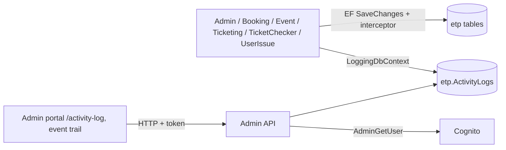

# X-24 · Activity logging (audit trail)

> **Bangla name:** অ্যাক্টিভিটি লগিং (অডিট ট্রেইল)
>
> [← 60 · Cross-cutting](README.md) · [Contents](../README.md) · [Open queries](../99-open-queries.md)

## 1. Name and purpose

**Activity logging.** Every change to a database row made through six of the services is recorded automatically in one table, `etp."ActivityLogs"`: who changed which entity, from which values to which values, and from which IP address. Admins read the trail in the admin portal ([A-27](../10-admin-portal/A-27-activity-log.md)). The mechanism is an EF Core **SaveChanges interceptor**, so feature code does not call it.

## 2. Trigger and actor

Any `SaveChanges` in Admin, Booking, Event, Ticketing, TicketChecker or UserIssue. The "actor" is the `username` claim of the current request, or the text `System` when there is no request (workers, queue consumers).

## 3. Business flow

A change to venues, events, prices, promo codes, users, tickets and so on leaves an audit entry. A user with role Admin or EventManager can search the log by service, entity name and entity id, or open the per-event trail.

## 4. Technical flow

1. Each of the six `DbContext` classes adds `ActivityLogInterceptor(userId, ipAddress, serviceName, loggingDbContext)` in `OnConfiguring`. `userId` is the `username` claim (else `System`); the IP is the first entry of `X-Forwarded-For` (else the connection address, else `Unknown`). The service name is a literal (`Admin`, `Booking`, ...).
2. **Before** the save (`SavingChangesAsync`): entries in state **Modified** or **Deleted** are logged. For Modified, only the properties whose value changed are stored, as JSON in `OldValues` and `NewValues`; for Deleted, all original values go to `OldValues`. `CreatedAt`, `UpdatedAt`, `CreatedBy`, `UpdatedBy` are left out. Rows whose old and new JSON are both `{}` are skipped.
3. **After** the save (`SavedChangesAsync`): **Added** entries are logged with all current values in `NewValues` (the key is only known after the insert).
4. The rows are written through a separate `LoggingDbContext` (`etp."ActivityLogs"`) by its own `SaveChanges`.
5. `EntityContext` (JSON text) is built by `EntityContextBuilder` for known entity names, for example the venue, gallery and block names for a `BlockLevel`, so a reader sees names instead of numeric ids.
6. A few Admin managers also call `IActivityLogger.LogActivityAsync(entityName, entityId, action, old, new)` explicitly; `AdminUserManager` does this for admin-user create, update and delete, because those changes happen in Cognito, not in the database.

**Reading** (Admin service, roles `Admin` and `EventManager`):

- `GET /admin/api/v1/activity-log?serviceName=&entityNames=&entityNamesToExclude=&entityId=&pageOffset=&pageSize=` (default `pageSize` 100)
- `POST /admin/api/v1/activity-log/batch` with `{ "requests": [ {serviceName, entityName, entityId?, pageOffset, pageSize} ] }`
- `GET /admin/api/v1/activity-log/event/{eventId}`

`ActivityLogManager` then fills `UserName` for each distinct `UserId` through `AdminUserManager.GetUserDetails` (a Cognito lookup); where the lookup throws `ArgumentException` (for example for `System`), the exception message becomes the name.

## 5. Components

| Kind | Component |
|---|---|
| Services | Admin, Booking, Event, Ticketing, TicketChecker, UserIssue (write); Admin (read) |
| Not covered | Scheduler, Utility, PushNotification (no interceptor) |
| Tables | `etp."ActivityLogs"` |
| Code | `Core/ETP.Core.EntityFramework/*` (`ActivityLogInterceptor`, `LoggingDbContext`, `ActivityLogConfiguration`, `EntityContextBuilder`), `Services/Admin/*` (`ActivityLogController`, `ActivityLogManager`, `ActivityLogRepository`, `ActivityLogger`) |
| AWS | Cognito (user names) |
| Config | Each service's own DB connection string; `LoggingDbContext` reuses it ([X-26](X-26-configuration.md)) |

## 6. API contracts

| Method | Path | Auth | Request | Response | Errors |
|---|---|---|---|---|---|
| GET | `/admin/api/v1/activity-log` | roles `Admin`, `EventManager` | query as above | paged list of `ActivityLogsResponse` | 404, 500 |
| POST | `/admin/api/v1/activity-log/batch` | same | `ActivityLogsBatchRequest { requests: ActivityLogsRequest[] }` | paged list | 404, 500 |
| GET | `/admin/api/v1/activity-log/event/{eventId}` | same | query `pageOffset`, `pageSize` | paged list | 404, 500 |

`ActivityLogsResponse` properties (camelCase on the wire, no string-enum converter in Admin): `serviceName`, `entityName`, `entityId`, `action` (`Added`, `Modified`, `Deleted`, or a custom text such as `Created`), `oldValues`, `newValues`, `entityContext` (all three are JSON **strings**), `transactionId`, `timestamp`, `userId`, `userName`, `ipAddress`.

## 7. Data and side effects

- `etp."ActivityLogs"` columns: `Id`, `ServiceName`, `EntityName`, `EntityId`, `Action`, `OldValues`, `NewValues`, `EntityContext`, `TransactionId`, `Timestamp`, `UserId`, `IpAddress`.
- Every audited save causes a second `SaveChanges` on the logging context, so each write costs one extra database round trip.

## 8. Code references

| What | Where |
|---|---|
| Interceptor | `rvl-gobcb-backend/Core/ETP.Core.EntityFramework/Interceptors/ActivityLogInterceptor.cs` |
| Logging context and mapping | `rvl-gobcb-backend/Core/ETP.Core.EntityFramework/LoggingDbContext.cs`, `.../Configuration/ActivityLogConfiguration.cs` |
| Wiring per service | `.../Services/Admin/ETP.Admin.Storage/DbContexts/AdminDbContext.cs:77-85`; the same pattern in `BookingDbContext.cs:42-49`, `EventDbContext`, `TicketingDbContext`, `TicketCheckerDbContext`, `UserIssueDbContext` |
| Explicit logger | `rvl-gobcb-backend/Services/Admin/ETP.Admin.Domain/Services/ActivityLogger.cs`, used in `Managers/AdminUserManager.cs:45-170` |
| Read API | `rvl-gobcb-backend/Services/Admin/ETP.Admin.Service/Api/ActivityLogController.cs`, `.../Managers/ActivityLogManager.cs`, `.../Repositories/ActivityLogRepository.cs` |
| Portal | `rvl-gobcb-admin-portal/src/app/features/global-activity-log/services/activity-log.service.ts:22`; `.../events/services/event.service.ts:256` |

## 9. Handover notes

1. **The log is written before the main save for updates and deletes.** If the main `SaveChanges` then fails, the Modified/Deleted log rows already exist (they use a different context and are committed on their own). Added rows are written only after a successful save. Do not treat the log as proof that a change happened.
2. **`TransactionId` does not group a transaction.** `ActivityLogInterceptor.SetTransactionId` is never called anywhere, so every row gets its own new GUID.
3. **Workers appear as `System`** with IP `Unknown`, so changes made by queue consumers and schedulers (capacity, ticket status, booking status) cannot be traced to a user.
4. **Reading needs the log in the same database as the writers.** Each service writes to its own connection; the Admin read API sees only what is in the database its `LoggingDbContext` points at, so a service on a different database would be invisible `[UNCONFIRMED: Q-02]`.
5. **Sensitive values.** Property values are stored as plain JSON. For admin-user logging only name, email, phone, role and program ids are stored (no password); the generic interceptor stores every changed column of the entity, so any entity with a secret column would leak it into the log.
6. No retention or cleanup job exists for `ActivityLogs` in the repository; the table only grows.
7. The Scheduler, Utility and PushNotification services do not audit; their changes (for example device-token cleanup) have no entries.

## 10. Component relationships

**Depends on:** every feature that writes data; the admin login for the `username` claim ([X-01](X-01-admin-login.md), [X-15](X-15-authz-roles.md)). **Affects:** [A-27](../10-admin-portal/A-27-activity-log.md).

## 11. Developer test guide

**Local testability: Full.** The interceptor and the read API run locally.

| Item | Detail |
|---|---|
| Test data and accounts | Admin seeded login, phone …01 (`Passw0rd!23`, [X-01](X-01-admin-login.md)); role `Admin` or `EventManager` is required to read the log |
| Browser | `http://localhost:4200` → Activity log; change something (for example a team name) and reload the log; Network shows `GET .../admin/api/v1/activity-log?serviceName=...` |
| Emulator | — |
| Postman | `postman/services/etp-admin.postman_collection.json`: "GET /api/v1/activity-log" with `{{access_token_admin}}`, then a write request such as a team update |
| Visual Studio debug | Breakpoints in `ActivityLogInterceptor.SavingChangesAsync` / `SavedChangesAsync`, and `ActivityLogManager.GetAllAsync` |
| Verify | SQL: `select "ServiceName","EntityName","EntityId","Action","UserId","Timestamp" from etp."ActivityLogs" order by "Timestamp" desc limit 20;` |
