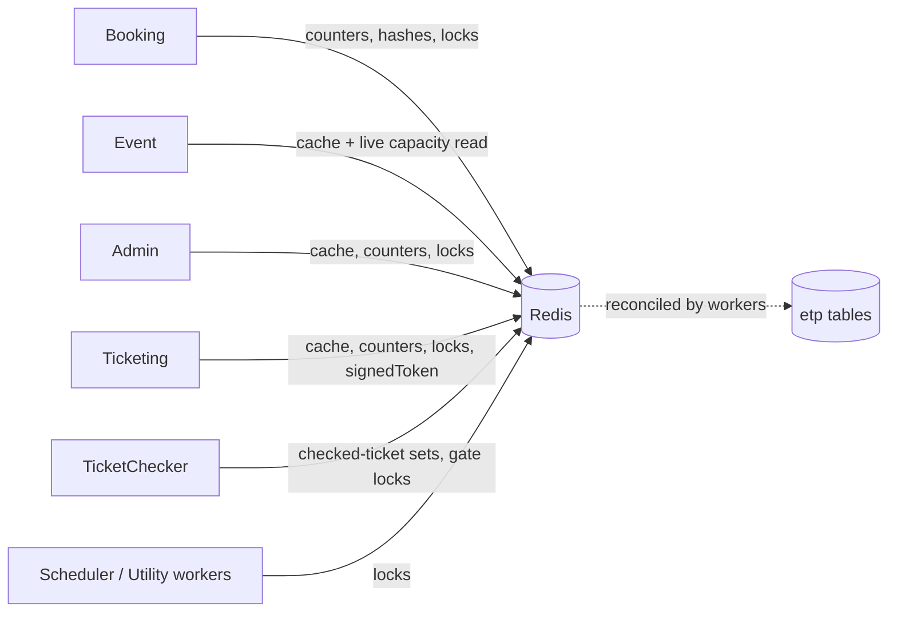

# X-25 · Redis: cache, live capacity and locks

> **Bangla name:** Redis: ক্যাশ, লাইভ ক্যাপাসিটি ও লক
>
> [← 60 · Cross-cutting](README.md) · [Contents](../README.md) · [Open queries](../99-open-queries.md)

## 1. Name and purpose

**Redis.** One Redis instance carries four different jobs: (1) a **read cache** for hot data, (2) **live capacity and seat counters** that decide whether a booking can proceed, (3) **distributed locks** (RedLock) so only one instance runs a worker or touches a level at a time, and (4) small operational state (ticket counters, checked-ticket sets, the signed token, the DgePay token). Concepts: [Redis live capacity](../00-platform-primer.md#explainer-redis-live-capacity), [distributed locks](../00-platform-primer.md#explainer-distributed-locks).

## 2. Trigger and actor

Any request or worker in Admin, Booking, Event, Ticketing, TicketChecker, Scheduler, UserIssue and Utility. There is no user-facing Redis feature; the effects show up as faster reads, capacity numbers, and "only one worker at a time".

## 3. Business flow

When customers book seats, the available count is read and decremented in Redis first and reconciled to the database by workers ([S-01](../50-system-initiated/S-01-level-capacity-update.md) to [S-04](../50-system-initiated/S-04-scheduler-capacity-update.md)). If Redis is flushed, the live counters are wrong until the reconcile workers rebuild them.

## 4. Technical flow

**Three access paths, all against the same server** (`Cache:Redis:ConnectionString`):

| Path | Registered by | Used for | Notes |
|---|---|---|---|
| `ICacheManager` (`DistributedCacheManager` over `IDistributedCache`) | `AddCaching` | read-through cache, for example Cognito user attributes in cache `User` | `InstanceName` prefix (`Cache:Redis:InstanceName`); **default absolute expiry 2 minutes** (`CacheConfig.DefaultExpireTime`) |
| `IRedisService` (StackExchange.Redis `IDatabase`, JSON values) | `AddRedisCaching` | strings, sets, hashes, counters; no prefix, database `Cache:Redis:DefaultDatabase` | all capacity, seat and checker keys |
| `IDistributedLockFactory` (RedLock.net) | `AddDistributedLock` | locks | endpoint from `DistributedLock:Redis:EndPoint`, `:Port`, `:Database`; a single endpoint, so it is a plain Redis lock, not multi-node RedLock |

Both `AddCaching` and `AddRedisCaching` also persist ASP.NET **Data Protection keys** into Redis (`DataProtection-Keys`, `DataProtection-Keys-redis`).

**Registration per service:** Admin, Booking, Ticketing and UserIssue register all three; Event registers cache and `IRedisService`; Scheduler, TicketChecker and Utility register `IRedisService` and locks; PushNotification registers cache only; Platform and UserAuth only the cache.

**Key families** (`CachePrefix` in `Core/ETP.Core/Constant/AppConstant.cs`; key shapes taken from the call sites):

| Prefix and shape | Content | Used by |
|---|---|---|
| `level_live:{event}_{gallery}_{block}_{level}` | live available capacity per level (also hash `capacity` with field `level_live:{groupId}`) | Booking, Event |
| `event_live:{eventId}` | live capacity per event | Booking, Event |
| `level_locked:{event}_{gallery}_{block}_{level}` | hash of orders holding locked capacity (field = order id) | Booking |
| `level_live_seats:{event}_{gallery}_{block}_{level}` | live seat state | Booking |
| `event_database:*`, `level_database:*`, `level_database_seats:*`, `level_database_purchased_seats:*` | database-side counters used to reconcile | Booking |
| `event_total_online_ticket:{eventId}` | online ticket total | Booking, Event |
| `event_details:{id}`, `admin_event_details:{id}`, `event_venue_details:{id}`, `event_settings_details`, `program_settings_details`, `ticket_attributes_details`, `ticket_pricing_all`, `admin_level_info`, `landing_page_image_published`, `general_notice_published` | cached read models | Admin, Event, Ticketing, Booking |
| `booking_details:{publicId}` | order details | Booking |
| `dgepay_auth_token` | DgePay token | Booking ([P-06](../20-user-portal/P-06-booking-payment.md)) |
| `ticket_checker_tickets:event_{e}_gate_{g}`, `ticket_checker_checked_tickets:{e}_{g}_{user}`, `TicketCheckerLevelGateMap` (hash, field `{event}_{gate or level}`) | offline ticket lists, checked tickets, level-to-gate map | TicketChecker, Ticketing, Admin ([C-02](../40-checker-app/C-02-offline-ticket-download.md), [C-05](../40-checker-app/C-05-ticket-sync.md), [S-14](../50-system-initiated/S-14-checked-ticket-sync.md)) |
| `event_ticket_counter:{eventId}` | consecutive ticket number counter, reset to `0` on event publish | Admin, Ticketing |
| `signedToken` | single global admin download token, 60 s | Ticketing ([X-20](X-20-file-storage.md)) |
| `sharedTicket:{ticketNumber}_{signature}` | presigned share URL | Ticketing ([X-20](X-20-file-storage.md)) |

`mergeTicket`, `zipTicket` and `program_details` are declared in `CachePrefix` but no code reads or writes them (merge state is held in S3 file names instead).

**Lock resources** (`CreateLockAsync(resource, expiry[, wait, retry])`; acquired with `await using`):

| Resource name | Where | Purpose |
|---|---|---|
| `user_booking:{userId}` (60 s) | Booking `UserBookingOrderManager` | one booking attempt per user at a time |
| `level_booking_{event}_{gallery}_{block}_{level}` | Booking `UserBookingOrderManager`, `SeatReservationManager`, `EventCapacityAdjustmentManager` | serialise capacity changes of one level |
| `database_update_{event}_{gallery}_{block}_{level}` and `{event}_{gallery}_{block}_{level}_database_update` | Booking `CapacityManager` | capacity reconcile |
| `level_capacity_updater_{n}`, `event_capacity_updater_{n}`, `locked_order_refresher_{n}`, `vat_challan_processor_{n}` | Booking workers (`n` = random slot) | queue consumers: up to several instances in parallel |
| `booking_status_updater`, `reservation_status_updater`, `refresh_level_locks_{key}`, `user_ticket_generator_{eventId}` | Booking task managers | singleton periodic jobs |
| `event_live_capacity_refresher`, `pending_cancel_booking_status_updater`, `notification_for_ticket_generated`, `device_token_cleanup` | Scheduler | singleton periodic jobs |
| `checked_ticket`, `ticket_checker_status_reset`, `promo_code_status_updater`, `system_discount_status_updater` | Admin workers | singleton periodic jobs |
| `ticket_checker_gate_{gateId}` | TicketChecker `TicketsManager` | one sync per gate |
| `create_user_ticket_{publicId}` / `{orderId}` and `signed_ticket_generator_{0..9}` | Ticketing | ticket creation and signing slots |
| `ticket_processing_service_{reservationId}` (1 h) | Utility | merge/zip of one reservation |

## 5. Components

| Kind | Component |
|---|---|
| Code | `Core/ETP.Core/Caching/RedisService.cs`, `Core/ETP.Core/Configuration/CacheConfig.cs`, `RedisConfig.cs`, `DistributedLockConfig.cs`, `Core/ETP.Core/Constant/AppConstant.cs` (`CachePrefix`) |
| AWS | ElastiCache Redis (architecture document, data section) |
| Config | `Cache:Redis:ConnectionString`, `Cache:Redis:InstanceName`, `Cache:Redis:DefaultDatabase`, `DistributedLock:Redis:EndPoint`, `:Port`, `:Database` ([X-26](X-26-configuration.md)); locally `localhost:6379`, instance `etp-local:`, database 0 |

## 6. API contracts

None. Redis has no endpoint of its own; the features above use it internally.

## 7. Data and side effects

State lives only in Redis and is **not** in the database for: live capacity (until reconciled), `event_ticket_counter`, checker sets, `signedToken`, locks. The cached read models are copies of database rows and are removed explicitly when the owner changes them (for example event publish removes `event_details`, `admin_event_details`, `event_venue_details`, then resets `event_ticket_counter`).

## 8. Code references

| What | Where |
|---|---|
| Raw Redis wrapper | `rvl-gobcb-backend/Core/ETP.Core/Caching/RedisService.cs` |
| Cache manager and expiry | `rvl-gobcb-backend/Core/ETP.Core/Configuration/CacheConfig.cs:13-45` |
| Redis multiplexer | `rvl-gobcb-backend/Core/ETP.Core/Configuration/RedisConfig.cs` |
| Lock factory | `rvl-gobcb-backend/Core/ETP.Core/Configuration/DistributedLockConfig.cs` |
| Key prefixes | `rvl-gobcb-backend/Core/ETP.Core/Constant/AppConstant.cs:63-101` |
| Lock use | see the table above; e.g. `Services/Booking/ETP.Booking.Domain/Managers/UserBookingOrderManager.cs:68, 117-123` |
| Cache invalidation example | `rvl-gobcb-backend/Services/Admin/ETP.Admin.Domain/Managers/EventManager.cs:715-722` |

## 9. Handover notes

1. **Redis is a hard dependency and a source of truth for capacity.** A flush or failover loses live counters, locked-order hashes and the checker lists. Recovery relies on the reconcile workers; they are not instant ([S-03](../50-system-initiated/S-03-locked-capacity-refresh.md), [S-04](../50-system-initiated/S-04-scheduler-capacity-update.md)). The architecture document describes the ElastiCache setup and persistence settings, which this review cannot see in code `[UNCONFIRMED: Q-02]`.
2. **The lock endpoint is a single node**, so the lock offers no protection if that node fails over mid-operation.
3. **Locks and a booking:** `UserBookingOrderManager.CreateAsync` takes `user_booking:{userId}` for up to 60 s (no waiting), then waits up to 15 s (retrying every 1 s) for the per-level lock `level_booking_...`, which expires after 60 s. Contention is per level, so a popular level serialises its bookings.
4. **Two different expiry defaults**: `ICacheManager` 2 minutes (`CacheConfig`), while `RedisConfig.DefaultExpireTime` (2 hours) is declared but not applied by `RedisService`, which sets expiry only when a caller passes one.
5. **Key names are code constants and string templates**, spread over managers; there is no central key registry beyond `CachePrefix`. Search for the prefix to find all users.
6. The `DataProtection` keys sit in the same Redis; flushing Redis therefore also resets the data-protection key ring.
7. Queue-consumer workers lock a random slot name (`..._{n}`) rather than one name, so several consumers can run at once by design. Slot ranges in code: `level_capacity_updater` 0-49, `event_capacity_updater` 0-19, `vat_challan_processor` 0-9, `signed_ticket_generator` 0-9, `locked_order_refresher` 0-4.

## 10. Component relationships

**Depends on:** configuration ([X-26](X-26-configuration.md)). **Affects:** booking and seat selection ([P-04](../20-user-portal/P-04-seat-selection.md), [P-06](../20-user-portal/P-06-booking-payment.md)), capacity ([A-10](../10-admin-portal/A-10-capacity-adjustment.md)), the checker app, every worker in section 50.

## 11. Developer test guide

**Local testability: Full.** Redis runs as a Docker container on `localhost:6379` (`docs/local-dev.md`); services crash on start-up if it is down.

| Item | Detail |
|---|---|
| Test data and accounts | `pwsh ./scripts/Seed-EtpData.ps1`; admin login ([X-01](X-01-admin-login.md)) |
| Browser | Open an event on the user portal (`http://localhost:4201`) and Redis keys such as `level_live:*` appear after the first capacity read |
| Emulator | — |
| Postman | `postman/services/etp-booking.postman_collection.json`: capacity and seat requests; an Admin capacity adjustment changes `event_total_online_ticket:{id}` |
| Visual Studio debug | Breakpoints in `RedisService.HashGetAsync` / `StringSetAsync` and in a lock site, e.g. `UserBookingOrderManager` line 68 |
| Verify | `redis-cli -h localhost -p 6379 --scan --pattern 'level_*'`; `redis-cli HGETALL capacity`; `redis-cli --scan --pattern 'etp-local:*'` for `ICacheManager` entries (prefix = `InstanceName`) |
