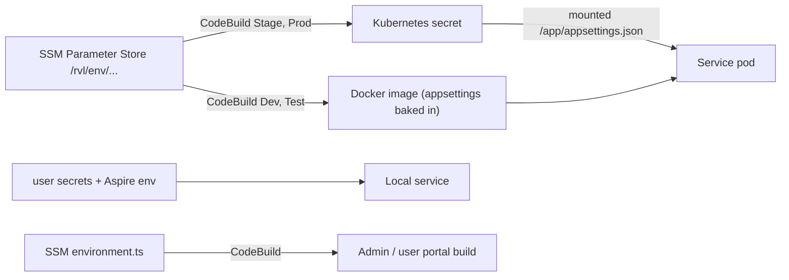

# X-26 · Configuration and secrets

> **Bangla name:** কনফিগারেশন ও সিক্রেট
>
> [← 60 · Cross-cutting](README.md) · [Contents](../README.md) · [Open queries](../99-open-queries.md)

## 1. Name and purpose

**Configuration and secrets.** Every service reads its settings from the standard .NET configuration system (`appsettings.json`, environment variables, user secrets). The repository only holds **placeholders** (`[see User Secrets]`); the real values are supplied per environment. This file explains where each environment's values come from and which keys matter, because almost every other feature refers to a `Section:Key` name.

## 2. Trigger and actor

A developer starting a service locally, or CodeBuild building and deploying an environment. No end user is involved.

## 3. Business flow

None. It decides which database, Redis, AWS account, payment gateway and sibling-service URLs a deployed copy of the platform talks to.

## 4. Technical flow

**Where values come from, by environment**

| Environment | Source | How it reaches the service | Evidence |
|---|---|---|---|
| Local (workspace) | `scripts/user-secrets.example.json` → `scripts/Set-EtpSecrets.ps1` → `dotnet user-secrets` per service; Aspire adds environment variables (`ConnectionStrings__*`, `Services__*`, `Cache__Redis__*`, `DistributedLock__Redis__*`, `ASPNETCORE_URLS`) | ASP.NET Core configuration order: `appsettings.json`, user secrets, environment variables | `docs/local-dev.md` Step 4; `aspire/Etp.AppHost/AppHost.cs:76-98` |
| Dev and Test | SSM Parameter Store `/rvl/<env>/<service>-service-appsettings` | `buildspec-dev.yml` and `buildspec-test.yaml` **replace the service's `appsettings.json` in the source tree and bake it into the Docker image** (`mv appsettings_N.json Services/...`) | `rvl-gobcb-backend/buildspec-dev.yml` pre_build and build stages; `envFrom` and the secret volume are commented out in `deployment/k8s/development/*.yaml` |
| Stage and Prod | the same SSM parameters | `buildspec-prod.yaml`, `buildspec-stage.yaml` create one Kubernetes secret per service (`kubectl create secret generic <svc>-appsettings --from-file=appsettings.json=...`); the deployment mounts it read-only at `/app/appsettings.json` | `buildspec-prod.yaml:122-135`; `deployment/k8s/production/admin_service.yaml:80-90` |

The architecture document (§2.3, §6) describes the SSM → Kubernetes secret path; the code shows that this is true for Stage and Prod, while Dev and Test use the image-baked file.

**Front ends**

| Client | Config file | Source in CI |
|---|---|---|
| Admin portal | `src/environments/environment.ts` and `environment.prod.ts`, **empty in git** | `/rvl/<env>/admin-portal/environment.prod.ts` (SSM) written by the buildspec (`rvl-gobcb-admin-portal/buildspec-dev.yml:7, 28-31`; `buildspec-prod.yaml:14, 27-28`) |
| User portal | no `src/environments/` folder in git | `/rvl/<env>/user-portal/environment.ts` (SSM) (`docs/user-portal-local.md`) |
| User app, checker app | `env/.env.<flavor>` (`dev`, `test`, `staging`, `prod`), not in git; `env/README.md` lists `API_BASE_URL`, `API_TOKEN` | created by the build; the app refuses to start when a required key is missing (`docs/mobile-local.md` §5) |

**Service identity and routing.** `Application:ServiceName` (`admin`, `booking`, `event`, `platform`, `PushNotification`, `scheduler`, `ticketChecker`, `ticketing`, `userAuth`, `utility`) becomes the URL prefix through `GlobalRoutePrefixConvention` ([explainer](../00-platform-primer.md#explainer-path-prefix-routing)). UserIssue has no `appsettings.json` in git, so locally Aspire sets `Application__ServiceName=userissue` (`AppHost.cs:85`); in the cloud it comes from the SSM file.

**Key map** (sections used across this document; the complete local list is `scripts/user-secrets.example.json`):

| Section | Holds | Described in |
|---|---|---|
| `ConnectionStrings:<Service>` | one PostgreSQL connection string per context | [X-24](X-24-activity-logging.md), `[UNCONFIRMED: Q-02]` |
| `Services:<Name>` | base URL of a sibling service (note `Services:AppBase`) | [X-19](X-19-service-to-service.md) |
| `AWS:Region`, `AccessKey`, `SecretAccessKey` | static AWS credentials used for S3, SQS, SES, Cognito | [X-20](X-20-file-storage.md), [X-19](X-19-service-to-service.md) |
| `AWS:Bucket:*`, `AWS:Ticket:*` | media and ticket buckets, ticket path bases | [X-20](X-20-file-storage.md) |
| `AWS:CognitoPool:{Admin,User,TicketChecker,Agent}:{PoolId,Authority,ClientId,Metadata}` | Cognito pools | [X-14](X-14-authz-pool-policies.md) |
| `AWS:Queue:*` | SQS queue names | [X-19](X-19-service-to-service.md) |
| `Cache:Redis:*`, `DistributedLock:Redis:*` | Redis | [X-25](X-25-redis.md) |
| `PaymentSettings:*` | DgePay and SSLCommerz credentials, redirect URL | [P-06](../20-user-portal/P-06-booking-payment.md) |
| `Notification:*`, `Serverless:*` | external notification and user APIs | [X-22](X-22-sms-notification.md) |
| `TSP:*`, `OneIdSettings:*` | signing provider, OneID | [S-08](../50-system-initiated/S-08-ticket-signing.md), [P-10](../20-user-portal/P-10-oneid-ticket-sync.md) |
| `CloudfrontTicketValidator:*` | S3 object holding the CloudFront signing key | [X-20](X-20-file-storage.md) |
| `FirebasePushNotificationConfig:*` | Firebase service-account fields (Scheduler) | [X-23](X-23-push-firebase.md) |
| `CORS:AllowedOrigins` | allowed browser origins (committed value: localhost 4200/4201) | all services |
| `GallerySettings` | Admin venue gallery settings | [A-05](../10-admin-portal/A-05-venues.md) |

## 5. Components

| Kind | Component |
|---|---|
| Code | each service's `Program.cs` and `appsettings.json`; `Core/ETP.Core/Options/*` (typed options such as `AwsOptions`) |
| Pipeline | `rvl-gobcb-backend/buildspec-{dev,test,stage,prod}.y*ml`, `deployment/k8s/<env>/*.yaml`; front-end `buildspec-*.y*ml` |
| AWS | SSM Parameter Store, CodeBuild, ECR, EKS secrets |
| Workspace | `scripts/user-secrets.example.json`, `scripts/Set-EtpSecrets.ps1`, `scripts/Clear-EtpSecrets.ps1`, `aspire/Etp.AppHost` |

## 6. API contracts

None.

## 7. Data and side effects

None at run time. At build time: the Docker images for Dev and Test contain the real `appsettings.json`.

## 8. Code references

| What | Where |
|---|---|
| Placeholder settings | `rvl-gobcb-backend/Services/Admin/ETP.Admin.Service/appsettings.json` (and each service) |
| SSM and image bake (Dev) | `rvl-gobcb-backend/buildspec-dev.yml` |
| SSM and secret (Prod) | `rvl-gobcb-backend/buildspec-prod.yaml:122-135`, `rvl-gobcb-backend/deployment/k8s/production/admin_service.yaml:80-90` |
| Local values | `scripts/user-secrets.example.json`, `scripts/Set-EtpSecrets.ps1` |
| Aspire overrides | `aspire/Etp.AppHost/AppHost.cs:76-98` |
| Front-end env from SSM | `rvl-gobcb-admin-portal/buildspec-dev.yml:7-31`, `rvl-gobcb-admin-portal/buildspec-prod.yaml:14-28` |

## 9. Handover notes

1. **The committed `appsettings.json` files are incomplete templates.** For example, Admin's file has no `Notification`, `Serverless`, `CloudfrontTicketValidator` or `AWS:Ticket` section, although the code needs them. To know the full key set, use `scripts/user-secrets.example.json` (written for the local setup from the code) and the SSM parameters, which this review cannot see `[UNCONFIRMED: Q-06]`.
2. **Dev and Test bake secrets into the image.** The built image carries the real `appsettings.json` (database, AWS keys, gateway secrets), and the buildspecs `cat` the Admin file to the build log. Anyone who can pull the image or read the CodeBuild log sees them. The admin-portal Dev buildspec also prints the environment file to its log (`cat src/environments/environment.prod.ts`).
3. **AWS access is a static key pair** in configuration (`AWS:AccessKey`, `AWS:SecretAccessKey`), used for S3, SQS, SES, Cognito and the MassTransit bus; there is no role-based access in code (architecture §2.3). Rotating it means updating all 11 SSM parameters and redeploying.
4. **Typos and drift to keep in mind**: `ticekt` paths ([X-20](X-20-file-storage.md)); the Postman environment sets region `ap-southeast-1` while some docs say `us-east-1` ([Appendix D](../93-appendix-d-local-test-reference.md)).
5. **Missing-key failures happen at start-up or on first use.** Many keys are read with `configuration["..."]!`, so a missing key shows as a null reference or `ArgumentNullException` where it is first used, not as a clear message. Redis keys are validated at start (`DistributedLockConfig` throws a `ConfigurationErrorsException`).
6. Local `CORS:AllowedOrigins` in git lists only `localhost` ports; the real origins are in the SSM files.

## 10. Component relationships

**Depends on:** nothing. **Affects:** every feature.

## 11. Developer test guide

**Local testability: Full.**

| Item | Detail |
|---|---|
| Test data and accounts | `pwsh ./scripts/Set-EtpSecrets.ps1` (after Floci seeding) writes the secrets; `-DryRun` prints the JSON (`docs/local-dev.md` Step 4) |
| Browser | `http://localhost:4200/` shows the effect of the generated `environment.ts` (API base URLs) |
| Emulator | `env/.env.dev` in the git-ignored `mobile-local/` copy (`pwsh ./scripts/Setup-MobileApps.ps1`) |
| Postman | the environment files in `postman/` hold `base_url` and tokens (see [Appendix D](../93-appendix-d-local-test-reference.md)) |
| Visual Studio debug | Start a service from the IDE; it reads the same user secrets (`docs/local-dev.md` §6.1) |
| Verify | `dotnet user-secrets list --project rvl-gobcb-backend/Services/Admin/ETP.Admin.Service` |
