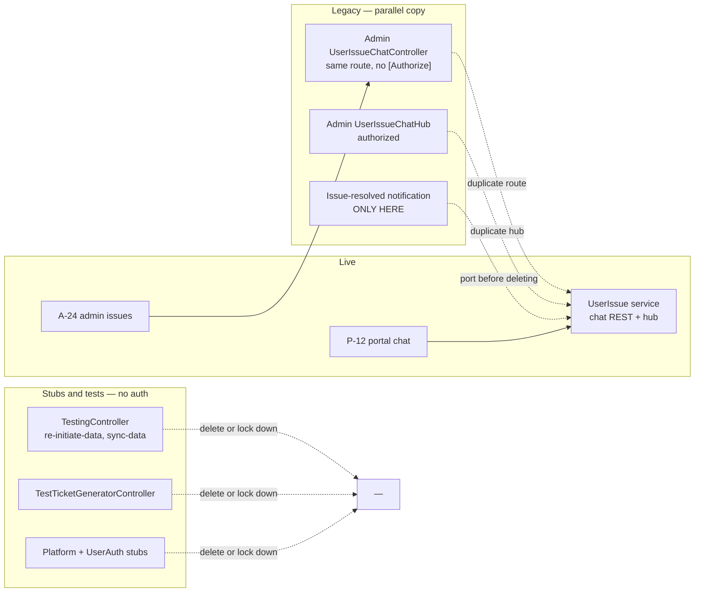

# 90 · Appendix A — Legacy, unused and dormant code

> **Bangla name:** লেগ্যাসি, অব্যবহৃত ও নিষ্ক্রিয় কোড
>
> [← Contents](README.md) · [Open queries](99-open-queries.md)

BS23 built more than the product that shipped. This page lists the code that is **still in the repository but is not part of the live product** — duplicate services, test controllers, dead endpoints, unused settings records and template leftovers. It exists so that RVL can decide what to delete, and so that nobody later mistakes a dormant endpoint for a live one.

**How this page was built.** Every item below was found by searching the five repositories for controllers, managers, records and routes that have no caller in any client and no reachable path from a live screen. Nothing here is inferred from the architecture document.

## 1. How to read the Status column

| Status | Meaning | Action |
|---|---|---|
| **Dead** | No caller anywhere in the five repositories | Delete, after confirming no external consumer |
| **Legacy** | A live, parallel copy of a feature that was reimplemented elsewhere | Delete the old copy once the new one is proven |
| **Dormant** | Reachable but has no caller; may be intentional for an upcoming release | Ask BS23 |
| **Stub** | A template project with no implementation | Delete or replace |
| **Inert** | Data exists but nothing reads or writes it | Ask BS23 |

## 2. Duplicate services

### 2.1 The issue-chat REST API exists twice — both unauthenticated

**Status: Legacy (must be fixed before deletion).**

`Admin` and `UserIssue` each implement the full support-chat REST surface, on the **same route prefix** `api/v1/user-issue-chat`, with the same eight endpoints:

| Endpoint | Admin (legacy) | UserIssue (live) |
|---|---|---|
| `POST send` | `:24` | `:52` |
| `GET {id}/messages` | `:43` | `:32` |
| `GET {id}/unread` | `:64` | `:87` |
| `GET {id}/unread/count` | `:83` | `:70` (`unread-count`) |
| `POST {id}/mark-read` | `:102` | `:104` |
| `GET {id}/last` | `:120` | `:120` |
| `GET {id}/recent` | `:141` | `:141` |
| `GET message/{id}/attachment/download` | `:159` | `:157` |

Files:
- `rvl-gobcb-backend/Services/Admin/ETP.Admin.Service/Api/UserIssueChatController.cs`
- `rvl-gobcb-backend/Services/UserIssue/ETP.UserIssue.Service/Api/ReportIssueChatController.cs`

**Neither carries `[Authorize]`** — zero occurrences in either file. Because `senderId`, `senderName` and `senderType` are client-supplied form fields, an anonymous caller can post into any issue thread labelled `ADMIN`. **This is the top security finding of the handover** ([Q-46](99-open-queries.md)).

There are also **two SignalR hubs** with the same class name, and both *are* authorized with `[Authorize(AuthenticationSchemes = AuthScheme.User + "," + AuthScheme.Admin)]`:
- `Services/Admin/ETP.Admin.Service/Hubs/UserIssueChatHub.cs:12-13`
- `Services/UserIssue/ETP.UserIssue.Service/Hubs/UserIssueChatHub.cs:13-14`

Note the near-identical but **not identical** route spelling (`unread/count` vs `unread-count`) — a client written against one copy will not work against the other.

**The legacy Admin copy is also the only place the "issue resolved" notification is implemented.** Its manager calls `INotificationClient`; the live `UserIssue` manager does not. So resolving an issue in the admin portal currently sends **no** notification to the customer ([X-22](60-cross-cutting/X-22-sms-notification.md) note 2, [P-12](20-user-portal/P-12-issues-chat.md) note 11). **Before deleting the legacy copy, port that notification across.**

See [A-24](10-admin-portal/A-24-user-issues-admin.md) and [P-12](20-user-portal/P-12-issues-chat.md).

### 2.2 Both services register the same hub route

`Program.cs` in each service maps its hub to a path. Confirm which one the deployed gateway routes to before removing either — a mismatch here breaks the chat silently.

## 3. Test and template controllers left in the services

| Controller | Service | Routes | Auth | Status |
|---|---|---|---|---|
| `TestingController` | TicketChecker | `GET api/v1/testing/re-initiate-data`, `POST api/v1/testing/sync-data` | **none** | **Dead, and dangerous** |
| `WeatherForecastController` | TicketChecker | `api/[controller]` | none | **Stub** |
| `TestTicketGeneratorController` | Ticketing | `api/TestTicketGenerator` | **none** | **Dead** |
| `TestController` | UserAuth | `/health` only | none | **Stub** |
| `Platform` service | Platform | template `WeatherForecastController` | none | **Stub** |

`TestingController` is the one to deal with first: `re-initiate-data` and `sync-data` **re-initialise and re-sync ticket data**, and neither is authorized. Any caller who can reach the service can trigger a full data re-sync. Whether the ingress exposes `/ticketChecker/api/v1/testing/*` is a deployment question ([Q-04](99-open-queries.md)).

`TestTicketGeneratorController` publishes to the ticket-generation queue directly — it can create tickets without an order.

## 4. Dead endpoints in live services

Endpoints with no caller in any client. They are listed so nobody builds on them assuming they work.

| Endpoint | Service | Status | Note |
|---|---|---|---|
| `GET api/v1/user-issue-chat/*` (whole surface) | Admin | Legacy | See §2.1 |
| `POST push-notification/send-to-users`, `send-to-user` | PushNotification | Dormant | No caller found; the only live sender is event publish ([Q-08](99-open-queries.md)) |
| `POST api/v1/offline-sold-ticket` | Ticketing | Dormant | The whole agent feature has no client ([Q-07](99-open-queries.md), [X-13](60-cross-cutting/X-13-agent-pool.md)) |
| `POST booking/api/v1/user-booking-order/payment-status-bypass` | Booking | Dormant | Marks an order paid without a gateway call; not called by any client. **It is the reason a bypass can skip the VAT record** ([Q-15](99-open-queries.md)) |
| `POST api/v1/seat-reservation` bulk (`CreateBulk`, default 65 %) | Booking | Dormant | No portal caller; unexplained constant ([Q-22](99-open-queries.md), [A-11](10-admin-portal/A-11-seat-reservation.md)) |
| `GET api/v1/currency` | Admin | Dormant | One route; no caller found |
| `GET api/v1/portal-users` | Admin | Dormant | One route; no caller found |
| `GET api/v1/system-settings` | Admin | Dormant | One route; no caller found |
| `GET api/v1/social-media-settings` | Admin | Legacy | The record is written but the portal reads `HeaderFooters` instead ([Q-34](99-open-queries.md), [A-30](10-admin-portal/A-30-header-footer-social.md)) |
| SSLCommerz callback handler | Booking | Dormant | Supported by the enum and the form; the handler does nothing ([Q-19](99-open-queries.md)) |

## 5. Inert data

Data that exists in the schema but which nothing in the five repositories reads or writes in a meaningful way.

| Item | Where | Status | Note |
|---|---|---|---|
| `SocialMediaSettings` | Admin — model, migration `20250226115506`, manager, controller | Legacy | Superseded by `HeaderFooters`; the portal reads only the latter ([Q-34](99-open-queries.md)) |
| `OfflineSoldTickets` | Ticketing | Inert | Written by the agent endpoint, **read by nothing** — no report, no admin screen ([X-13](60-cross-cutting/X-13-agent-pool.md) note 3) |
| `GeneralNotices` | Admin writes them; **nothing in the user portal reads them** | Inert | `EventApiService.getAllGeneralNotices` exists with no caller; the home-page strip shows something else ([Q-35](99-open-queries.md), [P-01](20-user-portal/P-01-home-content.md)) |
| `Ticket-pricing` content page | Admin (`POST /admin/api/v1/ticket-pricing`) | Inert | The customer pricing page calls `program-pricing` (live prices), not this content ([Q-33](99-open-queries.md), [P-03](20-user-portal/P-03-info-pages.md), [A-14](10-admin-portal/A-14-ticket-pricing-content.md)) |
| `checkNumber` beyond zero/non-zero | checker app | Inert | An `IntColumn`, but the platform only needs "never scanned" vs "scanned" ([C-02](40-checker-app/C-02-offline-ticket-download.md) note 5) |
| `send-to-users`, `send-to-user` | PushNotification | Dormant | See §4 |
| `'Pending'` issue status | UserIssue enum | Inert | The enum is `{Open, Resolved}` only; the leftover branch in the portal can never trigger ([P-12](20-user-portal/P-12-issues-chat.md) note 9) |

## 6. Template leftovers in the clients

| Leftover | Where | Note |
|---|---|---|
| Route enum names `movieList`, `movieDetails`, `movieSearch`, `movieBookmark` | `rvl-gobcb-checker-app/…/navigation/route_path.dart` | From a movie-ticket template. `movieList`/`movieDetails`/`movieBookmark` have no screen; `movieSearch` is dead too ([Q-67](99-open-queries.md), [C-01](40-checker-app/C-01-assigned-event-gate.md) note 6) |
| `status.ps1` | workspace root | A helper left by the previous team; not referenced by any build |
| `gobcb_architecture_diagram.png` | workspace root | Useful as context; the text version is `architecture/gobcb-aws-architecture.md` |

## 7. Comments and code that says one thing and does another

Not dead code, but a place where a comment will mislead you.

| What | Where | The comment says | The code does |
|---|---|---|---|
| `onGetOfflineData` callback | `qr_page_view_model.dart:145-148` | That a cached assignment can be used offline | The body is **entirely commented out**, so no cached value is ever returned ([C-05](40-checker-app/C-05-ticket-sync.md) note 5) |
| Manual-entry length check | `manual_entry_view_model.dart:27-30` | (a commented block) | `if (ticketId.length < 13)` is commented out, so the field accepts any length ([C-04](40-checker-app/C-04-manual-entry.md) note 3) |
| "If we know this ticket is already checked…" | `qr_page_view_model.dart:210-220` | That already-checked tickets are not sent | That is what happens — **no row is written**, deliberately ([C-04](40-checker-app/C-04-manual-entry.md) note 2) |

## 8. What to do with all this

Suggested order:

1. **Secure first, delete later.** `TestingController`, `TestTicketGeneratorController` and both chat controllers have no authorization. Lock them down or remove them from the deployed configuration *before* touching anything else ([Q-04](99-open-queries.md), [Q-46](99-open-queries.md)).
2. **Port the issue-resolved notification** out of the legacy Admin chat copy (§2.1) — otherwise deleting it silently removes a customer notification that is currently the only one.
3. **Ask BS23 about the agent feature** ([Q-07](99-open-queries.md)). Either an agent client is missing from the handover or the feature is dead weight.
4. **Then delete** the stubs (Platform, UserAuth, both `WeatherForecastController`s, `TestController`) — they cost nothing but noise.
5. **Decide the fate of the inert data** (§5) with the business. `SocialMediaSettings` and `GeneralNotices` are the two that most likely represent content someone believes is live.

## 9. Component relationships

**Depends on:** [A-24](10-admin-portal/A-24-user-issues-admin.md), [P-12](20-user-portal/P-12-issues-chat.md), [X-13](60-cross-cutting/X-13-agent-pool.md). **Affects:** anything you plan to delete from — check §2.1's notification dependency first.