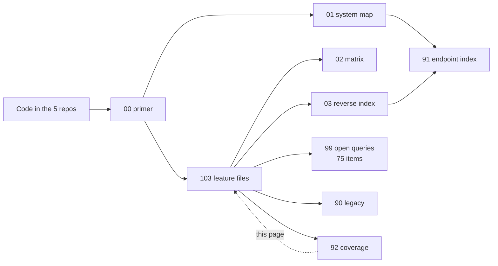

# 92 · Appendix C — Coverage

> **Bangla name:** কভারেজ
>
> [← Contents](README.md) · [Local test reference](93-appendix-d-local-test-reference.md) · [Open queries](99-open-queries.md)

What this documentation covers, what it deliberately does not, and where the coverage is thin. Use it to judge whether a question you have will be answered here.

## 1. What is documented

| Section | Features | Files |
|---|---|---|
| [00 · Platform primer](00-platform-primer.md) | — (background) | 1 |
| [01 · System map](01-system-map.md) | — (index) | 1 |
| [02 · Traceability matrix](02-traceability-matrix.md) | — (index) | 1 |
| [03 · Component reverse index](03-component-reverse-index.md) | — (index) | 1 |
| [10 · Admin portal](10-admin-portal/README.md) | A-01 … A-31 | 31 + README |
| [20 · User portal](20-user-portal/README.md) | P-01 … P-13 | 13 + README |
| [30 · User app](30-user-app/README.md) | U-01 … U-10 | 10 + README |
| [40 · Checker app](40-checker-app/README.md) | C-01 … C-06 | 6 + README |
| [50 · System-initiated](50-system-initiated/README.md) | S-01 … S-17 | 17 + README |
| [60 · Cross-cutting](60-cross-cutting/README.md) | X-01 … X-26 | 26 + README |
| [90–93 · Appendices](90-appendix-a-legacy.md) | — (reference) | 4 |
| [99 · Open queries](99-open-queries.md) | — (queries) | 1 |

**Total: 103 feature files**, each following the same eleven-point template.

## 2. What each feature file covers

Every file answers, in this order:

| § | Section | Always present? |
|---|---|---|
| 1 | Name and purpose | yes |
| 2 | Trigger and actor | yes |
| 3 | Business flow | yes |
| 4 | **Technical flow** — the hop-by-hop path with `[HTTP + token]` / `[SQS: key]` / `[Worker: interval, lock]` tags | yes |
| 5 | Components | yes |
| 6 | API contracts | yes, even when the answer is "None" |
| 7 | Data and side effects | yes |
| 8 | Code references | yes |
| 9 | **Handover notes** — the findings, the risks and the `[UNCONFIRMED: Q-nn]` markers | yes |
| 10 | Component relationships (mermaid) | yes |
| 11 | **Developer test guide** — test data, breakpoints, and how to verify | yes |

The three sections that carry the most value for a handover are **4**, **9** and **11**.

## 3. Coverage by platform area

| Area | Documented | How well | Gaps |
|---|---|---|---|
| **Admin master data** (programs, venues, events, pricing, layouts) | 14 features | thorough | — |
| **Booking and payment** | 8 features | thorough | Real gateway cannot be tested locally |
| **Ticket generation and signing** | 6 features | thorough on the code path | Real TSP signing untestable ([Q-06](99-open-queries.md), [Q-13](99-open-queries.md)) |
| **Checker app** | 6 features | thorough | **iOS is not testable at all** ([Q-72](99-open-queries.md)) |
| **Support and issues** | 3 features | thorough | Notification side is external ([Q-05](99-open-queries.md)) |
| **Push notifications** | 4 features | good | Firebase delivery untestable ([X-23](60-cross-cutting/X-23-push-firebase.md)) |
| **Identity and auth** | 13 features | **partial by necessity** | The identity API has no source ([Q-01](99-open-queries.md)) |
| **Agent / offline sales** | 2 features | thin | No client exists ([Q-07](99-open-queries.md)) |
| **Infrastructure** (Redis, S3, SES, SMS, config, logging) | 8 features | good | Deployment values unknown ([Q-02](99-open-queries.md), [Q-04](99-open-queries.md)) |
| **Workers and queues** | 17 features | thorough | No dead-letter handling exists ([Q-09](99-open-queries.md)) |
| **Admin reporting** | 5 features | good | Report definitions and time zones unclear ([Q-28](99-open-queries.md), [Q-30](99-open-queries.md)) |

## 4. What is deliberately not documented

| Not covered | Why | Where it is instead |
|---|---|---|
| **The identity API's implementation** | Not in the workspace | [Q-01](99-open-queries.md) — ask BS23 |
| **OneID's implementation** | External, dummy locally | `docs/user-portal-local.md` §5 |
| **The external notification service's templates** | External | [Q-05](99-open-queries.md) |
| **NBR VAT's API** | External | [Q-06](99-open-queries.md) |
| **Deployment manifests, Terraform, ingress rules** | Not in the workspace | `architecture/gobcb-aws-architecture.md` (BS23's document, not verified here) |
| **Database schema DDL** | Generated by migrations | `Services/*/ETP.*.Storage/Migrations/` |
| **Unit and integration test suites** | Almost none exist in the five repositories | — see §6 |
| **The generated drift `.g.dart` files** | Generated | `data/lib/local/drift_database/*.g.dart` |
| **AWS account specifics** | BS23's | `docs/rvl-handover-AWS-access-summary.md` |

## 5. Coverage of the code

| Component | Size | Documented |
|---|---|---|
| 11 backend services | 58 controllers, 354 routes | Every controller is indexed in [91](91-appendix-b-endpoint-index.md) |
| 17 background workers | — | Every worker in [03 §6](03-component-reverse-index.md) |
| 6 SQS queues | — | Every queue in [03 §5](03-component-reverse-index.md) |
| ~30 Redis key families | — | Every key family in [03 §4](03-component-reverse-index.md) |
| ~70 database tables | — | Every table in [03 §3](03-component-reverse-index.md) |
| Admin portal | 31 screens | All 31 features |
| User portal | 13 features | All 13 |
| User app | 10 features | All 10 |
| Checker app | 6 features | All 6 |

**Code coverage of the documentation is complete at the feature level.** What varies is depth: the flows that are simple are documented briefly, and the flows that hide surprises are documented at length.

## 6. A gap in the product, not the documentation

**There is no meaningful automated test suite in any of the five repositories.** What exists is manual test guidance — the §11 developer test guide in each feature file.

That means:

- Every regression risk listed in the handover notes is unguarded by CI.
- A behaviour can change without anyone noticing, because nothing asserts it.
- The §11 guides are the only regression protection until tests are written.

If RVL prioritises one investment after the handover, it should be characterising tests around the flows with the most findings: the checker validation path ([C-03](40-checker-app/C-03-qr-scan-validation.md)), the payment callback ([P-06](20-user-portal/P-06-booking-payment.md)) and the chat authorisation ([P-12](20-user-portal/P-12-issues-chat.md)).

## 7. Confidence

| Statement type | Confidence | Note |
|---|---|---|
| "This file exists at this path" | **Verified** | Every code reference was read during this review |
| "This endpoint is called from this file" | **Verified** | Call sites were read, not inferred |
| "This is what the code does" | **High** | The code was read |
| "This is what it is *meant* to do" | **Marked `[UNCONFIRMED]`** | 75 open queries in [99](99-open-queries.md) |
| "This is what the deployed system does" | **Unknown** | Deployment values are not in the workspace ([Q-02](99-open-queries.md), [Q-04](99-open-queries.md), [Q-06](99-open-queries.md)) |

Where this documentation and BS23's `gobcb-aws-architecture.md` disagree, **the code wins** — the architecture document describes the intended deployment, this documentation describes what the code in the workspace actually does.

## 8. Known thin spots

| Spot | Why it is thin |
|---|---|
| [X-13](60-cross-cutting/X-13-agent-pool.md) / [A-26](10-admin-portal/A-26-agent-users.md) | Only the backend half exists; there is no client to trace ([Q-07](99-open-queries.md)) |
| [A-20](10-admin-portal/A-20-raffle-draw.md) raffle draw | Small feature; the Serverless lookup is dummy locally |
| [A-28](10-admin-portal/A-28-media-configuration.md) media | Gallery and banners share one endpoint ([Q-53](99-open-queries.md)) |
| [A-27](10-admin-portal/A-27-activity-log.md) activity log | Thin because [X-24](60-cross-cutting/X-24-activity-logging.md) carries the detail |
| [P-13](20-user-portal/P-13-language-switch.md) language switch | Entirely client-side; nothing to trace on the server |
| [U-10](30-user-app/U-10-push-receipt.md) push receipt | There is no server-side component to trace — which is itself the finding ([Q-65](99-open-queries.md)) |
| [S-15](50-system-initiated/S-15-gate-download-status-cleanup.md), [S-16](50-system-initiated/S-16-promo-code-status.md), [S-17](50-system-initiated/S-17-discount-status.md) | Simple status-update workers with no surprises beyond those noted |

## 9. How to extend this documentation

The eleven-point template is the contract. To add a feature:

1. Copy an existing file in the same section.
2. Keep the eleven sections in order. "None" is a valid answer for §6 and §7 — write it rather than deleting the section.
3. Tag every technical-flow hop with one of: `[HTTP + user token]`, `[HTTP + admin token]`, `[HTTP, no token]`, `[SQS: <queue>]`, `[Worker: <interval>, <lock>]`, `[External: <system>]`, `[Local: <store>]`.
4. Add a `[UNCONFIRMED: Q-nn]` marker for anything you cannot settle, and define it in [99](99-open-queries.md) in the same change.
5. Update the section README, the [traceability matrix](02-traceability-matrix.md) and the [endpoint index](91-appendix-b-endpoint-index.md).
6. Verify the local testability claim by actually running it.

## 10. Component relationships

**Depends on:** every other page. **Affects:** §9 — the procedure for keeping this documentation accurate.