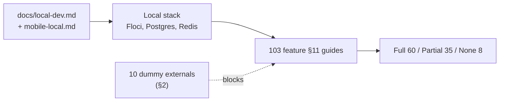

# 93 · Appendix D — Local test reference

> **Bangla name:** লোকাল টেস্ট রেফারেন্স
>
> [← Contents](README.md) · [Coverage](92-appendix-c-coverage.md)

One row per feature: **can you test this locally, and if not, why.** Every feature file has its own §11 developer test guide with the concrete steps; this page is the index that tells you which of those guides will actually get you somewhere.

## 1. The setup documents

Do not start here. Start here, then come back:

| Document | Covers |
|---|---|
| [`docs/local-dev.md`](../../../local-dev.md) | The whole backend stack: PostgreSQL, Redis, DynamoDB Local, Floci (Cognito, S3, SQS, SES, DynamoDB), the nine services under Aspire, seeding, teardown |
| [`docs/mobile-local.md`](../../../mobile-local.md) | Both Flutter apps: tools, devices, how they reach the backend, and **§8 known gaps** |
| [`docs/admin-portal-local.md`](../../../admin-portal-local.md) | The admin portal (it runs from a local copy, not the submodule) |
| [`docs/user-portal-local.md`](../../../user-portal-local.md) | The user portal, including the `/p/identity` and `/p/oneid` stubs |
| [`docs/config-reference.md`](../../../config-reference.md) | Every configuration key |
| [`docs/local-dev-setup.bn.md`](../../../local-dev-setup.bn.md) | The setup manual in Bangla |
| [`postman/`](../../../../postman/) | Service collections and local environments |
| [`scripts/`](../../../../scripts/) | `user-secrets.example.json`, seed SQL, `Set-EtpSecrets.ps1` |

## 2. What is dummy in the local stack

Everything below is stubbed. This single table explains most "Partial" ratings in §3.

| External | Local value | Consequence |
|---|---|---|
| **DgePay** | dummy | Order creation works; the payment page and callback do not |
| **TSP (VDS)** | `https://tsp.invalid/…`, no certificate | Tickets reach `Requested` but are never signed — blocks [S-08](50-system-initiated/S-08-ticket-signing.md), [S-09](50-system-initiated/S-09-ticket-merge-zip.md), [P-08](20-user-portal/P-08-ticket-generation-request.md), [C-03](40-checker-app/C-03-qr-scan-validation.md) |
| **OneID** | fake at `/p/oneid` | Login works; ticket sync does not ([P-10](20-user-portal/P-10-oneid-ticket-sync.md)) |
| **NBR VAT** | `https://*.invalid` | The VAT message retries for ever ([S-10](50-system-initiated/S-10-vat-challan.md)) |
| **Identity API** | 503 stub, or `/p/identity` | Registration, OTP, profile and delete cannot be tested properly ([Q-01](99-open-queries.md)) |
| **Serverless API** | `https://serverless.invalid/` | Customer name/phone lookups return empty ([Q-03](99-open-queries.md)) |
| **Notification service** | `https://notification.invalid/` | Every SMS fails ([Q-05](99-open-queries.md)) |
| **Firebase** | dummy | No push is ever delivered |
| **CloudFront signed cookie** | `local-dummy` | Admin-portal file protection fails locally ([X-20](60-cross-cutting/X-20-file-storage.md)) |
| **SES** | Floci SES, `noreply@etp.local` | Sends are accepted; no real mail ([X-21](60-cross-cutting/X-21-email-ses.md)) |

**What Floci does provide, and is real:** Cognito (all four pools), S3 (bucket `etp-local`), SQS (real queue semantics), SES, DynamoDB Local, PostgreSQL and Redis.

## 3. Feature-by-feature testability

**Full** — works locally. **Partial** — the main path works, something downstream is dummy. **Not locally** — no way to test without a real external system.

### 3.1 Admin portal

| Id | Rating | Limitation |
|---|---|---|
| [A-01](10-admin-portal/A-01-program-selection.md) | Full | — |
| [A-02](10-admin-portal/A-02-programs.md) | Full | S3 is Floci |
| [A-03](10-admin-portal/A-03-program-settings.md) | Full | — |
| [A-04](10-admin-portal/A-04-teams.md) | Full | — |
| [A-05](10-admin-portal/A-05-venues.md) | Full | seeded venues exist |
| [A-06](10-admin-portal/A-06-program-venue-mapping.md) | Full | — |
| [A-07](10-admin-portal/A-07-events.md) | Full except push | dummy Firebase |
| [A-08](10-admin-portal/A-08-event-settings.md) | Full | — |
| [A-09](10-admin-portal/A-09-event-level-pricing.md) | Full | — |
| [A-10](10-admin-portal/A-10-capacity-adjustment.md) | Full | — |
| [A-11](10-admin-portal/A-11-seat-reservation.md) | Full | — |
| [A-12](10-admin-portal/A-12-reserved-tickets.md) | **Partial** | signing needs TSP; CloudFront cookie fails |
| [A-13](10-admin-portal/A-13-ticket-layouts.md) | Full | — |
| [A-14](10-admin-portal/A-14-ticket-pricing-content.md) | Full | — |
| [A-15](10-admin-portal/A-15-promo-codes.md) | Full | — |
| [A-16](10-admin-portal/A-16-discounts.md) | Full | — |
| [A-17](10-admin-portal/A-17-ticket-checker-users.md) | **Partial** | Cognito works; **the SMS fails after the user is created**, so creation errors |
| [A-18](10-admin-portal/A-18-gate-assignment.md) | Full (admin side) | — |
| [A-19](10-admin-portal/A-19-gate-reports.md) | **Partial** | the checker app cannot sign in locally; use Postman or seed data |
| [A-20](10-admin-portal/A-20-raffle-draw.md) | **Partial** | Serverless dummy; partner and complimentary tickets work |
| [A-21](10-admin-portal/A-21-dashboard.md) | Full | `pwsh ./scripts/Seed-EtpData.ps1` for data |
| [A-22](10-admin-portal/A-22-reports.md) | Full | `scripts/seed/03-orders-tickets.sql` |
| [A-23](10-admin-portal/A-23-reconciliation.md) | **Partial** | Serverless dummy, so customer details are empty |
| [A-24](10-admin-portal/A-24-user-issues-admin.md) | **Partial** | service, hub and REST run; customer data does not |
| [A-25](10-admin-portal/A-25-admin-users.md) | **Partial** | same SMS-after-create failure |
| [A-26](10-admin-portal/A-26-agent-users.md) | **Partial** | same |
| [A-27](10-admin-portal/A-27-activity-log.md) | Full | — |
| [A-28](10-admin-portal/A-28-media-configuration.md) | Full | — |
| [A-29](10-admin-portal/A-29-content-editor.md) | Full | — |
| [A-30](10-admin-portal/A-30-header-footer-social.md) | Full | — |
| [A-31](10-admin-portal/A-31-general-notices.md) | Full | — |

### 3.2 User portal

| Id | Rating | Limitation |
|---|---|---|
| [P-01](20-user-portal/P-01-home-content.md) | Full | seeded hero, sponsors, notice and FAQ rows |
| [P-02](20-user-portal/P-02-browse-events.md) | Full | seven seeded matches |
| [P-03](20-user-portal/P-03-info-pages.md) | Full | — |
| [P-04](20-user-portal/P-04-seat-selection.md) | Full to the preview | payment is not possible locally |
| [P-05](20-user-portal/P-05-apply-promo-code.md) | Full | — |
| [P-06](20-user-portal/P-06-booking-payment.md) | **Partial** | DgePay dummy |
| [P-07](20-user-portal/P-07-my-bookings.md) | Full | nine seeded orders |
| [P-08](20-user-portal/P-08-ticket-generation-request.md) | **Partial** | tickets reach `Requested`, never signed |
| [P-09](20-user-portal/P-09-ticket-details-downloads.md) | **Partial** | holder edit, details and invoice work; signed PDFs depend on the seed |
| [P-10](20-user-portal/P-10-oneid-ticket-sync.md) | **Not locally** | OneID dummy |
| [P-11](20-user-portal/P-11-profile.md) | **Partial** | runs against `/p/identity`; OTP stub is `123456` |
| [P-12](20-user-portal/P-12-issues-chat.md) | Full REST / **Partial** hub | the hub needs the WebSocket route; `skipNegotiation` removes the fallback |
| [P-13](20-user-portal/P-13-language-switch.md) | Full | entirely client-side |

### 3.3 User app

| Id | Rating | Limitation |
|---|---|---|
| [U-01](30-user-app/U-01-splash-onboarding.md) | Full except the version check | no `allowed-app-version` stub; point at `/p/identity` |
| [U-02](30-user-app/U-02-home-browse-events.md) | Full | — |
| [U-03](30-user-app/U-03-info-pages.md) | Full | — |
| [U-04](30-user-app/U-04-seat-selection-promo.md) | Full reads / **Partial** payment | needs a gateway sandbox |
| [U-05](30-user-app/U-05-booking-webview-payment.md) | **Partial** | the order POST works; the gateway page does not |
| [U-06](30-user-app/U-06-my-bookings-tickets.md) | Full list / **Partial** PDF | signing and OneID are not local |
| [U-07](30-user-app/U-07-profile-settings.md) | **Partial** | runs against `/p/identity`; Cognito calls need a real pool |
| [U-08](30-user-app/U-08-issues-chat.md) | Full REST / **Partial** hub | — |
| [U-09](30-user-app/U-09-device-token.md) | **Partial** | exercises the code; no real token |
| [U-10](30-user-app/U-10-push-receipt.md) | **Not locally** (delivery) | foreground rendering can be exercised with a manual notification |

### 3.4 Checker app

| Id | Rating | Limitation |
|---|---|---|
| [C-01](40-checker-app/C-01-assigned-event-gate.md) | Full (API call) | the Cognito pool must be reachable or seeded |
| [C-02](40-checker-app/C-02-offline-ticket-download.md) | Full | — |
| [C-03](40-checker-app/C-03-qr-scan-validation.md) | **Full on Android / Not on iOS** | no iOS crypto implementation ([Q-72](99-open-queries.md)) |
| [C-04](40-checker-app/C-04-manual-entry.md) | Full | no network involved |
| [C-05](40-checker-app/C-05-ticket-sync.md) | Full | — |
| [C-06](40-checker-app/C-06-manual-ticket-validation.md) | **Full on Android / always fails on iOS** | — |

**The checker app cannot sign in locally at all** — Amplify Flutter cannot be pointed at Floci ([X-12](60-cross-cutting/X-12-checker-login.md)). This is why [A-19](10-admin-portal/A-19-gate-reports.md) is only partial: you have to inject scans via Postman.

### 3.5 System-initiated

| Id | Rating | Limitation |
|---|---|---|
| [S-01](50-system-initiated/S-01-level-capacity-update.md) | Full | — |
| [S-02](50-system-initiated/S-02-event-live-capacity.md) | Full | — |
| [S-03](50-system-initiated/S-03-locked-capacity-refresh.md) | Full | — |
| [S-04](50-system-initiated/S-04-scheduler-capacity-update.md) | Full | — |
| [S-05](50-system-initiated/S-05-pending-failed-revalidation.md) | **Partial** | DgePay dummy → `GetPaymentStatus` throws → orders stay `Pending` |
| [S-06](50-system-initiated/S-06-booking-status-generated.md) | **Partial** | orders never reach `Generated` without signing |
| [S-07](50-system-initiated/S-07-initiate-user-ticket-generation.md) | **Partial** | tickets and blank PDFs work |
| [S-08](50-system-initiated/S-08-ticket-signing.md) | **Partial** | everything before signing works |
| [S-09](50-system-initiated/S-09-ticket-merge-zip.md) | **Partial** | needs signed PDFs first |
| [S-10](50-system-initiated/S-10-vat-challan.md) | **Partial** | the message retries for ever |
| [S-11](50-system-initiated/S-11-firebase-notification.md) | **Partial** | the queue and worker run; no delivery |
| [S-12](50-system-initiated/S-12-ticket-generated-notification.md) | **Partial** | the send fails, nothing is marked |
| [S-13](50-system-initiated/S-13-device-token-cleanup.md) | **Partial** | the coded path reaches Admin, not PushNotification — [Q-16](99-open-queries.md) |
| [S-14](50-system-initiated/S-14-checked-ticket-sync.md) | Full (worker) | — |
| [S-15](50-system-initiated/S-15-gate-download-status-cleanup.md) | Full | — |
| [S-16](50-system-initiated/S-16-promo-code-status.md) | Full | — |
| [S-17](50-system-initiated/S-17-discount-status.md) | Full | — |

### 3.6 Cross-cutting

| Id | Rating | Limitation |
|---|---|---|
| [X-01](60-cross-cutting/X-01-admin-login.md) | **Partial** | OTP stub: any phone, code `123456` |
| [X-02](60-cross-cutting/X-02-admin-forgot-password.md) | **Partial** | the OTP stub does not return `user_id`, so the flow stops |
| [X-03](60-cross-cutting/X-03-admin-change-password-logout.md) | Full logout / **Partial** change password | Floci's `ChangePassword` emulation is incomplete |
| [X-04](60-cross-cutting/X-04-admin-session.md) | Full | — |
| [X-05](60-cross-cutting/X-05-admin-provisioning.md) | **Partial** | Cognito works; the SMS fails |
| [X-06](60-cross-cutting/X-06-user-registration.md) | **Not locally** | the identity proxy answers 503 |
| [X-07](60-cross-cutting/X-07-user-password-login.md) | Full (portal) / **Not locally** (app) | Amplify Flutter cannot point at Floci |
| [X-08](60-cross-cutting/X-08-oneid-sso.md) | **Partial** | the `/p/oneid` fake auto-approves |
| [X-09](60-cross-cutting/X-09-user-forgot-password.md) | **Not locally** | 503 stub |
| [X-10](60-cross-cutting/X-10-user-session.md) | Full (portal) / **Not locally** (app) | — |
| [X-11](60-cross-cutting/X-11-delete-account-force-update.md) | **Not locally** | 503 stub |
| [X-12](60-cross-cutting/X-12-checker-login.md) | **Not locally** (sign-in) | Amplify Flutter limitation |
| [X-13](60-cross-cutting/X-13-agent-pool.md) | **Partial** | endpoint and pool login work; no agent data |
| [X-14](60-cross-cutting/X-14-authz-pool-policies.md) | Full | all four pools in Floci |
| [X-15](60-cross-cutting/X-15-authz-roles.md) | Full | — |
| [X-16](60-cross-cutting/X-16-authz-program-scope.md) | Full | — |
| [X-17](60-cross-cutting/X-17-authz-client-side.md) | Full | — |
| [X-18](60-cross-cutting/X-18-endpoints-without-auth.md) | Full | — |
| [X-19](60-cross-cutting/X-19-service-to-service.md) | Full (HTTP, SQS) | external systems are dummies |
| [X-20](60-cross-cutting/X-20-file-storage.md) | **Partial** | uploads work; the signed cookie does not |
| [X-21](60-cross-cutting/X-21-email-ses.md) | **Partial** | Floci SES accepts sends |
| [X-22](60-cross-cutting/X-22-sms-notification.md) | **Not locally** | no stub |
| [X-23](60-cross-cutting/X-23-push-firebase.md) | **Partial** | tokens and the queue work; no delivery |
| [X-24](60-cross-cutting/X-24-activity-logging.md) | Full | — |
| [X-25](60-cross-cutting/X-25-redis.md) | Full | `localhost:6379`; **services crash if Redis is down** |
| [X-26](60-cross-cutting/X-26-configuration.md) | Full | — |

## 4. Summary

| Rating | Count | Of 103 |
|---|---|---|
| **Full** | 60 | 58% |
| **Partial** | 35 | 34% |
| **Not locally** | 8 | 8% |

Almost every "Partial" is caused by one of the ten dummies in §2, and almost every "Not locally" is caused by the identity API, OneID, DgePay or the missing Amplify-Floci bridge. **None of them is a defect in the code** — they are limits of the local environment, which is what a local environment is for.

## 5. The five things worth testing first

If you have one afternoon and want to see the most behaviour per minute:

| # | Do this | Shows you |
|---|---|---|
| 1 | Seed the data, open the user portal, browse to an event and open the seat map | The whole read path: Event, Booking, Redis capacity |
| 2 | Create a booking order and watch the Redis lock appear, then watch [S-03](50-system-initiated/S-03-locked-capacity-refresh.md) clean it up | Capacity locking, the RedLock worker, and the [Q-10](99-open-queries.md) key bug |
| 3 | Run the checker app's **manual entry** path ([C-04](40-checker-app/C-04-manual-entry.md)) | The weakest validation in the product, and [Q-75](99-open-queries.md) |
| 4 | Post to the chat REST endpoint **without a token** | [Q-46](99-open-queries.md) — the most serious finding, reproducible in one request |
| 5 | Stop Redis, then restart a service | Why [X-25](60-cross-cutting/X-25-redis.md) calls Redis a hard dependency |

## 6. Component relationships

**Depends on:** `docs/local-dev.md`, `docs/mobile-local.md`, `docs/admin-portal-local.md`, `docs/user-portal-local.md`. **Affects:** every feature's §11 guide.