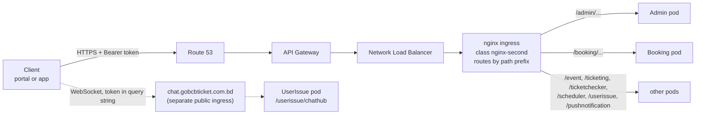

# GoBCB প্ল্যাটফর্ম — ফিচার ডকুমেন্টেশন (টেকনিক্যাল হ্যান্ডওভার)

> **English version:** অভিন্ন ইংরেজি সংস্করণ পাশের ফাইলে — `gobcb-feature-documentation-en.md`।
> **Hosting architecture:** `docs/architecture/gobcb-aws-architecture.md` (পুরো ডকুমেন্টে "architecture doc" নামে উল্লেখিত)।

**পড়ার বিধি:** এই ডকুমেন্ট বাংলায় লেখা, তবে টেকনিক্যাল টার্ম — service নাম, endpoint path, AWS service নাম, code identifier, config key — সব **ইংরেজিতে** রাখা হয়েছে, যাতরা কোডের সাথে সরাসরি মেলানো যায়। ইংরেজি সংস্করণের সাথে section-কাঠামো ১:1 identical।

## 0. Orientation (সূচনা)

### 0.1 উদ্দেশ্য, পাঠক ও পড়ার নিয়ম

**উদ্দেশ্য।** GoBCB (rvl-etp) ইভেন্ট ও টিকিটিং প্ল্যাটফর্মের প্রতিটি business feature-এর জন্য এই ডকুমেন্ট দেখায় — কোন screen থেকে শুরু হয়, কোন endpoint ও service হ্যান্ডেল করে, কোন queue ও worker পরে কাজটি এগিয়ে নেয়, কোন table, Redis key ও file ছোঁয়, কোন external system কল হয়, আর কোড কোথায়।

**পাঠক।** RVL-এর নতুন tech lead: অভিজ্ঞ .NET developer, যিনি আগে কখনো **microservices-ভিত্তিক সিস্টেমে কাজ করেননি**। Microservice ধারণাগুলো একবার, এই Part 0-তে, 📦 **explainer box**-এ ব্যাখ্যা করা হয়েছে; প্রতিটি feature সেগুলোর রেফারেন্স দেয়, পুনরাবৃত্তি করে না।

**উৎস।** BS23-এর delivery পক্ষ থেকে handover-এর জন্য লেখা, শুধু দুটি উৎস থেকে:

1. পাঁচটি repository-র source code (read-only), নিচের commit-গুলোতে;
2. AWS-এ প্ল্যাটফর্ম কীভাবে host করা তার বিবরণ — `docs/architecture/gobcb-aws-architecture.md`।

এখানে কিছু বানানো হয়নি। কোথাও কোড থেকে উত্তর মেলেনি, সেখানে তা স্পষ্টভাবে বলা হয়েছে এবং `[UNCONFIRMED]` মার্কার দেওয়া হয়েছে — ডকুমেন্টের শেষে **Open queries** section-এ সেগুলো একত্রিত, প্রতিটি প্রশ্ন এমনভাবে লেখা যেন BS23-কে as-is পাঠানো যায়।

### Evidence baseline

| Repository (submodule) | Commit |
|---|---|
| `rvl-gobcb-backend` | `430ec16d7554254ff4f6adfa21f9c0c10d3234b2` |
| `rvl-gobcb-admin-portal` | `f62d2756bd9bbd4bfaa92585ae3f999d9f4c213f` |
| `rvl-gobcb-user-portal` | `36aaf58c0dae070da9f958da09451d33e6e47c73` |
| `rvl-gobcb-user-app` | `365b8bee71454d94747b75bef7cb07e8b47b6f8a` |
| `rvl-gobcb-checker-app` | `e919c54dad40a33aecc9922a68637a4a887513e6` |

Code reference-এর line number (`File.cs:123`) এই commit-গুলোর জন্য বৈধ। Submodule এগিয়ে গেলে আপনার নির্ভরশীল feature-গুলোর reference আবার যাচাই করুন।

### Feature template

Feature-গুলো সাজানো **কী শুরু করে তার ভিত্তিতে**: admin portal-এ staff (F1.x), web portal-এ customer (F2.x) বা app-এ (F3.x), checker app-এ gate staff (F4.x), timer/queue-তে সিস্টেম নিজে (F5.x), আর অনেক feature-এর সাথে সম্পর্কিত বিষয় (F6.x — authentication/authorization সহ)। প্রতিটি feature একই নয়টি section মেনে চলে:

| # | Section | কী জানায় |
|---|---|---|
| 1 | Name and purpose | feature-টি কী কাজে, business ভাষায় (ইংরেজি ও বাংলা নাম) |
| 2 | Trigger and actor | কে শুরু করে, কোন client-screen থেকে, কোন Cognito pool, role, program scope দিয়ে |
| 3 | Business flow | business user যে ধাপগুলো দেখে |
| 4 | Technical flow | একই ধাপগুলো component-গুলোর মধ্যে hop হিসেবে; প্রতিটি hop tagged (নিচে) |
| 5 | Components | client, service, queue, worker, table, Redis key, bucket, external system |
| 6 | API contracts | feature-টি যে endpoint গুলো ব্যবহার করে (method, full path, auth, DTO, মূল error); মূল endpoint-এর জন্য পূর্ণ JSON sample |
| 7 | Data and side effects | কী লেখা হয়: row, queue message, file, email, push, cache entry |
| 8 | Code references | কোথা থেকে পড়া শুরু করবেন: controller, manager, worker, client file |
| 9 | Handover notes | সহজেই চোখ এড়ানো আচরণ, কোডে পাওয়া risk, `[UNCONFIRMED]` item |

**Section 4-এ ব্যবহৃত hop tag:**

| Tag | অর্থ |
|---|---|
| **[HTTP + user token]** | sync HTTP call যা caller-এর Cognito access token বহন করে (client থেকে, বা কোনো service forward করে) |
| **[HTTP, no token]** | token ছাড়া sync HTTP call — সাধারণত background worker থেকে `[Authorize]`-নেই এমন endpoint-এ |
| **[HTTP, static key]** | configuration-এর key দিয়ে external/internal system-এ sync HTTP call |
| **[SQS: Key]** | `AWS:Queue:Key` হিসেবে configured queue-তে message রাখা বা পড়া |
| **[Worker: interval, lock]** | কোনো service-এর background worker, তার hard-coded interval ও Redis lock-সহ |
| **[SignalR]** | SignalR hub দিয়ে WebSocket message |
| **[Shared table]** | এক service অন্য service-এর লেখা table পড়ে (একই database, §0.8 দ্রষ্টব্য) |

**Path** লেখা হয়েছে client যেভাবে ডাকে সেভাবে পূর্ণরূপে, যেমন `/booking/api/v1/user-booking-order`; প্রথম segment-টি service prefix (§0.6)।

### 0.2 এক অনুচ্ছেদে প্ল্যাটফর্ম

GoBCB বাংলাদেশ ক্রিকেট বোর্ডের ইভেন্টের টিকিট বিক্রি ও যাচাই করে। Staff-রা **admin portal**-এ সাজান **program** (সিরিজ/টুর্নামেন্ট), **venue** (স্টেডিয়াম → gallery → block → level), **event** (ম্যাচ) — দাম ও capacity-সহ, সাথে promotion ও ticket layout। Customer-রা **user web portal** বা **user app**-এ ব্রাউজ ও কেনেন, **DgePay** দিয়ে পরিশোধ করেন, আর QR-সহ ডিজিটালি signed PDF টিকিট পান। Gate-এর staff **checker app** দিয়ে offline QR স্ক্যান করেন। Backend হলো একই repository-র একগুচ্ছ ASP.NET Core 8 web API ("service") — Amazon EKS-এ API Gateway-এর পেছনে চলে (architecture doc §0–§4)।

### 0.3 Repository

এই workspace (`rvl-etp-workspace`) পাঁচটি git submodule পরিচালনা করে:

| Repo | কী |
|---|---|
| `rvl-gobcb-backend` | .NET 8 backend: ১১টি service project (৯টি active + ২টি stub) + shared `Core/` library |
| `rvl-gobcb-admin-portal` | Angular admin portal (staff) |
| `rvl-gobcb-user-portal` | Angular user web portal (app `ETP-Web/` subfolder-এ) |
| `rvl-gobcb-user-app` | End user-দের Flutter app (clean architecture: `presentation/`, `domain/`, `data/` package) |
| `rvl-gobcb-checker-app` | Gate checker-দের Flutter app |

### 0.4 Backend service

সব service `rvl-gobcb-backend/Services/<Name>/`-এ, প্রতিটি ভাগ করা `ETP.<Name>.Service` (controller, `Program.cs`, worker), `.Domain` (manager = business logic), `.Storage` (EF Core `DbContext`, repository) এবং কিছু ক্ষেত্রে `.Client` (অন্য service-এর ব্যবহারের typed HTTP client) ও `.Integration`। Shared code `rvl-gobcb-backend/Core/`-এ (`ETP.Core`, `ETP.Core.Web`, `ETP.Core.EntityFramework`, `ETP.Core.BlobStorage`, `ETP.Core.Storage`, `ETP.Core.Email`, `ETP.Core.SMS`, `ETP.Core.EventBus`)।

| Service | Path prefix | Local port | কী করে (controller ও worker থেকে) | DB connection key | Background worker |
|---|---|---|---|---|---|
| Admin | `/admin` | 5101 | Master data ও back office: program, venue, event, settings, promo code, discount, ticket layout, staff user (Cognito), gate assignment, raffle, notice, site content, activity log, dashboard | `ConnectionStrings:Admin` | `CheckedTicketService`, `PromoCodeStatusUpdateService`, `SystemDiscountStatusUpdateService`, `GateCheckerDownloadStatusCleanupService` |
| Booking | `/booking` | 5102 | Capacity ও seat, booking order, payment (DgePay), promo code apply, seat reservation, capacity adjustment, sales report, VAT challan | `ConnectionStrings:Booking` | `BookingStatusUpdateService`, `InitiateUserTicketGenerationService`, `LevelCapacityUpdateService`, `RefreshLockedCapacityService`, `EventLiveCapacityUpdateService`, `VatChallanProcessingService` |
| Event | `/event` | 5103 | Portal/app-এর জন্য program, event, venue detail, landing image, header/footer ও ticket pricing-এর public, read-only view | `ConnectionStrings:Event` | নেই |
| Ticketing | `/ticketing` | 5108 | টিকিট: generation, signing (TSP), PDF, download, share, invoice, reserved ticket, OneID sync, offline-sold ticket | `ConnectionStrings:Booking` (লক্ষ্য করুন — §0.8) | `TicketGenerationService` |
| TicketChecker | `/ticketchecker` | 5107 | Checker app-এর sync endpoint (scan যায়, scan আসে) | `ConnectionStrings:TicketChecker` | নেই |
| UserIssue | `/userissue` | 5110 | Customer issue ও support chat; SignalR hub `/userissue/chathub` host করে | `ConnectionStrings:UserIssue` | নেই |
| PushNotification | `/pushnotification` | 5105 | Device token ও push send API (queue-তে লেখে) | `ConnectionStrings:PushNotification` | নেই |
| Scheduler | `/scheduler` | 5106 | শুধু worker: Firebase-এ push delivery, payment revalidation, ticket-generated notice, capacity reconcile, device-token cleanup | নেই | `FirebaseNotificationService`, `PendingOrFailedBookingStatusUpdateService`, `SendNotificationAfterGeneratedTicketService`, `CapacityUpdateService`, `DeviceTokenCleanupService` |
| Utility | `/utility` | 5111 | শুধু worker: reserved ticket merge/zip | নেই | `TicketProcessingService` |
| Platform | `/platform` | 5104 | **Stub** — শুধু Visual Studio template-এর `WeatherForecastController`; production-এ ব্যবহৃত নয় | নেই | নেই |
| UserAuth | `/userauth` | 5109 | **Stub** — আসল controller নেই; client-রা `AUTH_API_BASE_URL` / `services.identity`-এ যে identity API ডাকে সেটি এই project নয় (Open queries দ্রষ্টব্য) | নেই | নেই |

উৎস: `Services/*/ETP.*.Service/Program.cs` ও `Configuration(s)/DependencyConfig.cs`, `Services/*/ETP.*.Service/appsettings.json` (`Application:ServiceName` = path prefix; UserIssue-এর `appsettings.json` commit করা নেই — তার prefix `userissue` hub mapping ও client থেকে এসেছে)। Local port `aspire/README.md` থেকে। `Application:ServiceName` মান TicketChecker-এ `ticketChecker` (camelCase), PushNotification-এ `PushNotification` (capital) — ASP.NET Core routing case-insensitive, client-রা ছোট হাতের রূপ ব্যবহার করে। Local dev-এ একই service .NET Aspire (`aspire/Etp.AppHost`) বা Docker-এ চলে।

> 📦 **Explainer: এই codebase-এ microservices (৩০ সেকেন্ডে)**
> Monolith মানে এক process, এক database। এখানে উপরের টেবিলের প্রতিটি row আলাদা **deployable ASP.NET Core app** — নিজস্ব controller, নিজস্ব EF Core `DbContext` ও নিজস্ব background worker-সহ, সব Amazon EKS-এ pod হিসেবে deploy। এরা শুধু HTTP ও SQS message-এ যোগাযোগ করে (§0.8) — runtime-এ compile-করা `Core/` library ছাড়া কোনো in-process shared code নেই। কোডের ভেতরে কিছু "route" হয় না: URL-এর প্রথম path segment ঠিক করে কোন service উত্তর দেবে (পরের box)।

### 0.5 Client

| Client | Repository | Tech | লগইন হয় | কাদের ডাকে |
|---|---|---|---|---|
| Admin portal | `rvl-gobcb-admin-portal` | Angular 18 | Admin pool (Serverless API-র SMS OTP-র পরে — F6.1) | Admin, Booking, Ticketing, UserIssue; OTP-র জন্য Serverless API |
| User web portal | `rvl-gobcb-user-portal/ETP-Web` | Angular 19 | User pool, বা Cognito-র মাধ্যমে OneID (F6.8) | Event, Booking, Ticketing, Admin (public endpoint), UserIssue; identity API |
| User app | `rvl-gobcb-user-app` | Flutter | User pool, বা Cognito-র মাধ্যমে OneID (F6.8) | Event, Booking, Ticketing, UserIssue, PushNotification, Admin; identity API |
| Checker app | `rvl-gobcb-checker-app` | Flutter | TicketChecker pool | Admin (`ticket-checker-gate/event-info`), TicketChecker (`tickets/sync-tickets`); app version-এর জন্য identity API |

**Identity API** (`services.identity` portal-এ, app-এ `AUTH_API_BASE_URL`) customer registration, OTP, profile ও app version সামলায়। এর source **পাঁচটি repository-র কোনোটিতেই নেই** `[UNCONFIRMED]` — Open queries দ্রষ্টব্য।

### 0.6 একটি request service পর্যন্ত কীভাবে পৌঁছায়



ছবির hosting অংশ (API Gateway, NLB, ingress) architecture doc §1 ও §4.1 থেকে। API Gateway নিজেও কি token validate করে তা reported-but-unverified (architecture Q1/Q1b)। Service-গুলো সবসময় নিজেরাই token validate করে (F6.14)।

> 📦 **Explainer: path-prefix routing**
> Monolith-এ সব controller এক host-এর নিচে। এখানে প্রতিটি service আলাদা process, কিন্তু client এখনো **একটাই API host** ব্যবহার করে। URL-এর প্রথম path segment ঠিক করে কোন service request পাবে: `/booking/api/v1/user-booking-order` যাবে Booking-কে, `/event/api/v1/events/list` Event-কে।
>
> দুটি জিনিস এটি সম্ভব করে:
> 1. **কোডে**, `Core/ETP.Core/Conventions/GlobalRoutePrefixConvention.cs` প্রতিটি controller route-এর আগে `Application:ServiceName` বসায় (প্রতিটি `Program.cs`-এ registered)। তাই Booking controller-এর `[Route("api/v1/user-booking-order")]` আসলে `/booking/api/v1/user-booking-order`-এ serve হয় — service-কে তার নিজের port-এ সরাসরি ডাকলেও।
> 2. **Cluster-এ**, প্রতি service-এর একটি nginx ingress `/<prefix>/...` অপরিবর্তিত রেখে সেই service-এ forward করে (architecture doc §4.1)।
>
> আপনার জন্য ফল: service-কে locally ডাকলে (`http://localhost:5102`) prefix দিতেই হবে: `http://localhost:5102/booking/api/v1/...`। Swagger পাবেন `/<prefix>/swagger`-এ (যেমন `/booking/swagger`)।

### 0.7 Request ও response-এর নিয়ম

| বিষয় | কোড যা করে | উৎস |
|---|---|---|
| JSON property নাম | সব service-এ camelCase। Booking, Event, Ticketing, TicketChecker, Scheduler, Utility, PushNotification, Platform, UserAuth `PropertyNamingPolicy = CamelCase` স্পষ্টভাবে সেট করে; Admin ও UserIssue ASP.NET Core default ব্যবহার করে — যেটাও camelCase | `Services/*/ETP.*.Service/Program.cs` (`AddJsonOptions`) |
| Enum | `AddJsonOptions` ব্যবহারকারী service-গুলোতে string (`JsonStringEnumConverter`); Admin ও UserIssue-তে (converter register করে না) **সংখ্যা** | একই |
| Null | `AddJsonOptions` ব্যবহারকারী service-গুলোতে response থেকে বাদ (`WhenWritingNull`); Admin ও UserIssue-তে থাকে | একই |
| Error | `ErrorResponseExceptionFilter` exception-কে `ProblemDetails`-স্টাইল body-তে রূপ দেয় (নিচে) | `Core/ETP.Core.Web/Filters/ErrorResponseExceptionFilter.cs` |
| Pagination | Paged endpoint `PagedList` object ফেরায়: `{ "items": [ … ], "totalCount": 123 }`। (array body + `X-Total-Count` header-এর helper `PagedOkResult` Core-এ আছে, কিন্তু **কোনো controller তা ব্যবহার করে না**) | `Core/ETP.Core/Collections/PagedList.cs`, `Core/ETP.Core.Web/Results/PagedOkResult.cs` (dead code) |
| Id | বেশিরভাগ table-এ `long Id`। অনেকে সাথে public string/Guid id রাখে (যেমন `Event.EventId`, order-এর `PublicId`), endpoint একটিকে বা অন্যটিকে নেয় — এ কারণেই `events/{eventId}` আর `events/EventLongId/{id}`-এর মতো জোড়া আছে | `Services/Admin/ETP.Admin.Storage/Models/Event.cs` |
| সময় | Server-side comparison-এ `DateTime.UtcNow` | যেমন `UserBookingOrderManager.cs` |

**Error response।** Controller throw করে; filter exception-এর ধরন অনুযায়ী status code ও body দেয়:

| Exception | Status | Body |
|---|---|---|
| `ArgumentException` (subclass-সহ) | 400 | `{ "status": 400, "title": "<exception message>" }` |
| `ApiException` | 400 | exception-এর নিজের `Details` (`ProblemDetails`) |
| `UnauthorizedAccessException` | 403 | `{ "status": 403, "title": "Unauthorized access", "detail": "<message>" }` |
| অন্য যেকোনো | 500 | `{ "status": 500, "title": "An unexpected error occurred." }` (Development-এ আসল message) |

Development environment-এ `stackTrace` field যোগ হয়। Authentication failure (token নেই/invalid) filter পর্যন্ত পৌঁছায় না: JWT handler **401** দেয় খালি body-তে; ভুল pool বা role-এর বৈধ token পেলে **403** (F6.14)। দুটি quirk জেনে রাখুন: `ApiException` ভেতরে ভিন্ন status থাকলেও সবসময় **400**-এ যায়, আর কিছু Admin manager validation-এ ব্যবহৃত `BadHttpRequestException` (যেমন "Name must not exceed 60 characters.") default branch-এ পড়ে **500** হয়ে যায়। সাধারণ business ব্যর্থতা (`seat_limit_exceeded`, `no_seats_available`, `Invalid promo code…`) `ArgumentException` হিসেবে throw হয় → **400**।

```json
{
  "status": 400,
  "title": "Invalid promo code. Please enter a valid code."
}
```

### 0.8 মূল ধারণা (explainer)

> 📦 **Explainer: token forwarding (এক service কীভাবে user-এর জন্য আরেক service কল করে)**
> Customer-এর request Booking-এ পৌঁছেছে, আর Booking-এর Event-এর data দরকার — Booking তখন Event-কে HTTP কল দেয়। এই codebase-এ সেই কল **customer-এর নিজের Cognito access token** বহন করে, কোনো service identity নয়।
> - প্রতিটি service typed `HttpClient` register করে (যেমন `services.AddHttpClient<IEventClient, EventClient>`, base URL `Services:<Name>` থেকে — প্রতিটি `Configurations/DependencyConfig.cs`-এ)।
> - Client pipeline-এ `DelegatedBearerAuthenticationHandler` থাকে (`Core/ETP.Core.Web/Security/DelegatedBearerAuthenticationHandler.cs`)। সে JWT handler বর্তমান user-এর claim-এ রাখা access token (`OnTokenValidated`, `Core/ETP.Core/Configuration/DefaultAuthenticationConfig.cs`) পড়ে outgoing request-এ `Authorization: Bearer` হিসেবে বসায়।
> - Downstream service সেই token **নিজের policy দিয়ে আবার** validate করে। Customer থাকা অবস্থায় Booking যদি Admin-pool-দাবি করা endpoint কল করে, downstream call 401/403-এ ব্যর্থ হবে।
> - Retry: বেশিরভাগ client ৩ বার exponential backoff-সহ retry করে (Polly)।
> - **User নেই মানে token নেই।** Background worker-এ HTTP request থাকে না, তাই handler কিছু পায় না এবং কিছু পাঠায় না। এ কারণেই worker-দের ডাকা endpoint-গুলোতে `[Authorize]` নেই (F6.18)।
>
> Hop tag: **[HTTP + user token]** ও **[HTTP, no token]**। বিস্তারিত: F6.19।

> 📦 **Explainer: queue-driven processing (SQS)**
> কিছু কাজ user-এর request-এর ভেতরে করার মতো দ্রুত বা নিরাপদ নয়: TSP দিয়ে টিকিট sign, শত শত PDF merge, NBR-এ VAT record, push message, capacity recompute। Request **একটি message publish করে** Amazon SQS queue-তে আর ফিরে আসে; কোনো এক service-এর **worker** পরে queue পড়ে কাজটি করে।
> - Publishing: `Core/ETP.Core/Queue/Services/SqsPublisher.cs` queue-এর **নাম** থেকে (configured `AWS:Queue:<Key>`; মান SSM/user-secrets-এ) URL বের করে, message JSON serialize করে পাঠায়। Queue-এর নাম `fifo`-তে শেষ হলে `MessageGroupId` ও `MessageDeduplicationId`-ও সেট করে।
> - Consuming: একটি `BackgroundService` loop করে, `ReceiveMessageAsync` ডাকে, প্রসেস করে, আর **সফল হলেই message delete করে**। ব্যর্থ message আবার visible হয় এবং retry হয় (কোডের মন্তব্যে dead-letter queue-এর কথা; তার configuration repo-তে নেই `[UNCONFIRMED]`)।
> - Message-এ শুধু business id থাকে। ভেতরে user token নেই, sender যাচাই নেই: queue-তে SendMessage-এর IAM permission থাকা যে কেউ কাজ enqueue করতে পারে (architecture doc §2.3 C)।
> - MassTransit (`Core/ETP.Core.EventBus`) কয়েকটি service-এ registered, কিন্তু কোনো consumer/publisher তা ব্যবহার করে না (dead code)।
>
> Queue ক্যাটালগ (config key → message → producer → consumer):
>
> | `AWS:Queue:` key | Message DTO | Published by | Consumed by | কাজ |
> |---|---|---|---|---|
> | `OrderSuccess` | `LevelCapacityUpdate` | Booking (`UserBookingOrderManager`, `CapacityManager`) | Booking `LevelCapacityUpdateService` | booked/released seat কে level capacity-তে প্রয়োগ (F5.1) |
> | `EventCapacity` | `EventLiveCapacityUpdate` | Booking (`CapacityManager`) | Booking `EventLiveCapacityUpdateService` | event live capacity recompute (F5.2) |
> | `TicketSigning` | `SignedTicketGeneration` | Ticketing (`TicketManager`) | Ticketing `TicketGenerationService` | TSP দিয়ে টিকিট PDF sign (F5.8) |
> | `TicketProcessing` | `TicketProcessingRequest` (Merge/Zip) | Ticketing (`TicketManager`) | Utility `TicketProcessingService` | reserved টিকিট merge/zip (F5.9) |
> | `VatChallanProcessing` | `VatChallanProcessing` | Booking (`UserBookingOrderManager`) | Booking `VatChallanProcessingService` | NBR-এ VAT record (F5.10) |
> | `FirebaseNotification` | `FirebaseNotificationRequest` | PushNotification (`NotificationManager`) | Scheduler `FirebaseNotificationService` | FCM দিয়ে push delivery (F5.11) |
>
> Event service `AWS:Queue:FirebaseNotification` register করে কিন্তু কখনো publish/consume করে না (dead config)। Physical queue নাম secret মান, তাই কোনো queue FIFO কিনা repo থেকে বোঝা যায় না `[UNCONFIRMED]`।

> 📦 **Explainer: background worker (service-এর ভেতরের timer)**
> HTTP request-এর পাশাপাশি কয়েকটি service **hosted service** (`BackgroundService`) timer-এ চালায় — `services.AddHostedService<...>()` দিয়ে registered। প্যাটার্ন সবখানে একই (উদাহরণ: `Services/Admin/ETP.Admin.Service/Workers/BackgroundServices/CheckedTicketService.cs`):
> 1. start-up-এর প্রায় এক মিনিট পর;
> 2. চিরকাল loop: Redis lock নেওয়ার চেষ্টা, পেলে একটি DI scope খুলে **TaskManager** (`Workers/TaskManagers/*`) চালায় — আসল logic সেখানে;
> 3. **hard-coded** interval-এ ঘুমায় (৩০ সেকেন্ড থেকে ১ দিন), error-এর পরে বেশি।
>
> Interval-গুলো কোডের ধ্রুবক, configuration নয়। Service-এর প্রতিটি replica (pod) একই worker চালায় — এ কারণেই lock দরকার (পরের box)। Hop tag: **[Worker: interval, lock]**। প্রতিটি worker-এর বিবরণ Part 5-এ।

> 📦 **Explainer: distributed lock (RedLock)**
> Production-এ প্রতিটি service একাধিক pod-এ চলতে পারে। Coordinat‌ion ছাড়া প্রতিটি pod-এর worker একই order একসাথে প্রসেস করত। কোড Redis-এ **RedLock** (`RedLockNet`) ব্যবহার করে: job চালানোর আগে worker নাম-দেওয়া lock চায় (যেমন `checked_ticket`, ২০ মিনিট expiry)। যে pod পায় শুধু সে কাজ করে; বাকিরা cycle skip করে আর log করে `Could NOT acquire lock ... Skipping this cycle` (স্বাভাবিক বার্তা, locally-ও দেখা যায়)।
>
> একই mechanism business operation-ও রক্ষা করে যেগুলো একসাথে চলা চলবে না — যেমন প্রতি customer একবারে একটি booking (`user_booking:{userId}`, `UserBookingOrderManager.cs`) এবং level-প্রতি capacity change।
>
> Setup: `Core/ETP.Core/Configuration/DistributedLockConfig.cs` (key `DistributedLock:Redis:*`)। Lock-এর নাম ও expiry তালিকা F6.25-এ।

> 📦 **Explainer: একটাই database, শেয়ার্ড table ও read model**
> পাঠ্যবইয়ের microservice-এর নিজস্ব ব্যক্তিগত database থাকে। এই codebase সেভাবে চলে না:
> - প্রতিটি `DbContext` **একই schema `etp`** ব্যবহার করে (প্রতিটি `*DbContext.cs`-এ `DefaultSchema = "etp"`), আর প্রতিটি service-এর নিজের connection-string key (`ConnectionStrings:Admin`, `:Booking`, …)। Ticketing তো `ConnectionStrings:Booking`-ই ব্যবহার করে। Locally সব key এক database-এর দিকে যায় (`scripts/user-secrets.example.json`)।
> - যে service-এর migration কোনো table বানায়, table-টির **মালিক** সে। অন্য service-গুলো একই table নিজেদের `DbContext`-এ `ExcludeFromMigrations` দিয়ে map করে সরাসরি পড়ে (কখনো লেখে)। উদাহরণ: Booking অন্যের `PromoCodes`, `Discounts`, `EventVenueDetails`, `Events` mirror করে (`Services/Booking/ETP.Booking.Storage/DbContexts/BookingDbContext.cs`)।
> - **Event** service প্রায় কিছুরই মালিক নয়: সে Admin ও Booking-এর table-গুলোর উপর public, read-only view (`Services/Event/ETP.Event.Storage/DbContexts/EventDbContext.cs`)।
>
> আপনার জন্য অর্থ: Admin-এ কোনো column বদলালে compile আলাদা হলেও runtime-এ Booking, Ticketing বা Event ভেঙে যেতে পারে। কোনো table বদলানোর আগে সব `*DbContext.cs`-এ তার নাম খুঁজুন। Handover brief-এ বলা হয়েছিল "one schema per service"; কোড বলছে সবার জন্য একটাই schema। Production-এর প্রকৃত বিন্যাস অজানা `[UNCONFIRMED]` — Open queries দ্রষ্টব্য।
>
> Hop tag: **[Shared table]**।

> 📦 **Explainer: live seat counter হিসেবে Redis**
> বিক্রি চলাকালে seat availability প্রতি সেকেন্ডে বদলায়, তাই Booking **live counter রাখে Redis-এ** (key family যেমন `level_live`, `level_locked`, `event_live`, `level_live_seats`; constant `Core/ETP.Core/Constant/AppConstant.cs`) আর database-কে ধীর, durable কপি হিসেবে ব্যবহার করে। Order প্রথমে Redis-এ capacity lock করে; queue worker (F5.1, F5.2) ও timer (F5.3) database ও Redis-কে মিলিয়ে রাখে। Checker app-এর gate-scan counter-ও একই ভাবে চলে (F4.5, F5.14)।
>
> ফল: বিক্রির মধ্যে Redis flush হলে live সংখ্যা পরের worker cycle-এ database থেকে আবার তৈরি হয়। বিস্তারিত: F6.25।

### 0.9 External system

| System | কী কাজে | কোথা থেকে ডাকে | Feature |
|---|---|---|---|
| DgePay | Online card/payment-gateway checkout | Booking | F2.6, F3.5, F5.5 |
| SSLCommerz | দ্বিতীয় payment gateway (কোড আছে) | Booking | live কিনা `[UNCONFIRMED]` — Open queries |
| NBR OpenAPI | VAT challan (VAT record, challan download) | Booking worker | F5.10 |
| OneID Wallet | SSO login (Cognito-তে federated) ও wallet-এ টিকিট sync | Cognito; Ticketing | F6.8, F2.10 |
| TSP gateway (mTLS) | টিকিট PDF-এর ডিজিটাল signing | Ticketing worker | F5.8 |
| Firebase (FCM) | Push notification | Scheduler worker | F5.11 |
| SES | Email (টিকিট zip) | Ticketing | F6.21 |
| "Serverless" API | Cognito user lookup, admin login 2FA OTP | কয়েকটি service + admin portal | F6.1, F6.22 — source repo-তে নেই `[UNCONFIRMED]` |
| "Notification" API | SMS পাঠানো (ticket-generated notice) | Scheduler | F5.12, F6.22 — source repo-তে নেই `[UNCONFIRMED]` |
| identity API | Registration, OTP, profile, app version | portal + app | F6.6 প্রভৃতি — source repo-তে নেই `[UNCONFIRMED]` |

### 0.10 Feature index (সূচি)

- **Part 1 — Admin Portal:** F1.1 program selection · F1.2 program · F1.3 program settings · F1.4 team · F1.5 venue ও stadium layout · F1.6 program–venue mapping · F1.7 event · F1.8 event settings override · F1.9 event venue details ও level-প্রতি pricing · F1.10 event capacity adjustment · F1.11 seat reservation · F1.12 reserved ticket generation ও distribution · F1.13 ticket layout ও attribute · F1.14 ticket-pricing content page · F1.15 promo code · F1.16 system discount · F1.17 ticket-checker account · F1.18 gate assignment ও download control · F1.19 gate report · F1.20 raffle draw · F1.21 dashboard · F1.22 booking/sales/revenue report · F1.23 reconciliation search · F1.24 user issue ও support chat (admin) · F1.25 admin user · F1.26 agent user · F1.27 activity log viewer · F1.28 media configuration · F1.29 content editor · F1.30 header/footer ও social media · F1.31 general notice
- **Part 2 — User Web Portal:** F2.1 home content · F2.2 event browse · F2.3 information page · F2.4 seat selection · F2.5 promo code apply · F2.6 booking order ও online payment (DgePay) · F2.7 আমার booking ও generation status · F2.8 ticket generation request · F2.9 ticket details, holder তথ্য, download, share, invoice · F2.10 OneID-তে টিকিট sync · F2.11 profile · F2.12 issue জানানো ও chat · F2.13 ভাষা পরিবর্তন
- **Part 3 — User App:** F3.1 splash, version gate ও onboarding · F3.2 home ও event browse · F3.3 information page · F3.4 seat selection ও promo code · F3.5 booking ও WebView payment · F3.6 আমার booking ও টিকিট · F3.7 profile ও settings · F3.8 issue জানানো ও support chat · F3.9 push device-token registration · F3.10 push গ্রহণ
- **Part 4 — Checker App:** F4.1 assigned event ও gate · F4.2 offline যাচাইয়ের টিকিট download · F4.3 QR scan validation · F4.4 manual entry · F4.5 scan sync · F4.6 শুধু signature যাচাই
- **Part 5 — System-initiated:** F5.1 level capacity update · F5.2 event live capacity · F5.3 locked-capacity refresh · F5.4 scheduler capacity reconcile · F5.5 pending/failed payment পুনঃযাচাই · F5.6 booking status → Generated · F5.7 user ticket generation শুরু · F5.8 TSP-তে টিকিট signing · F5.9 reserved টিকিট merge/zip · F5.10 NBR-এ VAT challan · F5.11 FCM-এ push delivery · F5.12 ticket-generated notification · F5.13 device-token cleanup · F5.14 checked-ticket sync · F5.15 gate download-status cleanup · F5.16 promo-code status update · F5.17 system-discount status update
- **Part 6 — Cross-cutting:** F6.1 admin login · F6.2 admin forgot password · F6.3 admin change password ও logout · F6.4 admin session · F6.5 staff account provisioning · F6.6 গ্রাহক registration · F6.7 গ্রাহক login (phone + password) · F6.8 OneID SSO · F6.9 গ্রাহক forgot/reset password · F6.10 গ্রাহক session · F6.11 account delete ও app force-update · F6.12 checker login · F6.13 Agent pool ও offline-sold ticket · F6.14 authorization স্তর ১ (pool policy) · F6.15 স্তর ২–৩ (role) · F6.16 স্তর ৪ (program scope) · F6.17 client-side authorization · F6.18 authorization-নেই এমন endpoint · F6.19 service-to-service communication · F6.20 file storage (S3, CloudFront) · F6.21 email (SES) · F6.22 SMS ও external notification service · F6.23 push notification · F6.24 activity logging · F6.25 Redis · F6.26 configuration ও secret
- **Part 7 — Open queries:** OQ1–OQ22

---

## 1. Admin Portal

BCB/BS23-এর staff-রা Angular admin portal-এ (`rvl-gobcb-admin-portal`) যে feature-গুলো শুরু করেন, Admin Cognito pool। লগইন নিজে cross-cutting (F6.1–F6.5); এই part লগইনের পরে শুরু হয়।

### F1.1 Program selection ও program-scoped menu

> **Bangla name:** প্রোগ্রাম নির্বাচন ও প্রোগ্রাম-ভিত্তিক মেনু

**1. Name and purpose.** লগইনের পর staff বেছে নেন কোন **program**-এ (সিরিজ/টুর্নামেন্ট) কাজ করবেন। Portal তখন থেকে প্রতিটি API call-এ `X-Program-Id` header পাঠায় ও program menu দেখায়; "global" mode (program id 0) বেছে নিলে সীমিত, program-নিরপেক্ষ মেনু আসে।

**2. Trigger and actor.** Admin portal-এর top bar / program switcher — লগইনের ঠিক পরে এবং যেকোনো সময়। Actor: যেকোনো staff role (`admin`, `event_manager`, `ticket_manager`, `ticket_operator`, `customer_support`), Admin pool থেকে।

**3. Business flow.**
1. লগইনের পর staff program selection-এ (বা role অনুযায়ী program-management screen-এ) পড়েন।
2. Program বেছে নিলে তা browser-এ জমা হয় (`localStorage.globalProgramId`) আর menu রিলোড হয়।
3. বেশিরভাগ menu item (events, dashboard, issues, reports) এখন শুধু সেই program-এর data দেখায় — কারণ প্রতিটি request `X-Program-Id` বহন করে।
4. Global mode (program id 0) বেছে নিলে limited menu খোলে (program, venue, user, media)।

**4. Technical flow.**

| # | From → To | Hop | কী ঘটে |
|---|---|---|---|
| 1 | Portal-এর `ProgramService` (BehaviorSubject + `localStorage.globalProgramId`) | — | নির্বাচন state client-side; guard `ProgramMenuGuard` (programId > 0) ও `LimitedMenuGuard` (programId == 0) ঠিক করে কোন route যাওয়া যাবে |
| 2 | Portal → প্রতিটি admin API call | — | `program-id.interceptor.ts` `ProgramService` থেকে `X-Program-Id` header যোগ করে |
| 3 | Admin service | — | `ProgramIdMiddleware` header-টি `HttpContext.Items["ProgramId"]`-এ কপি করে; `IProgramIdAccessor` তা `AdminDbContext`-কে দেয়, যেখানে ProgramId > 0 হলে `IHasProgramId` implement করা প্রতিটি entity-তে **global EF query filter** বসে — data scoping SQL-এ হয়, endpoint-প্রতি নয় |
| 4 | Admin service | — | `[AuthorizeProgram]`-চিহ্নিত route-এ `AuthorizeProgramAttribute` header-টি user-এর `program_id` claim-এর সাথেও মেলায় (claim আসে Cognito `custom:program_ids` থেকে): header নেই/invalid হলে 400, program অনুমোদিত না হলে 403। `admin` ও `user` role bypass করে |

**5. Components.** Admin portal (`ProgramService`, interceptor, guard); Admin service (middleware + EF filter + attribute); Cognito attribute `custom:program_ids`।

**6. API contracts.** এই feature program তালিকা ব্যবহার করে (F1.2-এর `GET /admin/api/v1/program`)। এই part-এর যেকোনো admin endpoint পড়ুন *"সাথে `X-Program-Id` header"* — portal প্রতিটি request-এ পাঠায়। Backend-এ program scoping শুধু সেখানেই যেখানে কোড তা ব্যবহার করে (EF filter ও `[AuthorizeProgram]`; Booking/Ticketing বরং স্পষ্ট `programId` query parameter নেয়)।

**7. Data and side effects.** Server-এ কিছু নয়; শুধু browser state।

**8. Code references.**

| কী | কোথায় |
|---|---|
| Program state | `rvl-gobcb-admin-portal/src/app/core/services/program.service.ts` |
| Header interceptor | `rvl-gobcb-admin-portal/src/app/interceptors/program-id.interceptor.ts` |
| Menu guard | `rvl-gobcb-admin-portal/src/app/core/guard/program-menu.guard.ts`, `limited-menu.guard.ts` |
| Backend middleware | `rvl-gobcb-backend/Services/Admin/ETP.Admin.Service/Middleware/ProgramIdMiddleware.cs` |
| Program attribute | `rvl-gobcb-backend/Services/Admin/ETP.Admin.Service/Attributes/AuthorizeProgramAttribute.cs` |
| EF filter + accessor | `rvl-gobcb-backend/Services/Admin/ETP.Admin.Storage/Repositories/ProgramIdAccessor.cs`, `AdminDbContext.cs` |

**9. Handover notes.** ① `admin` role program যাচাই bypass করে সব program দেখে; অন্যদের `custom:program_ids` দিয়ে provision করতে হয় (F6.5)। ② `[AuthorizeProgram]` এখন শুধু dashboard controller-এ active; `EventsController`-এ আছে কিন্তু **comment out** — events আজকে শুধু query parameter দিয়ে scoped, program-ভিত্তিক enforce হয় না। ③ Header শুধু Admin service বোঝে; বাকিরা উপেক্ষা করে।

### F1.2 Program

> **Bangla name:** প্রোগ্রাম (সিরিজ/টুর্নামেন্ট) ব্যবস্থাপনা

**1. Name and purpose.** **Program** তৈরি, সম্পাদনা ও মুছে ফেলা — সেই সিরিজ বা টুর্নামেন্ট যা event-গুলোকে ধারণ করে এবং নিজের logo ও তারিখ বহন করে।

**2. Trigger and actor.** Admin portal → `/program-management/program-create`, `/program-management/edit/:id`, `/settings/programs`। Role: `admin`, `event_manager` (controller: `[Authorize(Roles = admin, event_manager, …)]`)।

**3. Business flow.**
1. Staff Program Management → Create Program খোলেন।
2. নাম, সংক্ষিপ্ত নাম, শুরু/শেষ তারিখ দেন ও logo image upload করেন।
3. Save করলে program তৈরি হয়; সে এখন program switcher-এ (F1.1) দেখা যায় এবং team, venue ও event ধারণ করতে পারে।
4. Edit একই field বদলায়; delete মুছে ফেলে (venue screen-এর `has-running-events` যাচাই venue-এর জন্য; program-level guard কোডে দৃশ্যমান নয় — note দ্রষ্টব্য)।

**4. Technical flow.**

| # | From → To | Hop | কী ঘটে |
|---|---|---|---|
| 1 | Portal `programs.service.ts` → Admin `POST /admin/api/v1/program` | **[HTTP + user token]** | multipart form (logo file) |
| 2 | Admin `ProgramController` → `ProgramManager` | — | Program row save; logo `AwsSimpleStorageMediaManager` দিয়ে media bucket-এ (`AWS:Bucket:Name`), CloudFront URL save |
| 3 | Admin DB | **[Shared table]** | `Programs` table (schema `etp`); Event service ও Booking নিজেদের `DbContext` mirror দিয়ে একই table পড়ে |
| 4 | Public দিক | **[Shared table]** | User portal/app Event service-এর `GET /event/api/v1/events/programs` (F2.2) দিয়ে program দেখায় |

**5. Components.** Admin portal; Admin service; S3 media bucket + CloudFront; `Programs` table (মালিক Admin)।

**6. API contracts.** Base: `/admin/api/v1/program`। Auth: Admin pool; role `admin`, `event_manager`।

| Method | Path | Request | Response |
|---|---|---|---|
| GET | `/admin/api/v1/program` | — | program-এর তালিকা |
| GET | `/admin/api/v1/program/{id}` | — | একটি program |
| POST | `/admin/api/v1/program` | multipart `CreateOrUpdateProgram` | তৈরি হওয়া program |
| PUT | `/admin/api/v1/program/{id}` | multipart `CreateOrUpdateProgram` | হালনাগাদ program |
| DELETE | `/admin/api/v1/program/{id}` | — | মুছে ফেলা program |

`CreateOrUpdateProgram` (`Services/Admin/ETP.Admin.Domain/Models/Settings/CreateOrUpdateProgram.cs`):

```json
// POST /admin/api/v1/program  (multipart/form-data; "Logo" একটি file part)
{
  "Name": "Bangladesh Tour of Sri Lanka 2026",
  "ShortName": "BAN in SL 2026",
  "StartDateTime": "2026-07-01T00:00:00Z",
  "EndDateTime": "2026-07-28T00:00:00Z"
}
```

মূল error: standard envelope (§0.7) — manager-এর throw করা invalid date/একই নামের ক্ষেত্রে 400।

**7. Data and side effects.** `Programs` table-এ insert/update/delete; media bucket-এ একটি file (logo); Redis-cached public তালিকায় (Event service) TTL শেষ না হওয়া পর্যন্ত পুরোনো নাম/logo।

**8. Code references.**

| কী | কোথায় |
|---|---|
| Portal service | `rvl-gobcb-admin-portal/src/app/features/program-settings/services/programs.service.ts` (`program-management.service.ts`-ও) |
| Controller | `rvl-gobcb-backend/Services/Admin/ETP.Admin.Service/Api/ProgramController.cs` |
| Manager | `rvl-gobcb-backend/Services/Admin/ETP.Admin.Domain/Managers/ProgramManager.cs` |
| Media upload | `rvl-gobcb-backend/Core/ETP.Core.BlobStorage/AWSS3/AwsSimpleStorageMediaManager.cs` |

**9. Handover notes.** ① Deletion guard (যেমন "program-এ event আছে") extract করা কোডে দেখা যায়নি — production-এ delete নির্ভর করার আগে যাচাই করুন। ② একই create form দুই মেনু থেকে (`/settings/programs` ও `/program-management`) — দুটি কাছাকাছি Angular service পেছনে।

### F1.3 Program settings

> **Bangla name:** প্রোগ্রাম সেটিংস

**1. Name and purpose.** Program-প্রতি বাণিজ্যিক নিয়ম: payment gateway নির্বাচন, কেনাকাটার সীমা, selling/availability সময় (ঘণ্টায়), VAT ও service charge, আর ticket-number prefix।

**2. Trigger and actor.** Admin portal → `/program-management/configuration`। Role: `admin`, `event_manager` (`ProgramSettingsController`)।

**3. Business flow.**
1. Staff নির্বাচিত program-এর settings খোলেন।
2. Per user কত order, per order কত seat অনুমোদিত, ঘণ্টায় selling window, VAT (শতাংশ/ফিক্সড, inclusive কিনা), service charge, "limited availability" threshold ও ticket-number prefix সেট করেন।
3. Program-এর **payment gateway** বেছে নেন (DgePay বা SSLCommerz)।
4. Save করলে নিয়ম জমা হয়; event নিজস্ব override না দিলে (F1.8) program-এর প্রতিটি event এগুলো পায়।

**4. Technical flow.**

| # | From → To | Hop | কী ঘটে |
|---|---|---|---|
| 1 | Portal → Admin `GET /admin/api/v1/program-settings/{programId}` | **[HTTP + user token]** | বর্তমান settings |
| 2 | Portal → Admin `PUT /admin/api/v1/program-settings` | **[HTTP + user token]** | JSON `ProgramSettings` |
| 3 | Admin DB + cache | — | `ProgramSettings` row (প্রতি program একটি); Redis key family `program_settings_details` অন্যান্য flow-এর read cache করে |

**5. Components.** Admin portal (`program-settings.service.ts`); Admin service; `ProgramSettings` table।

**6. API contracts.**

```json
// PUT /admin/api/v1/program-settings   (ProgramSettings, Services/Admin/ETP.Admin.Domain/Models/Settings/ProgramSettings.cs)
{
  "id": 19,
  "programId": 7,
  "limitedAvailabilityThreshold": 10.0,
  "allowableMaximumOrderPerUser": 2,
  "allowableMaximumSeatPerOrder": 4,
  "ticketSellingStartFromHour": 240,       // event-এর আগে কত ঘণ্টা
  "ticketSellingStopFromHour": 2,
  "ticketAvailableFromHour": 180,
  "ticketNumberPrefix": "BCB-ODI2-",
  "vat": 15.0,
  "isVatPercentage": true,
  "serviceCharge": 20.0,
  "isServiceChargePercentage": false,
  "isVatInclusive": false,
  "paymentGateway": 1                      // enum: DgePay = 1, SSLCommerz = 2
}
```

`GET program-settings/{programId}` একই shape ফেরায়। Error: standard envelope।

**7. Data and side effects.** `ProgramSettings` upsert; program settings key-এর Redis cache refresh।

**8. Code references.** `rvl-gobcb-admin-portal/src/app/features/program-management/services/program-settings.service.ts`; `rvl-gobcb-backend/Services/Admin/ETP.Admin.Service/Api/ProgramSettingsController.cs`।

**9. Handover notes.** ① `PaymentGateway` field মানে active gateway **program-অনুযায়ী** — এটা আংশিক উত্তর দেয় "DgePay নাকি SSLCommerz" প্রশ্নের: দুটোই নির্বাচনযোগ্য; production-এ কোন program-এ কোনটা, সেটা data, কোড নয় `[UNCONFIRMED]`। ② `LimitedAvailabilityThreshold` "limited seats left" badge-এর logic চালায়; এর প্রকৃত ভোক্তা Booking-এর capacity check।

### F1.4 Team

> **Bangla name:** টিম ব্যবস্থাপনা

**1. Name and purpose.** Program-এর event-গুলোতে যে টিমগুলো খেলে তাদের (logo ও flag-সহ) রক্ষণাবেক্ষণ; event segment ও public page-এ ব্যবহৃত।

**2. Trigger and actor.** Admin portal → `/settings/program-teams`, `/program-management`-এর team screen। Role: `admin`, `event_manager` (`TeamsController`)।

**3. Business flow.** Staff program-এর অধীনে টিম বানান (নাম, সংক্ষিপ্ত নাম, logo, flag), সম্পাদনা, toggle, মুছে ফেলা; event segment (F1.7) তখন টিম রেফার করে।

**4. Technical flow.**

| # | From → To | Hop | কী ঘটে |
|---|---|---|---|
| 1 | Portal → Admin `POST /admin/api/v1/teams` | **[HTTP + user token]** | multipart `CreateOrUpdateProgramTeam` |
| 2 | Admin manager | — | `ProgramTeams` row; logo/flag media bucket-এ |
| 3 | Public দিক | **[Shared table]** | Event service event segment response-এ টিমের নাম দেয় (F2.2) |

**5. Components.** Admin portal; Admin service; S3 media bucket; `ProgramTeams` table।

**6. API contracts.** Base `/admin/api/v1/teams`: `GET program/{programId}`, `GET {id}`, `GET ` (paged), `GET list`, `POST` (multipart), `PUT {id}`, `DELETE {id}`, `PUT toggle-status/{id}`। `CreateOrUpdateProgramTeam` (`Models/Events/CreateOrUpdateProgramTeam.cs`): `Id, ProgramId, Name, ShortName, Logo (file, optional), IsFlag (bool?), IsActive, Flag (file, optional)`। Error: standard envelope।

**7. Data and side effects.** `ProgramTeams` upsert/delete; media bucket-এ file।

**8. Code references.** `rvl-gobcb-admin-portal/src/app/features/program-management/services/teams-management.service.ts`; `rvl-gobcb-backend/Services/Admin/ETP.Admin.Service/Api/TeamsController.cs`।

**9. Handover notes.** অতীত event-এ রেফার করা টিমের জন্য delete-এর বদলে `toggle-status` soft enable/disable ব্যবহৃত হয়।

### F1.5 Venue ও stadium/exhibition layout

> **Bangla name:** ভেন্যু ও স্টেডিয়াম/প্রদর্শনী লেআউট

**1. Name and purpose.** Venue সংজ্ঞায়িত করা (স্টেডিয়াম বা exhibition hall) — SVG seat map ও **gallery → block → level** অনুক্রমসহ, প্রতিটিতে seat-mapping flag, sellability, ticket color ও entry/mini gate। এই গাছের উপরেই পরের সব (pricing, capacity, checker) দাঁড়িয়ে।

**2. Trigger and actor.** Admin portal → `/venue-management`, `create-venue`, `update-venue/:venueId`, `stadium-layout/:venueId` বা `exhibition-layout/:venueId`, `gallery-details/:venueId`। Role: `admin`, `event_manager` (`VenuesController`)।

**3. Business flow.**
1. Staff venue বানান: type (Stadium/ExhibitionHall), সংক্ষিপ্ত ও পূর্ণ নাম, location, SVG map image ও SVG key (map-এর যে অঞ্চলগুলো gallery/block/level হবে)।
2. Layout editor-এ gallery, block, level গড়েন; level-এ `SeatingCapacity`, ঐচ্ছিক আসনের তালিকা (`HasSeats`), sellability ও ticket color থাকে।
3. Block-level-এ **entry gate** ও **mini gate** যুক্ত করেন।
4. Event চলাকালীন সম্পাদনা আটকায় `has-running-events/{venueId}`।

**4. Technical flow.**

| # | From → To | Hop | কী ঘটে |
|---|---|---|---|
| 1 | Portal → Admin `POST /admin/api/v1/venues` | **[HTTP + user token]** | multipart `CreateOrUpdateVenue` (SVG map file + svg key) |
| 2 | Portal → Admin `POST /admin/api/v1/venues/venueLayout` | **[HTTP + user token]** | JSON `CreateOrUpdateVenueLayout` — এক call-এ পুরো gallery/block/level গাছ |
| 3 | Portal → Admin `POST /admin/api/v1/venues/entry-gate` / `mini-gate` | **[HTTP + user token]** | Block-level-প্রতি gate তালিকা |
| 4 | Admin DB | **[Shared table]** | `Venues`, `VenueGalleries`, `GalleryBlocks`, `BlockLevels`, `BlockLevelEntryGates`, `BlockLevelMiniGates`, `GalleryBlockEntryGates`; Event/Booking/TicketChecker mirror দিয়ে পড়ে |

**5. Components.** Admin portal; Admin service; S3 media bucket (SVG map); venue টেবিল (মালিক Admin)।

**6. API contracts.** নির্বাচিত endpoint (`VenuesController`, base `/admin/api/v1/venues`):

```json
// POST /admin/api/v1/venues   (multipart CreateOrUpdateVenue)
{ "type": 1, "shortName": "SBNCS", "name": "Sher-e-Bangla National Cricket Stadium", "location": "Mirpur, Dhaka" }
// part: SvgMapImageFile (file), SvgKeys (string তালিকা)

// POST /admin/api/v1/venues/venueLayout   (CreateOrUpdateVenueLayout)
{
  "venueId": 2,
  "venueGalleries": [
    {
      "id": 12, "name": "Grandstand", "seatType": "Seat", "isSeatMapped": true, "isSellable": true,
      "isActive": true, "svgKey": "grandstand-n", "ticketColor": "#1E7B4F",
      "galleryBlocks": [
        {
          "id": 7, "name": "Block B", "isSeatMapped": true, "isSellable": true, "isActive": true, "svgKey": "gs-n-b",
          "blockLevels": [
            { "id": 45, "name": "Level 1", "seatingCapacity": 1200, "hasSeats": true, "seats": "A1..A600,B1..B600",
              "isSeatMapped": true, "isSellable": true, "isActive": true, "svgKey": "gs-n-b-l1" }
          ]
        }
      ]
    }
  ]
}
```

আরও: `GET {programId}`, `GET venue?venueId=`, `GET gallery` / `galleryBlocks` / `blockLevel`, `PUT venue/{venueId}`, `POST|PUT venueGallery|galleryBlocks|blockLevel`, `GET entry-gate|mini-gate`, `POST mini-gate`, `GET has-running-events/{venueId}`। Response entity: `Venue` (`Models/Events/Venue.cs`) — nested `VenueGallery`/`GalleryBlock`/`BlockLevel` উপরের sample-এর মতো। Error: standard envelope।

**7. Data and side effects.** Venue-গাছের টেবিলে লেখা; SVG map upload; downstream cache (`event_venue_details` key family) refresh না হওয়া পর্যন্ত পুরোনো।

**8. Code references.** `rvl-gobcb-admin-portal/src/app/features/venue-management/services/venue-management.service.ts`, `pages/…`; `rvl-gobcb-backend/Services/Admin/ETP.Admin.Service/Api/VenuesController.cs`।

**9. Handover notes.** ① Layout editor **পুরো গাছ** এক `venueLayout` call-এ পাঠায় — editor-এর ভুল sibling-ও মুছে দিতে পারে; UI-র unsaved-changes guard (`unsave-changes-guard`) মূল সুরক্ষা। ② `VenueType` enum: `Stadium = 1`, `ExhibitionHall = 2`; type অনুযায়ী portal ভিন্ন layout editor দেখায়। ③ একটি `BlockLevel` property-র নাম `BlockLevelEntrieGates` (typo, compatibility-র জন্য রাখা)।

### F1.6 Program–venue mapping ও venue details sync

> **Bangla name:** প্রোগ্রাম-ভেন্যু ম্যাপিং ও ভেন্যু ডিটেইলস সিঙ্ক

**1. Name and purpose.** Venue-কে program-এ যুক্ত করা এবং program-প্রতি **venue details** তৈরি করা: প্রতিটি gallery/block/level-এর জন্য override (active/sellable flag, seating capacity, price per seat, seats)। Event পরে এখান থেকেই শুরু হয় (F1.9)।

**2. Trigger and actor.** Admin portal → `/program-management/programVenueDetails`, `/settings/program-venues`। Role: `admin`, `event_manager` (`ProgramVenueController`, `ProgramVenueDetailsController`)।

**3. Business flow.**
1. Staff venue-কে program-এর সাথে map করেন (`ProgramVenue`)।
2. "Generate" সেই venue-র প্রতিটি level-এর জন্য `ProgramVenueDetails` row বানায় (venue গাছের সম্পাদনাযোগ্য কপি — দাম/capacity-সহ)।
3. Staff level-প্রতি দাম, capacity, sellability সম্পাদনা করেন; "Sync" venue layout-এর গঠনগত পরিবর্তন আবার টেনে আনে (venue layout বদলালে screen-এ **needs-sync** flag দেখায়)।
4. এই program-এর তৈরি event এই দাম থেকে শুরু হয় (F1.9)।

**4. Technical flow.**

| # | From → To | Hop | কী ঘটে |
|---|---|---|---|
| 1 | Portal → Admin `POST /admin/api/v1/programVenue` | **[HTTP + user token]** | `CreateOrUpdateProgramVenue { id, programId, venueId }` |
| 2 | Portal → Admin `POST /admin/api/v1/programVenueDetails/{programId}` | **[HTTP + user token]** | venue গাছ থেকে details row generate |
| 3 | Portal → Admin `POST /admin/api/v1/programVenueDetails/{programId}/{venueId}` | **[HTTP + user token]** | গঠনগত পরিবর্তন sync |
| 4 | Portal → Admin `PUT /admin/api/v1/programVenueDetails/update/{id}` | **[HTTP + user token]** | level-প্রতি `CreateOrUpdateProgramVenueDetails` |
| 5 | Admin DB | **[Shared table]** | `ProgramVenues`, `ProgramVenueDetails` (মালিক Admin); Event service পড়ে |

**5. Components.** Admin portal; Admin service; `ProgramVenues`, `ProgramVenueDetails` টেবিল।

**6. API contracts.**

```json
// PUT /admin/api/v1/programVenueDetails/update/{id}   (CreateOrUpdateProgramVenueDetails)
{
  "id": 918,
  "isGalleryActive": true, "isSeatMappedInGallery": true, "isGallerySellable": true,
  "isBlockActive": true,   "isSeatMappedInBlock": true,   "isBlockSellable": true,
  "isLevelActive": true,   "isSeatMappedInLevel": true,   "isLevelSellable": true,
  "seatingCapacity": 1200,
  "pricePerSeat": 500.0,
  "hasSeats": true,
  "seats": "A1..A600,B1..B600"
}
// GET /admin/api/v1/programVenueDetails/sync-status/{programId}/{venueId}
{ "needsSync": false }
```

আরও `GET {programId}/{venueId}`, `GET venue-galleries/{programId}/{venueId}`, `GET venue-details/{programId}`, `GET programVenue/{programId}`। Error: standard envelope।

**7. Data and side effects.** Program-venue টেবিলে লেখা; queue/email নেই।

**8. Code references.** `rvl-gobcb-admin-portal/src/app/features/program-management/services/{program-venues-details,program-management}.service.ts`; `rvl-gobcb-backend/Services/Admin/ETP.Admin.Service/Api/{ProgramVenueController,ProgramVenueDetailsController}.cs`।

**9. Handover notes.** `needsSync` venue layout-এর updated timestamp-কে শেষ sync-এর সাথে মেলায় — venue layout (F1.5) সম্পাদনা করলে map করা প্রতিটি program "need sync" হয়ে যায়, যতক্ষণ না কোনো admin sync করেন।

### F1.7 Event (ম্যাচ)

> **Bangla name:** ইভেন্ট (ম্যাচ) ব্যবস্থাপনা

**1. Name and purpose.** **Event** — যে ম্যাচের টিকিট customer কেনে — তৈরি, সম্পাদনা, segment যোগ, publish/unpublish, duplicate ও enable/disable; প্রতিটি event একটি program ও venue-র অধীনে, cover image ও একাধিক segment-সহ (innings/days/team)।

**2. Trigger and actor.** Admin portal → `/events`, `/events/create`, `/events/edit/:id`, `/events/event-details/:id`। Role: `admin`, `event_manager`, `ticket_manager`, `ticket_operator` (`EventsController`-এ class-level `[Authorize]`)।

**3. Business flow.**
1. Staff Events খোলেন (তালিকা নির্বাচিত program-এ সীমিত, F1.1) এবং Create চাপেন।
2. Program, venue, নাম, শুরু/শেষ date-time বেছে নেন, cover image দেন, **segment** যোগ করেন (প্রতিটিতে নাম, type, শুরু/শেষ, দুই টিম ও banner)।
3. Save করলে draft event তৈরি হয়। Details screen-এ staff settings (F1.8) ও venue pricing (F1.9) ঠিক করেন।
4. **Publish** করলে event public portal/app-এ দেখা যায়; **Unpublish** লুকায়; **toggle status** enable/disable করে; **Duplicate** পরের ম্যাচের জন্য event ক্লোন করে।
5. পরিবর্তনগুলো activity log-এ (F1.27) জমা পড়ে।

**4. Technical flow.**

| # | From → To | Hop | কী ঘটে |
|---|---|---|---|
| 1 | Portal `event.service.ts` → Admin `POST /admin/api/v1/events` | **[HTTP + user token]** | multipart `CreateEvent` (cover image + segment-প্রতি banner file) |
| 2 | Admin `EventsController` → `EventManager` | — | `Events` + `EventSegments` row; image media bucket-এ (row-তে CloudFront URL) |
| 3 | Admin DB | **[Shared table]** | `Events`, `EventSegments` (মালিক Admin); Event/Booking/Ticketing/TicketChecker mirror দিয়ে পড়ে |
| 4 | `PUT publish/{id}` | **[HTTP + user token]** | `IsPublished` set; public Event service শুধু published event দেখায় (`published/list`) |
| 5 | `POST duplicate/{id}` | **[HTTP + user token]** | event row + segment নতুন draft-এ কপি |
| 6 | Portal তালিকা | **[HTTP + user token]** | `GET /admin/api/v1/events` (paged, search/sort) বা `GET program/{programId}/events` |

**5. Components.** Admin portal; Admin service; S3 media bucket + CloudFront; `Events`, `EventSegments`, `EventSettings` টেবিল; Cognito Admin pool; `X-Program-Id` দিয়ে program scope (তালিকা ছাঁকাই)।

**6. API contracts.** Base: `/admin/api/v1/events`। Auth: Admin pool; §2-এর মতো role। মূল endpoint-এর sample:

`POST /admin/api/v1/events` — multipart `CreateEvent` (`Services/Admin/ETP.Admin.Domain/Models/Events/CreateEvent.cs`):

| Part | Type | নোট |
|---|---|---|
| `ProgramId` | long | মালিক program |
| `VenueId` | int | ম্যাচের venue |
| `Name` | string | |
| `StartDateTime` / `EndDateTime` | date-time | End nullable |
| `EventCoverImageFile` | file | cover image |
| `Segments[i].Name/SegmentType/StartDateTime/EndDateTime/Team1Id/Team2Id` | mixed | টিম optional |
| `Segments[i].BannerImageFile` | file | segment-প্রতি banner |

সফল 200/201 — `Event` response (`Domain/Models/Events/Event.cs`):

```json
{
  "id": 1042,
  "eventId": "b8e6a9d2-3f1c-4e7a-9d5f-6c2b1a8e0d34",
  "programId": 7,
  "venueId": 2,
  "name": "2nd ODI — Bangladesh vs Sri Lanka",
  "startDateTime": "2026-07-08T14:00:00Z",
  "endDateTime": null,
  "ticketSellingStartDateTime": "2026-06-20T10:00:00Z",
  "ticketSellingStopDateTime": "2026-07-08T12:00:00Z",
  "ticketAvailabilityStartDateTime": "2026-06-25T10:00:00Z",
  "eventCoverImage": "https://<cloudfront>/<key>.jpg",
  "minimumPrice": 500.0,
  "isPublished": false,
  "isActive": true,
  "vat": 15.0,
  "isVatParcentage": true,
  "isVatInclusive": false,
  "venue": { "…": "F1.5 দ্রষ্টব্য" },
  "program": { "…": "F1.2 দ্রষ্টব্য" },
  "eventSettings": { "…": "F1.8 দ্রষ্টব্য" },
  "segments": [
    { "name": "Match day", "segmentType": 1, "startDateTime": "2026-07-08T14:00:00Z", "endDateTime": "2026-07-08T22:00:00Z", "team1Id": 3, "team2Id": 5 }
  ]
}
```

অন্যান্য endpoint: `PUT {id}` (multipart `UpdateEvent`), `DELETE {id}`, `PUT publish/{id}`, `PUT unpublish/{id}`, `PUT toggle-status/{id}`, `POST duplicate/{id}`, `GET ` (paged: `search,sortBy,sortOrder,pageOffset,pageSize`), `GET search?search=`, `GET list`, `GET published/list`, `GET {startDatetime}/{endDateTime}/{eventId?}`, `GET filtered-list/{status}/{count}`, `GET {id}` (long id), `GET by-public-id/{eventId}` (Guid), `GET program/{programId}/events`, `GET programs/{programId}/events/no-end-date-check`। Error: standard envelope (§0.7); 401/403 §0.7-এর auth নিয়মে।

**7. Data and side effects.** `Events`, `EventSegments` (+F1.8-এর মাধ্যমে `EventSettings`); media bucket-এ image; publish করলে `IsPublished` ওল্টায়, যা public Event service Redis-cached তালিকায় ছোট বিলম্বে দেখা যায়।

**8. Code references.**

| কী | কোথায় |
|---|---|
| Portal service | `rvl-gobcb-admin-portal/src/app/features/events/services/event.service.ts` |
| তালিকা/তৈরি/সম্পাদনা page | `rvl-gobcb-admin-portal/src/app/features/events/pages/event-list/event-list.component.ts`, `event-create/event-create.component.ts` |
| Controller | `rvl-gobcb-backend/Services/Admin/ETP.Admin.Service/Api/EventsController.cs` |
| Manager | `rvl-gobcb-backend/Services/Admin/ETP.Admin.Domain/Managers/EventManager.cs` |
| Public mirror | `rvl-gobcb-backend/Services/Event/ETP.Event.Service/Api/EventsController.cs` |

**9. Handover notes.** ① এই controller-এ `[AuthorizeProgram]` comment out — event তালিকার program scoping attribute নয়, স্পষ্ট `programId` parameter-এর উপর নির্ভর করে। ② `minimumPrice`, selling window ও VAT field settings flow-এ (F1.3/F1.8/F1.9) রক্ষিত, create form-এ নয়। ③ Admin-এ `GET /admin/api/v1/events/search`-ও আছে (অন্য admin screen ব্যবহার করে) — একই controller।

<!-- 🔄 CONTINUE-BN -->

