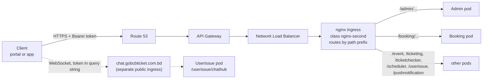

# GoBCB প্ল্যাটফর্ম — ফিচার ডকুমেন্টেশন (টেকনিক্যাল হ্যান্ডওভার)

> **English version:** অভিন্ন ইংরেজি সংস্করণ পাশের ফাইলে — `gobcb-feature-documentation-en.md`।
> **Hosting architecture:** `docs/architecture/gobcb-aws-architecture.md` (পুরো ডকুমেন্টে "architecture doc" নামে উল্লেখিত)।

**পড়ার বিধি:** এই ডকুমেন্ট বাংলায় লেখা, তবে টেকনিক্যাল টার্ম — service নাম, endpoint path, AWS service নাম, code identifier, config key — সব **ইংরেজিতে** রাখা হয়েছে, যাতরা কোডের সাথে সরাসরি মেলানো যায়। ইংরেজি সংস্করণের সাথে section-কাঠামো ১:1 identical।

## 0. Orientation (সূচনা)

### 0.1 উদ্দেশ্য, পাঠক ও পড়ার নিয়ম

**উদ্দেশ্য।** GoBCB (rvl-etp) ইভেন্ট ও টিকিটিং প্ল্যাটফর্মের প্রতিটি business feature-এর জন্য এই ডকুমেন্ট দেখায় — কোন screen থেকে শুরু হয়, কোন endpoint ও service হ্যান্ডেল করে, কোন queue ও worker পরে কাজটি এগিয়ে নেয়, কোন table, Redis key ও file ছোঁয়, কোন external system কল হয়, আর কোড কোথায়।

**পাঠক।** RVL-এর নতুন tech lead: অভিজ্ঞ .NET developer, যিনি আগে কখনো **microservices-ভিত্তিক সিস্টেমে কাজ করেননি**। Microservice ধারণাগুলো একবার, এই Part 0-তে, 📦 **explainer box**-এ ব্যাখ্যা করা হয়েছে; প্রতিটি feature সেগুলোর রেফারেন্স দেয়, পুনরাবৃত্তি করে না।

**উৎস।** BS23-এর delivery পক্ষ থেকে handover-এর জন্য লেখা, শুধু দুটি উৎস থেকে:

1. পাঁচটি repository-র source code (read-only), নিচের commit-গুলোতে;
2. AWS-এ প্ল্যাটফর্ম কীভাবে host করা তার বিবরণ — `docs/architecture/gobcb-aws-architecture.md`।

এখানে কিছু বানানো হয়নি। কোথাও কোড থেকে উত্তর মেলেনি, সেখানে তা স্পষ্টভাবে বলা হয়েছে এবং `[UNCONFIRMED]` মার্কার দেওয়া হয়েছে — ডকুমেন্টের শেষে **Open queries** section-এ সেগুলো একত্রিত, প্রতিটি প্রশ্ন এমনভাবে লেখা যেন BS23-কে as-is পাঠানো যায়।

### Evidence baseline

| Repository (submodule) | Commit |
|---|---|
| `rvl-gobcb-backend` | `430ec16d7554254ff4f6adfa21f9c0c10d3234b2` |
| `rvl-gobcb-admin-portal` | `f62d2756bd9bbd4bfaa92585ae3f999d9f4c213f` |
| `rvl-gobcb-user-portal` | `36aaf58c0dae070da9f958da09451d33e6e47c73` |
| `rvl-gobcb-user-app` | `365b8bee71454d94747b75bef7cb07e8b47b6f8a` |
| `rvl-gobcb-checker-app` | `e919c54dad40a33aecc9922a68637a4a887513e6` |

Code reference-এর line number (`File.cs:123`) এই commit-গুলোর জন্য বৈধ। Submodule এগিয়ে গেলে আপনার নির্ভরশীল feature-গুলোর reference আবার যাচাই করুন।

### Feature template

Feature-গুলো সাজানো **কী শুরু করে তার ভিত্তিতে**: admin portal-এ staff (F1.x), web portal-এ customer (F2.x) বা app-এ (F3.x), checker app-এ gate staff (F4.x), timer/queue-তে সিস্টেম নিজে (F5.x), আর অনেক feature-এর সাথে সম্পর্কিত বিষয় (F6.x — authentication/authorization সহ)। প্রতিটি feature একই নয়টি section মেনে চলে:

| # | Section | কী জানায় |
|---|---|---|
| 1 | Name and purpose | feature-টি কী কাজে, business ভাষায় (ইংরেজি ও বাংলা নাম) |
| 2 | Trigger and actor | কে শুরু করে, কোন client-screen থেকে, কোন Cognito pool, role, program scope দিয়ে |
| 3 | Business flow | business user যে ধাপগুলো দেখে |
| 4 | Technical flow | একই ধাপগুলো component-গুলোর মধ্যে hop হিসেবে; প্রতিটি hop tagged (নিচে) |
| 5 | Components | client, service, queue, worker, table, Redis key, bucket, external system |
| 6 | API contracts | feature-টি যে endpoint গুলো ব্যবহার করে (method, full path, auth, DTO, মূল error); মূল endpoint-এর জন্য পূর্ণ JSON sample |
| 7 | Data and side effects | কী লেখা হয়: row, queue message, file, email, push, cache entry |
| 8 | Code references | কোথা থেকে পড়া শুরু করবেন: controller, manager, worker, client file |
| 9 | Handover notes | সহজেই চোখ এড়ানো আচরণ, কোডে পাওয়া risk, `[UNCONFIRMED]` item |

**Section 4-এ ব্যবহৃত hop tag:**

| Tag | অর্থ |
|---|---|
| **[HTTP + user token]** | sync HTTP call যা caller-এর Cognito access token বহন করে (client থেকে, বা কোনো service forward করে) |
| **[HTTP, no token]** | token ছাড়া sync HTTP call — সাধারণত background worker থেকে `[Authorize]`-নেই এমন endpoint-এ |
| **[HTTP, static key]** | configuration-এর key দিয়ে external/internal system-এ sync HTTP call |
| **[SQS: Key]** | `AWS:Queue:Key` হিসেবে configured queue-তে message রাখা বা পড়া |
| **[Worker: interval, lock]** | কোনো service-এর background worker, তার hard-coded interval ও Redis lock-সহ |
| **[SignalR]** | SignalR hub দিয়ে WebSocket message |
| **[Shared table]** | এক service অন্য service-এর লেখা table পড়ে (একই database, §0.8 দ্রষ্টব্য) |

**Path** লেখা হয়েছে client যেভাবে ডাকে সেভাবে পূর্ণরূপে, যেমন `/booking/api/v1/user-booking-order`; প্রথম segment-টি service prefix (§0.6)।

### 0.2 এক অনুচ্ছেদে প্ল্যাটফর্ম

GoBCB বাংলাদেশ ক্রিকেট বোর্ডের ইভেন্টের টিকিট বিক্রি ও যাচাই করে। Staff-রা **admin portal**-এ সাজান **program** (সিরিজ/টুর্নামেন্ট), **venue** (স্টেডিয়াম → gallery → block → level), **event** (ম্যাচ) — দাম ও capacity-সহ, সাথে promotion ও ticket layout। Customer-রা **user web portal** বা **user app**-এ ব্রাউজ ও কেনেন, **DgePay** দিয়ে পরিশোধ করেন, আর QR-সহ ডিজিটালি signed PDF টিকিট পান। Gate-এর staff **checker app** দিয়ে offline QR স্ক্যান করেন। Backend হলো একই repository-র একগুচ্ছ ASP.NET Core 8 web API ("service") — Amazon EKS-এ API Gateway-এর পেছনে চলে (architecture doc §0–§4)।

### 0.3 Repository

এই workspace (`rvl-etp-workspace`) পাঁচটি git submodule পরিচালনা করে:

| Repo | কী |
|---|---|
| `rvl-gobcb-backend` | .NET 8 backend: ১১টি service project (৯টি active + ২টি stub) + shared `Core/` library |
| `rvl-gobcb-admin-portal` | Angular admin portal (staff) |
| `rvl-gobcb-user-portal` | Angular user web portal (app `ETP-Web/` subfolder-এ) |
| `rvl-gobcb-user-app` | End user-দের Flutter app (clean architecture: `presentation/`, `domain/`, `data/` package) |
| `rvl-gobcb-checker-app` | Gate checker-দের Flutter app |

### 0.4 Backend service

সব service `rvl-gobcb-backend/Services/<Name>/`-এ, প্রতিটি ভাগ করা `ETP.<Name>.Service` (controller, `Program.cs`, worker), `.Domain` (manager = business logic), `.Storage` (EF Core `DbContext`, repository) এবং কিছু ক্ষেত্রে `.Client` (অন্য service-এর ব্যবহারের typed HTTP client) ও `.Integration`। Shared code `rvl-gobcb-backend/Core/`-এ (`ETP.Core`, `ETP.Core.Web`, `ETP.Core.EntityFramework`, `ETP.Core.BlobStorage`, `ETP.Core.Storage`, `ETP.Core.Email`, `ETP.Core.SMS`, `ETP.Core.EventBus`)।

| Service | Path prefix | Local port | কী করে (controller ও worker থেকে) | DB connection key | Background worker |
|---|---|---|---|---|---|
| Admin | `/admin` | 5101 | Master data ও back office: program, venue, event, settings, promo code, discount, ticket layout, staff user (Cognito), gate assignment, raffle, notice, site content, activity log, dashboard | `ConnectionStrings:Admin` | `CheckedTicketService`, `PromoCodeStatusUpdateService`, `SystemDiscountStatusUpdateService`, `GateCheckerDownloadStatusCleanupService` |
| Booking | `/booking` | 5102 | Capacity ও seat, booking order, payment (DgePay), promo code apply, seat reservation, capacity adjustment, sales report, VAT challan | `ConnectionStrings:Booking` | `BookingStatusUpdateService`, `InitiateUserTicketGenerationService`, `LevelCapacityUpdateService`, `RefreshLockedCapacityService`, `EventLiveCapacityUpdateService`, `VatChallanProcessingService` |
| Event | `/event` | 5103 | Portal/app-এর জন্য program, event, venue detail, landing image, header/footer ও ticket pricing-এর public, read-only view | `ConnectionStrings:Event` | নেই |
| Ticketing | `/ticketing` | 5108 | টিকিট: generation, signing (TSP), PDF, download, share, invoice, reserved ticket, OneID sync, offline-sold ticket | `ConnectionStrings:Booking` (লক্ষ্য করুন — §0.8) | `TicketGenerationService` |
| TicketChecker | `/ticketchecker` | 5107 | Checker app-এর sync endpoint (scan যায়, scan আসে) | `ConnectionStrings:TicketChecker` | নেই |
| UserIssue | `/userissue` | 5110 | Customer issue ও support chat; SignalR hub `/userissue/chathub` host করে | `ConnectionStrings:UserIssue` | নেই |
| PushNotification | `/pushnotification` | 5105 | Device token ও push send API (queue-তে লেখে) | `ConnectionStrings:PushNotification` | নেই |
| Scheduler | `/scheduler` | 5106 | শুধু worker: Firebase-এ push delivery, payment revalidation, ticket-generated notice, capacity reconcile, device-token cleanup | নেই | `FirebaseNotificationService`, `PendingOrFailedBookingStatusUpdateService`, `SendNotificationAfterGeneratedTicketService`, `CapacityUpdateService`, `DeviceTokenCleanupService` |
| Utility | `/utility` | 5111 | শুধু worker: reserved ticket merge/zip | নেই | `TicketProcessingService` |
| Platform | `/platform` | 5104 | **Stub** — শুধু Visual Studio template-এর `WeatherForecastController`; production-এ ব্যবহৃত নয় | নেই | নেই |
| UserAuth | `/userauth` | 5109 | **Stub** — আসল controller নেই; client-রা `AUTH_API_BASE_URL` / `services.identity`-এ যে identity API ডাকে সেটি এই project নয় (Open queries দ্রষ্টব্য) | নেই | নেই |

উৎস: `Services/*/ETP.*.Service/Program.cs` ও `Configuration(s)/DependencyConfig.cs`, `Services/*/ETP.*.Service/appsettings.json` (`Application:ServiceName` = path prefix; UserIssue-এর `appsettings.json` commit করা নেই — তার prefix `userissue` hub mapping ও client থেকে এসেছে)। Local port `aspire/README.md` থেকে। `Application:ServiceName` মান TicketChecker-এ `ticketChecker` (camelCase), PushNotification-এ `PushNotification` (capital) — ASP.NET Core routing case-insensitive, client-রা ছোট হাতের রূপ ব্যবহার করে। Local dev-এ একই service .NET Aspire (`aspire/Etp.AppHost`) বা Docker-এ চলে।

> 📦 **Explainer: এই codebase-এ microservices (৩০ সেকেন্ডে)**
> Monolith মানে এক process, এক database। এখানে উপরের টেবিলের প্রতিটি row আলাদা **deployable ASP.NET Core app** — নিজস্ব controller, নিজস্ব EF Core `DbContext` ও নিজস্ব background worker-সহ, সব Amazon EKS-এ pod হিসেবে deploy। এরা শুধু HTTP ও SQS message-এ যোগাযোগ করে (§0.8) — runtime-এ compile-করা `Core/` library ছাড়া কোনো in-process shared code নেই। কোডের ভেতরে কিছু "route" হয় না: URL-এর প্রথম path segment ঠিক করে কোন service উত্তর দেবে (পরের box)।

### 0.5 Client

| Client | Repository | Tech | লগইন হয় | কাদের ডাকে |
|---|---|---|---|---|
| Admin portal | `rvl-gobcb-admin-portal` | Angular 18 | Admin pool (Serverless API-র SMS OTP-র পরে — F6.1) | Admin, Booking, Ticketing, UserIssue; OTP-র জন্য Serverless API |
| User web portal | `rvl-gobcb-user-portal/ETP-Web` | Angular 19 | User pool, বা Cognito-র মাধ্যমে OneID (F6.8) | Event, Booking, Ticketing, Admin (public endpoint), UserIssue; identity API |
| User app | `rvl-gobcb-user-app` | Flutter | User pool, বা Cognito-র মাধ্যমে OneID (F6.8) | Event, Booking, Ticketing, UserIssue, PushNotification, Admin; identity API |
| Checker app | `rvl-gobcb-checker-app` | Flutter | TicketChecker pool | Admin (`ticket-checker-gate/event-info`), TicketChecker (`tickets/sync-tickets`); app version-এর জন্য identity API |

**Identity API** (`services.identity` portal-এ, app-এ `AUTH_API_BASE_URL`) customer registration, OTP, profile ও app version সামলায়। এর source **পাঁচটি repository-র কোনোটিতেই নেই** `[UNCONFIRMED]` — Open queries দ্রষ্টব্য।

### 0.6 একটি request service পর্যন্ত কীভাবে পৌঁছায়



ছবির hosting অংশ (API Gateway, NLB, ingress) architecture doc §1 ও §4.1 থেকে। API Gateway নিজেও কি token validate করে তা reported-but-unverified (architecture Q1/Q1b)। Service-গুলো সবসময় নিজেরাই token validate করে (F6.14)।

> 📦 **Explainer: path-prefix routing**
> Monolith-এ সব controller এক host-এর নিচে। এখানে প্রতিটি service আলাদা process, কিন্তু client এখনো **একটাই API host** ব্যবহার করে। URL-এর প্রথম path segment ঠিক করে কোন service request পাবে: `/booking/api/v1/user-booking-order` যাবে Booking-কে, `/event/api/v1/events/list` Event-কে।
>
> দুটি জিনিস এটি সম্ভব করে:
> 1. **কোডে**, `Core/ETP.Core/Conventions/GlobalRoutePrefixConvention.cs` প্রতিটি controller route-এর আগে `Application:ServiceName` বসায় (প্রতিটি `Program.cs`-এ registered)। তাই Booking controller-এর `[Route("api/v1/user-booking-order")]` আসলে `/booking/api/v1/user-booking-order`-এ serve হয় — service-কে তার নিজের port-এ সরাসরি ডাকলেও।
> 2. **Cluster-এ**, প্রতি service-এর একটি nginx ingress `/<prefix>/...` অপরিবর্তিত রেখে সেই service-এ forward করে (architecture doc §4.1)।
>
> আপনার জন্য ফল: service-কে locally ডাকলে (`http://localhost:5102`) prefix দিতেই হবে: `http://localhost:5102/booking/api/v1/...`। Swagger পাবেন `/<prefix>/swagger`-এ (যেমন `/booking/swagger`)।

### 0.7 Request ও response-এর নিয়ম

| বিষয় | কোড যা করে | উৎস |
|---|---|---|
| JSON property নাম | সব service-এ camelCase। Booking, Event, Ticketing, TicketChecker, Scheduler, Utility, PushNotification, Platform, UserAuth `PropertyNamingPolicy = CamelCase` স্পষ্টভাবে সেট করে; Admin ও UserIssue ASP.NET Core default ব্যবহার করে — যেটাও camelCase | `Services/*/ETP.*.Service/Program.cs` (`AddJsonOptions`) |
| Enum | `AddJsonOptions` ব্যবহারকারী service-গুলোতে string (`JsonStringEnumConverter`); Admin ও UserIssue-তে (converter register করে না) **সংখ্যা** | একই |
| Null | `AddJsonOptions` ব্যবহারকারী service-গুলোতে response থেকে বাদ (`WhenWritingNull`); Admin ও UserIssue-তে থাকে | একই |
| Error | `ErrorResponseExceptionFilter` exception-কে `ProblemDetails`-স্টাইল body-তে রূপ দেয় (নিচে) | `Core/ETP.Core.Web/Filters/ErrorResponseExceptionFilter.cs` |
| Pagination | Paged endpoint `PagedList` object ফেরায়: `{ "items": [ … ], "totalCount": 123 }`। (array body + `X-Total-Count` header-এর helper `PagedOkResult` Core-এ আছে, কিন্তু **কোনো controller তা ব্যবহার করে না**) | `Core/ETP.Core/Collections/PagedList.cs`, `Core/ETP.Core.Web/Results/PagedOkResult.cs` (dead code) |
| Id | বেশিরভাগ table-এ `long Id`। অনেকে সাথে public string/Guid id রাখে (যেমন `Event.EventId`, order-এর `PublicId`), endpoint একটিকে বা অন্যটিকে নেয় — এ কারণেই `events/{eventId}` আর `events/EventLongId/{id}`-এর মতো জোড়া আছে | `Services/Admin/ETP.Admin.Storage/Models/Event.cs` |
| সময় | Server-side comparison-এ `DateTime.UtcNow` | যেমন `UserBookingOrderManager.cs` |

**Error response।** Controller throw করে; filter exception-এর ধরন অনুযায়ী status code ও body দেয়:

| Exception | Status | Body |
|---|---|---|
| `ArgumentException` (subclass-সহ) | 400 | `{ "status": 400, "title": "<exception message>" }` |
| `ApiException` | 400 | exception-এর নিজের `Details` (`ProblemDetails`) |
| `UnauthorizedAccessException` | 403 | `{ "status": 403, "title": "Unauthorized access", "detail": "<message>" }` |
| অন্য যেকোনো | 500 | `{ "status": 500, "title": "An unexpected error occurred." }` (Development-এ আসল message) |

Development environment-এ `stackTrace` field যোগ হয়। Authentication failure (token নেই/invalid) filter পর্যন্ত পৌঁছায় না: JWT handler **401** দেয় খালি body-তে; ভুল pool বা role-এর বৈধ token পেলে **403** (F6.14)। দুটি quirk জেনে রাখুন: `ApiException` ভেতরে ভিন্ন status থাকলেও সবসময় **400**-এ যায়, আর কিছু Admin manager validation-এ ব্যবহৃত `BadHttpRequestException` (যেমন "Name must not exceed 60 characters.") default branch-এ পড়ে **500** হয়ে যায়। সাধারণ business ব্যর্থতা (`seat_limit_exceeded`, `no_seats_available`, `Invalid promo code…`) `ArgumentException` হিসেবে throw হয় → **400**।

```json
{
  "status": 400,
  "title": "Invalid promo code. Please enter a valid code."
}
```

### 0.8 মূল ধারণা (explainer)

> 📦 **Explainer: token forwarding (এক service কীভাবে user-এর জন্য আরেক service কল করে)**
> Customer-এর request Booking-এ পৌঁছেছে, আর Booking-এর Event-এর data দরকার — Booking তখন Event-কে HTTP কল দেয়। এই codebase-এ সেই কল **customer-এর নিজের Cognito access token** বহন করে, কোনো service identity নয়।
> - প্রতিটি service typed `HttpClient` register করে (যেমন `services.AddHttpClient<IEventClient, EventClient>`, base URL `Services:<Name>` থেকে — প্রতিটি `Configurations/DependencyConfig.cs`-এ)।
> - Client pipeline-এ `DelegatedBearerAuthenticationHandler` থাকে (`Core/ETP.Core.Web/Security/DelegatedBearerAuthenticationHandler.cs`)। সে JWT handler বর্তমান user-এর claim-এ রাখা access token (`OnTokenValidated`, `Core/ETP.Core/Configuration/DefaultAuthenticationConfig.cs`) পড়ে outgoing request-এ `Authorization: Bearer` হিসেবে বসায়।
> - Downstream service সেই token **নিজের policy দিয়ে আবার** validate করে। Customer থাকা অবস্থায় Booking যদি Admin-pool-দাবি করা endpoint কল করে, downstream call 401/403-এ ব্যর্থ হবে।
> - Retry: বেশিরভাগ client ৩ বার exponential backoff-সহ retry করে (Polly)।
> - **User নেই মানে token নেই।** Background worker-এ HTTP request থাকে না, তাই handler কিছু পায় না এবং কিছু পাঠায় না। এ কারণেই worker-দের ডাকা endpoint-গুলোতে `[Authorize]` নেই (F6.18)।
>
> Hop tag: **[HTTP + user token]** ও **[HTTP, no token]**। বিস্তারিত: F6.19।

> 📦 **Explainer: queue-driven processing (SQS)**
> কিছু কাজ user-এর request-এর ভেতরে করার মতো দ্রুত বা নিরাপদ নয়: TSP দিয়ে টিকিট sign, শত শত PDF merge, NBR-এ VAT record, push message, capacity recompute। Request **একটি message publish করে** Amazon SQS queue-তে আর ফিরে আসে; কোনো এক service-এর **worker** পরে queue পড়ে কাজটি করে।
> - Publishing: `Core/ETP.Core/Queue/Services/SqsPublisher.cs` queue-এর **নাম** থেকে (configured `AWS:Queue:<Key>`; মান SSM/user-secrets-এ) URL বের করে, message JSON serialize করে পাঠায়। Queue-এর নাম `fifo`-তে শেষ হলে `MessageGroupId` ও `MessageDeduplicationId`-ও সেট করে।
> - Consuming: একটি `BackgroundService` loop করে, `ReceiveMessageAsync` ডাকে, প্রসেস করে, আর **সফল হলেই message delete করে**। ব্যর্থ message আবার visible হয় এবং retry হয় (কোডের মন্তব্যে dead-letter queue-এর কথা; তার configuration repo-তে নেই `[UNCONFIRMED]`)।
> - Message-এ শুধু business id থাকে। ভেতরে user token নেই, sender যাচাই নেই: queue-তে SendMessage-এর IAM permission থাকা যে কেউ কাজ enqueue করতে পারে (architecture doc §2.3 C)।
> - MassTransit (`Core/ETP.Core.EventBus`) কয়েকটি service-এ registered, কিন্তু কোনো consumer/publisher তা ব্যবহার করে না (dead code)।
>
> Queue ক্যাটালগ (config key → message → producer → consumer):
>
> | `AWS:Queue:` key | Message DTO | Published by | Consumed by | কাজ |
> |---|---|---|---|---|
> | `OrderSuccess` | `LevelCapacityUpdate` | Booking (`UserBookingOrderManager`, `CapacityManager`) | Booking `LevelCapacityUpdateService` | booked/released seat কে level capacity-তে প্রয়োগ (F5.1) |
> | `EventCapacity` | `EventLiveCapacityUpdate` | Booking (`CapacityManager`) | Booking `EventLiveCapacityUpdateService` | event live capacity recompute (F5.2) |
> | `TicketSigning` | `SignedTicketGeneration` | Ticketing (`TicketManager`) | Ticketing `TicketGenerationService` | TSP দিয়ে টিকিট PDF sign (F5.8) |
> | `TicketProcessing` | `TicketProcessingRequest` (Merge/Zip) | Ticketing (`TicketManager`) | Utility `TicketProcessingService` | reserved টিকিট merge/zip (F5.9) |
> | `VatChallanProcessing` | `VatChallanProcessing` | Booking (`UserBookingOrderManager`) | Booking `VatChallanProcessingService` | NBR-এ VAT record (F5.10) |
> | `FirebaseNotification` | `FirebaseNotificationRequest` | PushNotification (`NotificationManager`) | Scheduler `FirebaseNotificationService` | FCM দিয়ে push delivery (F5.11) |
>
> Event service `AWS:Queue:FirebaseNotification` register করে কিন্তু কখনো publish/consume করে না (dead config)। Physical queue নাম secret মান, তাই কোনো queue FIFO কিনা repo থেকে বোঝা যায় না `[UNCONFIRMED]`।

> 📦 **Explainer: background worker (service-এর ভেতরের timer)**
> HTTP request-এর পাশাপাশি কয়েকটি service **hosted service** (`BackgroundService`) timer-এ চালায় — `services.AddHostedService<...>()` দিয়ে registered। প্যাটার্ন সবখানে একই (উদাহরণ: `Services/Admin/ETP.Admin.Service/Workers/BackgroundServices/CheckedTicketService.cs`):
> 1. start-up-এর প্রায় এক মিনিট পর;
> 2. চিরকাল loop: Redis lock নেওয়ার চেষ্টা, পেলে একটি DI scope খুলে **TaskManager** (`Workers/TaskManagers/*`) চালায় — আসল logic সেখানে;
> 3. **hard-coded** interval-এ ঘুমায় (৩০ সেকেন্ড থেকে ১ দিন), error-এর পরে বেশি।
>
> Interval-গুলো কোডের ধ্রুবক, configuration নয়। Service-এর প্রতিটি replica (pod) একই worker চালায় — এ কারণেই lock দরকার (পরের box)। Hop tag: **[Worker: interval, lock]**। প্রতিটি worker-এর বিবরণ Part 5-এ।

> 📦 **Explainer: distributed lock (RedLock)**
> Production-এ প্রতিটি service একাধিক pod-এ চলতে পারে। Coordinat‌ion ছাড়া প্রতিটি pod-এর worker একই order একসাথে প্রসেস করত। কোড Redis-এ **RedLock** (`RedLockNet`) ব্যবহার করে: job চালানোর আগে worker নাম-দেওয়া lock চায় (যেমন `checked_ticket`, ২০ মিনিট expiry)। যে pod পায় শুধু সে কাজ করে; বাকিরা cycle skip করে আর log করে `Could NOT acquire lock ... Skipping this cycle` (স্বাভাবিক বার্তা, locally-ও দেখা যায়)।
>
> একই mechanism business operation-ও রক্ষা করে যেগুলো একসাথে চলা চলবে না — যেমন প্রতি customer একবারে একটি booking (`user_booking:{userId}`, `UserBookingOrderManager.cs`) এবং level-প্রতি capacity change।
>
> Setup: `Core/ETP.Core/Configuration/DistributedLockConfig.cs` (key `DistributedLock:Redis:*`)। Lock-এর নাম ও expiry তালিকা F6.25-এ।

> 📦 **Explainer: একটাই database, শেয়ার্ড table ও read model**
> পাঠ্যবইয়ের microservice-এর নিজস্ব ব্যক্তিগত database থাকে। এই codebase সেভাবে চলে না:
> - প্রতিটি `DbContext` **একই schema `etp`** ব্যবহার করে (প্রতিটি `*DbContext.cs`-এ `DefaultSchema = "etp"`), আর প্রতিটি service-এর নিজের connection-string key (`ConnectionStrings:Admin`, `:Booking`, …)। Ticketing তো `ConnectionStrings:Booking`-ই ব্যবহার করে। Locally সব key এক database-এর দিকে যায় (`scripts/user-secrets.example.json`)।
> - যে service-এর migration কোনো table বানায়, table-টির **মালিক** সে। অন্য service-গুলো একই table নিজেদের `DbContext`-এ `ExcludeFromMigrations` দিয়ে map করে সরাসরি পড়ে (কখনো লেখে)। উদাহরণ: Booking অন্যের `PromoCodes`, `Discounts`, `EventVenueDetails`, `Events` mirror করে (`Services/Booking/ETP.Booking.Storage/DbContexts/BookingDbContext.cs`)।
> - **Event** service প্রায় কিছুরই মালিক নয়: সে Admin ও Booking-এর table-গুলোর উপর public, read-only view (`Services/Event/ETP.Event.Storage/DbContexts/EventDbContext.cs`)।
>
> আপনার জন্য অর্থ: Admin-এ কোনো column বদলালে compile আলাদা হলেও runtime-এ Booking, Ticketing বা Event ভেঙে যেতে পারে। কোনো table বদলানোর আগে সব `*DbContext.cs`-এ তার নাম খুঁজুন। Handover brief-এ বলা হয়েছিল "one schema per service"; কোড বলছে সবার জন্য একটাই schema। Production-এর প্রকৃত বিন্যাস অজানা `[UNCONFIRMED]` — Open queries দ্রষ্টব্য।
>
> Hop tag: **[Shared table]**।

> 📦 **Explainer: live seat counter হিসেবে Redis**
> বিক্রি চলাকালে seat availability প্রতি সেকেন্ডে বদলায়, তাই Booking **live counter রাখে Redis-এ** (key family যেমন `level_live`, `level_locked`, `event_live`, `level_live_seats`; constant `Core/ETP.Core/Constant/AppConstant.cs`) আর database-কে ধীর, durable কপি হিসেবে ব্যবহার করে। Order প্রথমে Redis-এ capacity lock করে; queue worker (F5.1, F5.2) ও timer (F5.3) database ও Redis-কে মিলিয়ে রাখে। Checker app-এর gate-scan counter-ও একই ভাবে চলে (F4.5, F5.14)।
>
> ফল: বিক্রির মধ্যে Redis flush হলে live সংখ্যা পরের worker cycle-এ database থেকে আবার তৈরি হয়। বিস্তারিত: F6.25।

### 0.9 External system

| System | কী কাজে | কোথা থেকে ডাকে | Feature |
|---|---|---|---|
| DgePay | Online card/payment-gateway checkout | Booking | F2.6, F3.5, F5.5 |
| SSLCommerz | দ্বিতীয় payment gateway (কোড আছে) | Booking | live কিনা `[UNCONFIRMED]` — Open queries |
| NBR OpenAPI | VAT challan (VAT record, challan download) | Booking worker | F5.10 |
| OneID Wallet | SSO login (Cognito-তে federated) ও wallet-এ টিকিট sync | Cognito; Ticketing | F6.8, F2.10 |
| TSP gateway (mTLS) | টিকিট PDF-এর ডিজিটাল signing | Ticketing worker | F5.8 |
| Firebase (FCM) | Push notification | Scheduler worker | F5.11 |
| SES | Email (টিকিট zip) | Ticketing | F6.21 |
| "Serverless" API | Cognito user lookup, admin login 2FA OTP | কয়েকটি service + admin portal | F6.1, F6.22 — source repo-তে নেই `[UNCONFIRMED]` |
| "Notification" API | SMS পাঠানো (ticket-generated notice) | Scheduler | F5.12, F6.22 — source repo-তে নেই `[UNCONFIRMED]` |
| identity API | Registration, OTP, profile, app version | portal + app | F6.6 প্রভৃতি — source repo-তে নেই `[UNCONFIRMED]` |

### 0.10 Feature index (সূচি)

- **Part 1 — Admin Portal:** F1.1 program selection · F1.2 program · F1.3 program settings · F1.4 team · F1.5 venue ও stadium layout · F1.6 program–venue mapping · F1.7 event · F1.8 event settings override · F1.9 event venue details ও level-প্রতি pricing · F1.10 event capacity adjustment · F1.11 seat reservation · F1.12 reserved ticket generation ও distribution · F1.13 ticket layout ও attribute · F1.14 ticket-pricing content page · F1.15 promo code · F1.16 system discount · F1.17 ticket-checker account · F1.18 gate assignment ও download control · F1.19 gate report · F1.20 raffle draw · F1.21 dashboard · F1.22 booking/sales/revenue report · F1.23 reconciliation search · F1.24 user issue ও support chat (admin) · F1.25 admin user · F1.26 agent user · F1.27 activity log viewer · F1.28 media configuration · F1.29 content editor · F1.30 header/footer ও social media · F1.31 general notice
- **Part 2 — User Web Portal:** F2.1 home content · F2.2 event browse · F2.3 information page · F2.4 seat selection · F2.5 promo code apply · F2.6 booking order ও online payment (DgePay) · F2.7 আমার booking ও generation status · F2.8 ticket generation request · F2.9 ticket details, holder তথ্য, download, share, invoice · F2.10 OneID-তে টিকিট sync · F2.11 profile · F2.12 issue জানানো ও chat · F2.13 ভাষা পরিবর্তন
- **Part 3 — User App:** F3.1 splash, version gate ও onboarding · F3.2 home ও event browse · F3.3 information page · F3.4 seat selection ও promo code · F3.5 booking ও WebView payment · F3.6 আমার booking ও টিকিট · F3.7 profile ও settings · F3.8 issue জানানো ও support chat · F3.9 push device-token registration · F3.10 push গ্রহণ
- **Part 4 — Checker App:** F4.1 assigned event ও gate · F4.2 offline যাচাইয়ের টিকিট download · F4.3 QR scan validation · F4.4 manual entry · F4.5 scan sync · F4.6 শুধু signature যাচাই
- **Part 5 — System-initiated:** F5.1 level capacity update · F5.2 event live capacity · F5.3 locked-capacity refresh · F5.4 scheduler capacity reconcile · F5.5 pending/failed payment পুনঃযাচাই · F5.6 booking status → Generated · F5.7 user ticket generation শুরু · F5.8 TSP-তে টিকিট signing · F5.9 reserved টিকিট merge/zip · F5.10 NBR-এ VAT challan · F5.11 FCM-এ push delivery · F5.12 ticket-generated notification · F5.13 device-token cleanup · F5.14 checked-ticket sync · F5.15 gate download-status cleanup · F5.16 promo-code status update · F5.17 system-discount status update
- **Part 6 — Cross-cutting:** F6.1 admin login · F6.2 admin forgot password · F6.3 admin change password ও logout · F6.4 admin session · F6.5 staff account provisioning · F6.6 গ্রাহক registration · F6.7 গ্রাহক login (phone + password) · F6.8 OneID SSO · F6.9 গ্রাহক forgot/reset password · F6.10 গ্রাহক session · F6.11 account delete ও app force-update · F6.12 checker login · F6.13 Agent pool ও offline-sold ticket · F6.14 authorization স্তর ১ (pool policy) · F6.15 স্তর ২–৩ (role) · F6.16 স্তর ৪ (program scope) · F6.17 client-side authorization · F6.18 authorization-নেই এমন endpoint · F6.19 service-to-service communication · F6.20 file storage (S3, CloudFront) · F6.21 email (SES) · F6.22 SMS ও external notification service · F6.23 push notification · F6.24 activity logging · F6.25 Redis · F6.26 configuration ও secret
- **Part 7 — Open queries:** OQ1–OQ22

---

<!-- 🔄 CONTINUE-BN -->

