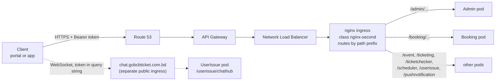

# GoBCB প্ল্যাটফর্ম — ফিচার ডকুমেন্টেশন (টেকনিক্যাল হ্যান্ডওভার)

> **English version:** অভিন্ন ইংরেজি সংস্করণ পাশের ফাইলে — `gobcb-feature-documentation-en.md`।
> **Hosting architecture:** `docs/architecture/gobcb-aws-architecture.md` (পুরো ডকুমেন্টে "architecture doc" নামে উল্লেখিত)।

**পড়ার বিধি:** এই ডকুমেন্ট বাংলায় লেখা, তবে টেকনিক্যাল টার্ম — service নাম, endpoint path, AWS service নাম, code identifier, config key — সব **ইংরেজিতে** রাখা হয়েছে, যাতরা কোডের সাথে সরাসরি মেলানো যায়। ইংরেজি সংস্করণের সাথে section-কাঠামো ১:1 identical।

## 0. Orientation (সূচনা)

### 0.1 উদ্দেশ্য, পাঠক ও পড়ার নিয়ম

**উদ্দেশ্য।** GoBCB (rvl-etp) ইভেন্ট ও টিকিটিং প্ল্যাটফর্মের প্রতিটি business feature-এর জন্য এই ডকুমেন্ট দেখায় — কোন screen থেকে শুরু হয়, কোন endpoint ও service হ্যান্ডেল করে, কোন queue ও worker পরে কাজটি এগিয়ে নেয়, কোন table, Redis key ও file ছোঁয়, কোন external system কল হয়, আর কোড কোথায়।

**পাঠক।** RVL-এর নতুন tech lead: অভিজ্ঞ .NET developer, যিনি আগে কখনো **microservices-ভিত্তিক সিস্টেমে কাজ করেননি**। Microservice ধারণাগুলো একবার, এই Part 0-তে, 📦 **explainer box**-এ ব্যাখ্যা করা হয়েছে; প্রতিটি feature সেগুলোর রেফারেন্স দেয়, পুনরাবৃত্তি করে না।

**উৎস।** BS23-এর delivery পক্ষ থেকে handover-এর জন্য লেখা, শুধু দুটি উৎস থেকে:

1. পাঁচটি repository-র source code (read-only), নিচের commit-গুলোতে;
2. AWS-এ প্ল্যাটফর্ম কীভাবে host করা তার বিবরণ — `docs/architecture/gobcb-aws-architecture.md`।

এখানে কিছু বানানো হয়নি। কোথাও কোড থেকে উত্তর মেলেনি, সেখানে তা স্পষ্টভাবে বলা হয়েছে এবং `[UNCONFIRMED]` মার্কার দেওয়া হয়েছে — ডকুমেন্টের শেষে **Open queries** section-এ সেগুলো একত্রিত, প্রতিটি প্রশ্ন এমনভাবে লেখা যেন BS23-কে as-is পাঠানো যায়।

### Evidence baseline

| Repository (submodule) | Commit |
|---|---|
| `rvl-gobcb-backend` | `430ec16d7554254ff4f6adfa21f9c0c10d3234b2` |
| `rvl-gobcb-admin-portal` | `f62d2756bd9bbd4bfaa92585ae3f999d9f4c213f` |
| `rvl-gobcb-user-portal` | `36aaf58c0dae070da9f958da09451d33e6e47c73` |
| `rvl-gobcb-user-app` | `365b8bee71454d94747b75bef7cb07e8b47b6f8a` |
| `rvl-gobcb-checker-app` | `e919c54dad40a33aecc9922a68637a4a887513e6` |

Code reference-এর line number (`File.cs:123`) এই commit-গুলোর জন্য বৈধ। Submodule এগিয়ে গেলে আপনার নির্ভরশীল feature-গুলোর reference আবার যাচাই করুন।

### Feature template

Feature-গুলো সাজানো **কী শুরু করে তার ভিত্তিতে**: admin portal-এ staff (F1.x), web portal-এ customer (F2.x) বা app-এ (F3.x), checker app-এ gate staff (F4.x), timer/queue-তে সিস্টেম নিজে (F5.x), আর অনেক feature-এর সাথে সম্পর্কিত বিষয় (F6.x — authentication/authorization সহ)। প্রতিটি feature একই নয়টি section মেনে চলে:

| # | Section | কী জানায় |
|---|---|---|
| 1 | Name and purpose | feature-টি কী কাজে, business ভাষায় (ইংরেজি ও বাংলা নাম) |
| 2 | Trigger and actor | কে শুরু করে, কোন client-screen থেকে, কোন Cognito pool, role, program scope দিয়ে |
| 3 | Business flow | business user যে ধাপগুলো দেখে |
| 4 | Technical flow | একই ধাপগুলো component-গুলোর মধ্যে hop হিসেবে; প্রতিটি hop tagged (নিচে) |
| 5 | Components | client, service, queue, worker, table, Redis key, bucket, external system |
| 6 | API contracts | feature-টি যে endpoint গুলো ব্যবহার করে (method, full path, auth, DTO, মূল error); মূল endpoint-এর জন্য পূর্ণ JSON sample |
| 7 | Data and side effects | কী লেখা হয়: row, queue message, file, email, push, cache entry |
| 8 | Code references | কোথা থেকে পড়া শুরু করবেন: controller, manager, worker, client file |
| 9 | Handover notes | সহজেই চোখ এড়ানো আচরণ, কোডে পাওয়া risk, `[UNCONFIRMED]` item |

**Section 4-এ ব্যবহৃত hop tag:**

| Tag | অর্থ |
|---|---|
| **[HTTP + user token]** | sync HTTP call যা caller-এর Cognito access token বহন করে (client থেকে, বা কোনো service forward করে) |
| **[HTTP, no token]** | token ছাড়া sync HTTP call — সাধারণত background worker থেকে `[Authorize]`-নেই এমন endpoint-এ |
| **[HTTP, static key]** | configuration-এর key দিয়ে external/internal system-এ sync HTTP call |
| **[SQS: Key]** | `AWS:Queue:Key` হিসেবে configured queue-তে message রাখা বা পড়া |
| **[Worker: interval, lock]** | কোনো service-এর background worker, তার hard-coded interval ও Redis lock-সহ |
| **[SignalR]** | SignalR hub দিয়ে WebSocket message |
| **[Shared table]** | এক service অন্য service-এর লেখা table পড়ে (একই database, §0.8 দ্রষ্টব্য) |

**Path** লেখা হয়েছে client যেভাবে ডাকে সেভাবে পূর্ণরূপে, যেমন `/booking/api/v1/user-booking-order`; প্রথম segment-টি service prefix (§0.6)।

### 0.2 এক অনুচ্ছেদে প্ল্যাটফর্ম

GoBCB বাংলাদেশ ক্রিকেট বোর্ডের ইভেন্টের টিকিট বিক্রি ও যাচাই করে। Staff-রা **admin portal**-এ সাজান **program** (সিরিজ/টুর্নামেন্ট), **venue** (স্টেডিয়াম → gallery → block → level), **event** (ম্যাচ) — দাম ও capacity-সহ, সাথে promotion ও ticket layout। Customer-রা **user web portal** বা **user app**-এ ব্রাউজ ও কেনেন, **DgePay** দিয়ে পরিশোধ করেন, আর QR-সহ ডিজিটালি signed PDF টিকিট পান। Gate-এর staff **checker app** দিয়ে offline QR স্ক্যান করেন। Backend হলো একই repository-র একগুচ্ছ ASP.NET Core 8 web API ("service") — Amazon EKS-এ API Gateway-এর পেছনে চলে (architecture doc §0–§4)।

### 0.3 Repository

এই workspace (`rvl-etp-workspace`) পাঁচটি git submodule পরিচালনা করে:

| Repo | কী |
|---|---|
| `rvl-gobcb-backend` | .NET 8 backend: ১১টি service project (৯টি active + ২টি stub) + shared `Core/` library |
| `rvl-gobcb-admin-portal` | Angular admin portal (staff) |
| `rvl-gobcb-user-portal` | Angular user web portal (app `ETP-Web/` subfolder-এ) |
| `rvl-gobcb-user-app` | End user-দের Flutter app (clean architecture: `presentation/`, `domain/`, `data/` package) |
| `rvl-gobcb-checker-app` | Gate checker-দের Flutter app |

### 0.4 Backend service

সব service `rvl-gobcb-backend/Services/<Name>/`-এ, প্রতিটি ভাগ করা `ETP.<Name>.Service` (controller, `Program.cs`, worker), `.Domain` (manager = business logic), `.Storage` (EF Core `DbContext`, repository) এবং কিছু ক্ষেত্রে `.Client` (অন্য service-এর ব্যবহারের typed HTTP client) ও `.Integration`। Shared code `rvl-gobcb-backend/Core/`-এ (`ETP.Core`, `ETP.Core.Web`, `ETP.Core.EntityFramework`, `ETP.Core.BlobStorage`, `ETP.Core.Storage`, `ETP.Core.Email`, `ETP.Core.SMS`, `ETP.Core.EventBus`)।

| Service | Path prefix | Local port | কী করে (controller ও worker থেকে) | DB connection key | Background worker |
|---|---|---|---|---|---|
| Admin | `/admin` | 5101 | Master data ও back office: program, venue, event, settings, promo code, discount, ticket layout, staff user (Cognito), gate assignment, raffle, notice, site content, activity log, dashboard | `ConnectionStrings:Admin` | `CheckedTicketService`, `PromoCodeStatusUpdateService`, `SystemDiscountStatusUpdateService`, `GateCheckerDownloadStatusCleanupService` |
| Booking | `/booking` | 5102 | Capacity ও seat, booking order, payment (DgePay), promo code apply, seat reservation, capacity adjustment, sales report, VAT challan | `ConnectionStrings:Booking` | `BookingStatusUpdateService`, `InitiateUserTicketGenerationService`, `LevelCapacityUpdateService`, `RefreshLockedCapacityService`, `EventLiveCapacityUpdateService`, `VatChallanProcessingService` |
| Event | `/event` | 5103 | Portal/app-এর জন্য program, event, venue detail, landing image, header/footer ও ticket pricing-এর public, read-only view | `ConnectionStrings:Event` | নেই |
| Ticketing | `/ticketing` | 5108 | টিকিট: generation, signing (TSP), PDF, download, share, invoice, reserved ticket, OneID sync, offline-sold ticket | `ConnectionStrings:Booking` (লক্ষ্য করুন — §0.8) | `TicketGenerationService` |
| TicketChecker | `/ticketchecker` | 5107 | Checker app-এর sync endpoint (scan যায়, scan আসে) | `ConnectionStrings:TicketChecker` | নেই |
| UserIssue | `/userissue` | 5110 | Customer issue ও support chat; SignalR hub `/userissue/chathub` host করে | `ConnectionStrings:UserIssue` | নেই |
| PushNotification | `/pushnotification` | 5105 | Device token ও push send API (queue-তে লেখে) | `ConnectionStrings:PushNotification` | নেই |
| Scheduler | `/scheduler` | 5106 | শুধু worker: Firebase-এ push delivery, payment revalidation, ticket-generated notice, capacity reconcile, device-token cleanup | নেই | `FirebaseNotificationService`, `PendingOrFailedBookingStatusUpdateService`, `SendNotificationAfterGeneratedTicketService`, `CapacityUpdateService`, `DeviceTokenCleanupService` |
| Utility | `/utility` | 5111 | শুধু worker: reserved ticket merge/zip | নেই | `TicketProcessingService` |
| Platform | `/platform` | 5104 | **Stub** — শুধু Visual Studio template-এর `WeatherForecastController`; production-এ ব্যবহৃত নয় | নেই | নেই |
| UserAuth | `/userauth` | 5109 | **Stub** — আসল controller নেই; client-রা `AUTH_API_BASE_URL` / `services.identity`-এ যে identity API ডাকে সেটি এই project নয় (Open queries দ্রষ্টব্য) | নেই | নেই |

উৎস: `Services/*/ETP.*.Service/Program.cs` ও `Configuration(s)/DependencyConfig.cs`, `Services/*/ETP.*.Service/appsettings.json` (`Application:ServiceName` = path prefix; UserIssue-এর `appsettings.json` commit করা নেই — তার prefix `userissue` hub mapping ও client থেকে এসেছে)। Local port `aspire/README.md` থেকে। `Application:ServiceName` মান TicketChecker-এ `ticketChecker` (camelCase), PushNotification-এ `PushNotification` (capital) — ASP.NET Core routing case-insensitive, client-রা ছোট হাতের রূপ ব্যবহার করে। Local dev-এ একই service .NET Aspire (`aspire/Etp.AppHost`) বা Docker-এ চলে।

> 📦 **Explainer: এই codebase-এ microservices (৩০ সেকেন্ডে)**
> Monolith মানে এক process, এক database। এখানে উপরের টেবিলের প্রতিটি row আলাদা **deployable ASP.NET Core app** — নিজস্ব controller, নিজস্ব EF Core `DbContext` ও নিজস্ব background worker-সহ, সব Amazon EKS-এ pod হিসেবে deploy। এরা শুধু HTTP ও SQS message-এ যোগাযোগ করে (§0.8) — runtime-এ compile-করা `Core/` library ছাড়া কোনো in-process shared code নেই। কোডের ভেতরে কিছু "route" হয় না: URL-এর প্রথম path segment ঠিক করে কোন service উত্তর দেবে (পরের box)।

### 0.5 Client

| Client | Repository | Tech | লগইন হয় | কাদের ডাকে |
|---|---|---|---|---|
| Admin portal | `rvl-gobcb-admin-portal` | Angular 18 | Admin pool (Serverless API-র SMS OTP-র পরে — F6.1) | Admin, Booking, Ticketing, UserIssue; OTP-র জন্য Serverless API |
| User web portal | `rvl-gobcb-user-portal/ETP-Web` | Angular 19 | User pool, বা Cognito-র মাধ্যমে OneID (F6.8) | Event, Booking, Ticketing, Admin (public endpoint), UserIssue; identity API |
| User app | `rvl-gobcb-user-app` | Flutter | User pool, বা Cognito-র মাধ্যমে OneID (F6.8) | Event, Booking, Ticketing, UserIssue, PushNotification, Admin; identity API |
| Checker app | `rvl-gobcb-checker-app` | Flutter | TicketChecker pool | Admin (`ticket-checker-gate/event-info`), TicketChecker (`tickets/sync-tickets`); app version-এর জন্য identity API |

**Identity API** (`services.identity` portal-এ, app-এ `AUTH_API_BASE_URL`) customer registration, OTP, profile ও app version সামলায়। এর source **পাঁচটি repository-র কোনোটিতেই নেই** `[UNCONFIRMED]` — Open queries দ্রষ্টব্য।

### 0.6 একটি request service পর্যন্ত কীভাবে পৌঁছায়



ছবির hosting অংশ (API Gateway, NLB, ingress) architecture doc §1 ও §4.1 থেকে। API Gateway নিজেও কি token validate করে তা reported-but-unverified (architecture Q1/Q1b)। Service-গুলো সবসময় নিজেরাই token validate করে (F6.14)।

> 📦 **Explainer: path-prefix routing**
> Monolith-এ সব controller এক host-এর নিচে। এখানে প্রতিটি service আলাদা process, কিন্তু client এখনো **একটাই API host** ব্যবহার করে। URL-এর প্রথম path segment ঠিক করে কোন service request পাবে: `/booking/api/v1/user-booking-order` যাবে Booking-কে, `/event/api/v1/events/list` Event-কে।
>
> দুটি জিনিস এটি সম্ভব করে:
> 1. **কোডে**, `Core/ETP.Core/Conventions/GlobalRoutePrefixConvention.cs` প্রতিটি controller route-এর আগে `Application:ServiceName` বসায় (প্রতিটি `Program.cs`-এ registered)। তাই Booking controller-এর `[Route("api/v1/user-booking-order")]` আসলে `/booking/api/v1/user-booking-order`-এ serve হয় — service-কে তার নিজের port-এ সরাসরি ডাকলেও।
> 2. **Cluster-এ**, প্রতি service-এর একটি nginx ingress `/<prefix>/...` অপরিবর্তিত রেখে সেই service-এ forward করে (architecture doc §4.1)।
>
> আপনার জন্য ফল: service-কে locally ডাকলে (`http://localhost:5102`) prefix দিতেই হবে: `http://localhost:5102/booking/api/v1/...`। Swagger পাবেন `/<prefix>/swagger`-এ (যেমন `/booking/swagger`)।

### 0.7 Request ও response-এর নিয়ম

| বিষয় | কোড যা করে | উৎস |
|---|---|---|
| JSON property নাম | সব service-এ camelCase। Booking, Event, Ticketing, TicketChecker, Scheduler, Utility, PushNotification, Platform, UserAuth `PropertyNamingPolicy = CamelCase` স্পষ্টভাবে সেট করে; Admin ও UserIssue ASP.NET Core default ব্যবহার করে — যেটাও camelCase | `Services/*/ETP.*.Service/Program.cs` (`AddJsonOptions`) |
| Enum | `AddJsonOptions` ব্যবহারকারী service-গুলোতে string (`JsonStringEnumConverter`); Admin ও UserIssue-তে (converter register করে না) **সংখ্যা** | একই |
| Null | `AddJsonOptions` ব্যবহারকারী service-গুলোতে response থেকে বাদ (`WhenWritingNull`); Admin ও UserIssue-তে থাকে | একই |
| Error | `ErrorResponseExceptionFilter` exception-কে `ProblemDetails`-স্টাইল body-তে রূপ দেয় (নিচে) | `Core/ETP.Core.Web/Filters/ErrorResponseExceptionFilter.cs` |
| Pagination | Paged endpoint `PagedList` object ফেরায়: `{ "items": [ … ], "totalCount": 123 }`। (array body + `X-Total-Count` header-এর helper `PagedOkResult` Core-এ আছে, কিন্তু **কোনো controller তা ব্যবহার করে না**) | `Core/ETP.Core/Collections/PagedList.cs`, `Core/ETP.Core.Web/Results/PagedOkResult.cs` (dead code) |
| Id | বেশিরভাগ table-এ `long Id`। অনেকে সাথে public string/Guid id রাখে (যেমন `Event.EventId`, order-এর `PublicId`), endpoint একটিকে বা অন্যটিকে নেয় — এ কারণেই `events/{eventId}` আর `events/EventLongId/{id}`-এর মতো জোড়া আছে | `Services/Admin/ETP.Admin.Storage/Models/Event.cs` |
| সময় | Server-side comparison-এ `DateTime.UtcNow` | যেমন `UserBookingOrderManager.cs` |

**Error response।** Controller throw করে; filter exception-এর ধরন অনুযায়ী status code ও body দেয়:

| Exception | Status | Body |
|---|---|---|
| `ArgumentException` (subclass-সহ) | 400 | `{ "status": 400, "title": "<exception message>" }` |
| `ApiException` | 400 | exception-এর নিজের `Details` (`ProblemDetails`) |
| `UnauthorizedAccessException` | 403 | `{ "status": 403, "title": "Unauthorized access", "detail": "<message>" }` |
| অন্য যেকোনো | 500 | `{ "status": 500, "title": "An unexpected error occurred." }` (Development-এ আসল message) |

Development environment-এ `stackTrace` field যোগ হয়। Authentication failure (token নেই/invalid) filter পর্যন্ত পৌঁছায় না: JWT handler **401** দেয় খালি body-তে; ভুল pool বা role-এর বৈধ token পেলে **403** (F6.14)। দুটি quirk জেনে রাখুন: `ApiException` ভেতরে ভিন্ন status থাকলেও সবসময় **400**-এ যায়, আর কিছু Admin manager validation-এ ব্যবহৃত `BadHttpRequestException` (যেমন "Name must not exceed 60 characters.") default branch-এ পড়ে **500** হয়ে যায়। সাধারণ business ব্যর্থতা (`seat_limit_exceeded`, `no_seats_available`, `Invalid promo code…`) `ArgumentException` হিসেবে throw হয় → **400**।

```json
{
  "status": 400,
  "title": "Invalid promo code. Please enter a valid code."
}
```

### 0.8 মূল ধারণা (explainer)

> 📦 **Explainer: token forwarding (এক service কীভাবে user-এর জন্য আরেক service কল করে)**
> Customer-এর request Booking-এ পৌঁছেছে, আর Booking-এর Event-এর data দরকার — Booking তখন Event-কে HTTP কল দেয়। এই codebase-এ সেই কল **customer-এর নিজের Cognito access token** বহন করে, কোনো service identity নয়।
> - প্রতিটি service typed `HttpClient` register করে (যেমন `services.AddHttpClient<IEventClient, EventClient>`, base URL `Services:<Name>` থেকে — প্রতিটি `Configurations/DependencyConfig.cs`-এ)।
> - Client pipeline-এ `DelegatedBearerAuthenticationHandler` থাকে (`Core/ETP.Core.Web/Security/DelegatedBearerAuthenticationHandler.cs`)। সে JWT handler বর্তমান user-এর claim-এ রাখা access token (`OnTokenValidated`, `Core/ETP.Core/Configuration/DefaultAuthenticationConfig.cs`) পড়ে outgoing request-এ `Authorization: Bearer` হিসেবে বসায়।
> - Downstream service সেই token **নিজের policy দিয়ে আবার** validate করে। Customer থাকা অবস্থায় Booking যদি Admin-pool-দাবি করা endpoint কল করে, downstream call 401/403-এ ব্যর্থ হবে।
> - Retry: বেশিরভাগ client ৩ বার exponential backoff-সহ retry করে (Polly)।
> - **User নেই মানে token নেই।** Background worker-এ HTTP request থাকে না, তাই handler কিছু পায় না এবং কিছু পাঠায় না। এ কারণেই worker-দের ডাকা endpoint-গুলোতে `[Authorize]` নেই (F6.18)।
>
> Hop tag: **[HTTP + user token]** ও **[HTTP, no token]**। বিস্তারিত: F6.19।

> 📦 **Explainer: queue-driven processing (SQS)**
> কিছু কাজ user-এর request-এর ভেতরে করার মতো দ্রুত বা নিরাপদ নয়: TSP দিয়ে টিকিট sign, শত শত PDF merge, NBR-এ VAT record, push message, capacity recompute। Request **একটি message publish করে** Amazon SQS queue-তে আর ফিরে আসে; কোনো এক service-এর **worker** পরে queue পড়ে কাজটি করে।
> - Publishing: `Core/ETP.Core/Queue/Services/SqsPublisher.cs` queue-এর **নাম** থেকে (configured `AWS:Queue:<Key>`; মান SSM/user-secrets-এ) URL বের করে, message JSON serialize করে পাঠায়। Queue-এর নাম `fifo`-তে শেষ হলে `MessageGroupId` ও `MessageDeduplicationId`-ও সেট করে।
> - Consuming: একটি `BackgroundService` loop করে, `ReceiveMessageAsync` ডাকে, প্রসেস করে, আর **সফল হলেই message delete করে**। ব্যর্থ message আবার visible হয় এবং retry হয় (কোডের মন্তব্যে dead-letter queue-এর কথা; তার configuration repo-তে নেই `[UNCONFIRMED]`)।
> - Message-এ শুধু business id থাকে। ভেতরে user token নেই, sender যাচাই নেই: queue-তে SendMessage-এর IAM permission থাকা যে কেউ কাজ enqueue করতে পারে (architecture doc §2.3 C)।
> - MassTransit (`Core/ETP.Core.EventBus`) কয়েকটি service-এ registered, কিন্তু কোনো consumer/publisher তা ব্যবহার করে না (dead code)।
>
> Queue ক্যাটালগ (config key → message → producer → consumer):
>
> | `AWS:Queue:` key | Message DTO | Published by | Consumed by | কাজ |
> |---|---|---|---|---|
> | `OrderSuccess` | `LevelCapacityUpdate` | Booking (`UserBookingOrderManager`, `CapacityManager`) | Booking `LevelCapacityUpdateService` | booked/released seat কে level capacity-তে প্রয়োগ (F5.1) |
> | `EventCapacity` | `EventLiveCapacityUpdate` | Booking (`CapacityManager`) | Booking `EventLiveCapacityUpdateService` | event live capacity recompute (F5.2) |
> | `TicketSigning` | `SignedTicketGeneration` | Ticketing (`TicketManager`) | Ticketing `TicketGenerationService` | TSP দিয়ে টিকিট PDF sign (F5.8) |
> | `TicketProcessing` | `TicketProcessingRequest` (Merge/Zip) | Ticketing (`TicketManager`) | Utility `TicketProcessingService` | reserved টিকিট merge/zip (F5.9) |
> | `VatChallanProcessing` | `VatChallanProcessing` | Booking (`UserBookingOrderManager`) | Booking `VatChallanProcessingService` | NBR-এ VAT record (F5.10) |
> | `FirebaseNotification` | `FirebaseNotificationRequest` | PushNotification (`NotificationManager`) | Scheduler `FirebaseNotificationService` | FCM দিয়ে push delivery (F5.11) |
>
> Event service `AWS:Queue:FirebaseNotification` register করে কিন্তু কখনো publish/consume করে না (dead config)। Physical queue নাম secret মান, তাই কোনো queue FIFO কিনা repo থেকে বোঝা যায় না `[UNCONFIRMED]`।

> 📦 **Explainer: background worker (service-এর ভেতরের timer)**
> HTTP request-এর পাশাপাশি কয়েকটি service **hosted service** (`BackgroundService`) timer-এ চালায় — `services.AddHostedService<...>()` দিয়ে registered। প্যাটার্ন সবখানে একই (উদাহরণ: `Services/Admin/ETP.Admin.Service/Workers/BackgroundServices/CheckedTicketService.cs`):
> 1. start-up-এর প্রায় এক মিনিট পর;
> 2. চিরকাল loop: Redis lock নেওয়ার চেষ্টা, পেলে একটি DI scope খুলে **TaskManager** (`Workers/TaskManagers/*`) চালায় — আসল logic সেখানে;
> 3. **hard-coded** interval-এ ঘুমায় (৩০ সেকেন্ড থেকে ১ দিন), error-এর পরে বেশি।
>
> Interval-গুলো কোডের ধ্রুবক, configuration নয়। Service-এর প্রতিটি replica (pod) একই worker চালায় — এ কারণেই lock দরকার (পরের box)। Hop tag: **[Worker: interval, lock]**। প্রতিটি worker-এর বিবরণ Part 5-এ।

> 📦 **Explainer: distributed lock (RedLock)**
> Production-এ প্রতিটি service একাধিক pod-এ চলতে পারে। Coordinat‌ion ছাড়া প্রতিটি pod-এর worker একই order একসাথে প্রসেস করত। কোড Redis-এ **RedLock** (`RedLockNet`) ব্যবহার করে: job চালানোর আগে worker নাম-দেওয়া lock চায় (যেমন `checked_ticket`, ২০ মিনিট expiry)। যে pod পায় শুধু সে কাজ করে; বাকিরা cycle skip করে আর log করে `Could NOT acquire lock ... Skipping this cycle` (স্বাভাবিক বার্তা, locally-ও দেখা যায়)।
>
> একই mechanism business operation-ও রক্ষা করে যেগুলো একসাথে চলা চলবে না — যেমন প্রতি customer একবারে একটি booking (`user_booking:{userId}`, `UserBookingOrderManager.cs`) এবং level-প্রতি capacity change।
>
> Setup: `Core/ETP.Core/Configuration/DistributedLockConfig.cs` (key `DistributedLock:Redis:*`)। Lock-এর নাম ও expiry তালিকা F6.25-এ।

> 📦 **Explainer: একটাই database, শেয়ার্ড table ও read model**
> পাঠ্যবইয়ের microservice-এর নিজস্ব ব্যক্তিগত database থাকে। এই codebase সেভাবে চলে না:
> - প্রতিটি `DbContext` **একই schema `etp`** ব্যবহার করে (প্রতিটি `*DbContext.cs`-এ `DefaultSchema = "etp"`), আর প্রতিটি service-এর নিজের connection-string key (`ConnectionStrings:Admin`, `:Booking`, …)। Ticketing তো `ConnectionStrings:Booking`-ই ব্যবহার করে। Locally সব key এক database-এর দিকে যায় (`scripts/user-secrets.example.json`)।
> - যে service-এর migration কোনো table বানায়, table-টির **মালিক** সে। অন্য service-গুলো একই table নিজেদের `DbContext`-এ `ExcludeFromMigrations` দিয়ে map করে সরাসরি পড়ে (কখনো লেখে)। উদাহরণ: Booking অন্যের `PromoCodes`, `Discounts`, `EventVenueDetails`, `Events` mirror করে (`Services/Booking/ETP.Booking.Storage/DbContexts/BookingDbContext.cs`)।
> - **Event** service প্রায় কিছুরই মালিক নয়: সে Admin ও Booking-এর table-গুলোর উপর public, read-only view (`Services/Event/ETP.Event.Storage/DbContexts/EventDbContext.cs`)।
>
> আপনার জন্য অর্থ: Admin-এ কোনো column বদলালে compile আলাদা হলেও runtime-এ Booking, Ticketing বা Event ভেঙে যেতে পারে। কোনো table বদলানোর আগে সব `*DbContext.cs`-এ তার নাম খুঁজুন। Handover brief-এ বলা হয়েছিল "one schema per service"; কোড বলছে সবার জন্য একটাই schema। Production-এর প্রকৃত বিন্যাস অজানা `[UNCONFIRMED]` — Open queries দ্রষ্টব্য।
>
> Hop tag: **[Shared table]**।

> 📦 **Explainer: live seat counter হিসেবে Redis**
> বিক্রি চলাকালে seat availability প্রতি সেকেন্ডে বদলায়, তাই Booking **live counter রাখে Redis-এ** (key family যেমন `level_live`, `level_locked`, `event_live`, `level_live_seats`; constant `Core/ETP.Core/Constant/AppConstant.cs`) আর database-কে ধীর, durable কপি হিসেবে ব্যবহার করে। Order প্রথমে Redis-এ capacity lock করে; queue worker (F5.1, F5.2) ও timer (F5.3) database ও Redis-কে মিলিয়ে রাখে। Checker app-এর gate-scan counter-ও একই ভাবে চলে (F4.5, F5.14)।
>
> ফল: বিক্রির মধ্যে Redis flush হলে live সংখ্যা পরের worker cycle-এ database থেকে আবার তৈরি হয়। বিস্তারিত: F6.25।

### 0.9 External system

| System | কী কাজে | কোথা থেকে ডাকে | Feature |
|---|---|---|---|
| DgePay | Online card/payment-gateway checkout | Booking | F2.6, F3.5, F5.5 |
| SSLCommerz | দ্বিতীয় payment gateway (কোড আছে) | Booking | live কিনা `[UNCONFIRMED]` — Open queries |
| NBR OpenAPI | VAT challan (VAT record, challan download) | Booking worker | F5.10 |
| OneID Wallet | SSO login (Cognito-তে federated) ও wallet-এ টিকিট sync | Cognito; Ticketing | F6.8, F2.10 |
| TSP gateway (mTLS) | টিকিট PDF-এর ডিজিটাল signing | Ticketing worker | F5.8 |
| Firebase (FCM) | Push notification | Scheduler worker | F5.11 |
| SES | Email (টিকিট zip) | Ticketing | F6.21 |
| "Serverless" API | Cognito user lookup, admin login 2FA OTP | কয়েকটি service + admin portal | F6.1, F6.22 — source repo-তে নেই `[UNCONFIRMED]` |
| "Notification" API | SMS পাঠানো (ticket-generated notice) | Scheduler | F5.12, F6.22 — source repo-তে নেই `[UNCONFIRMED]` |
| identity API | Registration, OTP, profile, app version | portal + app | F6.6 প্রভৃতি — source repo-তে নেই `[UNCONFIRMED]` |

### 0.10 Feature index (সূচি)

- **Part 1 — Admin Portal:** F1.1 program selection · F1.2 program · F1.3 program settings · F1.4 team · F1.5 venue ও stadium layout · F1.6 program–venue mapping · F1.7 event · F1.8 event settings override · F1.9 event venue details ও level-প্রতি pricing · F1.10 event capacity adjustment · F1.11 seat reservation · F1.12 reserved ticket generation ও distribution · F1.13 ticket layout ও attribute · F1.14 ticket-pricing content page · F1.15 promo code · F1.16 system discount · F1.17 ticket-checker account · F1.18 gate assignment ও download control · F1.19 gate report · F1.20 raffle draw · F1.21 dashboard · F1.22 booking/sales/revenue report · F1.23 reconciliation search · F1.24 user issue ও support chat (admin) · F1.25 admin user · F1.26 agent user · F1.27 activity log viewer · F1.28 media configuration · F1.29 content editor · F1.30 header/footer ও social media · F1.31 general notice
- **Part 2 — User Web Portal:** F2.1 home content · F2.2 event browse · F2.3 information page · F2.4 seat selection · F2.5 promo code apply · F2.6 booking order ও online payment (DgePay) · F2.7 আমার booking ও generation status · F2.8 ticket generation request · F2.9 ticket details, holder তথ্য, download, share, invoice · F2.10 OneID-তে টিকিট sync · F2.11 profile · F2.12 issue জানানো ও chat · F2.13 ভাষা পরিবর্তন
- **Part 3 — User App:** F3.1 splash, version gate ও onboarding · F3.2 home ও event browse · F3.3 information page · F3.4 seat selection ও promo code · F3.5 booking ও WebView payment · F3.6 আমার booking ও টিকিট · F3.7 profile ও settings · F3.8 issue জানানো ও support chat · F3.9 push device-token registration · F3.10 push গ্রহণ
- **Part 4 — Checker App:** F4.1 assigned event ও gate · F4.2 offline যাচাইয়ের টিকিট download · F4.3 QR scan validation · F4.4 manual entry · F4.5 scan sync · F4.6 শুধু signature যাচাই
- **Part 5 — System-initiated:** F5.1 level capacity update · F5.2 event live capacity · F5.3 locked-capacity refresh · F5.4 scheduler capacity reconcile · F5.5 pending/failed payment পুনঃযাচাই · F5.6 booking status → Generated · F5.7 user ticket generation শুরু · F5.8 TSP-তে টিকিট signing · F5.9 reserved টিকিট merge/zip · F5.10 NBR-এ VAT challan · F5.11 FCM-এ push delivery · F5.12 ticket-generated notification · F5.13 device-token cleanup · F5.14 checked-ticket sync · F5.15 gate download-status cleanup · F5.16 promo-code status update · F5.17 system-discount status update
- **Part 6 — Cross-cutting:** F6.1 admin login · F6.2 admin forgot password · F6.3 admin change password ও logout · F6.4 admin session · F6.5 staff account provisioning · F6.6 গ্রাহক registration · F6.7 গ্রাহক login (phone + password) · F6.8 OneID SSO · F6.9 গ্রাহক forgot/reset password · F6.10 গ্রাহক session · F6.11 account delete ও app force-update · F6.12 checker login · F6.13 Agent pool ও offline-sold ticket · F6.14 authorization স্তর ১ (pool policy) · F6.15 স্তর ২–৩ (role) · F6.16 স্তর ৪ (program scope) · F6.17 client-side authorization · F6.18 authorization-নেই এমন endpoint · F6.19 service-to-service communication · F6.20 file storage (S3, CloudFront) · F6.21 email (SES) · F6.22 SMS ও external notification service · F6.23 push notification · F6.24 activity logging · F6.25 Redis · F6.26 configuration ও secret
- **Part 7 — Open queries:** OQ1–OQ22

---

## 1. Admin Portal

BCB/BS23-এর staff-রা Angular admin portal-এ (`rvl-gobcb-admin-portal`) যে feature-গুলো শুরু করেন, Admin Cognito pool। লগইন নিজে cross-cutting (F6.1–F6.5); এই part লগইনের পরে শুরু হয়।

### F1.1 Program selection ও program-scoped menu

> **Bangla name:** প্রোগ্রাম নির্বাচন ও প্রোগ্রাম-ভিত্তিক মেনু

**1. Name and purpose.** লগইনের পর staff বেছে নেন কোন **program**-এ (সিরিজ/টুর্নামেন্ট) কাজ করবেন। Portal তখন থেকে প্রতিটি API call-এ `X-Program-Id` header পাঠায় ও program menu দেখায়; "global" mode (program id 0) বেছে নিলে সীমিত, program-নিরপেক্ষ মেনু আসে।

**2. Trigger and actor.** Admin portal-এর top bar / program switcher — লগইনের ঠিক পরে এবং যেকোনো সময়। Actor: যেকোনো staff role (`admin`, `event_manager`, `ticket_manager`, `ticket_operator`, `customer_support`), Admin pool থেকে।

**3. Business flow.**
1. লগইনের পর staff program selection-এ (বা role অনুযায়ী program-management screen-এ) পড়েন।
2. Program বেছে নিলে তা browser-এ জমা হয় (`localStorage.globalProgramId`) আর menu রিলোড হয়।
3. বেশিরভাগ menu item (events, dashboard, issues, reports) এখন শুধু সেই program-এর data দেখায় — কারণ প্রতিটি request `X-Program-Id` বহন করে।
4. Global mode (program id 0) বেছে নিলে limited menu খোলে (program, venue, user, media)।

**4. Technical flow.**

| # | From → To | Hop | কী ঘটে |
|---|---|---|---|
| 1 | Portal-এর `ProgramService` (BehaviorSubject + `localStorage.globalProgramId`) | — | নির্বাচন state client-side; guard `ProgramMenuGuard` (programId > 0) ও `LimitedMenuGuard` (programId == 0) ঠিক করে কোন route যাওয়া যাবে |
| 2 | Portal → প্রতিটি admin API call | — | `program-id.interceptor.ts` `ProgramService` থেকে `X-Program-Id` header যোগ করে |
| 3 | Admin service | — | `ProgramIdMiddleware` header-টি `HttpContext.Items["ProgramId"]`-এ কপি করে; `IProgramIdAccessor` তা `AdminDbContext`-কে দেয়, যেখানে ProgramId > 0 হলে `IHasProgramId` implement করা প্রতিটি entity-তে **global EF query filter** বসে — data scoping SQL-এ হয়, endpoint-প্রতি নয় |
| 4 | Admin service | — | `[AuthorizeProgram]`-চিহ্নিত route-এ `AuthorizeProgramAttribute` header-টি user-এর `program_id` claim-এর সাথেও মেলায় (claim আসে Cognito `custom:program_ids` থেকে): header নেই/invalid হলে 400, program অনুমোদিত না হলে 403। `admin` ও `user` role bypass করে |

**5. Components.** Admin portal (`ProgramService`, interceptor, guard); Admin service (middleware + EF filter + attribute); Cognito attribute `custom:program_ids`।

**6. API contracts.** এই feature program তালিকা ব্যবহার করে (F1.2-এর `GET /admin/api/v1/program`)। এই part-এর যেকোনো admin endpoint পড়ুন *"সাথে `X-Program-Id` header"* — portal প্রতিটি request-এ পাঠায়। Backend-এ program scoping শুধু সেখানেই যেখানে কোড তা ব্যবহার করে (EF filter ও `[AuthorizeProgram]`; Booking/Ticketing বরং স্পষ্ট `programId` query parameter নেয়)।

**7. Data and side effects.** Server-এ কিছু নয়; শুধু browser state।

**8. Code references.**

| কী | কোথায় |
|---|---|
| Program state | `rvl-gobcb-admin-portal/src/app/core/services/program.service.ts` |
| Header interceptor | `rvl-gobcb-admin-portal/src/app/interceptors/program-id.interceptor.ts` |
| Menu guard | `rvl-gobcb-admin-portal/src/app/core/guard/program-menu.guard.ts`, `limited-menu.guard.ts` |
| Backend middleware | `rvl-gobcb-backend/Services/Admin/ETP.Admin.Service/Middleware/ProgramIdMiddleware.cs` |
| Program attribute | `rvl-gobcb-backend/Services/Admin/ETP.Admin.Service/Attributes/AuthorizeProgramAttribute.cs` |
| EF filter + accessor | `rvl-gobcb-backend/Services/Admin/ETP.Admin.Storage/Repositories/ProgramIdAccessor.cs`, `AdminDbContext.cs` |

**9. Handover notes.** ① `admin` role program যাচাই bypass করে সব program দেখে; অন্যদের `custom:program_ids` দিয়ে provision করতে হয় (F6.5)। ② `[AuthorizeProgram]` এখন শুধু dashboard controller-এ active; `EventsController`-এ আছে কিন্তু **comment out** — events আজকে শুধু query parameter দিয়ে scoped, program-ভিত্তিক enforce হয় না। ③ Header শুধু Admin service বোঝে; বাকিরা উপেক্ষা করে।

### F1.2 Program

> **Bangla name:** প্রোগ্রাম (সিরিজ/টুর্নামেন্ট) ব্যবস্থাপনা

**1. Name and purpose.** **Program** তৈরি, সম্পাদনা ও মুছে ফেলা — সেই সিরিজ বা টুর্নামেন্ট যা event-গুলোকে ধারণ করে এবং নিজের logo ও তারিখ বহন করে।

**2. Trigger and actor.** Admin portal → `/program-management/program-create`, `/program-management/edit/:id`, `/settings/programs`। Role: `admin`, `event_manager` (controller: `[Authorize(Roles = admin, event_manager, …)]`)।

**3. Business flow.**
1. Staff Program Management → Create Program খোলেন।
2. নাম, সংক্ষিপ্ত নাম, শুরু/শেষ তারিখ দেন ও logo image upload করেন।
3. Save করলে program তৈরি হয়; সে এখন program switcher-এ (F1.1) দেখা যায় এবং team, venue ও event ধারণ করতে পারে।
4. Edit একই field বদলায়; delete মুছে ফেলে (venue screen-এর `has-running-events` যাচাই venue-এর জন্য; program-level guard কোডে দৃশ্যমান নয় — note দ্রষ্টব্য)।

**4. Technical flow.**

| # | From → To | Hop | কী ঘটে |
|---|---|---|---|
| 1 | Portal `programs.service.ts` → Admin `POST /admin/api/v1/program` | **[HTTP + user token]** | multipart form (logo file) |
| 2 | Admin `ProgramController` → `ProgramManager` | — | Program row save; logo `AwsSimpleStorageMediaManager` দিয়ে media bucket-এ (`AWS:Bucket:Name`), CloudFront URL save |
| 3 | Admin DB | **[Shared table]** | `Programs` table (schema `etp`); Event service ও Booking নিজেদের `DbContext` mirror দিয়ে একই table পড়ে |
| 4 | Public দিক | **[Shared table]** | User portal/app Event service-এর `GET /event/api/v1/events/programs` (F2.2) দিয়ে program দেখায় |

**5. Components.** Admin portal; Admin service; S3 media bucket + CloudFront; `Programs` table (মালিক Admin)।

**6. API contracts.** Base: `/admin/api/v1/program`। Auth: Admin pool; role `admin`, `event_manager`।

| Method | Path | Request | Response |
|---|---|---|---|
| GET | `/admin/api/v1/program` | — | program-এর তালিকা |
| GET | `/admin/api/v1/program/{id}` | — | একটি program |
| POST | `/admin/api/v1/program` | multipart `CreateOrUpdateProgram` | তৈরি হওয়া program |
| PUT | `/admin/api/v1/program/{id}` | multipart `CreateOrUpdateProgram` | হালনাগাদ program |
| DELETE | `/admin/api/v1/program/{id}` | — | মুছে ফেলা program |

`CreateOrUpdateProgram` (`Services/Admin/ETP.Admin.Domain/Models/Settings/CreateOrUpdateProgram.cs`):

```json
// POST /admin/api/v1/program  (multipart/form-data; "Logo" একটি file part)
{
  "Name": "Bangladesh Tour of Sri Lanka 2026",
  "ShortName": "BAN in SL 2026",
  "StartDateTime": "2026-07-01T00:00:00Z",
  "EndDateTime": "2026-07-28T00:00:00Z"
}
```

মূল error: standard envelope (§0.7) — manager-এর throw করা invalid date/একই নামের ক্ষেত্রে 400।

**7. Data and side effects.** `Programs` table-এ insert/update/delete; media bucket-এ একটি file (logo); Redis-cached public তালিকায় (Event service) TTL শেষ না হওয়া পর্যন্ত পুরোনো নাম/logo।

**8. Code references.**

| কী | কোথায় |
|---|---|
| Portal service | `rvl-gobcb-admin-portal/src/app/features/program-settings/services/programs.service.ts` (`program-management.service.ts`-ও) |
| Controller | `rvl-gobcb-backend/Services/Admin/ETP.Admin.Service/Api/ProgramController.cs` |
| Manager | `rvl-gobcb-backend/Services/Admin/ETP.Admin.Domain/Managers/ProgramManager.cs` |
| Media upload | `rvl-gobcb-backend/Core/ETP.Core.BlobStorage/AWSS3/AwsSimpleStorageMediaManager.cs` |

**9. Handover notes.** ① Deletion guard (যেমন "program-এ event আছে") extract করা কোডে দেখা যায়নি — production-এ delete নির্ভর করার আগে যাচাই করুন। ② একই create form দুই মেনু থেকে (`/settings/programs` ও `/program-management`) — দুটি কাছাকাছি Angular service পেছনে।

### F1.3 Program settings

> **Bangla name:** প্রোগ্রাম সেটিংস

**1. Name and purpose.** Program-প্রতি বাণিজ্যিক নিয়ম: payment gateway নির্বাচন, কেনাকাটার সীমা, selling/availability সময় (ঘণ্টায়), VAT ও service charge, আর ticket-number prefix।

**2. Trigger and actor.** Admin portal → `/program-management/configuration`। Role: `admin`, `event_manager` (`ProgramSettingsController`)।

**3. Business flow.**
1. Staff নির্বাচিত program-এর settings খোলেন।
2. Per user কত order, per order কত seat অনুমোদিত, ঘণ্টায় selling window, VAT (শতাংশ/ফিক্সড, inclusive কিনা), service charge, "limited availability" threshold ও ticket-number prefix সেট করেন।
3. Program-এর **payment gateway** বেছে নেন (DgePay বা SSLCommerz)।
4. Save করলে নিয়ম জমা হয়; event নিজস্ব override না দিলে (F1.8) program-এর প্রতিটি event এগুলো পায়।

**4. Technical flow.**

| # | From → To | Hop | কী ঘটে |
|---|---|---|---|
| 1 | Portal → Admin `GET /admin/api/v1/program-settings/{programId}` | **[HTTP + user token]** | বর্তমান settings |
| 2 | Portal → Admin `PUT /admin/api/v1/program-settings` | **[HTTP + user token]** | JSON `ProgramSettings` |
| 3 | Admin DB + cache | — | `ProgramSettings` row (প্রতি program একটি); Redis key family `program_settings_details` অন্যান্য flow-এর read cache করে |

**5. Components.** Admin portal (`program-settings.service.ts`); Admin service; `ProgramSettings` table।

**6. API contracts.**

```json
// PUT /admin/api/v1/program-settings   (ProgramSettings, Services/Admin/ETP.Admin.Domain/Models/Settings/ProgramSettings.cs)
{
  "id": 19,
  "programId": 7,
  "limitedAvailabilityThreshold": 10.0,
  "allowableMaximumOrderPerUser": 2,
  "allowableMaximumSeatPerOrder": 4,
  "ticketSellingStartFromHour": 240,       // event-এর আগে কত ঘণ্টা
  "ticketSellingStopFromHour": 2,
  "ticketAvailableFromHour": 180,
  "ticketNumberPrefix": "BCB-ODI2-",
  "vat": 15.0,
  "isVatPercentage": true,
  "serviceCharge": 20.0,
  "isServiceChargePercentage": false,
  "isVatInclusive": false,
  "paymentGateway": 1                      // enum: DgePay = 1, SSLCommerz = 2
}
```

`GET program-settings/{programId}` একই shape ফেরায়। Error: standard envelope।

**7. Data and side effects.** `ProgramSettings` upsert; program settings key-এর Redis cache refresh।

**8. Code references.** `rvl-gobcb-admin-portal/src/app/features/program-management/services/program-settings.service.ts`; `rvl-gobcb-backend/Services/Admin/ETP.Admin.Service/Api/ProgramSettingsController.cs`।

**9. Handover notes.** ① `PaymentGateway` field মানে active gateway **program-অনুযায়ী** — এটা আংশিক উত্তর দেয় "DgePay নাকি SSLCommerz" প্রশ্নের: দুটোই নির্বাচনযোগ্য; production-এ কোন program-এ কোনটা, সেটা data, কোড নয় `[UNCONFIRMED]`। ② `LimitedAvailabilityThreshold` "limited seats left" badge-এর logic চালায়; এর প্রকৃত ভোক্তা Booking-এর capacity check।

### F1.4 Team

> **Bangla name:** টিম ব্যবস্থাপনা

**1. Name and purpose.** Program-এর event-গুলোতে যে টিমগুলো খেলে তাদের (logo ও flag-সহ) রক্ষণাবেক্ষণ; event segment ও public page-এ ব্যবহৃত।

**2. Trigger and actor.** Admin portal → `/settings/program-teams`, `/program-management`-এর team screen। Role: `admin`, `event_manager` (`TeamsController`)।

**3. Business flow.** Staff program-এর অধীনে টিম বানান (নাম, সংক্ষিপ্ত নাম, logo, flag), সম্পাদনা, toggle, মুছে ফেলা; event segment (F1.7) তখন টিম রেফার করে।

**4. Technical flow.**

| # | From → To | Hop | কী ঘটে |
|---|---|---|---|
| 1 | Portal → Admin `POST /admin/api/v1/teams` | **[HTTP + user token]** | multipart `CreateOrUpdateProgramTeam` |
| 2 | Admin manager | — | `ProgramTeams` row; logo/flag media bucket-এ |
| 3 | Public দিক | **[Shared table]** | Event service event segment response-এ টিমের নাম দেয় (F2.2) |

**5. Components.** Admin portal; Admin service; S3 media bucket; `ProgramTeams` table।

**6. API contracts.** Base `/admin/api/v1/teams`: `GET program/{programId}`, `GET {id}`, `GET ` (paged), `GET list`, `POST` (multipart), `PUT {id}`, `DELETE {id}`, `PUT toggle-status/{id}`। `CreateOrUpdateProgramTeam` (`Models/Events/CreateOrUpdateProgramTeam.cs`): `Id, ProgramId, Name, ShortName, Logo (file, optional), IsFlag (bool?), IsActive, Flag (file, optional)`। Error: standard envelope।

**7. Data and side effects.** `ProgramTeams` upsert/delete; media bucket-এ file।

**8. Code references.** `rvl-gobcb-admin-portal/src/app/features/program-management/services/teams-management.service.ts`; `rvl-gobcb-backend/Services/Admin/ETP.Admin.Service/Api/TeamsController.cs`।

**9. Handover notes.** অতীত event-এ রেফার করা টিমের জন্য delete-এর বদলে `toggle-status` soft enable/disable ব্যবহৃত হয়।

### F1.5 Venue ও stadium/exhibition layout

> **Bangla name:** ভেন্যু ও স্টেডিয়াম/প্রদর্শনী লেআউট

**1. Name and purpose.** Venue সংজ্ঞায়িত করা (স্টেডিয়াম বা exhibition hall) — SVG seat map ও **gallery → block → level** অনুক্রমসহ, প্রতিটিতে seat-mapping flag, sellability, ticket color ও entry/mini gate। এই গাছের উপরেই পরের সব (pricing, capacity, checker) দাঁড়িয়ে।

**2. Trigger and actor.** Admin portal → `/venue-management`, `create-venue`, `update-venue/:venueId`, `stadium-layout/:venueId` বা `exhibition-layout/:venueId`, `gallery-details/:venueId`। Role: `admin`, `event_manager` (`VenuesController`)।

**3. Business flow.**
1. Staff venue বানান: type (Stadium/ExhibitionHall), সংক্ষিপ্ত ও পূর্ণ নাম, location, SVG map image ও SVG key (map-এর যে অঞ্চলগুলো gallery/block/level হবে)।
2. Layout editor-এ gallery, block, level গড়েন; level-এ `SeatingCapacity`, ঐচ্ছিক আসনের তালিকা (`HasSeats`), sellability ও ticket color থাকে।
3. Block-level-এ **entry gate** ও **mini gate** যুক্ত করেন।
4. Event চলাকালীন সম্পাদনা আটকায় `has-running-events/{venueId}`।

**4. Technical flow.**

| # | From → To | Hop | কী ঘটে |
|---|---|---|---|
| 1 | Portal → Admin `POST /admin/api/v1/venues` | **[HTTP + user token]** | multipart `CreateOrUpdateVenue` (SVG map file + svg key) |
| 2 | Portal → Admin `POST /admin/api/v1/venues/venueLayout` | **[HTTP + user token]** | JSON `CreateOrUpdateVenueLayout` — এক call-এ পুরো gallery/block/level গাছ |
| 3 | Portal → Admin `POST /admin/api/v1/venues/entry-gate` / `mini-gate` | **[HTTP + user token]** | Block-level-প্রতি gate তালিকা |
| 4 | Admin DB | **[Shared table]** | `Venues`, `VenueGalleries`, `GalleryBlocks`, `BlockLevels`, `BlockLevelEntryGates`, `BlockLevelMiniGates`, `GalleryBlockEntryGates`; Event/Booking/TicketChecker mirror দিয়ে পড়ে |

**5. Components.** Admin portal; Admin service; S3 media bucket (SVG map); venue টেবিল (মালিক Admin)।

**6. API contracts.** নির্বাচিত endpoint (`VenuesController`, base `/admin/api/v1/venues`):

```json
// POST /admin/api/v1/venues   (multipart CreateOrUpdateVenue)
{ "type": 1, "shortName": "SBNCS", "name": "Sher-e-Bangla National Cricket Stadium", "location": "Mirpur, Dhaka" }
// part: SvgMapImageFile (file), SvgKeys (string তালিকা)

// POST /admin/api/v1/venues/venueLayout   (CreateOrUpdateVenueLayout)
{
  "venueId": 2,
  "venueGalleries": [
    {
      "id": 12, "name": "Grandstand", "seatType": "Seat", "isSeatMapped": true, "isSellable": true,
      "isActive": true, "svgKey": "grandstand-n", "ticketColor": "#1E7B4F",
      "galleryBlocks": [
        {
          "id": 7, "name": "Block B", "isSeatMapped": true, "isSellable": true, "isActive": true, "svgKey": "gs-n-b",
          "blockLevels": [
            { "id": 45, "name": "Level 1", "seatingCapacity": 1200, "hasSeats": true, "seats": "A1..A600,B1..B600",
              "isSeatMapped": true, "isSellable": true, "isActive": true, "svgKey": "gs-n-b-l1" }
          ]
        }
      ]
    }
  ]
}
```

আরও: `GET {programId}`, `GET venue?venueId=`, `GET gallery` / `galleryBlocks` / `blockLevel`, `PUT venue/{venueId}`, `POST|PUT venueGallery|galleryBlocks|blockLevel`, `GET entry-gate|mini-gate`, `POST mini-gate`, `GET has-running-events/{venueId}`। Response entity: `Venue` (`Models/Events/Venue.cs`) — nested `VenueGallery`/`GalleryBlock`/`BlockLevel` উপরের sample-এর মতো। Error: standard envelope।

**7. Data and side effects.** Venue-গাছের টেবিলে লেখা; SVG map upload; downstream cache (`event_venue_details` key family) refresh না হওয়া পর্যন্ত পুরোনো।

**8. Code references.** `rvl-gobcb-admin-portal/src/app/features/venue-management/services/venue-management.service.ts`, `pages/…`; `rvl-gobcb-backend/Services/Admin/ETP.Admin.Service/Api/VenuesController.cs`।

**9. Handover notes.** ① Layout editor **পুরো গাছ** এক `venueLayout` call-এ পাঠায় — editor-এর ভুল sibling-ও মুছে দিতে পারে; UI-র unsaved-changes guard (`unsave-changes-guard`) মূল সুরক্ষা। ② `VenueType` enum: `Stadium = 1`, `ExhibitionHall = 2`; type অনুযায়ী portal ভিন্ন layout editor দেখায়। ③ একটি `BlockLevel` property-র নাম `BlockLevelEntrieGates` (typo, compatibility-র জন্য রাখা)।

### F1.6 Program–venue mapping ও venue details sync

> **Bangla name:** প্রোগ্রাম-ভেন্যু ম্যাপিং ও ভেন্যু ডিটেইলস সিঙ্ক

**1. Name and purpose.** Venue-কে program-এ যুক্ত করা এবং program-প্রতি **venue details** তৈরি করা: প্রতিটি gallery/block/level-এর জন্য override (active/sellable flag, seating capacity, price per seat, seats)। Event পরে এখান থেকেই শুরু হয় (F1.9)।

**2. Trigger and actor.** Admin portal → `/program-management/programVenueDetails`, `/settings/program-venues`। Role: `admin`, `event_manager` (`ProgramVenueController`, `ProgramVenueDetailsController`)।

**3. Business flow.**
1. Staff venue-কে program-এর সাথে map করেন (`ProgramVenue`)।
2. "Generate" সেই venue-র প্রতিটি level-এর জন্য `ProgramVenueDetails` row বানায় (venue গাছের সম্পাদনাযোগ্য কপি — দাম/capacity-সহ)।
3. Staff level-প্রতি দাম, capacity, sellability সম্পাদনা করেন; "Sync" venue layout-এর গঠনগত পরিবর্তন আবার টেনে আনে (venue layout বদলালে screen-এ **needs-sync** flag দেখায়)।
4. এই program-এর তৈরি event এই দাম থেকে শুরু হয় (F1.9)।

**4. Technical flow.**

| # | From → To | Hop | কী ঘটে |
|---|---|---|---|
| 1 | Portal → Admin `POST /admin/api/v1/programVenue` | **[HTTP + user token]** | `CreateOrUpdateProgramVenue { id, programId, venueId }` |
| 2 | Portal → Admin `POST /admin/api/v1/programVenueDetails/{programId}` | **[HTTP + user token]** | venue গাছ থেকে details row generate |
| 3 | Portal → Admin `POST /admin/api/v1/programVenueDetails/{programId}/{venueId}` | **[HTTP + user token]** | গঠনগত পরিবর্তন sync |
| 4 | Portal → Admin `PUT /admin/api/v1/programVenueDetails/update/{id}` | **[HTTP + user token]** | level-প্রতি `CreateOrUpdateProgramVenueDetails` |
| 5 | Admin DB | **[Shared table]** | `ProgramVenues`, `ProgramVenueDetails` (মালিক Admin); Event service পড়ে |

**5. Components.** Admin portal; Admin service; `ProgramVenues`, `ProgramVenueDetails` টেবিল।

**6. API contracts.**

```json
// PUT /admin/api/v1/programVenueDetails/update/{id}   (CreateOrUpdateProgramVenueDetails)
{
  "id": 918,
  "isGalleryActive": true, "isSeatMappedInGallery": true, "isGallerySellable": true,
  "isBlockActive": true,   "isSeatMappedInBlock": true,   "isBlockSellable": true,
  "isLevelActive": true,   "isSeatMappedInLevel": true,   "isLevelSellable": true,
  "seatingCapacity": 1200,
  "pricePerSeat": 500.0,
  "hasSeats": true,
  "seats": "A1..A600,B1..B600"
}
// GET /admin/api/v1/programVenueDetails/sync-status/{programId}/{venueId}
{ "needsSync": false }
```

আরও `GET {programId}/{venueId}`, `GET venue-galleries/{programId}/{venueId}`, `GET venue-details/{programId}`, `GET programVenue/{programId}`। Error: standard envelope।

**7. Data and side effects.** Program-venue টেবিলে লেখা; queue/email নেই।

**8. Code references.** `rvl-gobcb-admin-portal/src/app/features/program-management/services/{program-venues-details,program-management}.service.ts`; `rvl-gobcb-backend/Services/Admin/ETP.Admin.Service/Api/{ProgramVenueController,ProgramVenueDetailsController}.cs`।

**9. Handover notes.** `needsSync` venue layout-এর updated timestamp-কে শেষ sync-এর সাথে মেলায় — venue layout (F1.5) সম্পাদনা করলে map করা প্রতিটি program "need sync" হয়ে যায়, যতক্ষণ না কোনো admin sync করেন।

### F1.7 Event (ম্যাচ)

> **Bangla name:** ইভেন্ট (ম্যাচ) ব্যবস্থাপনা

**1. Name and purpose.** **Event** — যে ম্যাচের টিকিট customer কেনে — তৈরি, সম্পাদনা, segment যোগ, publish/unpublish, duplicate ও enable/disable; প্রতিটি event একটি program ও venue-র অধীনে, cover image ও একাধিক segment-সহ (innings/days/team)।

**2. Trigger and actor.** Admin portal → `/events`, `/events/create`, `/events/edit/:id`, `/events/event-details/:id`। Role: `admin`, `event_manager`, `ticket_manager`, `ticket_operator` (`EventsController`-এ class-level `[Authorize]`)।

**3. Business flow.**
1. Staff Events খোলেন (তালিকা নির্বাচিত program-এ সীমিত, F1.1) এবং Create চাপেন।
2. Program, venue, নাম, শুরু/শেষ date-time বেছে নেন, cover image দেন, **segment** যোগ করেন (প্রতিটিতে নাম, type, শুরু/শেষ, দুই টিম ও banner)।
3. Save করলে draft event তৈরি হয়। Details screen-এ staff settings (F1.8) ও venue pricing (F1.9) ঠিক করেন।
4. **Publish** করলে event public portal/app-এ দেখা যায়; **Unpublish** লুকায়; **toggle status** enable/disable করে; **Duplicate** পরের ম্যাচের জন্য event ক্লোন করে।
5. পরিবর্তনগুলো activity log-এ (F1.27) জমা পড়ে।

**4. Technical flow.**

| # | From → To | Hop | কী ঘটে |
|---|---|---|---|
| 1 | Portal `event.service.ts` → Admin `POST /admin/api/v1/events` | **[HTTP + user token]** | multipart `CreateEvent` (cover image + segment-প্রতি banner file) |
| 2 | Admin `EventsController` → `EventManager` | — | `Events` + `EventSegments` row; image media bucket-এ (row-তে CloudFront URL) |
| 3 | Admin DB | **[Shared table]** | `Events`, `EventSegments` (মালিক Admin); Event/Booking/Ticketing/TicketChecker mirror দিয়ে পড়ে |
| 4 | `PUT publish/{id}` | **[HTTP + user token]** | `IsPublished` set; public Event service শুধু published event দেখায় (`published/list`) |
| 5 | `POST duplicate/{id}` | **[HTTP + user token]** | event row + segment নতুন draft-এ কপি |
| 6 | Portal তালিকা | **[HTTP + user token]** | `GET /admin/api/v1/events` (paged, search/sort) বা `GET program/{programId}/events` |

**5. Components.** Admin portal; Admin service; S3 media bucket + CloudFront; `Events`, `EventSegments`, `EventSettings` টেবিল; Cognito Admin pool; `X-Program-Id` দিয়ে program scope (তালিকা ছাঁকাই)।

**6. API contracts.** Base: `/admin/api/v1/events`। Auth: Admin pool; §2-এর মতো role। মূল endpoint-এর sample:

`POST /admin/api/v1/events` — multipart `CreateEvent` (`Services/Admin/ETP.Admin.Domain/Models/Events/CreateEvent.cs`):

| Part | Type | নোট |
|---|---|---|
| `ProgramId` | long | মালিক program |
| `VenueId` | int | ম্যাচের venue |
| `Name` | string | |
| `StartDateTime` / `EndDateTime` | date-time | End nullable |
| `EventCoverImageFile` | file | cover image |
| `Segments[i].Name/SegmentType/StartDateTime/EndDateTime/Team1Id/Team2Id` | mixed | টিম optional |
| `Segments[i].BannerImageFile` | file | segment-প্রতি banner |

সফল 200/201 — `Event` response (`Domain/Models/Events/Event.cs`):

```json
{
  "id": 1042,
  "eventId": "b8e6a9d2-3f1c-4e7a-9d5f-6c2b1a8e0d34",
  "programId": 7,
  "venueId": 2,
  "name": "2nd ODI — Bangladesh vs Sri Lanka",
  "startDateTime": "2026-07-08T14:00:00Z",
  "endDateTime": null,
  "ticketSellingStartDateTime": "2026-06-20T10:00:00Z",
  "ticketSellingStopDateTime": "2026-07-08T12:00:00Z",
  "ticketAvailabilityStartDateTime": "2026-06-25T10:00:00Z",
  "eventCoverImage": "https://<cloudfront>/<key>.jpg",
  "minimumPrice": 500.0,
  "isPublished": false,
  "isActive": true,
  "vat": 15.0,
  "isVatParcentage": true,
  "isVatInclusive": false,
  "venue": { "…": "F1.5 দ্রষ্টব্য" },
  "program": { "…": "F1.2 দ্রষ্টব্য" },
  "eventSettings": { "…": "F1.8 দ্রষ্টব্য" },
  "segments": [
    { "name": "Match day", "segmentType": 1, "startDateTime": "2026-07-08T14:00:00Z", "endDateTime": "2026-07-08T22:00:00Z", "team1Id": 3, "team2Id": 5 }
  ]
}
```

অন্যান্য endpoint: `PUT {id}` (multipart `UpdateEvent`), `DELETE {id}`, `PUT publish/{id}`, `PUT unpublish/{id}`, `PUT toggle-status/{id}`, `POST duplicate/{id}`, `GET ` (paged: `search,sortBy,sortOrder,pageOffset,pageSize`), `GET search?search=`, `GET list`, `GET published/list`, `GET {startDatetime}/{endDateTime}/{eventId?}`, `GET filtered-list/{status}/{count}`, `GET {id}` (long id), `GET by-public-id/{eventId}` (Guid), `GET program/{programId}/events`, `GET programs/{programId}/events/no-end-date-check`। Error: standard envelope (§0.7); 401/403 §0.7-এর auth নিয়মে।

**7. Data and side effects.** `Events`, `EventSegments` (+F1.8-এর মাধ্যমে `EventSettings`); media bucket-এ image; publish করলে `IsPublished` ওল্টায়, যা public Event service Redis-cached তালিকায় ছোট বিলম্বে দেখা যায়।

**8. Code references.**

| কী | কোথায় |
|---|---|
| Portal service | `rvl-gobcb-admin-portal/src/app/features/events/services/event.service.ts` |
| তালিকা/তৈরি/সম্পাদনা page | `rvl-gobcb-admin-portal/src/app/features/events/pages/event-list/event-list.component.ts`, `event-create/event-create.component.ts` |
| Controller | `rvl-gobcb-backend/Services/Admin/ETP.Admin.Service/Api/EventsController.cs` |
| Manager | `rvl-gobcb-backend/Services/Admin/ETP.Admin.Domain/Managers/EventManager.cs` |
| Public mirror | `rvl-gobcb-backend/Services/Event/ETP.Event.Service/Api/EventsController.cs` |

**9. Handover notes.** ① এই controller-এ `[AuthorizeProgram]` comment out — event তালিকার program scoping attribute নয়, স্পষ্ট `programId` parameter-এর উপর নির্ভর করে। ② `minimumPrice`, selling window ও VAT field settings flow-এ (F1.3/F1.8/F1.9) রক্ষিত, create form-এ নয়। ③ Admin-এ `GET /admin/api/v1/events/search`-ও আছে (অন্য admin screen ব্যবহার করে) — একই controller।

### F1.8 Event settings override

> **Bangla name:** ইভেন্ট সেটিংস (ওভাররাইড)

**1. Name and purpose.** একটি event-এর জন্য program settings (F1.3) override করা: selling window, কেনাকাটার সীমা, VAT/service charge, ticket prefix, payment gateway।

**2. Trigger and actor.** Admin portal → event details-এর Settings tab (`/events/event-details/:id`)। Role: F1.7-এর মতো। **নোট:** `EventSettingsController`-এ **কোনো `[Authorize]` নেই** (F6.18 দ্রষ্টব্য)।

**3. Business flow.** Staff event-এর Settings tab খুলে উত্তরাধিকার-পাওয়া যেকোনো নিয়ম বদলান (যেমন playoff-এর জন্য selling ঘণ্টা বাড়ান), save করেন; এরপর থেকে program-এর বদলে event-এর নিজের row প্রযোজ্য হয়।

**4. Technical flow.**

| # | From → To | Hop | কী ঘটে |
|---|---|---|---|
| 1 | Portal → Admin `GET /admin/api/v1/event-settings/{eventId}` | **[HTTP + user token]** | event-এর কার্যকর settings |
| 2 | Portal → Admin `PUT /admin/api/v1/event-settings/{eventId}` | **[HTTP + user token]** | JSON `EventSettings` |
| 3 | Admin DB + cache | — | `EventSettings` row; Redis key family `event_settings_details` |

**5. Components.** Admin portal (`event-settings.service.ts`); Admin service; `EventSettings` টেবিল।

**6. API contracts.** `EventSettings`-এর field F1.3-এর `ProgramSettings`-এর মতোই, `ProgramId`-এর জায়গায় `EventId`। Error: standard envelope।

**7. Data and side effects.** `EventSettings` upsert; Ticketing টিকিট নম্বর বানানোর সময় prefix পড়ে (F5.8: `{eventSettings.TicketNumberPrefix}{unique code}`)।

**8. Code references.** `rvl-gobcb-admin-portal/src/app/features/events/services/event-settings.service.ts`; `rvl-gobcb-backend/Services/Admin/ETP.Admin.Service/Api/EventSettingsController.cs`।

**9. Handover notes.** Controller-এ `[Authorize]` নেই মানে নিরাপত্তা শুধু network placement — F6.18-এর তালিকায়।

### F1.9 Event venue details ও level-প্রতি pricing

> **Bangla name:** ইভেন্ট ভেন্যু ডিটেইলস ও লেভেল-ভিত্তিক দাম

**1. Name and purpose.** এক event-এর venue গাছ দেখা এবং কোনো level-এর **price per seat** সেট করা — event-এর price map (ও public `MinimumPrice`) এখানেই নির্ধারিত হয়।

**2. Trigger and actor.** Admin portal → event details / venue details screen। Role: `admin`, `event_manager`, `ticket_manager`, `ticket_operator` (`EventsVenueDetailsController`)।

**3. Business flow.**
1. Staff event-এর venue details খোলেন: gallery → block → level, capacity ও gate-সহ।
2. একটি level-এর দাম দেন (level-প্রতি একটি সহজ call)।
3. Public event model-এ `MinimumPrice` নতুন হিসাব হয় (F2.2) ও user seat map-এ নতুন দাম দেখায়।

**4. Technical flow.**

| # | From → To | Hop | কী ঘটে |
|---|---|---|---|
| 1 | Portal → Admin `GET /admin/api/v1/eventsVenueDetails/venue-details/{eventId}` | **[HTTP + user token]** | `EventVenueDetailsTree` |
| 2 | Portal → Admin `PUT /admin/api/v1/eventsVenueDetails/{eventId}/{levelId}/{price}` | **[HTTP + user token]** | level-এর দাম set |
| 3 | Admin DB | **[Shared table]** | `EventVenueDetails` (মালিক Admin) — Event service publicly একই table serve করে (F2.4) |

**5. Components.** Admin portal (`event.service.ts`); Admin service; `EventVenueDetails` টেবিল।

**6. API contracts.** আরও: `GET {eventId}?isForTicket=`, `GET get-level/{eventId}/{levelId}` → `UserLevelWithGates` (sample F2.4-এ), `POST galleries/by-event-ids` (body `List<long>`, কয়েক event-এর gallery)। Error: standard envelope।

**7. Data and side effects.** `EventVenueDetails`-এ দাম বদল; public venue-details cache (`event_venue_details`, TTL ১৫ দিন পর্যন্ত) বিলম্ব তৈরি করে — note দ্রষ্টব্য।

**8. Code references.** `rvl-gobcb-admin-portal/src/app/features/events/services/event.service.ts`; `rvl-gobcb-backend/Services/Admin/ETP.Admin.Service/Api/EventsVenueDetailsController.cs`।

**9. Handover notes.** Public seat map অনেকদিন Redis cache-এ থাকায় দাম বদলালে portal-এ দেখতে দেরি হতে পারে — তাৎক্ষণিক দরকার হলে cache key (`event_venue_details*`) মুছুন, নয়তো BS23 কীভাবে সামলায় জেনে নিন `[UNCONFIRMED]`।

### F1.10 Event capacity adjustment

> **Bangla name:** ইভেন্ট ক্যাপাসিটি সমন্বয়

**1. Name and purpose.** স্বাভাবিক বিক্রির বাইরে কোনো level-এর sellable capacity বাড়ানো/কমানো (allocate/deallocate) — যেমন টিকিট শেষ হওয়ার পর অতিরিক্ত block খোলা।

**2. Trigger and actor.** Admin portal → event ticket console (`/events/event-ticket`)। Role: **Booking** service-এর admin-pool endpoint (`EventCapacityAdjustmentController`-এ স্পষ্ট role নেই — F6.18)।

**3. Business flow.**
1. Staff event-এর capacity screen-এ level ও action (Allocate/Deallocate) ও seat সংখ্যা দেন।
2. Save করলে adjustment রেকর্ড হয় ও level capacity বদলায়।
3. Queue message event-এর live capacity recompute করে (F5.2), public counter-ও সেটি অনুসরণ করে।

**4. Technical flow.**

| # | From → To | Hop | কী ঘটে |
|---|---|---|---|
| 1 | Portal → Booking `POST /booking/api/v1/event-capacity-adjustment` | **[HTTP + user token]** | `EventCapacityAdjustment` (নিচে) |
| 2 | Booking `CapacityManager` | — | `EventCapacityAdjustments` row লেখে, `Capacities` হালনাগাদ করে; **[SQS: OrderSuccess]** `LevelCapacityUpdate` ও **[SQS: EventCapacity]** `EventLiveCapacityUpdate` publish করে |
| 3 | Worker | **[Worker]** | F5.1 DB+Redis level capacity হালনাগাদ করে; F5.2 event live counter |

**5. Components.** Admin portal; Booking service; SQS `OrderSuccess` + `EventCapacity`; Redis `capacity` hash; `EventCapacityAdjustments`, `Capacities` টেবিল।

**6. API contracts.**

```json
// POST /booking/api/v1/event-capacity-adjustment   (EventCapacityAdjustment)
{
  "id": 55, "eventId": 1042, "galleryId": 12, "blockId": 7, "levelId": 45,
  "ticketingCapacity": 100, "hasSeats": false, "seats": null, "availableSeats": null,
  "action": "Allocate",                 // enum string (Booking-এ enum string হিসেবে serialize, §0.7)
  "adjustmentNumber": "ADJ-000123"
}
```

আরও `GET by-event-level?eventId&levelId&action&programId`, `GET by-event?eventId`, `GET count/{eventId}?action=`। Error: `no_seats_available` → 400 envelope (§0.7)।

**7. Data and side effects.** Adjustment row + capacity হালনাগাদ; দুটি SQS message; worker-দের দ্বারা Redis counter refresh।

**8. Code references.** `rvl-gobcb-admin-portal/src/app/features/events/services/event.service.ts` (booking capacity-adjustment call); `rvl-gobcb-backend/Services/Booking/ETP.Booking.Service/Api/EventCapacityAdjustmentController.cs`, `…/Domain/Managers/CapacityManager.cs`।

**9. Handover notes.** চলমান বিক্রির মধ্যে adjustment user order-এর সাথে প্রতিযোগিতা করে — manager Redis locked-capacity key (`level_locked:…`) সম্মান করে; বিক্রির মধ্যে বড় deallocate সাবধানে করুন।

### F1.11 Seat reservation (complimentary / partner)

> **Bangla name:** আসন রিজার্ভেশন (কমপ্লিমেন্টারি / পার্টনার)

**1. Name and purpose.** Online বিক্রির বাইরে আসন ধরে রাখা **complimentary** (VIP/অতিথি) বা **partner** (sponsor/agent)-এর জন্য; reserved আসন পরে ছাপা টিকিট হয় (F1.12)।

**2. Trigger and actor.** Admin portal → event ticket console। Role: admin pool (Booking `SeatReservationController`)।

**3. Business flow.**
1. Staff event + level বেছে সংখ্যক আসন (বা level-এর শতাংশ) reserve করেন — reservation type (Complimentary/Partner) ও category (DigitalPrint / Printing / ReservedOnly)-সহ।
2. সিস্টেম reservation number-সহ reservation বানায় ও আসন ধরে রাখে।
3. Summary screen-এ reservation-প্রতি requested / generated / remaining দেখায়; আসন পরে ছাড়াও যায়।
4. Reservation-এর টিকিট তৈরি হয় F1.12-তে।

**4. Technical flow.**

| # | From → To | Hop | কী ঘটে |
|---|---|---|---|
| 1 | Portal → Booking `POST /booking/api/v1/seat-reservation` | **[HTTP + user token]** | `SeatReservation` (নিচে) |
| 2 | Portal → Booking `POST /booking/api/v1/seat-reservation/event/{eventId}?percentage=` | **[HTTP + user token]** | এক level-এর শতাংশ bulk reserve |
| 3 | Booking manager | — | `SeatReservations` row; capacity কমে; Redis locked/level key হালনাগাদ |
| 4 | Summary | **[HTTP + user token]** | `GET summary/{eventId}` → `List<ReservationSummary>` |

**5. Components.** Admin portal; Booking service; `SeatReservations`, `Capacities` টেবিল; Redis।

**6. API contracts.** `SeatReservation` (`Domain/Models/SeatReservation.cs`) — মূল field: `EventId, GalleryId, BlockId, LevelId, NumberOfSeats, HasSeats, Seats, Action ("Allocate"/"Deallocate"), Status, Type (Complimentary/Partner), ReservationCategory (DigitalPrint/Printing/ReservedOnly), MergeStatus, ZipStatus, PublicId, ProgramId, ReservationNumber`। Enum (Booking, string হিসেবে): `ReservationStatus {Draft, Generated, Requested, Closed, Locked, Merging, Merged}`, `ReservationType {Complimentary, Partner}`, `ReservationCategory {DigitalPrint, Printing, ReservedOnly}`, `MergeStatus {None, Requested, Merging, Merged, Failed}`, `ZipStatus {None, Requested, Zipping, Zipped, Failed}`। `ReservationSummary` (`Domain/Models/ReservationSummary.cs`):

```json
// GET /booking/api/v1/seat-reservation/summary/{eventId}?levelId=&programId=   (item)
{
  "id": 301, "publicId": "5f0c…-guid", "ref": "RES-000045",
  "eventId": 1042, "galleryId": 12, "blockId": 7, "levelId": 45, "programId": 7,
  "status": "Requested", "type": "Partner", "reservationCategory": "DigitalPrint",
  "mergeStatus": "None", "zipStatus": "None",
  "ticketGeneratedCount": 40, "generatedSeats": "A11..A50",
  "ticketRequestedCount": 40, "requestedSeats": "A11..A50",
  "reserved": 50, "remainingReserved": 10, "reservedSeats": "A1..A50",
  "released": 0, "releasedSeats": null,
  "blankTicketPreviewUrl": "https://<cloudfront>/tickets/reserved/…/preview.pdf"
}
```

অন্যান্য endpoint: `GET by-event-level?eventId&levelId&actionType&programId`, `GET by-event`, `GET count/{eventId}?actionType=`, `GET remainingReserveCount/{eventId}`, `GET reservations-count?eventId&levelIds`। Error: standard envelope (`no_seats_available` → 400)।

**7. Data and side effects.** `SeatReservations` row; capacity কমে; এই call থেকে নিজে কোনো queue message নয় (F1.12/F5.9 গল্প এগিয়ে নেয়)।

**8. Code references.** `rvl-gobcb-admin-portal/src/app/features/events/services/event.service.ts` (seat-reservation call); `rvl-gobcb-backend/Services/Booking/ETP.Booking.Service/Api/SeatReservationController.cs`, `…/Managers/SeatReservationManager.cs`।

**9. Handover notes.** এই controller-এর কিছু update endpoint (`update-reservation-status`, `update-merge-status`, `update-zip-status`, `event-id/{publicId}` …) **worker ও internal service-এর জন্য** (F5.9) এবং তাদের `[Authorize]` নেই — F6.18।

### F1.12 Reserved ticket generation ও distribution

> **Bangla name:** রিজার্ভড টিকিট তৈরি ও বিতরণ

**1. Name and purpose.** "Generate Tickets" console: reservation-কে আসল টিকিটে রূপ দেওয়া — blank PDF তৈরি, TSP দিয়ে sign, reservation-প্রতি merge/zip, portal থেকে download, বা partner-কে zip email।

**2. Trigger and actor.** Admin portal → `/events/event-ticket`, `/events/generate-ticket/:id`। Role: admin pool; Ticketing endpoint-গুলো `[Authorize(Policy = admin)]`।

**3. Business flow.**
1. Staff event-এর ticket console খুলে reservation-এর টিকিট বানান (level-প্রতি সংখ্যা/আসন, ticket type; "test" mode আছে যা শুধু preview PDF বানায়)।
2. "Sign" blank-গুলো TSP signing pipeline-এ পাঠায় — টিকিট `Generated` হয়।
3. "Merge" reservation-এর PDF একত্র করে; "Zip" আলাদা PDF গুলো zip করে (দুটোই Utility worker-এ চলে)।
4. Staff merged/zip artifact download করেন (**signed token** বা CloudFront cookie দিয়ে সুরক্ষিত), বা zip **email** করেন।
5. Console reservation-প্রতি merged/zipped টিকিট-নম্বরের তালিকাও দেখায়।

**4. Technical flow.**

| # | From → To | Hop | কী ঘটে |
|---|---|---|---|
| 1 | Portal → Ticketing `POST /ticketing/api/v1/booking-order-ticket/reserve-ticket?eventId&levelId` | **[HTTP + user token]** | `List<ReservedTicketRequest>`; Ticket row তৈরি (`Status=Requested`, type default "Partner Sale"), blank PDF S3-এ `{BlankBase}/reserved/{orderPublicId}/{TicketNumber}.pdf`, প্রতিটির জন্য **[SQS: TicketSigning]** publish |
| 2 | Worker | **[Worker]** | F5.8 TSP দিয়ে sign → `GenerateSignedTicketAsync` (reserved type-এ টিকিটের তথ্য PDF-এ আঁকা হয়, `{SignedBase}/reserved/{CreatedBy}/{orderPublicId}/{TicketNumber}-{type}.pdf`-এ সংরক্ষণ) |
| 3 | Portal → Ticketing `POST …/sign-reserve-ticket?eventId&levelId` | **[HTTP + user token]** | sign-না-হওয়া requested টিকিট আবার signing queue-তে |
| 4 | Portal → Ticketing `GET …/merge-reserved/{reservationId}` | **[HTTP + user token]** | **[SQS: TicketProcessing]** `ProcessingType=Merge` (F5.9 Utility worker → `{MergeBase}/{reservationId}/{ReservationNumber}_Merged_PDF_{i}.pdf`) |
| 5 | Portal → Ticketing `GET …/zip-reserved/{reservationId}` | **[HTTP + user token]** | একই ভাবে `ProcessingType=Zip` → `{ReservationNumber}_Individual_Zipped_{i}.zip` |
| 6 | Portal → Ticketing `GET …/download-merged?reservationId&signedToken` / `POST …/download-reserved` | **[HTTP + user token]** | artifact stream; `signedToken` আসে `POST …/generate-signed-token` থেকে |
| 7 | Portal → Ticketing `POST …/send-reserved` | **[HTTP + user token]** | SES দিয়ে zip email (`AWS:Ticket:EmailSender`, default subject "Get your tickets"); টিকিটের `Action` = `emailed: {recipient}` |
| 8 | লগইনের সময় | — | `admin`, `ticket_manager`, `ticket_operator` role-দের জন্য portal `GET …/signed-cookie` আনে (F6.1) যাতে browser সরাসরি CloudFront থেকে নামাতে পারে |

**5. Components.** Admin portal; Ticketing service; Utility service; SQS `TicketSigning` + `TicketProcessing`; TSP gateway; S3 ticket bucket (`AWS:Ticket:*` path); CloudFront signed URL/cookie; SES; `Tickets`, `SeatReservations` টেবিল।

**6. API contracts.** নির্বাচিত:

```json
// POST /ticketing/api/v1/booking-order-ticket/reserve-ticket?eventId=1042&levelId=45
[ { "id": 301, "amount": 40, "hasSeats": true, "seats": ["A11","A12"], "ticketType": "Partner Sale", "isTest": false } ]

// POST /ticketing/api/v1/booking-order-ticket/send-reserved   (TicketRequest)
{
  "ticketNumbers": ["BCB-ODI2-P0001","BCB-ODI2-P0002"],
  "fileName": "partner-batch-1",
  "email": { "recipient": "partner@example.com", "subject": "Your reserved tickets", "body": "Please find attached." }
}
```

অন্যান্য endpoint: `GET|PUT reserve-ticket` (তালিকা/পুনরায় তৈরি), `POST download-test-blank-reserved` (`BlankTicketRequest`), `GET merged-ticket-number/{reservationId}`, `GET zipped-ticket-number/{reservationId}`, `GET reserved-urls?reservationId`, `POST generate-signed-token`, `GET signed-cookie` (cookie string ফেরায় — **caller** নিজে তিনটি `CloudFront-*` cookie বসায়)। Error: standard envelope; template না পেলে `ArgumentException` ("Ticket Layout Config … not found", 400)।

**7. Data and side effects.** `Tickets` row (`Status` Requested→Generated, `SignedTicketUrl`); `SeatReservations.MergeStatus/ZipStatus` transition (None→Requested→Merging→Merged / Zipping→Zipped, error-এ Failed); S3 file (blank/signed/merged/zip); SES email; SQS message।

**8. Code references.**

| কী | কোথায় |
|---|---|
| Portal service | `rvl-gobcb-admin-portal/src/app/features/events/services/event.service.ts` |
| Console page | `…/features/events/pages/event-ticket/…`, `…/components/generate-ticket/…` |
| Controller | `rvl-gobcb-backend/Services/Ticketing/ETP.Ticketing.Service/Api/BookingOrderTicketController.cs` |
| Manager | `…/ETP.Ticketing.Domain/Managers/TicketManager.cs` (`CreateReservationTicketsAsync`, `PublishBulkTicketToSign`, `RequestMergeTicketsAsync`, `RequestZipTicketsAsync`, `SendReservedTicketsAsync`) |
| CloudFront | `rvl-gobcb-backend/Core/ETP.Core.BlobStorage/AWSS3/{S3CloudFrontStroge,TicketingCookieManager}.cs` |

**9. Handover notes.** ① Reserved টিকিটের QR-তে `Platform=offline` ও Name/Phone-এর বদলে `Complimentary` field — checker app সেগুলো বিশেষভাবে দেখে (F4.3)। ② signed-cookie endpoint `Set-Cookie` header নয়, **string** ফেরায় — portal `document.cookie` দিয়ে cookie লেখে (F6.1)। ③ Test mode (`isTest`) শুধু reservation-এ preview URL রাখে, আসল টিকিট হয় না।

### F1.13 Ticket layout ও ticket attributes

> **Bangla name:** টিকিট লেআউট ও টিকিট অ্যাট্রিবিউট

**1. Name and purpose.** টিকিট ছাপার **PDF template** রক্ষণাবেক্ষণ (program/venue/gallery-প্রতি, ছয় রকম variant: single/multiple segment × user/partner/complimentary, সাথে back page) এবং **ticket attributes** (টিকিটে কোন field দেখাবে ও কোন ক্রমে)।

**2. Trigger and actor.** Admin portal → `/ticket-layout` (`/program-management`-এর layout screen-ও)। Role: `admin`, `event_manager`, `ticket_manager`, `ticket_operator` (`TicketLayoutConfigsController`, `TicketAttributesController`)।

**3. Business flow.**
1. Staff layout config বানান: নাম, program, venue (ঐচ্ছিক gallery), ticket size (QR-এর অবস্থান ঠিক করে), default text।
2. Template PDF upload করেন (variant-প্রতি একটি) ও back-page PDF; publish করলেই সেটিই Ticketing ব্যবহার করে।
3. Ticket attributes দৃশ্যমান field ঠিক করে (gallery/block/level/entry gate/mini gate/venue name/segment datetime) — show flag ও ordering priority-সহ; DITF (exhibition) variant-এ ticket type / entry / exit time যোগ।
4. `download-backpage/{eventId}` দিয়ে event-এর কার্যকর back page দেখা যায়।

**4. Technical flow.**

| # | From → To | Hop | কী ঘটে |
|---|---|---|---|
| 1 | Portal → Admin `POST /admin/api/v1/ticket-layout` | **[HTTP + user token]** | `TicketLayoutConfigCreated` |
| 2 | Portal → Admin `POST /admin/api/v1/ticket-layout/upload/{id}?ticketLayoutType=` | **[HTTP + user token]** | multipart PDF upload → S3 media bucket; URL config-এ |
| 3 | Admin DB | **[Shared table]** | `TicketLayoutConfigs` (মালিক Admin); Ticketing পড়ে (published config program/venue/gallery-প্রতি F5.8-এর template নির্বাচন চালায়) |
| 4 | Portal → Admin `PUT /admin/api/v1/ticket-attributes/{id}` / `GET program/{programId}` | **[HTTP + user token]** | `TicketAttributes` upsert/read |

**5. Components.** Admin portal; Admin service; S3 media bucket; Ticketing (published layout-এর ভোক্তা); `TicketLayoutConfigs`, `TicketAttributes` টেবিল।

**6. API contracts.**

```json
// POST /admin/api/v1/ticket-layout   (TicketLayoutConfigCreated)
{ "id": 0, "ticketLayoutName": "SBNCS 2026 layouts", "ticketType": null,
  "defaultText": "Bangladesh Cricket Board", "ticketSize": "Default",
  "partnerSaleDefaultText": "Partner — not for sale", "programId": 7, "venueId": 2, "venueGalleryId": 12 }
```

`TicketLayoutType` enum (upload variant): `SingleSegmentUser(0), MultipleSegmentUser(1), SingleSegmentPartner(2), MultipleSegmentPartner(3), SingleSegmentComplimentary(4), MultipleSegmentComplimentary(5)`। Ticket attributes (`TicketAttributes`): show flag `ShowGallery, ShowBlock, ShowLevelRow, ShowEntryGate, ShowMiniGate, ShowVenueName, ShowSegmentDateTime` (+ DITF: `ShowTicketType, ShowEntryTime, ShowExitTime`) ও সংশ্লিষ্ট `*Priority` ক্রম field (default 1–8)। অন্যান্য endpoint: `GET ""` paged (`searchText`), `GET program/{programId}`, `GET venue/{programId}/{venueId}`, `GET configs/{programId}/{venueId}/{venueGalleryId}`, `GET published/…`, `GET back-page/…`, `GET {id}`, `PUT {id}` (`TicketLayoutConfigUpdated`), `DELETE {id}`, `PUT publish|unpublish|duplicate/{id}`, `POST upload/back-page/{id}`, `DELETE delete-pdf/{id}` (+ back-page), `GET {id}/{ticketLayoutType}` (URL), `GET download-backpage/{eventId}` (PDF stream)। Error: `ArgumentException("Ticket Layout Config with ID {id} not found.")` → 400।

**7. Data and side effects.** `TicketLayoutConfigs`/`TicketAttributes` row; S3-এ PDF; `TicketSize` QR position-এ ম্যাপ করে (`Default/Vertical [900,650,650]`, `A4 [1650,915,650]`, `Horizontal [2494,1055,650]`) — F5.8-এ ব্যবহৃত।

**8. Code references.** `rvl-gobcb-admin-portal/src/app/features/ticket-layout-management/services/ticket-layout.service.ts` (`program-management/services/`-এ কাছাকাছি আরেকটি আছে); `…/program-management/services/ticket-attributes.service.ts`; `rvl-gobcb-backend/Services/Admin/ETP.Admin.Service/Api/{TicketLayoutConfigsController,TicketAttributesController}.cs`।

**9. Handover notes.** ① Ticketing **published** config-ই ব্যবহার করে (`GetPublishedAsync(programId, venueId, galleryId)`); upload-করা কিন্তু unpublished PDF উপেক্ষিত। ② কোনো gallery-র published template না থাকলে টিকিট তৈরির সময় exception (400) — বিক্রি খোলার আগে layout publish করুন।

### F1.14 Ticket-pricing content page

> **Bangla name:** টিকিট-প্রাইসিং কনটেন্ট পেজ

**1. Name and purpose.** Public "ticket pricing" page-এর editorial content (program/venue অনুযায়ী নাম-দেওয়া দামের স্তর) রক্ষণাবেক্ষণ — portal ও app-এ দেখায় (F2.3)।

**2. Trigger and actor.** Admin portal → `/content-editor/ticket-pricing`। Role: `TicketPricingController`-এ **কোনো `[Authorize]` নেই** (F6.18); portal-এ screen-টি admin-only।

**3. Business flow.** Staff program/venue-প্রতি pricing entry বানান — নাম-দেওয়া attribute (স্তরের নাম + দাম) সহ — publish/unpublish করেন; public page (F2.3) published entry দেখায়।

**4. Technical flow.**

| # | From → To | Hop | কী ঘটে |
|---|---|---|---|
| 1 | Portal → Admin `POST /admin/api/v1/ticket-pricing` | **[HTTP + user token]** | `CreateOrUpdateTicketPricing` |
| 2 | Admin DB | **[Shared table]** | `TicketPricings` + `TicketPricingAttributes`; Event service `list` publicly দেয় (Redis key `ticket_pricing_all`) |

**5. Components.** Admin portal (`content-editor.service.ts`); Admin service; Event service (public read); `TicketPricings`, `TicketPricingAttributes` টেবিল।

**6. API contracts.**

```json
// POST /admin/api/v1/ticket-pricing   (CreateOrUpdateTicketPricing)
{
  "programName": "Bangladesh Tour of Sri Lanka 2026",
  "venueName": "Sher-e-Bangla National Cricket Stadium",
  "isPublished": false,
  "attributes": [
    { "attributeName": "Grandstand", "attributePrice": 500 },
    { "attributeName": "Premium", "attributePrice": 1500 }
  ]
}
```

Endpoint: `GET ""` paged, `GET list`, `GET {id}`, `PUT {id}`, `DELETE {id}`, `PUT publish/{id}`, `PUT unpublish/{id}`, `DELETE attribute/{attributeId}`। Public shape: `TicketPricingProgram` (sample F2.3-এ)। Error: standard envelope।

**7. Data and side effects.** Pricing টেবিল upsert; Redis `ticket_pricing_all` cache TTL পর্যন্ত পুরোনো।

**8. Code references.** `rvl-gobcb-admin-portal/src/app/features/content-editor/services/content-editor.service.ts`; `rvl-gobcb-backend/Services/Admin/ETP.Admin.Service/Api/TicketPricingController.cs`; public দিক `…/Event.Service/Api/TicketPricingController.cs`।

**9. Handover notes.** এটি **editorial** content (দেখানোর নাম ও দাম), বিক্রি চালানো আসল level-দাম (F1.9) থেকে আলাদা — দুটি একসাথে না রাখলে আলাদা হয়ে যেতে পারে; হাতে মিলিয়ে রাখতে হয়।

### F1.15 Promo code

> **Bangla name:** প্রোমো কোড ব্যবস্থাপনা

**1. Name and purpose.** **Promo code** তৈরি (checkout-এ customer যে ছাড়ের কোড লেখে) — ছাড়ের মান, মেয়াদ, ব্যবহারের সীমা ও assignment (কোন program/event/gallery-তে প্রযোজ্য) সহ।

**2. Trigger and actor.** Admin portal → `/promo-management`, `/promo-management/create`, `/promo-management/edit-promo/:promoCodeId`। Role: শুধু `admin` (`PromoCodeController`-এ `[Authorize(Roles = admin)]`)।

**3. Business flow.**
1. Staff Promo Management → Create Promo Code খোলেন।
2. Code, নাম, program, discount type (শতাংশ/ফিক্সড), মান, শুরু/শেষ date-time, মোট ব্যবহারের সীমা ও per-user সীমা দেন।
5. Code-টি program/event/gallery-তে assign করেন (assign type + টার্গেট তালিকা)।
4. Save করলে মেয়াদের জন্য code active; background worker (F5.16) তারিখ অনুযায়ী auto expire/reactivate করে।
5. তালিকায় paged code দেখায়; অন্য screen-এ save-এর আগে `exists` যাচাই।

**4. Technical flow.**

| # | From → To | Hop | কী ঘটে |
|---|---|---|---|
| 1 | Portal `promo-management.service.ts` → Admin `POST /admin/api/v1/promo-codes` | **[HTTP + user token]** | JSON `CreateOrUpdatePromoCode` |
| 2 | Admin `PromoCodeController` → `PromoCodeManager` | — | `PromoCodes` + `PromoCodeAssigns` (+ `PromoCodeVenueEventGallery` join row) insert |
| 3 | Checkout (user) | **[Shared table]** | Booking কোড apply-এর সময় নিজের mirror দিয়ে `PromoCodes`/`PromoCodeAssigns` পড়ে (F2.5) |
| 4 | Admin worker | **[Worker: 2 min]** | `PromoCodeStatusUpdateService` তারিখ অনুযায়ী status ওল্টায় (F5.16) |

**5. Components.** Admin portal; Admin service; Booking (read mirror); `PromoCodes`, `PromoCodeAssigns`, `PromoCodeVenueEventGallery` টেবিল।

**6. API contracts.** Base: `/admin/api/v1/promo-codes`। Auth: Admin pool, role `admin`।

| Method | Path | Request | Response |
|---|---|---|---|
| GET | `` | `pageOffset,pageSize,sortBy,sortOrder` | paged promo code (মোট `X-Total-Count` নয় — `{items,totalCount}`) |
| GET | `list` | — | সব code (dropdown-এর জন্য) |
| GET | `{id}` | — | একটি promo code |
| GET | `code/{code}/{eventId}` | — | event-এ কোড অনুসন্ধান |
| GET | `exists` | — | অস্তিত্ব যাচাই |
| POST / PUT `{id}` | `` / `{id}` | `CreateOrUpdatePromoCode` | তৈরি/হালনাগাদ entity |
| DELETE | `{id}` | — | মোছা entity |

`CreateOrUpdatePromoCode` (`Services/Admin/ETP.Admin.Domain/Models/PromoCodes/CreateOrUpdatePromoCode.cs`):

```json
// POST /admin/api/v1/promo-codes
{
  "code": "BCBWELCOME",
  "name": "Welcome offer",
  "programId": 7,
  "discountType": 1,            // DiscountType enum (Admin-এ enum সংখ্যা হিসেবে, §0.7)
  "discountValue": 10.0,
  "discountAppliedTo": 1,       // DiscountAppliedType
  "startDateTime": "2026-06-20T00:00:00Z",
  "endDateTime": "2026-07-10T23:59:59Z",
  "totalUsageLimit": 5000,
  "limitPerUser": 2,
  "assignTo": [
    { "assignType": 1, "programId": 7, "eventIds": [1042], "galleryIds": [12] }
  ]
}
```

মূল error: standard envelope (§0.7); একই code → manager থেকে 400।

**7. Data and side effects.** উপরের টেবিল; queue message নেই; email নেই; F5.16 পরে একই row-তে `Status` হালনাগাদ করে।

**8. Code references.**

| কী | কোথায় |
|---|---|
| Portal service | `rvl-gobcb-admin-portal/src/app/features/promo-management/services/promo-management.service.ts` |
| Page | `rvl-gobcb-admin-portal/src/app/features/promo-management/pages/…` |
| Controller | `rvl-gobcb-backend/Services/Admin/ETP.Admin.Service/Api/PromoCodeController.cs` |
| Worker | `rvl-gobcb-backend/Services/Admin/ETP.Admin.Service/Workers/BackgroundServices/PromoCodeStatusUpdateService.cs` |
| Read mirror | `rvl-gobcb-backend/Services/Booking/ETP.Booking.Storage/DbContexts/BookingDbContext.cs` |

**9. Handover notes.** ① শুধু `admin` role promo code সামলাতে পারে, অথচ প্রতিটি customer checkout একই row-এর উপর নির্ভরশীল — BS23-এর কাছে ইচ্ছাকৃত কিনা যাচাই করুন। ② `DiscountType`/`AssignType` enum-এর সংখ্যা Admin সংখ্যা হিসেবে serialize করে (§0.7); Angular UI সংখ্যা পাঠায়।

### F1.16 System discount

> **Bangla name:** সিস্টেম ডিসকাউন্ট ব্যবস্থাপনা

**1. Name and purpose.** **স্বয়ংক্রিয় ছাড়** তৈরি (কোড লাগে না — যেমন early-bird) — মান, মেয়াদ ও program/event/gallery assignment-সহ। User portal মেয়াদের ভেতরে দাম দেখানোর সময় স্বয়ংক্রিয়ভাবে প্রয়োগ করে (F2.4)।

**2. Trigger and actor.** Admin portal → `/promo-management/discount`, `…/create-discount`, `…/edit-discount/:discountId`। Role: `admin` (`DiscountController`)।

**3. Business flow.**
1. Staff Discount Management → Create Discount খোলেন।
2. নাম, program, discount type/মান ও মেয়াদ দেন, টার্গেট assign করেন (event/gallery)।
3. Save করলে discount তৈরি; মেয়াদে public price endpoint স্বয়ংক্রিয়ভাবে প্রয়োগ করে; worker F5.17 তারিখে status ওল্টায়।
4. Checkout-এর সময় user portal-এর পড়ার জন্য একটি anonymous read endpoint-ও আছে (`program/{programId}/{eventId}/{galleryId}`)।

**4. Technical flow.**

| # | From → To | Hop | কী ঘটে |
|---|---|---|---|
| 1 | Portal → Admin `POST /admin/api/v1/discount` | **[HTTP + user token]** | JSON `CreateOrUpdateDiscount` |
| 2 | Admin `DiscountController` → manager | — | `Discounts` + `DiscountAssigns` (+ join row) insert |
| 3 | Checkout-এ user portal | **[HTTP + user token]** (auth লাগে না — `[AllowAnonymous]`) | `GET /admin/api/v1/discount/program/{programId}/{eventId}/{galleryId}` সেই scope-এর active discount |
| 4 | Booking-এর দাম হিসাব | **[Shared table]** | Booking `Discounts`/`DiscountAssigns` mirror করে ও `TotalCharge` কমায় (F2.6) |
| 5 | Admin worker | **[Worker: 2 min]** | `SystemDiscountStatusUpdateService` তারিখে activate/expire করে (F5.17) |

**5. Components.** Admin portal; Admin service (মালিক); Booking (mirror); user portal (পাঠক); `Discounts`, `DiscountAssigns`, `DiscountVenueEventGallery` টেবিল।

**6. API contracts.** Base: `/admin/api/v1/discount`। Auth: Admin pool, role `admin` (public read ছাড়া)।

| Method | Path | Auth | Request | Response |
|---|---|---|---|---|
| GET | `` | admin | paged query | paged discount |
| GET | `list` / `{id}` / `exists?eventIds=&discountId=` | admin | — | তালিকা / একটি / যাচাই |
| POST / PUT `{id}` | | admin | `CreateOrUpdateDiscount` | entity |
| DELETE | `{id}` | admin | — | entity |
| GET | `program/{programId}/{eventId}/{galleryId}` | **anonymous** | — | scope-এর active discount |

`CreateOrUpdateDiscount` (`Services/Admin/ETP.Admin.Domain/Models/Discounts/CreateOrUpdateDiscount.cs`):

```json
// POST /admin/api/v1/discount
{
  "name": "Early bird — Grandstand",
  "programId": 7,
  "discountType": 1,
  "discountValue": 15.0,
  "startDateTime": "2026-06-20T00:00:00Z",
  "endDateTime": "2026-06-27T23:59:59Z",
  "discountAssigns": [
    { "assignType": 1, "eventIds": [1042], "galleryIds": [12] }
  ]
}
```

**7. Data and side effects.** উপরের টেবিল; queue/email নেই।

**8. Code references.**

| কী | কোথায় |
|---|---|
| Portal service | `rvl-gobcb-admin-portal/src/app/features/promo-management/services/promo-management.service.ts` |
| Controller | `rvl-gobcb-backend/Services/Admin/ETP.Admin.Service/Api/DiscountController.cs` |
| Portal থেকে public read | `rvl-gobcb-user-portal/ETP-Web/src/app/modules/core/services/api/booking-api.service.ts` |
| Worker | `rvl-gobcb-backend/Services/Admin/ETP.Admin.Service/Workers/BackgroundServices/SystemDiscountStatusUpdateService.cs` |

**9. Handover notes.** ① Public discount endpoint ইচ্ছাকৃতভাবে `[AllowAnonymous]` (checkout page-এ কোনোক্রমে লগইনের আগে দরকার) — শুধু discount metadata দেয়। ② Promo code ও system discount একসাথে প্রযোজ্য হলে নিয়ম Booking-এর দাম হিসাবের ভেতরে (F2.6) — কোনোটি বদলানোর আগে পরীক্ষা করুন।

### F1.17 Ticket-checker (gate staff) account

> **Bangla name:** টিকিট-চেকার (গেট স্টাফ) অ্যাকাউন্ট

**1. Name and purpose.** Gate staff-দের TicketChecker-pool account তৈরি ও ব্যবস্থাপনা — নাম+ফোন দিয়ে তৈরি, নাম বদল, set/force password, disable/enable, delete।

**2. Trigger and actor.** Admin portal → `/ticket-checker`। Role: `admin`, `event_manager`, `ticket_manager`, `ticket_operator` (`TicketCheckerController`)।

**3. Business flow.** Staff নাম ও ফোন দিয়ে checker যোগ করেন; account-এ অস্থায়ী password আসে (পরে "set password"); checker app-এ সাইন-ইন করেন (F6.12); admin শিফটের মধ্যে account disable করলে app-এ `user_disabled_for_this_gate` দেখায় (F4.5)।

**4. Technical flow.** Portal → Admin `POST /admin/api/v1/ticket-checker` **[HTTP + user token]** → `TicketCheckerCreateUser {name, phone}` → Cognito TicketChecker pool (`Integration/Services/…UserProvider`)। ফেরত আসে `TicketCheckerUserResponse`।

**5. Components.** Admin portal (`ticket-checker.service.ts`); Admin service; Cognito TicketChecker pool।

**6. API contracts.** Base `/admin/api/v1/ticket-checker`: `GET ""` / `{id}` → `TicketCheckerUserResponse { userId, name, email, phone, role, currentStatus, isActive, isPhoneNumberVerified }`; `POST` `{ "name": "Gate Checker 12", "phone": "+8801712345678" }`; `PUT {id}` `TicketCheckerUpdateUser {userId, name}`; `PUT change-password` `TicketCheckerChangePassword {accessToken, oldPassword, newPassword}`; `DELETE {id}`; `POST disable/{id}|enable/{id}`; `POST set-password` `TicketCheckerSetPasswordRequest {password, userId}`। আরও `GET search?name=`, `GET search-by-userid?sub=` (gate assignment-এ, F1.18)। Error: standard envelope।

**7. Data and side effects.** Cognito user CRUD; ETP টেবিল নেই (gate-user সম্পর্ক F1.18-এর `TicketCheckerGateUsers`-এ)।

**8. Code references.** `rvl-gobcb-admin-portal/src/app/features/ticket-checker/services/ticket-checker.service.ts`; `rvl-gobcb-backend/Services/Admin/ETP.Admin.Service/Api/TicketCheckerController.cs`, `…/Integration/Services/TicketCheckerUserProvider.cs`।

**9. Handover notes.** `change-password` body-তে checker-এর নিজের access token নেয় — কে ডাকে যাচাই করুন (এখন admin portal admin token পাঠায়; checker app-এ password-change screen নেই)।

### F1.18 Gate assignment ও download control

> **Bangla name:** গেট অ্যাসাইনমেন্ট ও ডাউনলোড নিয়ন্ত্রণ

**1. Name and purpose.** Ticket checker-দের event-এর entry gate-এ যুক্ত করা (multi-assign, force-assign/unassign) এবং প্রত্যেক checker-এর offline download অনুমতি (`IsDownloadEnable`) নিয়ন্ত্রণ।

**2. Trigger and actor.** Admin portal → `/ticket-checker` → assign-gate dialog (`components/event-assign-gate/`)। Role: admin pool; `TicketCheckerGateController` ভিন্ন action-এ `admin` ও `ticket-checker` উভয় scheme নেয়।

**3. Business flow.**
1. Staff event বেছে নেন; screen-এ event-এর gate ও প্রতিটিতে কোন checker আছে দেখায়।
2. Checker-দের gate-এ assign করেন (বা **force-assign/unassign** bulk তালিকা); `event-info` (F4.1) সাথে সাথে আপডেট হয়।
3. Checker-এর download অনুমতি toggle করতে পারেন ও gate থেকে সরাতে পারেন।
4. Event শেষ হলে worker স্বয়ংক্রিয়ভাবে download access বন্ধ করে (F5.15)।

**4. Technical flow.**

| # | From → To | Hop | কী ঘটে |
|---|---|---|---|
| 1 | Portal → Admin `POST /admin/api/v1/ticket-checker-gate` | **[HTTP + user token]** | `AssignTicketCheckerGate` (নিচে) |
| 2 | Portal → Admin `POST …/force-assign` / `force-unassign` | **[HTTP + user token]** | `List<AssignTicketCheckerGate>` bulk |
| 3 | Admin DB | **[Shared table]** | `TicketCheckerGates` + `TicketCheckerGateUsers`; TicketChecker service mirror দিয়ে পড়ে (F4.1) |
| 4 | `PUT …/update-download-status/{userId}/{gateId}/{status}` | **[HTTP + user token]** | `IsDownloadEnable` ওল্টায় |
| 5 | Redis | — | `TicketCheckerLevelGateMap` hash (level→gate) `TicketCheckerGateManager` রাখে; Ticketing signed টিকিট gate cache-এ দেওয়ার সময় ব্যবহার করে (F5.8-এর শেষ ধাপ) |

**5. Components.** Admin portal; Admin service; `TicketCheckerGates`, `TicketCheckerGateUsers` টেবিল; Redis map; checker app (ভোক্তা)।

**6. API contracts.**

```json
// POST /admin/api/v1/ticket-checker-gate   (AssignTicketCheckerGate)
{
  "eventId": 1042,
  "entryGateName": "Gate 3 — North",
  "entryGateId": "3,4",
  "ticketCheckerUsers": [ { "userId": "a1b2c3d4-…", "name": "Gate Checker 12", "isEnabled": true } ]
}
```

আরও: `GET {eventId}` (event-এর gate user), `GET user/{userId}`, `DELETE remove-user/{id}`, `GET event-info` (policy `ticket-checker` — checker app-এর নিজের call, sample F4.1-এ)। Error: standard envelope।

**7. Data and side effects.** Gate/gate-user row; Redis map হালনাগাদ; queue নেই।

**8. Code references.** `rvl-gobcb-admin-portal/src/app/features/ticket-checker/services/ticket-checker-gate.service.ts`; `rvl-gobcb-backend/Services/Admin/ETP.Admin.Service/Api/TicketCheckerGateController.cs`, `…/Managers/TicketCheckerGateManager.cs`।

**9. Handover notes.** `EntryGateId` কমা-দিয়ে-লেখা id string (TicketChecker storage entity-র সাথে মেলে) — cast নয়, parse করুন।

### F1.19 Gate (ticket-checker) report

> **Bangla name:** গেট রিপোর্ট (চেকার)

**1. Name and purpose.** Event-প্রতি scan report: gate/checker-প্রতি entry সংখ্যা, duplicate entry (একই টিকিট বারবার scan), manual entry, আর audit-এর জন্য Excel export।

**2. Trigger and actor.** Admin portal → `/report/checker`, `/report/ticket-duplicate`। Role: `admin`, `event_manager`, `ticket_manager`, `ticket_operator` (`TicketCheckerGateController`)।

**3. Business flow.**
1. Staff event বেছে gate → checker অনুযায়ী entry/manual/duplicate সংখ্যার গাছ দেখেন।
2. Duplicate-entry report বারবার scan হওয়া টিকিটের তালিকা দেয় (details drill-down-সহ)।
3. Manual-entry report টাইপ করা নম্বরে ঢোকানো টিকিট দেয়।
4. "Export" checked-ticket তালিকা Excel-এ নামায়।

**4. Technical flow.**

| # | From → To | Hop | কী ঘটে |
|---|---|---|---|
| 1 | Portal → Admin `GET /admin/api/v1/ticket-checker-gate/report/{eventId}` | **[HTTP + user token]** | `TicketCheckerGateReportData` গাছ |
| 2 | Portal → Admin `GET …/export/{eventId}` | **[HTTP + user token]** | Excel stream (row = `CheckedTicketExportData`) |
| 3 | Portal → Admin `POST …/duplicate-tickets/{eventLongId}` / `manual-entry-tickets/{eventLongId}`; `GET reports/duplicate-entries[/details]` | **[HTTP + user token]** | aggregate |
| 4 | Data source | **[Shared table]** | `CheckedTickets` টেবিল — worker F5.14 checker-দের Redis counter থেকে ভরে |

**5. Components.** Admin portal (`report.service.ts`); Admin service; `CheckedTickets` টেবিল; ClosedXML।

**6. API contracts.** `TicketCheckerGateReportData { eventId, ticketCheckerGateId (string), eventName, ticketCheckerGateName, ticketCheckerName, entryCount, manualEntryCount, duplicateEntryCount }` (গাছের node-এ `children`)। Export row: `CheckedTicketExportData { ticketNumber, ticketCheckerGateName, ticketCheckerName, entryCount, ticketType }`। Error: standard envelope।

**7. Data and side effects.** শুধু পাঠ।

**8. Code references.** `rvl-gobcb-admin-portal/src/app/features/reports/services/report.service.ts`; `rvl-gobcb-backend/Services/Admin/ETP.Admin.Service/Api/TicketCheckerGateController.cs`।

**9. Handover notes.** Report লাইভ স্ক্যানের চেয়ে ~৩০ মিনিট পেছনে (F5.14 drain cycle); ইভেন্ট চলাকালে লাইভ অবস্থা জানতে checker app-এর counter দেখুন।

### F1.20 Raffle draw

> **Bangla name:** র‍্যাফল ড্র

**1. Name and purpose.** কোনো event-এর বৈধ টিকিট নম্বর থেকে রাজ্য পুরস্কারের বিজয়ী রেকর্ড করা এবং পুরস্কার হস্তান্তরে টিকিটের holder-এর তথ্য খোঁজা।

**2. Trigger and actor.** Admin portal → event screen-এর raffle draw winner dialog। Role: `admin`, `event_manager` (`RaffleDrawController`)।

**3. Business flow.** Staff বাইরে একটি বিজয়ী টিকিট টানেন (বা নম্বর বাছেন), খুঁজে দেখেন (`details`), বিজয়ী হিসেবে রেকর্ড করেন; তালিকায় event-এর বিজয়ীরা থাকে, মুছে ফেলাও যায়।

**4. Technical flow.** Portal → Admin `POST /admin/api/v1/raffle-draw` **[HTTP + user token]** → `RaffleDraw` row (denormalized টিকিট + order তথ্য); `GET details/{eventId}/{ticketNumber}` `Tickets` mirror থেকে holder-এর নাম/পরিচয় বের করে (shared table)।

**5. Components.** Admin portal (`raffle-draw-winner.service.ts`); Admin service; `RaffleDraws`, `Tickets` (mirror) টেবিল।

**6. API contracts.** `RaffleDraw { ticketNumber, ticketType, userId, ticketHolderName, ticketHolderIdentification, eventLongId, eventPublicId, bookingOrderId, bookingOrderPublicId, bookingOrderDateTime, orderNumber }`; endpoint `GET ?eventId=`, `GET details/{eventId}/{ticketNumber}`, `POST`, `DELETE {id}`। Error: standard envelope।

**7. Data and side effects.** শুধু `RaffleDraws` row।

**8. Code references.** `rvl-gobcb-admin-portal/src/app/features/events/services/raffle-draw-winner.service.ts`; `rvl-gobcb-backend/Services/Admin/ETP.Admin.Service/Api/RaffleDrawController.cs`।

**9. Handover notes.** ড্র নিজে (র‍্যান্ডম বাছাই) server-এ নেই — এই feature শুধু ফলাফল রেকর্ড করে।

### F1.21 Dashboard

> **Bangla name:** ড্যাশবোর্ড

**1. Name and purpose.** Program dashboard: tile (মোট event, অমীমাংসিত issue) ও বিক্রয় চার্ট (টিকিট বিক্রয় সারসংক্ষেপ, শেষ সপ্তাহ/মাসের আসন বিক্রি, আসন্ন event)।

**2. Trigger and actor.** Admin portal → `/` (dashboard)। Role: `admin`, `ticket_operator` + `[AuthorizeProgram]` (Admin-এর `DashboardController`) — program attribute active একমাত্র এই controller-এ।

**3. Business flow.** Staff একনজরে দেখেন: program-এ কত event, কতটি upcoming/running/past, মোট বিক্রি ও পরিমাণ, সাত দিনের বিক্রয় চার্ট।

**4. Technical flow.**

| # | From → To | Hop | কী ঘটে |
|---|---|---|---|
| 1 | Portal → Admin `GET /admin/api/v1/dashboard/get-tile-data?programId=` | **[HTTP + user token]** | `TileData { totalEvents, unResolveIssue }` |
| 2 | Portal → Admin `GET /admin/api/v1/dashboard/get-event-by-category` | **[HTTP + user token]** | `EventsByCategory { totalUpcoming, totalPast, totalRunning }` |
| 3 | Portal → Booking `GET /booking/api/v1/dashboard/get-ticket-sales-summary?programId=` | **[HTTP + user token]** | `TicketSalesSummary { numberOfTotalTicketSale, amountOfTotalTicketSale }` |
| 4 | Portal → Booking `GET …/get-upcomming-seven-events` / `get-last-week-seats-sale-amount` / `get-last-Month-seats-sale-amount` | **[HTTP + user token]** | `DashboardChartData { labels[], datasets[{ label, data[] }] }` |

**5. Components.** Admin portal (`dashboard.service.ts`, chart.js); Admin + Booking service; `Events`, `UserIssues` (Admin), `UserBookingOrders` (Booking) টেবিল।

**6. API contracts.** উপরের shape; sample:

```json
// GET /booking/api/v1/dashboard/get-last-week-seats-sale-amount
{ "labels": ["Mon 29","Tue 30","Wed 01","Thu 02","Fri 03","Sat 04","Sun 05"],
  "datasets": [ { "label": "Seats sold", "data": [120, 340, 510, 80, 950, 1210, 430 ] } ] }
```

Error: standard envelope; Admin dashboard endpoint-এ `X-Program-Id` না থাকলে 400 (F1.1)।

**7. Data and side effects.** শুধু-পাঠ aggregate।

**8. Code references.** `rvl-gobcb-admin-portal/src/app/features/dashboard/services/dashboard.service.ts`; `rvl-gobcb-backend/Services/Admin/ETP.Admin.Service/Api/DashboardController.cs`, `…/Booking.Service/Api/BookingReportController.cs`।

**9. Handover notes.** Tile/চার্ট **দুই service** থেকে আসে (Admin + Booking) — program scoping ভিন্নভাবে (header বনাম query param, §F1.1)।

### F1.22 Booking, sales, revenue ও payment-discrepancy report

> **Bangla name:** বুকিং, বিক্রয়, রাজস্ব ও পেমেন্ট-ডিসক্রিপ্যান্সি রিপোর্ট

**1. Name and purpose.** Reports menu: event-প্রতি booking order, booking metrics, event-wise/summary বিক্রি ও রাজস্ব, day-wise revenue, payment discrepancy (gateway বনাম ledger) — Excel export-সহ।

**2. Trigger and actor.** Admin portal → `/report/*` page। Role: admin pool; Booking-এর `ReportController`-এ **কোনো `[Authorize]` নেই** (F6.18)।

**3. Business flow.** Staff program/event/তারিখ দিয়ে ফিল্টার করে দেখেন বা export করেন: booking order তালিকা, event-প্রতি capacity/বিক্রি metrics, রাজস্ব (VAT-সহ/ছাড়া), DgePay transaction ও রেকর্ড করা payment-এর অসঙ্গতি।

**4. Technical flow.** Portal → Booking `GET /booking/api/v1/report/admin/…` **[HTTP + user token]** → `ReportController` (`export-booking-orders`-এ ClosedXML Excel) — `UserBookingOrders`, `Capacities`, `SeatReservations` পড়ে; portal picker-এ Admin `events/search`-ও ব্যবহার করে।

**5. Components.** Admin portal (`report.service.ts`, `booking-orders.service.ts`); Booking service; ClosedXML; `UserBookingOrders`, `Capacities`, `SeatReservations` টেবিল।

**6. API contracts.** Endpoint (`/booking/api/v1/report/admin/`): `export-booking-orders?eventId&programId` (Excel), `revenue-report-list?startDate&endDate&eventId&programId`, `booking-metrics?eventId`, `event-revenue-summary?programId`, `event-sales-summary?programId`, `event-sales-details?id&programId`, `event-revenue-sales-details`, `payment-discrepancy?programId&eventId`। Shape:

```json
// booking-metrics
{ "totalCapacity": 25000, "totalOnlineGeneratedTicket": 18200, "totalSoldTickets": 17900,
  "totalReservedTickets": 400, "availableTickets": 6700,
  "totalOrders": 9500, "totalPaidOrders": 9100, "totalPaidOrdersInPercentage": 95.8,
  "totalRequestedOrders": 120, "totalRequestedOrdersInPercentage": 1.3,
  "totalGeneratedOrders": 80, "totalGeneratedOrdersInPercentage": 0.8,
  "totalCancelledOrders": 280, "totalCancelledOrderInPercentage": 2.9,
  "totalSuccessfulOrders": 9080, "totalSuccessfulOrdersInPercentage": 95.6 }

// revenue-report-list (item)
{ "eventName": "2nd ODI — BAN vs SL", "eventDateTime": "08 Jul 2026 14:00", "date": "05 Jul 2026",
  "ticketsSold": 17900, "ticketRevenueWithoutVatCharge": 26850000.0,
  "vat": 4027500.0, "serviceCharge": 358000.0, "totalRevenue": 31235500.0 }
```

`event-sales-summary`/`event-revenue-summary` item: `{ eventName, totalCapacity, onlineCapacity, onlineCapacityPercentage, onlineSold, onlineSoldPercentage, remainingOnlineSeats[, onlineRevenue, vat] }`; details variant-এ reserved/FOC/partner-sale ভাগ যোগ। Error: standard envelope।

**7. Data and side effects.** শুধু-পাঠ; Excel in-memory তৈরি।

**8. Code references.** `rvl-gobcb-admin-portal/src/app/features/reports/services/{report,booking-orders}.service.ts`; `rvl-gobcb-backend/Services/Booking/ETP.Booking.Service/Api/ReportController.cs`, `…/Domain/Models/Report/…`।

**9. Handover notes.** "FOC" (free of charge) ও partner-sale ভাগ reservation type (F1.11) থেকে আসে; discrepancy logic gateway record ও order row মেলায় — এর সঠিক matching নিয়ম data-নির্ভর `[UNCONFIRMED]`।

### F1.23 Reconciliation search

> **Bangla name:** রিকনসিলিয়েশন সার্চ

**1. Name and purpose.** Customer support-এর এক অর্ডার খোঁজা — order number / transaction id / ticket number / phone দিয়ে; পেমেন্ট অভিযোগ ("টাকা দিয়েছি টিকিট পাইনি") নিষ্পত্তির প্রবেশদ্বার।

**2. Trigger and actor.** Admin portal → `/issues/reconciliation`। Role: admin pool (`[Authorize(Policy = admin)]`)।

**3. Business flow.** Staff search type বেছে value লেখেন; মিলে যাওয়া order status, payment তথ্য ও user-সহ দেখেন; সেখান থেকে issue console বা order-এর টিকিট খোলেন।

**4. Technical flow.** Portal → Booking `GET /booking/api/v1/user-booking-order/admin/reconciliation/{searchType}/{searchText}` **[HTTP + user token]** → ফেরে `UserBooking` (পূর্ণ shape F2.7-এ); phone দিয়ে খুঁজলে Serverless API (`user/get-bulk-users`) user বের করে, ticket-number দিয়ে খুঁজলে `Tickets` mirror।

**5. Components.** Admin portal (`reconciliation.service.ts`, `booking-orders.service.ts`); Booking service; Serverless API (user lookup)।

**6. API contracts.** `searchType` enum: `OrderNumber | TransactionId | TicketNumber | PhoneNo`। Response: `UserBooking` (sample F2.7-এ)। Error: standard envelope (না পেলে 404-স্টাইল বার্তা)।

**7. Data and side effects.** শুধু-পাঠ।

**8. Code references.** `rvl-gobcb-admin-portal/src/app/features/issues/services/reconciliation.service.ts`; `rvl-gobcb-backend/Services/Booking/ETP.Booking.Service/Api/UserBookingOrderController.cs` (`admin/reconciliation/…`)।

**9. Handover notes.** "paid but not generated" জাতীয় অভিযোগের দ্রুততম হাতিয়ার; F2.8-এর generate-request-এর সাথে মিলিয়ে ব্যবহার করুন।

### F1.24 User issue ও support chat (admin পাশ)

> **Bangla name:** ইউজার ইস্যু ও সাপোর্ট চ্যাট (অ্যাডমিন পাশ)

**1. Name and purpose.** Program/অবস্থা অনুযায়ী customer issue-এর তালিকা, রিয়েল-টাইম chat-এ উত্তর, status/feedback হালনাগাদ, এবং এক জায়গায় customer-এর order + টিকিট দেখা।

**2. Trigger and actor.** Admin portal → `/issues/list`, `/issues/:id/details`। Role: Admin proxy-তে `admin`, `customer_support`; UserIssue service-তে policy `admin` (customer call-এ `user`)।

**3. Business flow.**
1. Support Issues খোলেন: paged, filter-যোগ্য তালিকা (status, program, order/issue/txn/phone দিয়ে সার্চ)।
2. Issue খুললে chat thread (attachment-সহ), customer-এর order সারসংক্ষেপ ও টিকিট দেখায়।
3. Support রিয়েল-টাইমে উত্তর দেন (typing indicator, read receipt), feedback দেন ও issue resolve করেন।
4. Resolve করলে external Notification API-র মাধ্যমে customer-কে SMS যেতে পারে (`SendIssueResolvedNotification`)।

**4. Technical flow.**

| # | From → To | Hop | কী ঘটে |
|---|---|---|---|
| 1 | Portal → Admin `GET /admin/api/v1/user-issue` | **[HTTP + user token]** | paged issue (Admin `UserIssueClient` দিয়ে proxy/enrich করে) |
| 2 | Portal → Admin `PUT /admin/api/v1/user-issue/{id}` | **[HTTP + user token]** | `UpdateUserIssue { feedback, status }` |
| 3 | Chat REST | **[HTTP + user token]** | `POST /admin/api/v1/user-issue-chat/send` (multipart), `GET {id}/messages|recent|last|unread-count`, `mark-read?receiverType=ADMIN`, attachment download |
| 4 | Chat রিয়েল-টাইম | **[SignalR]** | Admin portal **UserIssue hub**-এ যুক্ত হয় `{userissuehub}/userissue/chathub?access_token=…` (শুধু WebSocket) — customer-রা যে hub ব্যবহার করে (F2.12) সেটিই |
| 5 | Attachment | — | S3 media bucket `chat-attachments/{issueId}/{guid}{ext}`, `ICloudFrontMediaManager` দিয়ে |
| 6 | Resolve হলে | **[HTTP, static key]** | Admin → Notification API `POST /notification/request` (`IssueResolvedNotification`) |

**5. Components.** Admin portal (`issue.service.ts`, `chat.service.ts`, @microsoft/signalr); Admin service (proxy + নিজের `/admin/chathub` — legacy, note দ্রষ্টব্য); UserIssue service (মালিক); S3; Notification API (external); SignalR public ingress `chat.gobcbticket.com.bd`।

**6. API contracts.** মূল shape (UserIssue service): `ReportedUserIssue { id, user (CognitoUser), issueNumber, orderNumber, transactionId, orderStatus, orderDate, publicOrderId, description, feedback, status ("Open"/"Resolved"), createdAt/…, resolvedAt/… }`, `ReportedUserIssueDetails` যোগ করে `eventName, paymentInfo, tickets[]`; chat message: `ReportedUserIssueChatMessage { id, reportedIssueId, message, senderType ("USER"/"ADMIN"), senderId, senderName, isRead, attachmentFileName/Path/ContentType/Size, createdAt }`। Hub method: `SendMessage`, `JoinUserIssueChat`, `LeaveUserIssueChat`, `SendTypingIndicator`, `StopTyping`; client event: `NewMessage`, `MessagesRead`, `UserJoined`, `UserLeft`, `UserTyping`, `UserStoppedTyping`, `MessageError`। Error: standard envelope।

**7. Data and side effects.** `ReportedIssues` / `ReportedIssueChatMessages` row (মালিক UserIssue); S3 attachment; resolve-তে SMS।

**8. Code references.**

| কী | কোথায় |
|---|---|
| Portal service | `rvl-gobcb-admin-portal/src/app/features/issues/services/{issue,chat,reconciliation}.service.ts` |
| Admin proxy | `rvl-gobcb-backend/Services/Admin/ETP.Admin.Service/Api/{UserIssueController,UserIssueChatController}.cs` |
| মালিক service | `rvl-gobcb-backend/Services/UserIssue/ETP.UserIssue.Service/Api/{ReportIssueController,ReportIssueChatController}.cs`, `Hubs/UserIssueChatHub.cs` |
| Notification | `rvl-gobcb-backend/Core/ETP.Core/ServiceClient/NotificationClient/NotificationClient.cs` |

**9. Handover notes.** ① Admin service-এর নিজের hub `/admin/chathub` (একই hub class) — portal UserIssue hub ব্যবহার করে, তাই Admin hub **legacy** মনে হয় `[UNCONFIRMED]`। ② UserIssue-এর **chat REST controller-এ `[Authorize]` নেই** (F6.18) — hub authorized, history/send endpoint network placement-এর উপর নির্ভরশীল। ③ Admin proxy-র `user-detail/{orderId}` `[AllowAnonymous]`।

### F1.25 Admin user

> **Bangla name:** অ্যাডমিন ইউজার ব্যবস্থাপনা

**1. Name and purpose.** Staff account তৈরি ও ব্যবস্থাপনা: নাম/ফোন/email, **role** (`admin`, `event_manager`, `ticket_manager`, `ticket_operator`, `customer_support`), program scope, enable/disable, set/force password, delete।

**2. Trigger and actor.** Admin portal → `/users`। Role: শুধু `admin` (`AdminUsersController`)।

**3. Business flow.**
1. Admin নাম, ফোন, email, role ও (ঐচ্ছিক) program id দিয়ে staff account বানান।
2. Account-এ অস্থায়ী Cognito password আসে — নতুন staff প্রথম লগইনে বদলান (F6.1) বা admin "set password" দেন।
3. Disable/enable account রেখে লগইন আটকায়; "forgot password" (`forget-password?phoneNo=` + `set-forget-password`) SMS দিয়ে reset করে।
4. Role ও program বদল cache refresh-এর পরে কার্যকর (client-এ ৫৫ মিনিট পর্যন্ত, F6.4)।

**4. Technical flow.**

| # | From → To | Hop | কী ঘটে |
|---|---|---|---|
| 1 | Portal → Admin `POST /admin/api/v1/admin-users` | **[HTTP + user token]** | `AdminCreateUser { name, phone, email, role, programIds }` |
| 2 | Admin `Integration/Services/AdminUserProvider` | — | Cognito Admin-pool user তৈরি; `custom:role` ও `custom:program_ids` attribute লেখে |
| 3 | Portal → Admin `PUT {id}` / `disable/{id}` / `enable/{id}` / `set-password` | **[HTTP + user token]** | `AdminUpdateUser { userId, name, role, programIds }` প্রভৃতি — আবার Cognito |
| 4 | Forgot password | **[HTTP, no token]** (`[AllowAnonymous]`) | `GET forget-password?phoneNo=` (SMS OTP) → `POST set-forget-password { userId, password }` |

**5. Components.** Admin portal (`user.service.ts`); Admin service; Cognito Admin pool; Serverless API (SMS)।

**6. API contracts.**

```json
// POST /admin/api/v1/admin-users
{ "name": "Nazmul Hasan", "phone": "+8801700000010", "email": "nazmul@bcb.gov.bd",
  "role": "event_manager", "programIds": "7,8" }

// GET /admin/api/v1/admin-users   (item: AdminUserResponse)
{ "userId": "e5f6…-cognito-sub", "name": "Nazmul Hasan", "email": "nazmul@bcb.gov.bd",
  "phone": "+8801700000010", "role": "event_manager", "programIds": "7,8",
  "currentStatus": "Enabled", "isActive": true, "isPhoneNumberVerified": true }
```

আরও `GET {id}`, `DELETE {id}`, `POST disable/{id}`, `POST enable/{id}`, `POST set-password { userId }`, `GET forget-password?phoneNo=`, `POST set-forget-password { userId, password }`। Error: standard envelope।

**7. Data and side effects.** শুধু Cognito user record (staff-দের ETP টেবিল নেই)।

**8. Code references.** `rvl-gobcb-admin-portal/src/app/features/users/services/user.service.ts`; `rvl-gobcb-backend/Services/Admin/ETP.Admin.Service/Api/AdminUsersController.cs`, `…/Integration/Services/AdminUserProvider.cs`।

**9. Handover notes.** ① Role-এর অর্থ F6.15-এ; program id F6.16-এ। ② Registration UI নেই — account তৈরি কেবল admin-এর হাতে, ইচ্ছাকৃত।

### F1.26 Agent (বিক্রেতা) user

> **Bangla name:** এজেন্ট (বিক্রেতা) ইউজার

**1. Name and purpose.** Offline বিক্রেতাদের **Agent-pool** account ব্যবস্থাপনা (নাম, ফোন, কোম্পানি/শাখা) — যারা offline-sold টিকিট রেকর্ড করে (F6.13)।

**2. Trigger and actor.** Admin portal → `/agent-user`। Role: **নেই** — `AgentController`-এ (`api/v1/agent-users`) **কোনো `[Authorize]` নেই** (F6.18)।

**3. Business flow.** Staff কোম্পানি তথ্যসহ agent বানান, password সেট করেন, disable/enable বা delete করেন; agent-রা তখন (Agent pool) লগইন করে টিকিট offline বিক্রি হিসেবে চিহ্নিত করেন।

**4. Technical flow.** Portal → Admin `POST /admin/api/v1/agent-users` **[HTTP — token যায় কিন্তু enforce হয় না]** → `AgentCreateUser { name, phone, email?, companyName, companyBranch, branchLocation }` → Cognito Agent pool। Response `AgentUserResponse`-এ `currentStatus/isActive/isPhoneNumberVerified` ও কোম্পানি field।

**5. Components.** Admin portal (`agent-user.service.ts`); Admin service; Cognito Agent pool।

**6. API contracts.** Base `/admin/api/v1/agent-users`: `GET ""`, `GET {id}`, `POST`, `PUT {id}` (`AgentUpdateUser { userId, name }`), `DELETE {id}`, `POST disable/{id}|enable/{id}`, `POST set-password` (`AgentUserSetPasswordRequest { password, userId }`)। Error: standard envelope।

**7. Data and side effects.** শুধু Cognito Agent-pool record।

**8. Code references.** `rvl-gobcb-admin-portal/src/app/features/agent-user/services/agent-user.service.ts`; `rvl-gobcb-backend/Services/Admin/ETP.Admin.Service/Api/AgentUserController.cs`, `…/Integration/Services/AgentUserProvider.cs`।

**9. Handover notes.** এই controller-এ `[Authorize]`-এর অভাব handover-এর সবচেয়ে নিরাপত্তা-সংবেদনশীল আবিষ্কারগুলোর একটি — service-এ পৌঁছাতে পারলে যে কেউ Agent account বানিয়ে password সেট করতে পারে (F6.18, Open queries)।

### F1.27 Activity log viewer

> **Bangla name:** অ্যাক্টিভিটি লগ ভিউয়ার

**1. Name and purpose.** Service-গুলোর প্রতিটি entity পরিবর্তনের audit trail ব্রাউজ করা (কে কী বদলাল, পুরোনো বনাম নতুন মান) — service/entity/event অনুযায়ী, paged।

**2. Trigger and actor.** Admin portal → `/activity-log` (global) ও event details-এর Activity tab। Role: `admin`, `event_manager` (`ActivityLogController`)।

**3. Business flow.** Staff service নাম, entity নাম (বা বাদ দিয়ে), entity id দিয়ে ফিল্টার করেন; তালিকায় action (Added/Modified/Deleted), পুরোনো/নতুন JSON, user, IP ও সময় দেখেন।

**4. Technical flow.**

| # | From → To | Hop | কী ঘটে |
|---|---|---|---|
| 1 | Portal → Admin `GET /admin/api/v1/activity-log` | **[HTTP + user token]** | Query: `serviceName, entityNames, entityNamesToExclude, entityId, pageOffset, pageSize` |
| 2 | Admin `ActivityLogsManager` | **[Shared table]** | **প্রতিটি** service-এর `ActivityLogInterceptor`-এর (F6.24) লেখা shared `ActivityLogs` টেবিল পড়ে |
| 3 | অন্য service-গুলো | — | নিজেদের অংশ `POST batch` (`ActivityLogsBatchRequest`) দিয়ে পড়ে, `ETP.Admin.Client` library ব্যবহার করে |
| 4 | Event tab | **[HTTP + user token]** | `GET event/{eventId}` |

**5. Components.** Admin portal (`activity-log.service.ts`); Admin service; shared `ActivityLogs` টেবিল (LoggingDbContext, schema `etp`)।

**6. API contracts.** Entry shape (`ActivityLog`): `{ serviceName, entityName, entityId, action ("Added"/"Modified"/"Deleted"), oldValues, newValues (বদলানো property-র JSON; file part "[Image File]" মাস্কড), entityContext, transactionId, timestamp, userId, userName, ipAddress }`; paged envelope `{ items, totalCount }`। Batch request: `{ requests: [ { serviceName, entityName, entityId?, pageOffset, pageSize } ] }`। Error: standard envelope।

**7. Data and side effects.** এখানে শুধু-পাঠ; লেখা হয় F6.24-এ।

**8. Code references.** `rvl-gobcb-admin-portal/src/app/features/global-activity-log/services/activity-log.service.ts`; `rvl-gobcb-backend/Services/Admin/ETP.Admin.Service/Api/ActivityLogController.cs`; লেখক পক্ষ `rvl-gobcb-backend/Core/ETP.Core.EntityFramework/Interceptors/ActivityLogInterceptor.cs`।

**9. Handover notes.** ① Insert গুলো save-এর **পরে** log হয় (DB id পাওয়ার জন্য); update শুধু বদলানো property log করে। ② Actor চিনে `username` claim; background worker লেখে `System`।

### F1.28 Media configuration (banner, gallery, যোগাযোগ, রেজিস্ট্রেশন)

> **Bangla name:** মিডিয়া কনফিগারেশন (ব্যানার, গ্যালারি, যোগাযোগ, রেজিস্ট্রেশন)

**1. Name and purpose.** Public site-এর image ব্যবস্থাপনা: hero banner, sponsor strip, graffiti/advertisement banner, gallery page-এর দুই segment, contact-us ও registration page-এর ছবি — ক্রম, publish ও duplicate-সহ।

**2. Trigger and actor.** Admin portal → `/media-configuration` sub-page। Role: `admin`, `event_manager` (`LandingPageImageController`)।

**3. Business flow.** Staff **type**-প্রতি image upload করেন, title/bdescription/action URL ও display order দেন, publish/unpublish করেন; gallery-র দুই segment একাধিক image + segment title নেয়; দুটি image-এর ক্রম অদল-বদলের action আছে।

**4. Technical flow.**

| # | From → To | Hop | কী ঘটে |
|---|---|---|---|
| 1 | Portal → Admin `POST /admin/api/v1/landing-page-image` | **[HTTP + user token]** | multipart `CreateOrUpdateLandingPageImage` (image + ঐচ্ছিক thumbnail) |
| 2 | Admin manager | — | media bucket-এ upload; `LandingPageImage` row-তে `Type`, `DisplayOrder`, publish flag |
| 3 | Public read | **[HTTP, no token]** | Event service `GET /event/api/v1/landing-page-image/public` (Redis key `landing_page_image_published`) |
| 4 | Gallery segment | **[HTTP + user token]** | `POST add-gallery-image` — `GalleryPageSegmentImages { firstSegmentTitle, firstSegmentImageFiles[], secondSegmentTitle, secondSegmentImageFiles[] }` |

**5. Components.** Admin portal (`media-configuration.service.ts`); Admin service; Event service; S3 media bucket; `LandingPageImage` টেবিল।

**6. API contracts.** `LandingPageImageType` মান (wire string): `Hero, Sponsors, Graffiti, Advertisement, Gallery_Page_Segment_1, Gallery_Page_Segment_2, Contact_Us, Registration, Notice, Terms_Condition, Privacy_Policy, FAQ`। Public item (`LandingPageImagePublic`): `{ title?, description?, actionUrl?, imageUrl, thumbnailUrl?, type, displayOrder, startDateTime?, endDateTime? }`। Endpoint: `GET ""`, `GET {id}`, `POST`, `PUT {id}`, `DELETE {id}`, `PUT publish/{id}|unpublish/{id}|duplicate/{id}`, `PUT display-order/{type}/{displayOrder1}/{displayOrder2}`, `POST add-gallery-image`। Error: standard envelope।

**7. Data and side effects.** `LandingPageImage` row; S3-এ file; public cache TTL বিলম্ব।

**8. Code references.** `rvl-gobcb-admin-portal/src/app/features/media-configuration/services/media-configuration.service.ts`; `rvl-gobcb-backend/Services/Admin/ETP.Admin.Service/Api/LandingPageImageController.cs`।

**9. Handover notes.** ① Admin service `GET /admin/api/v1/gallery`-ও দেয় (`GallerySettings` config section থেকে স্থির তালিকা) — কিছু screen ব্যবহার করে। ② Enum-এ `Terms_Condition/Privacy_Policy/FAQ/Notice` image type আছে — legal page CMS-নির্ভর হওয়ার পরিকল্পনার প্রমাণ; portal এখন সেগুলো static asset থেকে দেখায় (F2.3 note) `[UNCONFIRMED]`।

### F1.29 Content editor (শর্তাবলি, FAQ, প্রাইভেসি, নোটিশ)

> **Bangla name:** কনটেন্ট এডিটর (শর্তাবলি, FAQ, প্রাইভেসি, নোটিশ)

**1. Name and purpose.** Customer-মুখী content-এর admin screen: terms & conditions, FAQ, privacy policy, notice ও ticket-pricing page।

**2. Trigger and actor.** Admin portal → `/content-editor/*`। Role: portal menu অনুযায়ী screen পৌঁছানো যায়; backend হলো ticket-pricing controller (F1.14) ও general-notice controller (F1.31)।

**3. Business flow.** Staff ticket-pricing matrix (F1.14) সম্পাদনা করেন ও notice publish করেন (F1.31); T&C/FAQ/privacy screen UI-তে আছে।

**4. Technical flow.** Ticket pricing → F1.14; notice → F1.31। **T&C/FAQ/privacy editor screen-এর জন্য কোনো API call পাওয়া যায়নি** — কোনো service-এ এমন controller নেই।

**5. Components.** Admin portal (`content-editor/` component); Admin service (শুধু pricing + notice)।

**6. API contracts.** শুধু F1.14 ও F1.31-এর।

**7. Data and side effects.** F1.14/F1.31-এর মতো।

**8. Code references.** `rvl-gobcb-admin-portal/src/app/features/content-editor/components/…`, `services/content-editor.service.ts`।

**9. Handover notes.** Customer-দের দেখা legal টেক্সট static client asset-এ (portal i18n; app string) — এদের admin screen কার্যকরহীন shell মনে হয় `[UNCONFIRMED]` — BS23 নিশ্চিত করুন CMS-নির্ভর legal page পরিকল্পিত ছিল কিনা (F1.28-এর image-type enum ইঙ্গিত দেয়)।

### F1.30 Header/footer ও social-media settings

> **Bangla name:** হেডার/ফুটার ও সোশ্যাল-মিডিয়া সেটিংস

**1. Name and purpose.** Public header/footer সম্পাদনা (brand logo, "powered by" logo, title, ফোন, email, ঠিকানা) ও social link; সাথে read-only system settings।

**2. Trigger and actor.** Admin portal → `/settings/footer-settings`। Role: `admin` (`SocialMediaSettingsController`); `HeaderFooterController`-এ **কোনো `[Authorize]` নেই** (F6.18)।

**3. Business flow.** Staff brand/powered-by image upload করেন, contact field ও social URL পূরণ করেন; save করলে public site-এর header/footer-এ যায়।

**4. Technical flow.**

| # | From → To | Hop | কী ঘটে |
|---|---|---|---|
| 1 | Portal → Admin `PUT /admin/api/v1/header-footer` | **[HTTP + user token]** | multipart `UpdateHeaderFooter` (brand/powered-by file + JSON field) |
| 2 | Portal → Admin `GET /admin/api/v1/header-footer` | **[HTTP, no token]** (controller-এ auth নেই) | বর্তমান মান |
| 3 | Public read | **[HTTP, no token]** | Event service `GET /event/api/v1/header-footer` (তালিকা) |
| 4 | Social | **[HTTP + user token]** | `GET|PUT /admin/api/v1/social-media-settings` |

**5. Components.** Admin portal (`footer-settings.service.ts`); Admin service; Event service; S3 media bucket; `HeaderFooter`, `SocialMediaSettings` টেবিল।

**6. API contracts.** `HeaderFooter { brandImageUrl?, poweredByImageUrl?, facebookUrl?, instagramUrl?, linkedInUrl?, twitterUrl?, title, phoneNumber?, email?, officeAddress? }`; `SocialMediaSettings { facebookUrl?, instagramUrl?, linkedInUrl?, twitterUrl? }`; `SystemSettings { id, allowUserSignInWithUserPassword, seatLockTimeout }` (read-only `GET /admin/api/v1/system-settings`, role `admin`)। Error: standard envelope।

**7. Data and side effects.** Settings row; image upload; public cache refresh।

**8. Code references.** `rvl-gobcb-admin-portal/src/app/features/program-settings/services/footer-settings.service.ts`; `rvl-gobcb-backend/Services/Admin/ETP.Admin.Service/Api/{HeaderFooterController,SocialMediaSettingsController,SystemSettingsController}.cs`।

**9. Handover notes.** `SystemSettings.SeatLockTimeout` setting হিসেবে আছে, অথচ Booking-এর lock মেয়াদ ১২ মিনিট hard-coded (F5.3) — setting আসলেই এটি চালায় কিনা `[UNCONFIRMED]`।

### F1.31 General notice

> **Bangla name:** সাধারণ নোটিশ

**1. Name and purpose.** Program-scoped notice (মেয়াদসহ) publish করা, যা public portal হোম page-এ দেখায়।

**2. Trigger and actor.** Admin portal → `/settings/notice`। Role: `admin`, `event_manager` (`GeneralNoticeController`)।

**3. Business flow.** Staff notice-র টেক্সট লেখেন, শুরু/শেষ date-time দেন ও publish করেন; portal home published notice আনে (`GeneralNoticePublic { description }`) — Redis-এ cached (`general_notice_published`)।

**4. Technical flow.**

| # | From → To | Hop | কী ঘটে |
|---|---|---|---|
| 1 | Portal → Admin `POST /admin/api/v1/general-notice` | **[HTTP + user token]** | `CreateOrUpdateGeneralNotice { programId, description, startDateTime, endDateTime, isPublished }` → `GeneralNotices` row |
| 2 | Public read | **[HTTP, no token]** | `GET /admin/api/v1/general-notice/public` `[AllowAnonymous]`; Redis key family `general_notice_published` |

**5. Components.** Admin portal (`notice.service.ts`); Admin service; `GeneralNotices` টেবিল; Redis।

**6. API contracts.** `GeneralNotice { id, programId, description, startDateTime, endDateTime, isPublished, isDeleted, isActive, createdAt/By, updatedAt/By }`; endpoint `GET ""`, `GET public`, `GET {id}`, `POST`, `PUT {id}`, `DELETE {id}`। Error: standard envelope।

**7. Data and side effects.** `GeneralNotices` row; public cache TTL।

**8. Code references.** `rvl-gobcb-admin-portal/src/app/features/program-settings/services/notice.service.ts`; `rvl-gobcb-backend/Services/Admin/ETP.Admin.Service/Api/GeneralNoticeController.cs`; portal পাঠক `rvl-gobcb-user-portal/ETP-Web/src/app/modules/core/services/api/event-api.service.ts`।

**9. Handover notes.** Notice টেক্সট একটিমাত্র description field (rich text/বাংলা variant নেই) — portal যেমন আছে তেমনই দেখায়।

<!-- Part 1 BN সম্পূর্ণ; Part 2 পরবর্তী -->
<!-- 🔄 CONTINUE-BN -->

