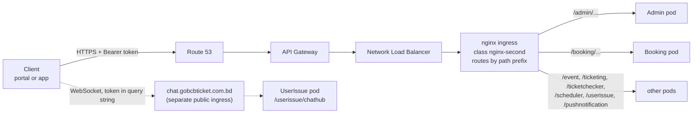

# GoBCB Platform — Feature Documentation (Technical Handover)

> **Bangla version:** the identical document in Bangla is `gobcb-feature-documentation-bn.md` next to this file.
> **Hosting architecture:** `docs/architecture/gobcb-aws-architecture.md` (referenced throughout as "the architecture doc").

## 0. Orientation

### 0.1 Purpose, audience and how to read

**Purpose.** For every business feature of the GoBCB (rvl-etp) event and ticketing platform this document shows which screen starts it, which endpoints and services handle it, which queues and workers continue it, which tables, Redis keys and files it touches, which external systems it calls, and where the code is.

**Audience.** RVL's incoming tech lead: an experienced .NET developer who has **not worked on a microservices system before**. Microservice concepts are explained once, in this Part 0, in 📦 **explainer boxes**; features reference them instead of repeating.

**Sources.** Written from the BS23 delivery side for the handover, from two sources only:

1. the source code of the five repositories (read-only), at the commits below;
2. `docs/architecture/gobcb-aws-architecture.md` for how the platform is hosted on AWS.

Nothing here is invented. Where the code cannot answer a question, the text says so and carries a marker `[UNCONFIRMED]` that is collected in the **Open queries** section at the end of this document, written so each query can be sent to BS23 as-is.

### Evidence baseline

| Repository (submodule) | Commit |
|---|---|
| `rvl-gobcb-backend` | `430ec16d7554254ff4f6adfa21f9c0c10d3234b2` |
| `rvl-gobcb-admin-portal` | `f62d2756bd9bbd4bfaa92585ae3f999d9f4c213f` |
| `rvl-gobcb-user-portal` | `36aaf58c0dae070da9f958da09451d33e6e47c73` |
| `rvl-gobcb-user-app` | `365b8bee71454d94747b75bef7cb07e8b47b6f8a` |
| `rvl-gobcb-checker-app` | `e919c54dad40a33aecc9922a68637a4a887513e6` |

Line numbers in code references (`File.cs:123`) are valid for these commits. If a submodule moves, re-check the references of the features you depend on.

### Feature template

Features are grouped by **what starts them**: staff in the admin portal (F1.x), customers on the web portal (F2.x) or in the app (F3.x), gate staff in the checker app (F4.x), the system itself on a timer or queue (F5.x), or a concern shared by many features (F6.x, including all authentication and authorization). Every feature follows the same nine sections:

| # | Section | What it answers |
|---|---|---|
| 1 | Name and purpose | What the feature is for, in business terms (English and Bangla name) |
| 2 | Trigger and actor | Who starts it, from which client and screen, with which Cognito pool, role and program scope |
| 3 | Business flow | The steps as a business user sees them |
| 4 | Technical flow | The same steps as hops between components; every hop is tagged (below) |
| 5 | Components | Clients, services, queues, workers, tables, Redis keys, buckets and external systems involved |
| 6 | API contracts | The endpoints the feature uses (method, full path, auth, DTOs, main errors); full JSON samples for the main endpoint(s) |
| 7 | Data and side effects | What is written: rows, queue messages, files, emails, pushes, cache entries |
| 8 | Code references | Where to start reading: controller, manager, worker, client file |
| 9 | Handover notes | Behaviour that is easy to miss, risks found in the code, and `[UNCONFIRMED]` items |

**Hop tags used in section 4:**

| Tag | Meaning |
|---|---|
| **[HTTP + user token]** | Synchronous HTTP call that carries the caller's Cognito access token (from a client, or forwarded by a service) |
| **[HTTP, no token]** | Synchronous HTTP call without a token, usually from a background worker to an endpoint that has no `[Authorize]` |
| **[HTTP, static key]** | Synchronous HTTP call to an external/internal system with a key from configuration |
| **[SQS: Key]** | A message put on, or read from, the SQS queue configured as `AWS:Queue:Key` |
| **[Worker: interval, lock]** | A background worker in a service, with its hard-coded interval and the Redis lock it takes (if any) |
| **[SignalR]** | WebSocket message through a SignalR hub |
| **[Shared table]** | One service reads a table that another service writes (same database, see §0.8) |

**Paths** are written in full as clients call them, for example `/booking/api/v1/user-booking-order`; the first segment is the service prefix (§0.6).

### 0.2 The platform in one paragraph

GoBCB sells and checks tickets for Bangladesh Cricket Board events. Staff set up **programs** (a series or a tournament), the **venues** (stadium → gallery → block → level), the **events** (matches) with prices and capacity, promotions and ticket layouts in the **admin portal**. Customers browse and buy on the **user web portal** or the **user app**, pay through **DgePay**, and receive digitally signed PDF tickets with a QR code. Gate staff scan the QR codes offline with the **checker app**. The backend is a set of ASP.NET Core 8 web APIs ("services") in one repository, running on Amazon EKS behind API Gateway (architecture doc §0–§4).

### 0.3 Repositories

This workspace (`rvl-etp-workspace`) orchestrates five git submodules:

| Repo | What it is |
|---|---|
| `rvl-gobcb-backend` | .NET 8 backend: 11 service projects (9 active + 2 stubs) + shared `Core/` libraries |
| `rvl-gobcb-admin-portal` | Angular admin portal (staff) |
| `rvl-gobcb-user-portal` | Angular user web portal (app lives in the `ETP-Web/` subfolder) |
| `rvl-gobcb-user-app` | Flutter app for end users (clean architecture: `presentation/`, `domain/`, `data/` packages) |
| `rvl-gobcb-checker-app` | Flutter app for gate checkers |

### 0.4 Backend services

All services live in `rvl-gobcb-backend/Services/<Name>/`, each split into `ETP.<Name>.Service` (controllers, `Program.cs`, workers), `.Domain` (managers = business logic), `.Storage` (EF Core `DbContext`, repositories) and, for some, `.Client` (typed HTTP client other services use) and `.Integration`. Shared code is in `rvl-gobcb-backend/Core/` (`ETP.Core`, `ETP.Core.Web`, `ETP.Core.EntityFramework`, `ETP.Core.BlobStorage`, `ETP.Core.Storage`, `ETP.Core.Email`, `ETP.Core.SMS`, `ETP.Core.EventBus`).

| Service | Path prefix | Local port | What it does (from controllers and workers) | DB connection key | Background workers |
|---|---|---|---|---|---|
| Admin | `/admin` | 5101 | Master data and back office: programs, venues, events, settings, promo codes, discounts, ticket layouts, staff users (Cognito), gate assignment, raffle, notices, site content, activity log, dashboard | `ConnectionStrings:Admin` | `CheckedTicketService`, `PromoCodeStatusUpdateService`, `SystemDiscountStatusUpdateService`, `GateCheckerDownloadStatusCleanupService` |
| Booking | `/booking` | 5102 | Capacity and seats, booking orders, payment (DgePay), promo-code application, seat reservations, capacity adjustments, sales reports, VAT challan | `ConnectionStrings:Booking` | `BookingStatusUpdateService`, `InitiateUserTicketGenerationService`, `LevelCapacityUpdateService`, `RefreshLockedCapacityService`, `EventLiveCapacityUpdateService`, `VatChallanProcessingService` |
| Event | `/event` | 5103 | Public, read-only view of programs, events, venue details, landing images, header/footer and ticket pricing for the portals and app | `ConnectionStrings:Event` | none |
| Ticketing | `/ticketing` | 5108 | Tickets: generation, signing (TSP), PDFs, downloads, sharing, invoices, reserved tickets, OneID sync, offline-sold tickets | `ConnectionStrings:Booking` (sic — see §0.8) | `TicketGenerationService` |
| TicketChecker | `/ticketchecker` | 5107 | Sync endpoint for the checker app (scans in, scans out) | `ConnectionStrings:TicketChecker` | none |
| UserIssue | `/userissue` | 5110 | Customer issues and support chat; hosts the SignalR hub `/userissue/chathub` | `ConnectionStrings:UserIssue` | none |
| PushNotification | `/pushnotification` | 5105 | Device tokens and push send APIs (writes to a queue) | `ConnectionStrings:PushNotification` | none |
| Scheduler | `/scheduler` | 5106 | Workers only: push delivery to Firebase, payment revalidation, ticket-generated notices, capacity reconcile, device-token cleanup | none | `FirebaseNotificationService`, `PendingOrFailedBookingStatusUpdateService`, `SendNotificationAfterGeneratedTicketService`, `CapacityUpdateService`, `DeviceTokenCleanupService` |
| Utility | `/utility` | 5111 | Worker only: merges/zips reserved tickets | none | `TicketProcessingService` |
| Platform | `/platform` | 5104 | **Stub** — only a Visual Studio template `WeatherForecastController`; not in production use | none | none |
| UserAuth | `/userauth` | 5109 | **Stub** — no real controllers; the identity API that clients call at `AUTH_API_BASE_URL` / `services.identity` is **not** this project (see Open queries) | none | none |

Sources: `Services/*/ETP.*.Service/Program.cs` and `Configuration(s)/DependencyConfig.cs`, `Services/*/ETP.*.Service/appsettings.json` (`Application:ServiceName` is the path prefix; UserIssue has no committed `appsettings.json` — its prefix `userissue` comes from the hub mapping and the clients). Local ports from `aspire/README.md`. The `Application:ServiceName` values are camelCase for TicketChecker (`ticketChecker`) and capitalized for PushNotification (`PushNotification`); ASP.NET Core routing is case-insensitive and clients use the lowercase forms shown above. Local dev runs the same services via .NET Aspire (`aspire/Etp.AppHost`) or Docker.

> 📦 **Explainer: microservices in this codebase (30 seconds)**
> A monolith is one process with one database. Here, each row in the table above is a **separate deployable ASP.NET Core app** with its own controllers, its own EF Core `DbContext` and its own background workers, all deployed as pods on Amazon EKS. They communicate only over HTTP and SQS messages (§0.8) — no shared in-process code at runtime beyond the copied `Core/` libraries compiled into each service. Nothing "routes" inside the code: the first path segment of a URL decides which service answers (next box).

### 0.5 Clients

| Client | Repository | Tech | Signs in with | Calls |
|---|---|---|---|---|
| Admin portal | `rvl-gobcb-admin-portal` | Angular 18 | Admin pool (after an SMS OTP from the Serverless API — F6.1) | Admin, Booking, Ticketing, UserIssue; Serverless API for OTP |
| User web portal | `rvl-gobcb-user-portal/ETP-Web` | Angular 19 | User pool, or OneID through Cognito (F6.8) | Event, Booking, Ticketing, Admin (public endpoints), UserIssue; identity API |
| User app | `rvl-gobcb-user-app` | Flutter | User pool, or OneID through Cognito (F6.8) | Event, Booking, Ticketing, UserIssue, PushNotification, Admin; identity API |
| Checker app | `rvl-gobcb-checker-app` | Flutter | TicketChecker pool | Admin (`ticket-checker-gate/event-info`), TicketChecker (`tickets/sync-tickets`); identity API for the app version |

The **identity API** (`services.identity` in the user portal, `AUTH_API_BASE_URL` in the apps) handles customer registration, OTPs, profile and app versions. Its source is in **none of the five repositories** `[UNCONFIRMED]` — see Open queries.

### 0.6 How a request reaches a service



The hosting part of this picture (API Gateway, NLB, ingress) comes from the architecture doc §1 and §4.1. Whether API Gateway also validates tokens is reported but unverified there (architecture Q1/Q1b). The services always validate the token themselves (F6.14).

> 📦 **Explainer: path-prefix routing**
> In a monolith every controller lives under one host. Here each service is a separate process, but clients still use **one API host**. The first path segment decides which service gets the request: `/booking/api/v1/user-booking-order` goes to Booking, `/event/api/v1/events/list` to Event.
>
> Two pieces make this work:
> 1. **In the code**, `Core/ETP.Core/Conventions/GlobalRoutePrefixConvention.cs` prepends `Application:ServiceName` to every controller route (registered in each `Program.cs`). So the Booking controller's `[Route("api/v1/user-booking-order")]` is really served at `/booking/api/v1/user-booking-order`, even when you call the service directly on its own port.
> 2. **In the cluster**, an nginx ingress per service forwards `/<prefix>/...` to that service unchanged (architecture doc §4.1).
>
> Consequence for you: when you call a service locally (`http://localhost:5102`), you must still include the prefix: `http://localhost:5102/booking/api/v1/...`. Swagger is at `/<prefix>/swagger` (e.g. `/booking/swagger`).

### 0.7 Request and response conventions

| Topic | What the code does | Source |
|---|---|---|
| JSON property names | camelCase in every service. Booking, Event, Ticketing, TicketChecker, Scheduler, Utility, PushNotification, Platform and UserAuth set `PropertyNamingPolicy = CamelCase` explicitly; Admin and UserIssue use the ASP.NET Core default, which is also camelCase | `Services/*/ETP.*.Service/Program.cs` (`AddJsonOptions`) |
| Enums | Strings (`JsonStringEnumConverter`) in the services that call `AddJsonOptions`; **numbers** in Admin and UserIssue, which do not register the converter | same |
| Nulls | Omitted from responses (`WhenWritingNull`) in the services that call `AddJsonOptions`; Admin and UserIssue include them | same |
| Errors | `ErrorResponseExceptionFilter` turns exceptions into a `ProblemDetails`-style body (below) | `Core/ETP.Core.Web/Filters/ErrorResponseExceptionFilter.cs` |
| Pagination | Paged endpoints return a `PagedList` object: `{ "items": [ … ], "totalCount": 123 }`. (A helper `PagedOkResult` — array body + `X-Total-Count` header — exists in Core but **no controller uses it**) | `Core/ETP.Core/Collections/PagedList.cs`, `Core/ETP.Core.Web/Results/PagedOkResult.cs` (dead code) |
| Ids | Most tables use a `long Id`. Many also carry a public string/Guid id (for example `Event.EventId`, order `PublicId`), and endpoints accept one or the other — which is why pairs such as `events/{eventId}` and `events/EventLongId/{id}` exist | `Services/Admin/ETP.Admin.Storage/Models/Event.cs` |
| Time | Server-side comparisons use `DateTime.UtcNow` | e.g. `UserBookingOrderManager.cs` |

**Error responses.** Controllers throw; the filter maps the exception type to a status code and a body:

| Exception | Status | Body |
|---|---|---|
| `ArgumentException` (and subclasses) | 400 | `{ "status": 400, "title": "<exception message>" }` |
| `ApiException` | 400 | the exception's own `Details` (`ProblemDetails`) |
| `UnauthorizedAccessException` | 403 | `{ "status": 403, "title": "Unauthorized access", "detail": "<message>" }` |
| anything else | 500 | `{ "status": 500, "title": "An unexpected error occurred." }` (the real message in Development) |

In the Development environment a `stackTrace` field is added. Authentication failures (no or invalid token) never reach the filter: the JWT handler answers **401** with an empty body; a valid token from the wrong pool or without the required role answers **403** (F6.14). Two quirks worth knowing: `ApiException` is always mapped to **400** even when it carries a different status inside, and `BadHttpRequestException` — used by some Admin managers for validation ("Name must not exceed 60 characters.") — falls into the default branch and becomes **500**. Typical business rejections (`seat_limit_exceeded`, `no_seats_available`, `Invalid promo code…`) are thrown as `ArgumentException` → **400**.

```json
{
  "status": 400,
  "title": "Invalid promo code. Please enter a valid code."
}
```

### 0.8 Core concepts (explainers)

> 📦 **Explainer: token forwarding (how one service calls another for a user)**
> When a customer's request reaches Booking and Booking needs data from Event, Booking calls Event over HTTP. In this codebase that call **carries the customer's own Cognito access token**, not a service identity.
> - Each service registers typed `HttpClient`s (for example `services.AddHttpClient<IEventClient, EventClient>` with a base URL from `Services:<Name>` in `Configurations/DependencyConfig.cs`).
> - The client pipeline includes `DelegatedBearerAuthenticationHandler` (`Core/ETP.Core.Web/Security/DelegatedBearerAuthenticationHandler.cs`). It reads the access token that the JWT handler stored as a claim on the current user (`OnTokenValidated` in `Core/ETP.Core/Configuration/DefaultAuthenticationConfig.cs`) and copies it to `Authorization: Bearer` on the outgoing request.
> - The downstream service validates that token again with its **own** policy. If Booking calls an Admin endpoint that requires the Admin pool while the caller is a customer, the downstream call fails with 401/403.
> - Retries: most clients retry 3 times with exponential backoff (Polly).
> - **No user, no token.** A background worker has no HTTP request, so the handler finds no token and sends none. That is why the endpoints workers call have no `[Authorize]` (F6.18).
>
> Hop tags: **[HTTP + user token]** and **[HTTP, no token]**. Full details: F6.19.

> 📦 **Explainer: queue-driven processing (SQS)**
> Some work is too slow or too important to do inside the user's request: signing a ticket with the TSP, merging hundreds of PDFs, recording VAT with NBR, sending push messages, recalculating capacity. The request **publishes a message** to an Amazon SQS queue and returns; a **worker** in some service reads the queue later and does the work.
> - Publishing: `Core/ETP.Core/Queue/Services/SqsPublisher.cs` resolves the queue URL from its **name** (configured as `AWS:Queue:<Key>`, values in SSM/user-secrets), serializes the message as JSON and sends it. If the queue name ends in `fifo`, it also sets `MessageGroupId` and `MessageDeduplicationId` from the message.
> - Consuming: a `BackgroundService` loops, calls `ReceiveMessageAsync`, processes, and **deletes the message only on success**. A failed message becomes visible again and is retried (the code comments mention a dead-letter queue; its configuration is not in the repos `[UNCONFIRMED]`).
> - Messages hold business ids only. There is no user token in a message and no sender check: anyone with IAM permission to send to the queue can enqueue work (architecture doc §2.3 C).
> - MassTransit (`Core/ETP.Core.EventBus`) is registered in several services but no consumer or publisher uses it (dead code).
>
> Queue catalog (config key → message → producer → consumer):
>
> | `AWS:Queue:` key | Message DTO | Published by | Consumed by | Purpose |
> |---|---|---|---|---|
> | `OrderSuccess` | `LevelCapacityUpdate` | Booking (`UserBookingOrderManager`, `CapacityManager`) | Booking `LevelCapacityUpdateService` | Apply booked/released seats to level capacity (F5.1) |
> | `EventCapacity` | `EventLiveCapacityUpdate` | Booking (`CapacityManager`) | Booking `EventLiveCapacityUpdateService` | Recompute event live capacity (F5.2) |
> | `TicketSigning` | `SignedTicketGeneration` | Ticketing (`TicketManager`) | Ticketing `TicketGenerationService` | Sign ticket PDFs via TSP (F5.8) |
> | `TicketProcessing` | `TicketProcessingRequest` (Merge/Zip) | Ticketing (`TicketManager`) | Utility `TicketProcessingService` | Merge/zip reserved tickets (F5.9) |
> | `VatChallanProcessing` | `VatChallanProcessing` | Booking (`UserBookingOrderManager`) | Booking `VatChallanProcessingService` | Record VAT with NBR (F5.10) |
> | `FirebaseNotification` | `FirebaseNotificationRequest` | PushNotification (`NotificationManager`) | Scheduler `FirebaseNotificationService` | Deliver push via FCM (F5.11) |
>
> The Event service also registers `AWS:Queue:FirebaseNotification` but never publishes or consumes it (dead config). Physical queue names are secret values, so whether any queue is FIFO cannot be seen from the repos `[UNCONFIRMED]`.

> 📦 **Explainer: background workers (timers inside services)**
> Besides answering HTTP requests, several services run **hosted services** (`BackgroundService`) on a timer, registered with `services.AddHostedService<...>()`. The pattern is the same everywhere (example: `Services/Admin/ETP.Admin.Service/Workers/BackgroundServices/CheckedTicketService.cs`):
> 1. wait about a minute after start-up;
> 2. loop forever: try to take a Redis lock, and if it is taken, create a DI scope and run a **TaskManager** (`Workers/TaskManagers/*`) that holds the real logic;
> 3. sleep for a **hard-coded** interval (30 seconds to 1 day), longer after an error.
>
> The intervals are constants in the code, not configuration. Every replica (pod) of a service runs the same workers, which is why the lock matters (next box). Hop tag: **[Worker: interval, lock]**. Part 5 documents each worker.

> 📦 **Explainer: distributed locks (RedLock)**
> In production each service can run as several pods. Without coordination, every pod's worker would process the same orders at the same time. The code uses **RedLock** (`RedLockNet`) on Redis: before a job runs, the worker asks for a named lock (for example `checked_ticket`, expiry 20 minutes). Only the pod that gets it does the work; the others skip the cycle and log `Could NOT acquire lock ... Skipping this cycle` (a normal message, also seen locally).
>
> The same mechanism protects business operations that must not overlap, for example one booking at a time per customer (`user_booking:{userId}` in `UserBookingOrderManager.cs`) and capacity changes per level.
>
> Set-up: `Core/ETP.Core/Configuration/DistributedLockConfig.cs` (keys `DistributedLock:Redis:*`). Lock names and expiries are listed in F6.25.

> 📦 **Explainer: one database, shared tables and read models**
> A textbook microservice owns a private database. This codebase does not work that way:
> - Every `DbContext` uses the **same schema `etp`** (`DefaultSchema = "etp"` in each `*DbContext.cs`), and each service has its own connection-string key (`ConnectionStrings:Admin`, `:Booking`, …). Ticketing even uses `ConnectionStrings:Booking`. Locally all keys point at one database (`scripts/user-secrets.example.json`).
> - A table is **owned** by the service whose migrations create it. Other services map the same table again in their own `DbContext` with `ExcludeFromMigrations`, and read it (sometimes write it) directly. Example: Booking maps `PromoCodes`, `Discounts`, `EventVenueDetails`, `Events` from Admin as excluded tables (`Services/Booking/ETP.Booking.Storage/DbContexts/BookingDbContext.cs`).
> - The **Event** service owns almost nothing: it is a public, read-only view over Admin's and Booking's tables (`Services/Event/ETP.Event.Storage/DbContexts/EventDbContext.cs`).
>
> What this means for you: a column change in Admin can break Booking, Ticketing or Event at run time even though they compile separately. Search all `*DbContext.cs` files for a table name before you change it. The handover brief said "one schema per service"; the code says one schema for all. The production layout is open `[UNCONFIRMED]` — see Open queries.
>
> Hop tag: **[Shared table]**.

> 📦 **Explainer: Redis as the live seat counter**
> Seat availability changes every second during a sale, so Booking keeps **live counters in Redis** (key families such as `level_live`, `level_locked`, `event_live`, `level_live_seats`; constants in `Core/ETP.Core/Constant/AppConstant.cs`) and treats the database as the slower, durable copy. Orders lock capacity in Redis first; queue workers (F5.1, F5.2) and timers (F5.3) bring the database and Redis back in line. The gate-scan counters of the checker app work the same way (F4.5, F5.14).
>
> Consequence: if Redis is flushed during a sale, live numbers are rebuilt from the database by the next worker cycle. Details: F6.25.

### 0.9 External systems

| System | Used for | Called from | Feature |
|---|---|---|---|
| DgePay | Online card/payment-gateway checkout | Booking | F2.6, F3.5, F5.5 |
| SSLCommerz | Second payment gateway (code present) | Booking | `[UNCONFIRMED]` whether live — Open queries |
| NBR OpenAPI | VAT challan (record VAT, download challan) | Booking worker | F5.10 |
| OneID Wallet | SSO login (federated through Cognito) and ticket sync to wallet | Cognito; Ticketing | F6.8, F2.10 |
| TSP gateway (mTLS) | Digital signing of ticket PDFs | Ticketing worker | F5.8 |
| Firebase (FCM) | Push notifications | Scheduler worker | F5.11 |
| SES | Email (ticket zips) | Ticketing | F6.21 |
| "Serverless" API | Cognito user lookup, admin login 2FA OTP | several services + admin portal | F6.1, F6.22 — source not in repos `[UNCONFIRMED]` |
| "Notification" API | SMS sending (ticket-generated notice) | Scheduler | F5.12, F6.22 — source not in repos `[UNCONFIRMED]` |
| identity API | Registration, OTP, profile, app version | portals + apps | F6.6 etc. — source not in repos `[UNCONFIRMED]` |

### 0.10 Feature index

- **Part 1 — Admin Portal:** F1.1 program selection · F1.2 programs · F1.3 program settings · F1.4 teams · F1.5 venues and stadium layout · F1.6 program–venue mapping · F1.7 events · F1.8 event settings override · F1.9 event venue details and per-level pricing · F1.10 event capacity adjustment · F1.11 seat reservation · F1.12 reserved ticket generation and distribution · F1.13 ticket layouts and attributes · F1.14 ticket-pricing content page · F1.15 promo codes · F1.16 system discounts · F1.17 ticket-checker accounts · F1.18 gate assignment and download control · F1.19 gate reports · F1.20 raffle draw · F1.21 dashboard · F1.22 booking/sales/revenue reports · F1.23 reconciliation lookup · F1.24 user issues and support chat (admin) · F1.25 admin users · F1.26 agent users · F1.27 activity log viewer · F1.28 media configuration · F1.29 content editor · F1.30 header/footer and social media · F1.31 general notices
- **Part 2 — User Web Portal:** F2.1 home page content · F2.2 browse events · F2.3 information pages · F2.4 seat selection · F2.5 apply promo code · F2.6 booking order and online payment (DgePay) · F2.7 my bookings and generation status · F2.8 ticket generation request · F2.9 ticket details, holder info, download, share, invoice · F2.10 sync tickets to OneID · F2.11 profile · F2.12 report an issue and chat · F2.13 language switch
- **Part 3 — User App:** F3.1 splash, version gate and onboarding · F3.2 home and browse events · F3.3 information pages · F3.4 seat selection and promo code · F3.5 booking and WebView payment · F3.6 my bookings and tickets · F3.7 profile and settings · F3.8 report an issue and support chat · F3.9 push device-token registration · F3.10 receiving push notifications
- **Part 4 — Checker App:** F4.1 assigned event and gate · F4.2 ticket download for offline checking · F4.3 QR scan validation · F4.4 manual entry · F4.5 scan sync · F4.6 signature-only ticket validation
- **Part 5 — System-initiated:** F5.1 level capacity update · F5.2 event live capacity · F5.3 locked-capacity refresh · F5.4 scheduler capacity reconcile · F5.5 pending/failed payment revalidation · F5.6 booking status → Generated · F5.7 initiate user ticket generation · F5.8 ticket signing via TSP · F5.9 reserved ticket merge/zip · F5.10 VAT challan with NBR · F5.11 push delivery to FCM · F5.12 ticket-generated notification · F5.13 device-token cleanup · F5.14 checked-ticket sync · F5.15 gate download-status cleanup · F5.16 promo-code status update · F5.17 system-discount status update
- **Part 6 — Cross-cutting:** F6.1 admin login · F6.2 admin forgot password · F6.3 admin change password and logout · F6.4 admin session handling · F6.5 staff account provisioning · F6.6 customer registration · F6.7 customer login (phone + password) · F6.8 OneID SSO · F6.9 customer forgot/reset password · F6.10 customer session handling · F6.11 delete account and app force-update · F6.12 checker login · F6.13 agent pool and offline-sold tickets · F6.14 authorization layer 1 (pool policies) · F6.15 authorization layers 2–3 (roles) · F6.16 authorization layer 4 (program scope) · F6.17 client-side authorization · F6.18 endpoints without authorization · F6.19 service-to-service communication · F6.20 file storage (S3, CloudFront) · F6.21 email (SES) · F6.22 SMS and the external notification service · F6.23 push notifications · F6.24 activity logging · F6.25 Redis · F6.26 configuration and secrets

---

## 1. Admin Portal

Features started by BCB/BS23 staff in the Angular admin portal (`rvl-gobcb-admin-portal`), Admin Cognito pool. Sign-in itself is a cross-cutting feature (F6.1–F6.5); this part starts after login.

### F1.1 Program selection and the program-scoped menu

> **Bangla name:** প্রোগ্রাম নির্বাচন ও প্রোগ্রাম-ভিত্তিক মেনু

**1. Name and purpose.** After signing in, staff pick the **program** (a series or tournament) they will work on. The portal then adds an `X-Program-Id` header to every API call and shows the program menu; picking "global" mode (program id 0) shows a limited, program-independent menu.

**2. Trigger and actor.** Admin portal, top bar / program switcher, immediately after login and any time later. Actor: any staff role (`admin`, `event_manager`, `ticket_manager`, `ticket_operator`, `customer_support`) from the Admin pool.

**3. Business flow.**
1. After login the staff member lands on a program selection (or the program-management screen, depending on role).
2. Choosing a program stores it in the browser (`localStorage.globalProgramId`) and reloads the menu.
3. Most menu items (events, dashboard, issues, reports) now show data for that program only, because every request carries `X-Program-Id`.
4. Choosing global mode (program id 0) unlocks the limited menu (programs, venues, users, media).

**4. Technical flow.**

| # | From → To | Hop | What happens |
|---|---|---|---|
| 1 | Portal `ProgramService` (BehaviorSubject + `localStorage.globalProgramId`) | — | Selection state kept client-side; guards `ProgramMenuGuard` (programId > 0) and `LimitedMenuGuard` (programId == 0) decide which routes are reachable |
| 2 | Portal → every admin API call | — | `program-id.interceptor.ts` adds the `X-Program-Id` header from `ProgramService` |
| 3 | Admin service | — | `ProgramIdMiddleware` copies the header into `HttpContext.Items["ProgramId"]`; `IProgramIdAccessor` exposes it to `AdminDbContext`, which applies a **global EF query filter** on every entity implementing `IHasProgramId` when ProgramId > 0 — the data scoping is done in SQL, not per endpoint |
| 4 | Admin service | — | On routes marked `[AuthorizeProgram]`, `AuthorizeProgramAttribute` also checks the header against the user's `program_id` claims (from Cognito `custom:program_ids`): 400 if the header is missing/invalid, 403 if the program is not allowed. Roles `admin` and `user` bypass |

**5. Components.** Admin portal (`ProgramService`, interceptors, guards); Admin service (middleware + EF filter + attribute); Cognito attribute `custom:program_ids`.

**6. API contracts.** The feature uses the programs list (F1.2 `GET /admin/api/v1/program`). Any admin endpoint documented in this part should be read as *"plus `X-Program-Id` header"* — the portal sends it on every request. Program scoping on the backend applies only where the code uses it (the EF filter and `[AuthorizeProgram]`; Booking/Ticketing take an explicit `programId` query parameter instead).

**7. Data and side effects.** None server-side; browser state only.

**8. Code references.**

| What | Where |
|---|---|
| Program state | `rvl-gobcb-admin-portal/src/app/core/services/program.service.ts` |
| Header interceptor | `rvl-gobcb-admin-portal/src/app/interceptors/program-id.interceptor.ts` |
| Menu guards | `rvl-gobcb-admin-portal/src/app/core/guard/program-menu.guard.ts`, `limited-menu.guard.ts` |
| Backend middleware | `rvl-gobcb-backend/Services/Admin/ETP.Admin.Service/Middleware/ProgramIdMiddleware.cs` |
| Program attribute | `rvl-gobcb-backend/Services/Admin/ETP.Admin.Service/Attributes/AuthorizeProgramAttribute.cs` |
| EF filter + accessor | `rvl-gobcb-backend/Services/Admin/ETP.Admin.Storage/Repositories/ProgramIdAccessor.cs`, `AdminDbContext.cs` |

**9. Handover notes.** ① The `admin` role bypasses the program check and sees every program; other roles must be provisioned with `custom:program_ids` (F6.5). ② `[AuthorizeProgram]` is currently active on the dashboard controller; on `EventsController` it is present but **commented out** — events are today scoped only by the query parameters, not enforced per program. ③ Only the Admin service understands the header; other services ignore it.

### F1.2 Programs

> **Bangla name:** প্রোগ্রাম (সিরিজ/টুর্নামেন্ট) ব্যবস্থাপনা

**1. Name and purpose.** Create, edit and delete **programs** — the series or tournament (for example a tour or a league) that groups events and carries its own logo and dates.

**2. Trigger and actor.** Admin portal → `/program-management/program-create`, `/program-management/edit/:id`, `/settings/programs`. Roles: `admin`, `event_manager` (controller: `[Authorize(Roles = admin, event_manager, …)]`).

**3. Business flow.**
1. Staff open Program Management → Create Program.
2. They fill name, short name, start/end dates and upload a logo image.
3. Save creates the program; it now appears in the program switcher (F1.1) and can host teams, venues and events.
4. Edit updates the same fields; delete removes the program (the UI warns about running events via the venues screen's `has-running-events` check for venues; program-level guards are not visible in the code — see notes).

**4. Technical flow.**

| # | From → To | Hop | What happens |
|---|---|---|---|
| 1 | Portal `programs.service.ts` → Admin `POST /admin/api/v1/program` | **[HTTP + user token]** | multipart form (logo file) |
| 2 | Admin `ProgramController` → `ProgramManager` | — | Saves program row; uploads logo via `AwsSimpleStorageMediaManager` to the media bucket (`AWS:Bucket:Name`), stores the CloudFront URL |
| 3 | Admin DB | **[Shared table]** | `Programs` table (schema `etp`); Event service and Booking read the same table through their own `DbContext` mirrors |
| 4 | Public side | **[Shared table]** | User portal/app list programs via Event service `GET /event/api/v1/events/programs` (F2.2) |

**5. Components.** Admin portal; Admin service; S3 media bucket + CloudFront; tables `Programs` (owner Admin).

**6. API contracts.** Base: `/admin/api/v1/program`. Auth: Admin pool; roles `admin`, `event_manager`.

| Method | Path | Request | Response |
|---|---|---|---|
| GET | `/admin/api/v1/program` | — | list of programs |
| GET | `/admin/api/v1/program/{id}` | — | one program |
| POST | `/admin/api/v1/program` | multipart `CreateOrUpdateProgram` | created program |
| PUT | `/admin/api/v1/program/{id}` | multipart `CreateOrUpdateProgram` | updated program |
| DELETE | `/admin/api/v1/program/{id}` | — | deleted program |

`CreateOrUpdateProgram` (`Services/Admin/ETP.Admin.Domain/Models/Settings/CreateOrUpdateProgram.cs`):

```json
// POST /admin/api/v1/program  (multipart/form-data; "Logo" is a file part)
{
  "Name": "Bangladesh Tour of Sri Lanka 2026",
  "ShortName": "BAN in SL 2026",
  "StartDateTime": "2026-07-01T00:00:00Z",
  "EndDateTime": "2026-07-28T00:00:00Z"
}
```

Main errors: standard envelope (§0.7) — 400 invalid dates/duplicate names as thrown by the manager.

**7. Data and side effects.** Table `Programs` insert/update/delete; one file written to the media bucket (logo); Redis-cached public lists (Event service) serve the stale logo/name until their TTL expires or cache keys are cleared.

**8. Code references.**

| What | Where |
|---|---|
| Portal service | `rvl-gobcb-admin-portal/src/app/features/program-settings/services/programs.service.ts` (also `program-management.service.ts`) |
| Controller | `rvl-gobcb-backend/Services/Admin/ETP.Admin.Service/Api/ProgramController.cs` |
| Manager | `rvl-gobcb-backend/Services/Admin/ETP.Admin.Domain/Managers/ProgramManager.cs` |
| Media upload | `rvl-gobcb-backend/Core/ETP.Core.BlobStorage/AWSS3/AwsSimpleStorageMediaManager.cs` |

**9. Handover notes.** ① Deletion guards (e.g. "program has events") are not visible in the extracted code — verify before relying on delete in production. ② The same create form is reachable from two menus (`/settings/programs` and `/program-management`), backed by two near-duplicate Angular services.

### F1.3 Program settings

> **Bangla name:** প্রোগ্রাম সেটিংস

**1. Name and purpose.** The per-program commercial rules: payment gateway choice, purchase limits, selling/availability windows (hours relative to the event), VAT and service charge, and the ticket-number prefix.

**2. Trigger and actor.** Admin portal → `/program-management/configuration` (program settings update screen). Roles: `admin`, `event_manager` (`ProgramSettingsController`).

**3. Business flow.**
1. Staff open the settings of the selected program.
2. They set how many orders per user and seats per order are allowed, the ticket-selling window in hours, VAT (percent or fixed, inclusive or not), service charge, the "limited availability" threshold and the ticket-number prefix.
3. They choose the **payment gateway** for the program (DgePay or SSLCommerz).
4. Save stores the rules; every event of the program inherits them unless an event overrides them (F1.8).

**4. Technical flow.**

| # | From → To | Hop | What happens |
|---|---|---|---|
| 1 | Portal → Admin `GET /admin/api/v1/program-settings/{programId}` | **[HTTP + user token]** | Current settings |
| 2 | Portal → Admin `PUT /admin/api/v1/program-settings` | **[HTTP + user token]** | JSON `ProgramSettings` |
| 3 | Admin DB + cache | — | `ProgramSettings` row (one per program); Redis key family `program_settings_details` caches reads used by other flows |

**5. Components.** Admin portal (`program-settings.service.ts`); Admin service; table `ProgramSettings`.

**6. API contracts.**

```json
// PUT /admin/api/v1/program-settings   (ProgramSettings, Services/Admin/ETP.Admin.Domain/Models/Settings/ProgramSettings.cs)
{
  "id": 19,
  "programId": 7,
  "limitedAvailabilityThreshold": 10.0,
  "allowableMaximumOrderPerUser": 2,
  "allowableMaximumSeatPerOrder": 4,
  "ticketSellingStartFromHour": 240,       // hours before the event
  "ticketSellingStopFromHour": 2,
  "ticketAvailableFromHour": 180,
  "ticketNumberPrefix": "BCB-ODI2-",
  "vat": 15.0,
  "isVatPercentage": true,
  "serviceCharge": 20.0,
  "isServiceChargePercentage": false,
  "isVatInclusive": false,
  "paymentGateway": 1                      // enum: DgePay = 1, SSLCommerz = 2
}
```

`GET program-settings/{programId}` returns the same shape. Errors: standard envelope.

**7. Data and side effects.** `ProgramSettings` upsert; Redis cache invalidation/refresh for the program settings key.

**8. Code references.**

| What | Where |
|---|---|
| Portal service | `rvl-gobcb-admin-portal/src/app/features/program-management/services/program-settings.service.ts` |
| Controller | `rvl-gobcb-backend/Services/Admin/ETP.Admin.Service/Api/ProgramSettingsController.cs` |

**9. Handover notes.** ① The `PaymentGateway` field means the active gateway is **per program** — this partially answers "DgePay vs SSLCommerz": both are selectable; which programs use which in production is data, not code `[UNCONFIRMED]`. ② `LimitedAvailabilityThreshold` drives the "limited seats left" badge logic; its exact consumer is Booking's capacity checks.

### F1.4 Teams

> **Bangla name:** টিম ব্যবস্থাপনা

**1. Name and purpose.** Maintain the teams (with logo and flag) that play in a program's events; used on event segments and public pages.

**2. Trigger and actor.** Admin portal → `/settings/program-teams`, `/program-management` team screens. Roles: `admin`, `event_manager` (`TeamsController`).

**3. Business flow.** Staff create a team under a program (name, short name, logo, flag), edit, toggle active, delete; event segments (F1.7) then reference the teams.

**4. Technical flow.**

| # | From → To | Hop | What happens |
|---|---|---|---|
| 1 | Portal → Admin `POST /admin/api/v1/teams` | **[HTTP + user token]** | multipart `CreateOrUpdateProgramTeam` |
| 2 | Admin manager | — | `ProgramTeams` row; logo/flag uploaded to the media bucket |
| 3 | Public side | **[Shared table]** | Event service includes team names in event segment responses (F2.2) |

**5. Components.** Admin portal; Admin service; S3 media bucket; table `ProgramTeams`.

**6. API contracts.** Base `/admin/api/v1/teams`: `GET program/{programId}`, `GET {id}`, `GET ` (paged), `GET list`, `POST` (multipart), `PUT {id}`, `DELETE {id}`, `PUT toggle-status/{id}`. `CreateOrUpdateProgramTeam` (`Models/Events/CreateOrUpdateProgramTeam.cs`): `Id, ProgramId, Name, ShortName, Logo (file, optional), IsFlag (bool?), IsActive, Flag (file, optional)`. Errors: standard envelope.

**7. Data and side effects.** `ProgramTeams` upsert/delete; files to the media bucket.

**8. Code references.** `rvl-gobcb-admin-portal/src/app/features/program-management/services/teams-management.service.ts`; `rvl-gobcb-backend/Services/Admin/ETP.Admin.Service/Api/TeamsController.cs`.

**9. Handover notes.** `toggle-status` is a soft enable/disable used instead of delete for teams referenced by past events.

### F1.5 Venues and stadium/exhibition layout

> **Bangla name:** ভেন্যু ও স্টেডিয়াম/প্রদর্শনী লেআউট

**1. Name and purpose.** Define a venue (stadium or exhibition hall) with its SVG seat map and the hierarchy **gallery → block → level**, each with seat-mapping flags, sellability, ticket color and entry/mini gates. Everything downstream (pricing, capacity, checkers) hangs off this tree.

**2. Trigger and actor.** Admin portal → `/venue-management`, `/venue-management/create-venue`, `/venue-management/update-venue/:venueId`, `/venue-management/stadium-layout/:venueId` (stadium) or `/venue-management/exhibition-layout/:venueId` (exhibition), `/venue-management/gallery-details/:venueId`. Roles: `admin`, `event_manager` (`VenuesController`).

**3. Business flow.**
1. Staff create the venue: type (Stadium/ExhibitionHall), short and full name, location, the SVG map image and the SVG keys (regions in the map that become clickable galleries/blocks/levels).
2. In the layout editor they build galleries, blocks and levels; a level carries `SeatingCapacity`, optional literal seat list (`HasSeats`), sellability and a ticket color.
3. They attach **entry gates** and **mini gates** to block-levels.
4. `has-running-events/{venueId}` guards edits while an event is running.

**4. Technical flow.**

| # | From → To | Hop | What happens |
|---|---|---|---|
| 1 | Portal → Admin `POST /admin/api/v1/venues` | **[HTTP + user token]** | multipart `CreateOrUpdateVenue` (SVG map file + svg keys) |
| 2 | Portal → Admin `POST /admin/api/v1/venues/venueLayout` | **[HTTP + user token]** | JSON `CreateOrUpdateVenueLayout` — the whole gallery/block/level tree in one call |
| 3 | Portal → Admin `POST /admin/api/v1/venues/entry-gate` / `mini-gate` | **[HTTP + user token]** | Gate lists per block-level |
| 4 | Admin DB | **[Shared table]** | Tables `Venues`, `VenueGalleries`, `GalleryBlocks`, `BlockLevels`, `BlockLevelEntryGates`, `BlockLevelMiniGates`, `GalleryBlockEntryGates`; Event/Booking/TicketChecker read them via mirrors |

**5. Components.** Admin portal; Admin service; S3 media bucket (SVG maps); venue tables (owner Admin).

**6. API contracts.** Selected endpoints (`VenuesController`, base `/admin/api/v1/venues`):

```json
// POST /admin/api/v1/venues   (multipart CreateOrUpdateVenue)
{ "type": 1, "shortName": "SBNCS", "name": "Sher-e-Bangla National Cricket Stadium", "location": "Mirpur, Dhaka" }
// parts: SvgMapImageFile (file), SvgKeys (list of strings)

// POST /admin/api/v1/venues/venueLayout   (CreateOrUpdateVenueLayout)
{
  "venueId": 2,
  "venueGalleries": [
    {
      "id": 12, "name": "Grandstand", "seatType": "Seat", "isSeatMapped": true, "isSellable": true,
      "isActive": true, "svgKey": "grandstand-n", "ticketColor": "#1E7B4F",
      "galleryBlocks": [
        {
          "id": 7, "name": "Block B", "isSeatMapped": true, "isSellable": true, "isActive": true, "svgKey": "gs-n-b",
          "blockLevels": [
            { "id": 45, "name": "Level 1", "seatingCapacity": 1200, "hasSeats": true, "seats": "A1..A600,B1..B600",
              "isSeatMapped": true, "isSellable": true, "isActive": true, "svgKey": "gs-n-b-l1" }
          ]
        }
      ]
    }
  ]
}
```

Also: `GET {programId}`, `GET venue?venueId=`, `GET gallery` / `galleryBlocks` / `blockLevel`, `PUT venue/{venueId}`, `POST|PUT venueGallery|galleryBlocks|blockLevel`, `GET entry-gate|mini-gate`, `POST mini-gate`, `GET has-running-events/{venueId}`. Response entity shapes: `Venue` (`Models/Events/Venue.cs`) with nested `VenueGallery`/`GalleryBlock`/`BlockLevel` as in the layout sample above. Errors: standard envelope.

**7. Data and side effects.** Venue-tree tables written; SVG map uploaded; downstream caches (`event_venue_details` key family) go stale until refreshed.

**8. Code references.**

| What | Where |
|---|---|
| Portal service + pages | `rvl-gobcb-admin-portal/src/app/features/venue-management/services/venue-management.service.ts`, `pages/…` |
| Controller | `rvl-gobcb-backend/Services/Admin/ETP.Admin.Service/Api/VenuesController.cs` |

**9. Handover notes.** ① The layout editor sends the **entire tree** in one `venueLayout` call — a mistake in the editor overwrites siblings; the UI's unsaved-changes guard (`unsave-changes-guard`) is the main protection. ② `VenueType` enum: `Stadium = 1`, `ExhibitionHall = 2`; the portal shows a different layout editor per type (stadium vs exhibition). ③ A `BlockLevel` property is named `BlockLevelEntrieGates` (typo, kept for compatibility).

### F1.6 Program–venue mapping and venue details sync

> **Bangla name:** প্রোগ্রাম-ভেন্যু ম্যাপিং ও ভেন্যু ডিটেইলস সিঙ্ক

**1. Name and purpose.** Attach venues to a program and materialize the per-program **venue details**: for every gallery/block/level, program-level overrides (active/sellable flags, seating capacity, price per seat, seats). Events then copy from this (F1.9).

**2. Trigger and actor.** Admin portal → `/program-management/programVenueDetails`, `/settings/program-venues`. Roles: `admin`, `event_manager` (`ProgramVenueController`, `ProgramVenueDetailsController`).

**3. Business flow.**
1. Staff map a venue to the program (`ProgramVenue`).
2. "Generate" creates `ProgramVenueDetails` rows for every level of that venue (copy of the venue tree with editable price/capacity).
3. Staff edit per-level price, capacity, sellability; "Sync" re-pulls structure changes from the venue layout (the screen shows a **needs-sync** flag when the venue layout has changed).
4. Events created for the program start from these prices (F1.9).

**4. Technical flow.**

| # | From → To | Hop | What happens |
|---|---|---|---|
| 1 | Portal → Admin `POST /admin/api/v1/programVenue` | **[HTTP + user token]** | `CreateOrUpdateProgramVenue { id, programId, venueId }` |
| 2 | Portal → Admin `POST /admin/api/v1/programVenueDetails/{programId}` | **[HTTP + user token]** | Generate details rows from the venue tree |
| 3 | Portal → Admin `POST /admin/api/v1/programVenueDetails/{programId}/{venueId}` | **[HTTP + user token]** | Sync structural changes |
| 4 | Portal → Admin `PUT /admin/api/v1/programVenueDetails/update/{id}` | **[HTTP + user token]** | Per-level `CreateOrUpdateProgramVenueDetails` |
| 5 | Admin DB | **[Shared table]** | Tables `ProgramVenues`, `ProgramVenueDetails` (owner Admin); Event service reads them |

**5. Components.** Admin portal; Admin service; tables `ProgramVenues`, `ProgramVenueDetails`.

**6. API contracts.**

```json
// PUT /admin/api/v1/programVenueDetails/update/{id}   (CreateOrUpdateProgramVenueDetails)
{
  "id": 918,
  "isGalleryActive": true, "isSeatMappedInGallery": true, "isGallerySellable": true,
  "isBlockActive": true,   "isSeatMappedInBlock": true,   "isBlockSellable": true,
  "isLevelActive": true,   "isSeatMappedInLevel": true,   "isLevelSellable": true,
  "seatingCapacity": 1200,
  "pricePerSeat": 500.0,
  "hasSeats": true,
  "seats": "A1..A600,B1..B600"
}
// GET /admin/api/v1/programVenueDetails/sync-status/{programId}/{venueId}
{ "needsSync": false }
```

Also `GET {programId}/{venueId}`, `GET venue-galleries/{programId}/{venueId}`, `GET venue-details/{programId}`, `GET programVenue/{programId}`. Errors: standard envelope.

**7. Data and side effects.** Program-venue tables written; no queues/emails.

**8. Code references.** `rvl-gobcb-admin-portal/src/app/features/program-management/services/{program-venues-details,program-management}.service.ts`; `rvl-gobcb-backend/Services/Admin/ETP.Admin.Service/Api/{ProgramVenueController,ProgramVenueDetailsController}.cs`.

**9. Handover notes.** `needsSync` compares the venue layout's updated timestamp with the last sync — editing a venue layout (F1.5) makes every mapped program "need sync" until an admin syncs.

### F1.7 Events (matches)

> **Bangla name:** ইভেন্ট (ম্যাচ) ব্যবস্থাপনা

**1. Name and purpose.** Create, edit, segment, publish/unpublish, duplicate and enable/disable **events** — the matches customers buy tickets for, each belonging to a program and a venue with a cover image and one or more segments (innings/days/teams).

**2. Trigger and actor.** Admin portal → `/events`, `/events/create`, `/events/edit/:id`, `/events/event-details/:id`. Roles: `admin`, `event_manager`, `ticket_manager`, `ticket_operator` (class-level `[Authorize]` on `EventsController`).

**3. Business flow.**
1. Staff open Events (the list is filtered by the selected program, F1.1) and click Create.
2. They choose program, venue, name, start/end date-time, upload a cover image, and add **segments** (each with name, type, start/end, the two teams and a banner image).
3. Save creates the event in draft. On the details screen staff adjust settings (F1.8) and venue pricing (F1.9).
4. **Publish** makes the event visible on the public portal/app; **Unpublish** hides it; **toggle status** enables/disables it; **Duplicate** clones the event for the next match.
5. The activity log (F1.27) records the changes.

**4. Technical flow.**

| # | From → To | Hop | What happens |
|---|---|---|---|
| 1 | Portal `event.service.ts` → Admin `POST /admin/api/v1/events` | **[HTTP + user token]** | multipart `CreateEvent` (cover image + per-segment banner files) |
| 2 | Admin `EventsController` → `EventManager` | — | Creates `Events` + `EventSegments` rows; uploads images to the media bucket (CloudFront URLs stored on the rows) |
| 3 | Admin DB | **[Shared table]** | Tables `Events`, `EventSegments` (owner Admin); Event/Booking/Ticketing/TicketChecker services read them through mirrors |
| 4 | `PUT publish/{id}` | **[HTTP + user token]** | Sets `IsPublished`; the public Event service serves published events only (`published/list`) |
| 5 | `POST duplicate/{id}` | **[HTTP + user token]** | Copies the event row + segments into a new draft |
| 6 | Portal list | **[HTTP + user token]** | `GET /admin/api/v1/events` (paged, search/sort) or `GET program/{programId}/events` |

**5. Components.** Admin portal; Admin service; S3 media bucket + CloudFront; tables `Events`, `EventSegments`, `EventSettings`; Cognito Admin pool; program scope via `X-Program-Id` (list filtering).

**6. API contracts.** Base: `/admin/api/v1/events`. Auth: Admin pool; roles as in §2. Sample for the main endpoint:

`POST /admin/api/v1/events` — multipart `CreateEvent` (`Services/Admin/ETP.Admin.Domain/Models/Events/CreateEvent.cs`):

| Part | Type | Notes |
|---|---|---|
| `ProgramId` | long | owning program |
| `VenueId` | int | venue of the match |
| `Name` | string | |
| `StartDateTime` / `EndDateTime` | date-time | End nullable |
| `EventCoverImageFile` | file | cover image |
| `Segments[i].Name/SegmentType/StartDateTime/EndDateTime/Team1Id/Team2Id` | mixed | teams are optional |
| `Segments[i].BannerImageFile` | file | per-segment banner |

Success 200/201 — `Event` response (`Domain/Models/Events/Event.cs`):

```json
{
  "id": 1042,
  "eventId": "b8e6a9d2-3f1c-4e7a-9d5f-6c2b1a8e0d34",
  "programId": 7,
  "venueId": 2,
  "name": "2nd ODI — Bangladesh vs Sri Lanka",
  "startDateTime": "2026-07-08T14:00:00Z",
  "endDateTime": null,
  "ticketSellingStartDateTime": "2026-06-20T10:00:00Z",
  "ticketSellingStopDateTime": "2026-07-08T12:00:00Z",
  "ticketAvailabilityStartDateTime": "2026-06-25T10:00:00Z",
  "eventCoverImage": "https://<cloudfront>/<key>.jpg",
  "minimumPrice": 500.0,
  "isPublished": false,
  "isActive": true,
  "vat": 15.0,
  "isVatParcentage": true,
  "isVatInclusive": false,
  "venue": { "…": "see F1.5" },
  "program": { "…": "see F1.2" },
  "eventSettings": { "…": "see F1.8" },
  "segments": [
    { "name": "Match day", "segmentType": 1, "startDateTime": "2026-07-08T14:00:00Z", "endDateTime": "2026-07-08T22:00:00Z", "team1Id": 3, "team2Id": 5 }
  ]
}
```

Other endpoints: `PUT {id}` (multipart `UpdateEvent`), `DELETE {id}`, `PUT publish/{id}`, `PUT unpublish/{id}`, `PUT toggle-status/{id}`, `POST duplicate/{id}`, `GET ` (paged: `search,sortBy,sortOrder,pageOffset,pageSize`), `GET search?search=`, `GET list`, `GET published/list`, `GET {startDatetime}/{endDateTime}/{eventId?}`, `GET filtered-list/{status}/{count}`, `GET {id}` (long id), `GET by-public-id/{eventId}` (Guid), `GET program/{programId}/events`, `GET programs/{programId}/events/no-end-date-check`. Errors: standard envelope (§0.7); 401/403 per §0.7 auth rules.

**7. Data and side effects.** Tables `Events`, `EventSegments` (+ `EventSettings` via F1.8); images written to the media bucket; publishing flips `IsPublished` which the public Event service exposes through its Redis-cached lists (cache TTL means a short delay before the portal sees the change).

**8. Code references.**

| What | Where |
|---|---|
| Portal service | `rvl-gobcb-admin-portal/src/app/features/events/services/event.service.ts` |
| List/create/edit pages | `rvl-gobcb-admin-portal/src/app/features/events/pages/event-list/event-list.component.ts`, `event-create/event-create.component.ts` |
| Controller | `rvl-gobcb-backend/Services/Admin/ETP.Admin.Service/Api/EventsController.cs` |
| Manager | `rvl-gobcb-backend/Services/Admin/ETP.Admin.Domain/Managers/EventManager.cs` |
| Public mirror | `rvl-gobcb-backend/Services/Event/ETP.Event.Service/Api/EventsController.cs` |

**9. Handover notes.** ① `[AuthorizeProgram]` is commented out on this controller — program scoping of the event list relies on the explicit `programId` parameters, not the attribute. ② `minimumPrice`, selling windows and VAT fields are maintained through settings flows (F1.3/F1.8/F1.9), not the create form. ③ Admin also exposes `GET /admin/api/v1/events/search` used by other admin screens (reports) — same controller.

### F1.8 Event settings override

> **Bangla name:** ইভেন্ট সেটিংস (ওভাররাইড)

**1. Name and purpose.** Override the program settings (F1.3) for a single event: selling windows, purchase limits, VAT/service charge, ticket prefix, payment gateway.

**2. Trigger and actor.** Admin portal → event details → Settings tab (`/events/event-details/:id`). Roles: same as F1.7. **Note:** `EventSettingsController` carries **no `[Authorize]` attribute** (see F6.18).

**3. Business flow.** Staff open the event's Settings tab, change any inherited rule (for example extend selling hours for a playoff), save; the event's own row wins over the program's from then on.

**4. Technical flow.**

| # | From → To | Hop | What happens |
|---|---|---|---|
| 1 | Portal → Admin `GET /admin/api/v1/event-settings/{eventId}` | **[HTTP + user token]** | Effective settings for the event |
| 2 | Portal → Admin `PUT /admin/api/v1/event-settings/{eventId}` | **[HTTP + user token]** | JSON `EventSettings` |
| 3 | Admin DB + cache | — | `EventSettings` row; Redis key family `event_settings_details` |

**5. Components.** Admin portal (`event-settings.service.ts`); Admin service; table `EventSettings`.

**6. API contracts.** `EventSettings` has the same field set as `ProgramSettings` (F1.3 sample) with `EventId` in place of `ProgramId`. Errors: standard envelope.

**7. Data and side effects.** `EventSettings` upsert; Ticketing reads the prefix when generating ticket numbers (F5.8: `{eventSettings.TicketNumberPrefix}{unique code}`).

**8. Code references.** `rvl-gobcb-admin-portal/src/app/features/events/services/event-settings.service.ts`; `rvl-gobcb-backend/Services/Admin/ETP.Admin.Service/Api/EventSettingsController.cs`.

**9. Handover notes.** The missing `[Authorize]` on this controller means network placement is the only guard — listed in F6.18.

### F1.9 Event venue details and per-level pricing

> **Bangla name:** ইভেন্ট ভেন্যু ডিটেইলস ও লেভেল-ভিত্তিক দাম

**1. Name and purpose.** See one event's venue tree and set the **price per seat** for a level; this is where the event's price map (and the public `MinimumPrice`) is decided.

**2. Trigger and actor.** Admin portal → event details / venue details screens. Roles: `admin`, `event_manager`, `ticket_manager`, `ticket_operator` (`EventsVenueDetailsController`).

**3. Business flow.**
1. Staff open the event's venue details: galleries → blocks → levels with capacities and gates.
2. They set a price for a level (one simple call per level).
3. The public event model recomputes `MinimumPrice` (F2.2) and the user seat map shows the new price.

**4. Technical flow.**

| # | From → To | Hop | What happens |
|---|---|---|---|
| 1 | Portal → Admin `GET /admin/api/v1/eventsVenueDetails/venue-details/{eventId}` | **[HTTP + user token]** | `EventVenueDetailsTree` |
| 2 | Portal → Admin `PUT /admin/api/v1/eventsVenueDetails/{eventId}/{levelId}/{price}` | **[HTTP + user token]** | Sets the level price |
| 3 | Admin DB | **[Shared table]** | `EventVenueDetails` (owner Admin) — the same table the Event service serves publicly (F2.4) |

**5. Components.** Admin portal (`event.service.ts`); Admin service; table `EventVenueDetails`.

**6. API contracts.** Also: `GET {eventId}?isForTicket=`, `GET get-level/{eventId}/{levelId}` → `UserLevelWithGates` (sample in F2.4), `POST galleries/by-event-ids` (body `List<long>`, returns the galleries of several events). Errors: standard envelope.

**7. Data and side effects.** `EventVenueDetails` price update; public venue-details cache (`event_venue_details`, TTL up to 15 days) delays visibility — see notes.

**8. Code references.** `rvl-gobcb-admin-portal/src/app/features/events/services/event.service.ts`; `rvl-gobcb-backend/Services/Admin/ETP.Admin.Service/Api/EventsVenueDetailsController.cs`.

**9. Handover notes.** Because the public seat map is Redis-cached for a long TTL, price changes can take a while to appear on the portal — if you need an instant change, clear the cache keys (`event_venue_details*`) or confirm with BS23 how they handle it `[UNCONFIRMED]`.

### F1.10 Event capacity adjustment

> **Bangla name:** ইভেন্ট ক্যাপাসিটি সমন্বয়

**1. Name and purpose.** Increase or decrease the sellable capacity of a level for an event (allocate/deallocate), outside normal sales — e.g. open an extra block after tickets sell out.

**2. Trigger and actor.** Admin portal → event ticket console (`/events/event-ticket`). Roles: admin-pool endpoints in the **Booking** service (`EventCapacityAdjustmentController` carries no explicit roles — F6.18).

**3. Business flow.**
1. Staff open the event's capacity screen, pick a level and an action (Allocate/Deallocate) with a seat count.
2. Save records the adjustment and updates the level capacity.
3. A queue message recomputes the event's live capacity (F5.2) so the public counters follow.

**4. Technical flow.**

| # | From → To | Hop | What happens |
|---|---|---|---|
| 1 | Portal → Booking `POST /booking/api/v1/event-capacity-adjustment` | **[HTTP + user token]** | `EventCapacityAdjustment` (below) |
| 2 | Booking `CapacityManager` | — | Writes `EventCapacityAdjustments` row, updates `Capacities`; publishes **[SQS: OrderSuccess]** `LevelCapacityUpdate` and **[SQS: EventCapacity]** `EventLiveCapacityUpdate` |
| 3 | Workers | **[Worker]** | F5.1 updates DB+Redis level capacity; F5.2 the event live counter |

**5. Components.** Admin portal; Booking service; SQS `OrderSuccess` + `EventCapacity`; Redis `capacity` hash; tables `EventCapacityAdjustments`, `Capacities`.

**6. API contracts.**

```json
// POST /booking/api/v1/event-capacity-adjustment   (EventCapacityAdjustment)
{
  "id": 55, "eventId": 1042, "galleryId": 12, "blockId": 7, "levelId": 45,
  "ticketingCapacity": 100, "hasSeats": false, "seats": null, "availableSeats": null,
  "action": "Allocate",                 // enum string (Booking serializes enums as strings, §0.7)
  "adjustmentNumber": "ADJ-000123"
}
```

Also `GET by-event-level?eventId&levelId&action&programId`, `GET by-event?eventId`, `GET count/{eventId}?action=`. Errors: `no_seats_available` → 400 envelope (§0.7).

**7. Data and side effects.** Adjustment row + capacity update; two SQS messages; Redis counters refreshed by the workers.

**8. Code references.** `rvl-gobcb-admin-portal/src/app/features/events/services/event.service.ts` (booking capacity-adjustment calls); `rvl-gobcb-backend/Services/Booking/ETP.Booking.Service/Api/EventCapacityAdjustmentController.cs`, `…/Domain/Managers/CapacityManager.cs`.

**9. Handover notes.** Adjustments during an active sale race with user orders — the Redis locked-capacity keys (`level_locked:…`) are respected by the manager; treat big deallocates during a sale carefully.

### F1.11 Seat reservation (complimentary / partner)

> **Bangla name:** আসন রিজার্ভেশন (কমপ্লিমেন্টারি / পার্টনার)

**1. Name and purpose.** Hold seats outside online sale for **complimentary** (VIP/guests) or **partner** (sponsors/agents) use; reserved seats later become printed tickets (F1.12).

**2. Trigger and actor.** Admin portal → event ticket console. Roles: admin pool (Booking `SeatReservationController`).

**3. Business flow.**
1. Staff choose event + level and reserve a number of seats (or a percentage of the level) with a reservation type (Complimentary/Partner) and category (DigitalPrint / Printing / ReservedOnly).
2. The system creates a reservation with a reservation number and holds the seats.
3. The summary screens show requested / generated / remaining per reservation; seats can later be released.
4. Ticket generation for a reservation happens in F1.12.

**4. Technical flow.**

| # | From → To | Hop | What happens |
|---|---|---|---|
| 1 | Portal → Booking `POST /booking/api/v1/seat-reservation` | **[HTTP + user token]** | `SeatReservation` (below) |
| 2 | Portal → Booking `POST /booking/api/v1/seat-reservation/event/{eventId}?percentage=` | **[HTTP + user token]** | Bulk reserve a percentage of a level |
| 3 | Booking manager | — | `SeatReservations` row; capacity decremented; Redis locked/level keys updated |
| 4 | Summary | **[HTTP + user token]** | `GET summary/{eventId}` → `List<ReservationSummary>` |

**5. Components.** Admin portal; Booking service; tables `SeatReservations`, `Capacities`; Redis.

**6. API contracts.** `SeatReservation` (`Domain/Models/SeatReservation.cs`) — key fields: `EventId, GalleryId, BlockId, LevelId, NumberOfSeats, HasSeats, Seats, Action ("Allocate"/"Deallocate"), Status, Type (Complimentary/Partner), ReservationCategory (DigitalPrint/Printing/ReservedOnly), MergeStatus, ZipStatus, PublicId, ProgramId, ReservationNumber`. Enums (Booking, serialized as strings): `ReservationStatus {Draft, Generated, Requested, Closed, Locked, Merging, Merged}`, `ReservationType {Complimentary, Partner}`, `ReservationCategory {DigitalPrint, Printing, ReservedOnly}`, `MergeStatus {None, Requested, Merging, Merged, Failed}`, `ZipStatus {None, Requested, Zipping, Zipped, Failed}`. `ReservationSummary` (`Domain/Models/ReservationSummary.cs`):

```json
// GET /booking/api/v1/seat-reservation/summary/{eventId}?levelId=&programId=   (item)
{
  "id": 301, "publicId": "5f0c…-guid", "ref": "RES-000045",
  "eventId": 1042, "galleryId": 12, "blockId": 7, "levelId": 45, "programId": 7,
  "status": "Requested", "type": "Partner", "reservationCategory": "DigitalPrint",
  "mergeStatus": "None", "zipStatus": "None",
  "ticketGeneratedCount": 40, "generatedSeats": "A11..A50",
  "ticketRequestedCount": 40, "requestedSeats": "A11..A50",
  "reserved": 50, "remainingReserved": 10, "reservedSeats": "A1..A50",
  "released": 0, "releasedSeats": null,
  "blankTicketPreviewUrl": "https://<cloudfront>/tickets/reserved/…/preview.pdf"
}
```

Other endpoints: `GET by-event-level?eventId&levelId&actionType&programId`, `GET by-event`, `GET count/{eventId}?actionType=`, `GET remainingReserveCount/{eventId}`, `GET reservations-count?eventId&levelIds`. Errors: standard envelope (`no_seats_available` → 400).

**7. Data and side effects.** `SeatReservations` rows; capacity decrements; no queue messages from this call itself (F1.12/F5.9 continue the story).

**8. Code references.** `rvl-gobcb-admin-portal/src/app/features/events/services/event.service.ts` (seat-reservation calls); `rvl-gobcb-backend/Services/Booking/ETP.Booking.Service/Api/SeatReservationController.cs`, `…/Managers/SeatReservationManager.cs`.

**9. Handover notes.** Several update endpoints on this controller (`update-reservation-status`, `update-merge-status`, `update-zip-status`, `event-id/{publicId}` …) exist for **workers and internal services** (F5.9) and carry no `[Authorize]` — F6.18.

### F1.12 Reserved ticket generation and distribution

> **Bangla name:** রিজার্ভড টিকিট তৈরি ও বিতরণ

**1. Name and purpose.** The "Generate Tickets" console: turn a reservation into real tickets — generate blank PDFs, sign them via TSP, merge/zip per reservation, download from the portal or email the zip to a partner.

**2. Trigger and actor.** Admin portal → `/events/event-ticket`, `/events/generate-ticket/:id`. Roles: admin pool; Ticketing endpoints marked `[Authorize(Policy = admin)]`.

**3. Business flow.**
1. Staff open the event's ticket console and create the reservation's tickets (count/seat list per level, ticket type; a "test" mode exists that only produces a preview PDF).
2. "Sign" sends the blanks through the TSP signing pipeline — tickets become `Generated`.
3. "Merge" combines the reservation's PDFs into merged PDFs; "Zip" packs individual PDFs into zips (both run in the Utility worker).
4. Staff download the merged/zip artifacts (a **signed token** or CloudFront cookies protect the download), or **email** the zip to a recipient.
5. The console also shows merged/zipped ticket-number lists per reservation.

**4. Technical flow.**

| # | From → To | Hop | What happens |
|---|---|---|---|
| 1 | Portal → Ticketing `POST /ticketing/api/v1/booking-order-ticket/reserve-ticket?eventId&levelId` | **[HTTP + user token]** | `List<ReservedTicketRequest>`; creates Ticket rows (`Status=Requested`, type default "Partner Sale"), blank PDFs to S3 `{BlankBase}/reserved/{orderPublicId}/{TicketNumber}.pdf`, publishes **[SQS: TicketSigning]** per ticket |
| 2 | Worker | **[Worker]** | F5.8 signs via TSP → `GenerateSignedTicketAsync` (for reserved type: draws ticket info onto the PDF, stores under `{SignedBase}/reserved/{CreatedBy}/{orderPublicId}/{TicketNumber}-{type}.pdf`) |
| 3 | Portal → Ticketing `POST …/sign-reserve-ticket?eventId&levelId` | **[HTTP + user token]** | Re-publishes unsigned requested tickets to the signing queue |
| 4 | Portal → Ticketing `GET …/merge-reserved/{reservationId}` | **[HTTP + user token]** | Publishes **[SQS: TicketProcessing]** `ProcessingType=Merge` (F5.9 Utility worker → `{MergeBase}/{reservationId}/{ReservationNumber}_Merged_PDF_{i}.pdf`) |
| 5 | Portal → Ticketing `GET …/zip-reserved/{reservationId}` | **[HTTP + user token]** | Same with `ProcessingType=Zip` → `{ReservationNumber}_Individual_Zipped_{i}.zip` |
| 6 | Portal → Ticketing `GET …/download-merged?reservationId&signedToken` / `POST …/download-reserved` | **[HTTP + user token]** | Streams the artifact; `signedToken` from `POST …/generate-signed-token` |
| 7 | Portal → Ticketing `POST …/send-reserved` | **[HTTP + user token]** | Emails the zip via SES (`AWS:Ticket:EmailSender`, default subject "Get your tickets"); ticket `Action` set to `emailed: {recipient}` |
| 8 | Login time | — | For roles `admin`, `ticket_manager`, `ticket_operator` the portal fetches `GET …/signed-cookie` (F6.1) so browser downloads can use CloudFront directly |

**5. Components.** Admin portal; Ticketing service; Utility service; SQS `TicketSigning` + `TicketProcessing`; TSP gateway; S3 ticket bucket (`AWS:Ticket:*` paths); CloudFront signed URLs/cookies; SES; tables `Tickets`, `SeatReservations`.

**6. API contracts.** Selected:

```json
// POST /ticketing/api/v1/booking-order-ticket/reserve-ticket?eventId=1042&levelId=45
[ { "id": 301, "amount": 40, "hasSeats": true, "seats": ["A11","A12"], "ticketType": "Partner Sale", "isTest": false } ]

// POST /ticketing/api/v1/booking-order-ticket/send-reserved   (TicketRequest)
{
  "ticketNumbers": ["BCB-ODI2-P0001","BCB-ODI2-P0002"],
  "fileName": "partner-batch-1",
  "email": { "recipient": "partner@example.com", "subject": "Your reserved tickets", "body": "Please find attached." }
}
```

Other endpoints: `GET|PUT reserve-ticket` (list/regenerate), `POST download-test-blank-reserved` (`BlankTicketRequest`), `GET merged-ticket-number/{reservationId}`, `GET zipped-ticket-number/{reservationId}`, `GET reserved-urls?reservationId`, `POST generate-signed-token`, `GET signed-cookie` (returns the cookie string — the **caller** sets the three `CloudFront-*` cookies). Errors: standard envelope; missing template → `ArgumentException` ("Ticket Layout Config … not found", 400).

**7. Data and side effects.** `Tickets` rows (`Status` Requested→Generated, `SignedTicketUrl`); `SeatReservations.MergeStatus/ZipStatus` transitions (None→Requested→Merging→Merged / Zipping→Zipped, Failed on error); S3 files (blank/signed/merged/zip); SES email; SQS messages.

**8. Code references.**

| What | Where |
|---|---|
| Portal service | `rvl-gobcb-admin-portal/src/app/features/events/services/event.service.ts` |
| Console pages | `…/features/events/pages/event-ticket/…`, `…/components/generate-ticket/…` |
| Controller | `rvl-gobcb-backend/Services/Ticketing/ETP.Ticketing.Service/Api/BookingOrderTicketController.cs` |
| Manager | `…/ETP.Ticketing.Domain/Managers/TicketManager.cs` (`CreateReservationTicketsAsync`, `PublishBulkTicketToSign`, `RequestMergeTicketsAsync`, `RequestZipTicketsAsync`, `SendReservedTicketsAsync`) |
| CloudFront | `rvl-gobcb-backend/Core/ETP.Core.BlobStorage/AWSS3/{S3CloudFrontStroge,TicketingCookieManager}.cs` |

**9. Handover notes.** ① Reserved-ticket QRs carry `Platform=offline` and a `Complimentary` field instead of Name/Phone — the checker app treats them specially (F4.3). ② The signed-cookie endpoint returns a **string**, not `Set-Cookie` headers — the portal writes the cookies with `document.cookie` (F6.1). ③ Test mode (`isTest`) only stores a preview URL on the reservation, no real tickets.

### F1.13 Ticket layouts and ticket attributes

> **Bangla name:** টিকিট লেআউট ও টিকিট অ্যাট্রিবিউট

**1. Name and purpose.** Maintain the **PDF templates** used to print tickets (per program/venue/gallery, six variants: single/multiple segment × user/partner/complimentary, plus a back page) and the **ticket attributes** (which fields appear on a ticket and in what order).

**2. Trigger and actor.** Admin portal → `/ticket-layout` (also `/program-management` layout screens). Roles: `admin`, `event_manager`, `ticket_manager`, `ticket_operator` (`TicketLayoutConfigsController`, `TicketAttributesController`).

**3. Business flow.**
1. Staff create a layout config: name, program, venue (optionally gallery), ticket size (drives QR position), default texts.
2. They upload the template PDFs (one per variant) and the back-page PDF; publish makes the config the one Ticketing uses.
3. Ticket attributes configure the visible fields (gallery/block/level/entry gate/mini gate/venue name/segment datetime) with show flags and ordering priorities; DITF (exhibition) variants add ticket type / entry / exit time.
4. `download-backpage/{eventId}` lets staff preview the effective back page for an event.

**4. Technical flow.**

| # | From → To | Hop | What happens |
|---|---|---|---|
| 1 | Portal → Admin `POST /admin/api/v1/ticket-layout` | **[HTTP + user token]** | `TicketLayoutConfigCreated` |
| 2 | Portal → Admin `POST /admin/api/v1/ticket-layout/upload/{id}?ticketLayoutType=` | **[HTTP + user token]** | multipart PDF upload → S3 media bucket; URL stored on the config |
| 3 | Admin DB | **[Shared table]** | `TicketLayoutConfigs` (owner Admin); Ticketing reads it (published config per program/venue/gallery drives template choice in F5.8) |
| 4 | Portal → Admin `PUT /admin/api/v1/ticket-attributes/{id}` / `GET program/{programId}` | **[HTTP + user token]** | `TicketAttributes` upsert/read |

**5. Components.** Admin portal; Admin service; S3 media bucket; Ticketing (consumer of published layouts); table `TicketLayoutConfigs`, `TicketAttributes`.

**6. API contracts.**

```json
// POST /admin/api/v1/ticket-layout   (TicketLayoutConfigCreated)
{ "id": 0, "ticketLayoutName": "SBNCS 2026 layouts", "ticketType": null,
  "defaultText": "Bangladesh Cricket Board", "ticketSize": "Default",
  "partnerSaleDefaultText": "Partner — not for sale", "programId": 7, "venueId": 2, "venueGalleryId": 12 }
```

`TicketLayoutType` enum (upload variant): `SingleSegmentUser(0), MultipleSegmentUser(1), SingleSegmentPartner(2), MultipleSegmentPartner(3), SingleSegmentComplimentary(4), MultipleSegmentComplimentary(5)`. Ticket attributes (`TicketAttributes`): show flags `ShowGallery, ShowBlock, ShowLevelRow, ShowEntryGate, ShowMiniGate, ShowVenueName, ShowSegmentDateTime` (+ DITF: `ShowTicketType, ShowEntryTime, ShowExitTime`) and matching `*Priority` order fields (defaults 1–8). Other endpoints: `GET ""` paged (`searchText`), `GET program/{programId}`, `GET venue/{programId}/{venueId}`, `GET configs/{programId}/{venueId}/{venueGalleryId}`, `GET published/…`, `GET back-page/…`, `GET {id}`, `PUT {id}` (`TicketLayoutConfigUpdated`), `DELETE {id}`, `PUT publish|unpublish|duplicate/{id}`, `POST upload/back-page/{id}`, `DELETE delete-pdf/{id}` (+ back-page), `GET {id}/{ticketLayoutType}` (URL), `GET download-backpage/{eventId}` (PDF stream). Errors: `ArgumentException("Ticket Layout Config with ID {id} not found.")` → 400.

**7. Data and side effects.** `TicketLayoutConfigs`/`TicketAttributes` rows; PDFs to S3; `TicketSize` maps to QR position (`Default/Vertical [900,650,650]`, `A4 [1650,915,650]`, `Horizontal [2494,1055,650]`) consumed in F5.8.

**8. Code references.** `rvl-gobcb-admin-portal/src/app/features/ticket-layout-management/services/ticket-layout.service.ts` (near-duplicate also under `program-management/services/`); `…/program-management/services/ticket-attributes.service.ts`; `rvl-gobcb-backend/Services/Admin/ETP.Admin.Service/Api/{TicketLayoutConfigsController,TicketAttributesController}.cs`.

**9. Handover notes.** ① **Publishing** is what Ticketing consumes (`GetPublishedAsync(programId, venueId, galleryId)`); an uploaded but unpublished PDF is ignored. ② If no published template exists for a gallery's config, ticket generation throws (400) — publish layouts before opening sales.

### F1.14 Ticket-pricing content page

> **Bangla name:** টিকিট-প্রাইসিং কনটেন্ট পেজ

**1. Name and purpose.** Maintain the public "ticket pricing" information page (program/venue matrix of named price tiers) shown on the portal and app (F2.3).

**2. Trigger and actor.** Admin portal → `/content-editor/ticket-pricing`. Roles: `TicketPricingController` carries **no** `[Authorize]` (F6.18); the screen itself is admin-only in the portal.

**3. Business flow.** Staff create a pricing entry per program/venue with named attributes (tier name + price), publish/unpublish it; the public page (F2.3) lists published entries.

**4. Technical flow.**

| # | From → To | Hop | What happens |
|---|---|---|---|
| 1 | Portal → Admin `POST /admin/api/v1/ticket-pricing` | **[HTTP + user token]** | `CreateOrUpdateTicketPricing` |
| 2 | Admin DB | **[Shared table]** | `TicketPricings` + `TicketPricingAttributes`; Event service serves `list` publicly (Redis key `ticket_pricing_all`) |

**5. Components.** Admin portal (`content-editor.service.ts`); Admin service; Event service (public read); tables `TicketPricings`, `TicketPricingAttributes`.

**6. API contracts.**

```json
// POST /admin/api/v1/ticket-pricing   (CreateOrUpdateTicketPricing)
{
  "programName": "Bangladesh Tour of Sri Lanka 2026",
  "venueName": "Sher-e-Bangla National Cricket Stadium",
  "isPublished": false,
  "attributes": [
    { "attributeName": "Grandstand", "attributePrice": 500 },
    { "attributeName": "Premium", "attributePrice": 1500 }
  ]
}
```

Endpoints: `GET ""` paged, `GET list`, `GET {id}`, `PUT {id}`, `DELETE {id}`, `PUT publish/{id}`, `PUT unpublish/{id}`, `DELETE attribute/{attributeId}`. Public shape: `TicketPricingProgram` (sample in F2.3). Errors: standard envelope.

**7. Data and side effects.** Pricing tables upsert; Redis `ticket_pricing_all` cache goes stale until TTL.

**8. Code references.** `rvl-gobcb-admin-portal/src/app/features/content-editor/services/content-editor.service.ts`; `rvl-gobcb-backend/Services/Admin/ETP.Admin.Service/Api/TicketPricingController.cs`; public side `…/Event.Service/Api/TicketPricingController.cs`.

**9. Handover notes.** This is **editorial** content (names + prices for display), separate from the real per-level prices that drive sales (F1.9) — they can drift apart; the old session's docs flag keeping them in sync manually.

### F1.15 Promo codes

> **Bangla name:** প্রোমো কোড ব্যবস্থাপনা

**1. Name and purpose.** Create **promo codes** (discount vouchers customers type at checkout) with a discount value, validity window, usage limits and assignment rules (which program / events / galleries they apply to).

**2. Trigger and actor.** Admin portal → `/promo-management`, `/promo-management/create`, `/promo-management/edit-promo/:promoCodeId`. Role: `admin` only (`[Authorize(Roles = admin)]` on `PromoCodeController`).

**3. Business flow.**
1. Staff open Promo Management → Create Promo Code.
2. They set the code, name, program, discount type (percentage/fixed), value, start/end date-time, total usage limit and per-user limit.
3. They assign the code to program/events/galleries (assign type + target lists).
4. Save activates the code for the validity window; a background worker (F5.16) auto-expires/reactivates it by date.
5. The list screen shows paged codes; `exists` checks are used by other screens before saving.

**4. Technical flow.**

| # | From → To | Hop | What happens |
|---|---|---|---|
| 1 | Portal `promo-management.service.ts` → Admin `POST /admin/api/v1/promo-codes` | **[HTTP + user token]** | JSON `CreateOrUpdatePromoCode` |
| 2 | Admin `PromoCodeController` → `PromoCodeManager` | — | Inserts `PromoCodes` + `PromoCodeAssigns` (+ `PromoCodeVenueEventGallery` join rows) |
| 3 | Checkout (user) | **[Shared table]** | Booking reads `PromoCodes`/`PromoCodeAssigns` through its own mirror when applying the code (F2.5) |
| 4 | Admin worker | **[Worker: 2 min]** | `PromoCodeStatusUpdateService` flips status by start/end dates (F5.16) |

**5. Components.** Admin portal; Admin service; Booking (read mirror); tables `PromoCodes`, `PromoCodeAssigns`, `PromoCodeVenueEventGallery`.

**6. API contracts.** Base: `/admin/api/v1/promo-codes`. Auth: Admin pool, role `admin`.

| Method | Path | Request | Response |
|---|---|---|---|
| GET | `` | `pageOffset,pageSize,sortBy,sortOrder` | paged promo codes (total in `X-Total-Count`) |
| GET | `list` | — | all codes (for dropdowns) |
| GET | `{id}` | — | one promo code |
| GET | `code/{code}/{eventId}` | — | lookup by code for an event |
| GET | `exists` | — | existence check |
| POST / PUT `{id}` | `` / `{id}` | `CreateOrUpdatePromoCode` | created/updated entity |
| DELETE | `{id}` | — | deleted entity |

`CreateOrUpdatePromoCode` (`Services/Admin/ETP.Admin.Domain/Models/PromoCodes/CreateOrUpdatePromoCode.cs`):

```json
// POST /admin/api/v1/promo-codes
{
  "code": "BCBWELCOME",
  "name": "Welcome offer",
  "programId": 7,
  "discountType": 1,            // DiscountType enum (Admin serializes enums as numbers, §0.7)
  "discountValue": 10.0,
  "discountAppliedTo": 1,       // DiscountAppliedType
  "startDateTime": "2026-06-20T00:00:00Z",
  "endDateTime": "2026-07-10T23:59:59Z",
  "totalUsageLimit": 5000,
  "limitPerUser": 2,
  "assignTo": [
    { "assignType": 1, "programId": 7, "eventIds": [1042], "galleryIds": [12] }
  ]
}
```

Main errors: standard envelope (§0.7); duplicate code → 400 from the manager.

**7. Data and side effects.** Tables above; no queue messages; no emails; F5.16 later updates `Status` on the same rows.

**8. Code references.**

| What | Where |
|---|---|
| Portal service | `rvl-gobcb-admin-portal/src/app/features/promo-management/services/promo-management.service.ts` |
| Pages | `rvl-gobcb-admin-portal/src/app/features/promo-management/pages/…` |
| Controller | `rvl-gobcb-backend/Services/Admin/ETP.Admin.Service/Api/PromoCodeController.cs` |
| Worker | `rvl-gobcb-backend/Services/Admin/ETP.Admin.Service/Workers/BackgroundServices/PromoCodeStatusUpdateService.cs` |
| Read mirror | `rvl-gobcb-backend/Services/Booking/ETP.Booking.Storage/DbContexts/BookingDbContext.cs` |

**9. Handover notes.** ① Only role `admin` may manage promo codes, but every customer checkout depends on the same rows — check with BS23 whether that is intentional. ② The `DiscountType`/`AssignType` enum numeric values are serialized as numbers by Admin (§0.7); the Angular UI sends numbers.

### F1.16 System discounts

> **Bangla name:** সিস্টেম ডিসকাউন্ট ব্যবস্থাপনা

**1. Name and purpose.** Create **automatic discounts** (no code needed — for example an early-bird reduction) with value, validity window and assignment to program/events/galleries. The user portal reads the active discount when showing prices (F2.4).

**2. Trigger and actor.** Admin portal → `/promo-management/discount`, `/promo-management/discount/create-discount`, `…/edit-discount/:discountId`. Role: `admin` (`DiscountController`).

**3. Business flow.**
1. Staff open Discount Management → Create Discount.
2. They set name, program, discount type/value and validity window, and assign targets (events/galleries).
3. Save creates the discount; the public price endpoints apply it automatically during the window; worker F5.17 flips status by date.
4. There is also an anonymous read endpoint the user portal calls at checkout time to show the discount (`program/{programId}/{eventId}/{galleryId}`).

**4. Technical flow.**

| # | From → To | Hop | What happens |
|---|---|---|---|
| 1 | Portal → Admin `POST /admin/api/v1/discount` | **[HTTP + user token]** | JSON `CreateOrUpdateDiscount` |
| 2 | Admin `DiscountController` → manager | — | Inserts `Discounts` + `DiscountAssigns` (+ join rows) |
| 3 | User portal at checkout | **[HTTP + user token]** (no auth needed — `[AllowAnonymous]`) | `GET /admin/api/v1/discount/program/{programId}/{eventId}/{galleryId}` returns the active discount for that scope |
| 4 | Booking price calculation | **[Shared table]** | Booking mirrors `Discounts`/`DiscountAssigns` and reduces `TotalCharge` (F2.6) |
| 5 | Admin worker | **[Worker: 2 min]** | `SystemDiscountStatusUpdateService` activates/expires by date (F5.17) |

**5. Components.** Admin portal; Admin service (owner); Booking (mirror); user portal (reader); tables `Discounts`, `DiscountAssigns`, `DiscountVenueEventGallery`.

**6. API contracts.** Base: `/admin/api/v1/discount`. Auth: Admin pool, role `admin` (except the public read).

| Method | Path | Auth | Request | Response |
|---|---|---|---|---|
| GET | `` | admin | paged query | paged discounts |
| GET | `list` / `{id}` / `exists?eventIds=&discountId=` | admin | — | list / one / check |
| POST / PUT `{id}` | | admin | `CreateOrUpdateDiscount` | entity |
| DELETE | `{id}` | admin | — | entity |
| GET | `program/{programId}/{eventId}/{galleryId}` | **anonymous** | — | active discount for scope |

`CreateOrUpdateDiscount` (`Services/Admin/ETP.Admin.Domain/Models/Discounts/CreateOrUpdateDiscount.cs`):

```json
// POST /admin/api/v1/discount
{
  "name": "Early bird — Grandstand",
  "programId": 7,
  "discountType": 1,
  "discountValue": 15.0,
  "startDateTime": "2026-06-20T00:00:00Z",
  "endDateTime": "2026-06-27T23:59:59Z",
  "discountAssigns": [
    { "assignType": 1, "eventIds": [1042], "galleryIds": [12] }
  ]
}
```

**7. Data and side effects.** Tables above; no queues/emails.

**8. Code references.**

| What | Where |
|---|---|
| Portal service | `rvl-gobcb-admin-portal/src/app/features/promo-management/services/promo-management.service.ts` |
| Controller | `rvl-gobcb-backend/Services/Admin/ETP.Admin.Service/Api/DiscountController.cs` |
| Public read from portal | `rvl-gobcb-user-portal/ETP-Web/src/app/modules/core/services/api/booking-api.service.ts` |
| Worker | `rvl-gobcb-backend/Services/Admin/ETP.Admin.Service/Workers/BackgroundServices/SystemDiscountStatusUpdateService.cs` |

**9. Handover notes.** ① The public discount endpoint is `[AllowAnonymous]` by design (the checkout page needs it before login in some flows) — it exposes only discount metadata. ② Interaction rules when a promo code AND a system discount both apply are decided inside Booking's price calculation (F2.6) — test before changing either feature.

### F1.17 Ticket-checker (gate staff) accounts

> **Bangla name:** টিকিট-চেকার (গেট স্টাফ) অ্যাকাউন্ট

**1. Name and purpose.** Create and manage the TicketChecker-pool accounts that gate staff use in the checker app: create (name+phone), rename, set/force password, disable/enable, delete.

**2. Trigger and actor.** Admin portal → `/ticket-checker`. Roles: `admin`, `event_manager`, `ticket_manager`, `ticket_operator` (`TicketCheckerController`).

**3. Business flow.** Staff add a checker with name and phone; the account gets a temporary password (set later via "set password"); the checker signs in on the app (F6.12); admins can disable an account mid-shift (`user_disabled_for_this_gate` appears in the app, F4.5).

**4. Technical flow.** Portal → Admin `POST /admin/api/v1/ticket-checker` **[HTTP + user token]** → `TicketCheckerCreateUser {name, phone}` → Cognito TicketChecker pool (`Integration/Services/…UserProvider`). Reads back via `TicketCheckerUserResponse`.

**5. Components.** Admin portal (`ticket-checker.service.ts`); Admin service; Cognito TicketChecker pool.

**6. API contracts.** Base `/admin/api/v1/ticket-checker`: `GET ""` / `{id}` → `TicketCheckerUserResponse { userId, name, email, phone, role, currentStatus, isActive, isPhoneNumberVerified }`; `POST` `{ "name": "Gate Checker 12", "phone": "+8801712345678" }`; `PUT {id}` `TicketCheckerUpdateUser {userId, name}`; `PUT change-password` `TicketCheckerChangePassword {accessToken, oldPassword, newPassword}`; `DELETE {id}`; `POST disable/{id}|enable/{id}`; `POST set-password` `TicketCheckerSetPasswordRequest {password, userId}`. Also `GET search?name=`, `GET search-by-userid?sub=` (used by gate assignment, F1.18). Errors: standard envelope.

**7. Data and side effects.** Cognito user CRUD; no ETP tables (gate-user links live in F1.18's `TicketCheckerGateUsers`).

**8. Code references.** `rvl-gobcb-admin-portal/src/app/features/ticket-checker/services/ticket-checker.service.ts`; `rvl-gobcb-backend/Services/Admin/ETP.Admin.Service/Api/TicketCheckerController.cs`, `…/Integration/Services/TicketCheckerUserProvider.cs`.

**9. Handover notes.** `change-password` takes the checker's own access token in the body — verify who calls it (the admin portal passes an admin token today; the checker app has no password-change screen).

### F1.18 Gate assignment and download control

> **Bangla name:** গেট অ্যাসাইনমেন্ট ও ডাউনলোড নিয়ন্ত্রণ

**1. Name and purpose.** Assign ticket checkers to an event's entry gates (multi-assign, force-assign/unassign) and control whether each checker may download tickets for offline checking (`IsDownloadEnable`).

**2. Trigger and actor.** Admin portal → `/ticket-checker` → assign-gate dialog (`components/event-assign-gate/`). Roles: admin pool; `TicketCheckerGateController` accepts both `admin` and `ticket-checker` schemes on different actions.

**3. Business flow.**
1. Staff pick an event; the screen shows the event's gates and the checkers on each.
2. They assign checkers to gates (or **force-assign/unassign** bulk lists); `event-info` (F4.1) immediately reflects it.
3. They can toggle a checker's download permission and remove a checker from a gate.
4. After an event ends, a worker automatically turns download access off (F5.15).

**4. Technical flow.**

| # | From → To | Hop | What happens |
|---|---|---|---|
| 1 | Portal → Admin `POST /admin/api/v1/ticket-checker-gate` | **[HTTP + user token]** | `AssignTicketCheckerGate` (below) |
| 2 | Portal → Admin `POST …/force-assign` / `force-unassign` | **[HTTP + user token]** | `List<AssignTicketCheckerGate>` bulk |
| 3 | Admin DB | **[Shared table]** | `TicketCheckerGates` + `TicketCheckerGateUsers`; TicketChecker service reads them via mirror (F4.1) |
| 4 | `PUT …/update-download-status/{userId}/{gateId}/{status}` | **[HTTP + user token]** | Flips `IsDownloadEnable` |
| 5 | Redis | — | `TicketCheckerLevelGateMap` hash (level→gate) maintained by `TicketCheckerGateManager`, used by Ticketing when publishing signed tickets to the gate cache (F5.8 tail) |

**5. Components.** Admin portal; Admin service; tables `TicketCheckerGates`, `TicketCheckerGateUsers`; Redis map; checker app (consumer).

**6. API contracts.**

```json
// POST /admin/api/v1/ticket-checker-gate   (AssignTicketCheckerGate)
{
  "eventId": 1042,
  "entryGateName": "Gate 3 — North",
  "entryGateId": "3,4",
  "ticketCheckerUsers": [ { "userId": "a1b2c3d4-…", "name": "Gate Checker 12", "isEnabled": true } ]
}
```

Also: `GET {eventId}` (gate users of an event), `GET user/{userId}`, `DELETE remove-user/{id}`, `GET event-info` (policy `ticket-checker` — the checker app's own call, sample in F4.1). Errors: standard envelope.

**7. Data and side effects.** Gate/gate-user rows; Redis map updates; no queues.

**8. Code references.** `rvl-gobcb-admin-portal/src/app/features/ticket-checker/services/ticket-checker-gate.service.ts`; `rvl-gobcb-backend/Services/Admin/ETP.Admin.Service/Api/TicketCheckerGateController.cs`, `…/Managers/TicketCheckerGateManager.cs`.

**9. Handover notes.** `EntryGateId` is a comma-separated id string (matches the TicketChecker storage entity) — parse, don't cast.

### F1.19 Gate (ticket-checker) reports

> **Bangla name:** গেট রিপোর্ট (চেকার)

**1. Name and purpose.** Per-event scan reports: entry counts per gate/checker, duplicate entries (same ticket scanned repeatedly), manual entries, and an Excel export for auditing.

**2. Trigger and actor.** Admin portal → `/report/checker`, `/report/ticket-duplicate`. Roles: `admin`, `event_manager`, `ticket_manager`, `ticket_operator` (`TicketCheckerGateController`).

**3. Business flow.**
1. Staff pick an event and see a tree of gates → checkers with entry/manual/duplicate counts.
2. Duplicate-entry report lists tickets with repeated scans (with a details drill-down).
3. Manual-entry report lists tickets admitted by typed number.
4. "Export" downloads the raw checked-ticket list as Excel.

**4. Technical flow.**

| # | From → To | Hop | What happens |
|---|---|---|---|
| 1 | Portal → Admin `GET /admin/api/v1/ticket-checker-gate/report/{eventId}` | **[HTTP + user token]** | `TicketCheckerGateReportData` tree |
| 2 | Portal → Admin `GET …/export/{eventId}` | **[HTTP + user token]** | Excel stream (rows = `CheckedTicketExportData`) |
| 3 | Portal → Admin `POST …/duplicate-tickets/{eventLongId}` / `manual-entry-tickets/{eventLongId}`; `GET reports/duplicate-entries[/details]` | **[HTTP + user token]** | Aggregations |
| 4 | Data source | **[Shared table]** | `CheckedTickets` table — filled by worker F5.14 from the checker Redis counters |

**5. Components.** Admin portal (`report.service.ts`); Admin service; table `CheckedTickets`; Excel via ClosedXML.

**6. API contracts.** `TicketCheckerGateReportData { eventId, ticketCheckerGateId (string), eventName, ticketCheckerGateName, ticketCheckerName, entryCount, manualEntryCount, duplicateEntryCount }` (tree nodes add `children`). Export row: `CheckedTicketExportData { ticketNumber, ticketCheckerGateName, ticketCheckerName, entryCount, ticketType }`. Errors: standard envelope.

**7. Data and side effects.** Read-only.

**8. Code references.** `rvl-gobcb-admin-portal/src/app/features/reports/services/report.service.ts`; `rvl-gobcb-backend/Services/Admin/ETP.Admin.Service/Api/TicketCheckerGateController.cs`.

**9. Handover notes.** Reports lag live scanning by up to ~30 minutes (F5.14 drain cycle); during an event use the checker app's counters for live state.

### F1.20 Raffle draw

> **Bangla name:** র‍্যাফল ড্র

**1. Name and purpose.** Record raffle winners drawn from an event's valid ticket numbers, and look up a ticket's holder details for prize handover.

**2. Trigger and actor.** Admin portal → event screens (raffle draw winner dialog). Roles: `admin`, `event_manager` (`RaffleDrawController`).

**3. Business flow.** Staff draw a winning ticket externally (or pick a number), look it up (`details`), and record it as a winner; the list shows the event's winners and can be cleaned up.

**4. Technical flow.** Portal → Admin `POST /admin/api/v1/raffle-draw` **[HTTP + user token]** → `RaffleDraw` row (denormalized ticket + order info); `GET details/{eventId}/{ticketNumber}` resolves holder name/identification from the `Tickets` mirror (shared table).

**5. Components.** Admin portal (`raffle-draw-winner.service.ts`); Admin service; tables `RaffleDraws`, `Tickets` (mirror).

**6. API contracts.** `RaffleDraw { ticketNumber, ticketType, userId, ticketHolderName, ticketHolderIdentification, eventLongId, eventPublicId, bookingOrderId, bookingOrderPublicId, bookingOrderDateTime, orderNumber }`; endpoints `GET ?eventId=`, `GET details/{eventId}/{ticketNumber}`, `POST`, `DELETE {id}`. Errors: standard envelope.

**7. Data and side effects.** `RaffleDraws` rows only.

**8. Code references.** `rvl-gobcb-admin-portal/src/app/features/events/services/raffle-draw-winner.service.ts`; `rvl-gobcb-backend/Services/Admin/ETP.Admin.Service/Api/RaffleDrawController.cs`.

**9. Handover notes.** The draw itself (random winner selection) is not implemented server-side — this feature only records results.

### F1.21 Dashboard

> **Bangla name:** ড্যাশবোর্ড

**1. Name and purpose.** The program dashboard: tiles (total events, unresolved issues) plus sales charts (ticket sales summary, last week/month seat sales, upcoming events).

**2. Trigger and actor.** Admin portal → `/` (dashboard). Roles: `admin`, `ticket_operator` + `[AuthorizeProgram]` on `DashboardController` (Admin) — the only controller where the program attribute is active.

**3. Business flow.** Staff see at a glance: how many events the program has, how many events are upcoming/running/past, total tickets sold and sales amount, a seven-day chart of recent sales.

**4. Technical flow.**

| # | From → To | Hop | What happens |
|---|---|---|---|
| 1 | Portal → Admin `GET /admin/api/v1/dashboard/get-tile-data?programId=` | **[HTTP + user token]** | `TileData { totalEvents, unResolveIssue }` |
| 2 | Portal → Admin `GET /admin/api/v1/dashboard/get-event-by-category` | **[HTTP + user token]** | `EventsByCategory { totalUpcoming, totalPast, totalRunning }` |
| 3 | Portal → Booking `GET /booking/api/v1/dashboard/get-ticket-sales-summary?programId=` | **[HTTP + user token]** | `TicketSalesSummary { numberOfTotalTicketSale, amountOfTotalTicketSale }` |
| 4 | Portal → Booking `GET …/get-upcomming-seven-events` / `get-last-week-seats-sale-amount` / `get-last-Month-seats-sale-amount` | **[HTTP + user token]** | `DashboardChartData { labels[], datasets[{ label, data[] }] }` |

**5. Components.** Admin portal (`dashboard.service.ts`, chart.js); Admin + Booking services; tables `Events`, `UserIssues` (Admin), `UserBookingOrders` (Booking).

**6. API contracts.** Shapes above; sample:

```json
// GET /booking/api/v1/dashboard/get-last-week-seats-sale-amount
{ "labels": ["Mon 29","Tue 30","Wed 01","Thu 02","Fri 03","Sat 04","Sun 05"],
  "datasets": [ { "label": "Seats sold", "data": [120, 340, 510, 80, 950, 1210, 430 ] } ] }
```

Errors: standard envelope; missing `X-Program-Id` on the Admin dashboard endpoints → 400 (F1.1).

**7. Data and side effects.** Read-only aggregations.

**8. Code references.** `rvl-gobcb-admin-portal/src/app/features/dashboard/services/dashboard.service.ts`; `rvl-gobcb-backend/Services/Admin/ETP.Admin.Service/Api/DashboardController.cs`, `…/Booking.Service/Api/BookingReportController.cs`.

**9. Handover notes.** Tiles/charts come from **two services** (Admin + Booking) — program scoping differs (header vs query param, §F1.1).

### F1.22 Booking, sales, revenue and payment-discrepancy reports

> **Bangla name:** বুকিং, বিক্রয়, রাজস্ব ও পেমেন্ট-ডিসক্রিপ্যান্সি রিপোর্ট

**1. Name and purpose.** The Reports menu: per-event booking orders, booking metrics, event-wise/summary sales and revenue, day-wise revenue, payment discrepancy (gateway vs ledger), with Excel exports.

**2. Trigger and actor.** Admin portal → `/report/*` pages. Roles: admin pool; the Booking `ReportController` carries **no** `[Authorize]` (F6.18).

**3. Business flow.** Staff filter by program/event/date and view or export: booking order list, capacity/sales metrics per event, revenue (with/without VAT), and discrepancy between DgePay transactions and recorded payments.

**4. Technical flow.** Portal → Booking `GET /booking/api/v1/report/admin/…` **[HTTP + user token]** → `ReportController` (ClosedXML Excel for `export-booking-orders`) reading `UserBookingOrders`, `Capacities`, `SeatReservations`; portal also uses Admin `events/search` for pickers.

**5. Components.** Admin portal (`report.service.ts`, `booking-orders.service.ts`); Booking service; ClosedXML; tables `UserBookingOrders`, `Capacities`, `SeatReservations`.

**6. API contracts.** Endpoints (`/booking/api/v1/report/admin/`): `export-booking-orders?eventId&programId` (Excel), `revenue-report-list?startDate&endDate&eventId&programId`, `booking-metrics?eventId`, `event-revenue-summary?programId`, `event-sales-summary?programId`, `event-sales-details?id&programId`, `event-revenue-sales-details`, `payment-discrepancy?programId&eventId`. Shapes:

```json
// booking-metrics
{ "totalCapacity": 25000, "totalOnlineGeneratedTicket": 18200, "totalSoldTickets": 17900,
  "totalReservedTickets": 400, "availableTickets": 6700,
  "totalOrders": 9500, "totalPaidOrders": 9100, "totalPaidOrdersInPercentage": 95.8,
  "totalRequestedOrders": 120, "totalRequestedOrdersInPercentage": 1.3,
  "totalGeneratedOrders": 80, "totalGeneratedOrdersInPercentage": 0.8,
  "totalCancelledOrders": 280, "totalCancelledOrderInPercentage": 2.9,
  "totalSuccessfulOrders": 9080, "totalSuccessfulOrdersInPercentage": 95.6 }

// revenue-report-list (item)
{ "eventName": "2nd ODI — BAN vs SL", "eventDateTime": "08 Jul 2026 14:00", "date": "05 Jul 2026",
  "ticketsSold": 17900, "ticketRevenueWithoutVatCharge": 26850000.0,
  "vat": 4027500.0, "serviceCharge": 358000.0, "totalRevenue": 31235500.0 }
```

`event-sales-summary`/`event-revenue-summary` items: `{ eventName, totalCapacity, onlineCapacity, onlineCapacityPercentage, onlineSold, onlineSoldPercentage, remainingOnlineSeats[, onlineRevenue, vat] }`; details variants add reserved/FOC/partner-sale splits. Errors: standard envelope.

**7. Data and side effects.** Read-only; Excel files generated in-memory.

**8. Code references.** `rvl-gobcb-admin-portal/src/app/features/reports/services/{report,booking-orders}.service.ts`; `rvl-gobcb-backend/Services/Booking/ETP.Booking.Service/Api/ReportController.cs`, `…/Domain/Models/Report/…`.

**9. Handover notes.** "FOC" (free of charge) and partner-sale splits come from reservation types (F1.11); discrepancy logic compares payment-gateway records with order rows — its exact matching rules are data-dependent `[UNCONFIRMED]`.

### F1.23 Reconciliation lookup

> **Bangla name:** রিকনসিলিয়েশন সার্চ

**1. Name and purpose.** Customer-support search for one order by order number / transaction id / ticket number / phone — the entry point for resolving payment complaints ("I paid but got no tickets").

**2. Trigger and actor.** Admin portal → `/issues/reconciliation`. Roles: admin pool (`[Authorize(Policy = admin)]`).

**3. Business flow.** Staff choose a search type, type the value, and see the matching order with status, payment info and user; from there they open the issue console or the order's tickets.

**4. Technical flow.** Portal → Booking `GET /booking/api/v1/user-booking-order/admin/reconciliation/{searchType}/{searchText}` **[HTTP + user token]** → `UserBooking` (full shape in F2.7); phone search resolves users via the Serverless API (`user/get-bulk-users`), ticket-number search via the `Tickets` mirror.

**5. Components.** Admin portal (`reconciliation.service.ts`, `booking-orders.service.ts`); Booking service; Serverless API (user lookup).

**6. API contracts.** `searchType` enum: `OrderNumber | TransactionId | TicketNumber | PhoneNo`. Response: `UserBooking` (sample in F2.7). Errors: standard envelope (404-style message when not found).

**7. Data and side effects.** Read-only.

**8. Code references.** `rvl-gobcb-admin-portal/src/app/features/issues/services/reconciliation.service.ts`; `rvl-gobcb-backend/Services/Booking/ETP.Booking.Service/Api/UserBookingOrderController.cs` (`admin/reconciliation/…`).

**9. Handover notes.** This is the fastest tool for the "paid but not generated" class of complaints; pair it with F2.8's generate-request to re-trigger generation.

### F1.24 User issues and support chat (admin side)

> **Bangla name:** ইউজার ইস্যু ও সাপোর্ট চ্যাট (অ্যাডমিন পাশ)

**1. Name and purpose.** List customer issues per program/status, read and answer them in a real-time chat, update status/feedback, and see the customer's order + tickets in one view.

**2. Trigger and actor.** Admin portal → `/issues/list`, `/issues/:id/details`. Roles: `admin`, `customer_support` on the Admin proxy; UserIssue service uses policy `admin` (and `user` for customer calls).

**3. Business flow.**
1. Support opens Issues: a paged, filterable list (status, program, free search by order/issue/txn/phone).
2. Opening an issue shows the chat thread (with attachments), the customer's order summary and tickets.
3. Support replies in real time (typing indicator, read receipts), sets feedback and resolves the issue.
4. Resolution can trigger an SMS to the customer through the external Notification API (`SendIssueResolvedNotification`).

**4. Technical flow.**

| # | From → To | Hop | What happens |
|---|---|---|---|
| 1 | Portal → Admin `GET /admin/api/v1/user-issue` | **[HTTP + user token]** | Paged issues (Admin proxies/enriches via `UserIssueClient`) |
| 2 | Portal → Admin `PUT /admin/api/v1/user-issue/{id}` | **[HTTP + user token]** | `UpdateUserIssue { feedback, status }` |
| 3 | Chat REST | **[HTTP + user token]** | `POST /admin/api/v1/user-issue-chat/send` (multipart), `GET {id}/messages|recent|last|unread-count`, `mark-read?receiverType=ADMIN`, attachment download |
| 4 | Chat real-time | **[SignalR]** | Admin portal connects to the **UserIssue hub** `{userissuehub}/userissue/chathub?access_token=…` (WebSocket-only) — the same hub customers use (F2.12) |
| 5 | Attachments | — | S3 media bucket `chat-attachments/{issueId}/{guid}{ext}` via `ICloudFrontMediaManager` |
| 6 | On resolve | **[HTTP, static key]** | Admin → Notification API `POST /notification/request` (`IssueResolvedNotification`) |

**5. Components.** Admin portal (`issue.service.ts`, `chat.service.ts`, @microsoft/signalr); Admin service (proxy + own `/admin/chathub` — legacy, see notes); UserIssue service (owner); S3; Notification API (external); SignalR public ingress `chat.gobcbticket.com.bd`.

**6. API contracts.** Main shapes (UserIssue service): `ReportedUserIssue { id, user (CognitoUser), issueNumber, orderNumber, transactionId, orderStatus, orderDate, publicOrderId, description, feedback, status ("Open"/"Resolved"), createdAt/…, resolvedAt/… }`, `ReportedUserIssueDetails` adds `eventName, paymentInfo, tickets[]`; chat message: `ReportedUserIssueChatMessage { id, reportedIssueId, message, senderType ("USER"/"ADMIN"), senderId, senderName, isRead, attachmentFileName/Path/ContentType/Size, createdAt }`. Hub methods: `SendMessage`, `JoinUserIssueChat`, `LeaveUserIssueChat`, `SendTypingIndicator`, `StopTyping`; client events: `NewMessage`, `MessagesRead`, `UserJoined`, `UserLeft`, `UserTyping`, `UserStoppedTyping`, `MessageError`. Errors: standard envelope.

**7. Data and side effects.** `ReportedIssues` / `ReportedIssueChatMessages` rows (owner UserIssue); S3 attachments; SMS on resolve.

**8. Code references.**

| What | Where |
|---|---|
| Portal services | `rvl-gobcb-admin-portal/src/app/features/issues/services/{issue,chat,reconciliation}.service.ts` |
| Admin proxy | `rvl-gobcb-backend/Services/Admin/ETP.Admin.Service/Api/{UserIssueController,UserIssueChatController}.cs` |
| Owner service | `rvl-gobcb-backend/Services/UserIssue/ETP.UserIssue.Service/Api/{ReportIssueController,ReportIssueChatController}.cs`, `Hubs/UserIssueChatHub.cs` |
| Notification | `rvl-gobcb-backend/Core/ETP.Core/ServiceClient/NotificationClient/NotificationClient.cs` |

**9. Handover notes.** ① The Admin service also hosts its own hub `/admin/chathub` (same hub class) — the portal uses the UserIssue hub, so the Admin hub appears **legacy** `[UNCONFIRMED]`. ② The UserIssue **chat REST controller has no `[Authorize]`** (F6.18) — the hub is authorized, the history/send endpoints rely on network placement. ③ `user-detail/{orderId}` is `[AllowAnonymous]` on the Admin proxy.

### F1.25 Admin users

> **Bangla name:** অ্যাডমিন ইউজার ব্যবস্থাপনা

**1. Name and purpose.** Create and manage staff accounts: name/phone/email, **role** (`admin`, `event_manager`, `ticket_manager`, `ticket_operator`, `customer_support`), program scope, enable/disable, set/force password, delete.

**2. Trigger and actor.** Admin portal → `/users`. Roles: `admin` only (`AdminUsersController`).

**3. Business flow.**
1. An admin creates a staff account with role and (optionally) allowed program ids.
2. The account gets a temporary Cognito password which the new staff member changes at first login (F6.1) or an admin sets via "set password".
3. Disable/enable keeps the account but blocks sign-in; "forgot password" (`forget-password?phoneNo=` + `set-forget-password`) resets via SMS.
4. Role and program changes take effect after the token/claim caches refresh (up to 55 min client-side, F6.4).

**4. Technical flow.**

| # | From → To | Hop | What happens |
|---|---|---|---|
| 1 | Portal → Admin `POST /admin/api/v1/admin-users` | **[HTTP + user token]** | `AdminCreateUser { name, phone, email, role, programIds }` |
| 2 | Admin `Integration/Services/AdminUserProvider` | — | Cognito Admin-pool user creation; writes `custom:role` and `custom:program_ids` attributes |
| 3 | Portal → Admin `PUT {id}` / `disable/{id}` / `enable/{id}` / `set-password` | **[HTTP + user token]** | `AdminUpdateUser { userId, name, role, programIds }`, etc. — again Cognito |
| 4 | Forgot password | **[HTTP, no token]** (`[AllowAnonymous]`) | `GET forget-password?phoneNo=` (sends SMS OTP) → `POST set-forget-password { userId, password }` |

**5. Components.** Admin portal (`user.service.ts`); Admin service; Cognito Admin pool; Serverless API (SMS).

**6. API contracts.**

```json
// POST /admin/api/v1/admin-users
{ "name": "Nazmul Hasan", "phone": "+8801700000010", "email": "nazmul@bcb.gov.bd",
  "role": "event_manager", "programIds": "7,8" }

// GET /admin/api/v1/admin-users   (item: AdminUserResponse)
{ "userId": "e5f6…-cognito-sub", "name": "Nazmul Hasan", "email": "nazmul@bcb.gov.bd",
  "phone": "+8801700000010", "role": "event_manager", "programIds": "7,8",
  "currentStatus": "Enabled", "isActive": true, "isPhoneNumberVerified": true }
```

Also `GET {id}`, `DELETE {id}`, `POST disable/{id}`, `POST enable/{id}`, `POST set-password { userId }`, `GET forget-password?phoneNo=`, `POST set-forget-password { userId, password }`. Errors: standard envelope.

**7. Data and side effects.** Cognito user records only (no ETP table for staff).

**8. Code references.** `rvl-gobcb-admin-portal/src/app/features/users/services/user.service.ts`; `rvl-gobcb-backend/Services/Admin/ETP.Admin.Service/Api/AdminUsersController.cs`, `…/Integration/Services/AdminUserProvider.cs`.

**9. Handover notes.** ① Role semantics land in F6.15; program ids in F6.16. ② There is no registration UI — account creation is admin-only by design.

### F1.26 Agent (seller) users

> **Bangla name:** এজেন্ট (বিক্রেতা) ইউজার

**1. Name and purpose.** Manage **Agent-pool** accounts for offline sellers (name, phone, company/branch) who record offline-sold tickets (F6.13).

**2. Trigger and actor.** Admin portal → `/agent-user`. Roles: **none** — `AgentController` (`api/v1/agent-users`) has **no `[Authorize]`** (F6.18).

**3. Business flow.** Staff create an agent with company details, set a password, disable/enable or delete the account; agents then sign in (Agent pool) and mark tickets as sold offline.

**4. Technical flow.** Portal → Admin `POST /admin/api/v1/agent-users` **[HTTP — token attached but not enforced]** → `AgentCreateUser { name, phone, email?, companyName, companyBranch, branchLocation }` → Cognito Agent pool. Response `AgentUserResponse` adds `currentStatus/isActive/isPhoneNumberVerified` and echoes company fields.

**5. Components.** Admin portal (`agent-user.service.ts`); Admin service; Cognito Agent pool.

**6. API contracts.** Base `/admin/api/v1/agent-users`: `GET ""`, `GET {id}`, `POST`, `PUT {id}` (`AgentUpdateUser { userId, name }`), `DELETE {id}`, `POST disable/{id}|enable/{id}`, `POST set-password` (`AgentUserSetPasswordRequest { password, userId }`). Errors: standard envelope.

**7. Data and side effects.** Cognito Agent-pool records only.

**8. Code references.** `rvl-gobcb-admin-portal/src/app/features/agent-user/services/agent-user.service.ts`; `rvl-gobcb-backend/Services/Admin/ETP.Admin.Service/Api/AgentUserController.cs`, `…/Integration/Services/AgentUserProvider.cs`.

**9. Handover notes.** The missing `[Authorize]` on this controller is one of the most security-relevant findings of the handover — anyone who can reach the service can create Agent accounts and set their passwords (F6.18, Open queries).

### F1.27 Activity log viewer

> **Bangla name:** অ্যাক্টিভিটি লগ ভিউয়ার

**1. Name and purpose.** Browse the audit trail of every entity change the services made (who changed what, old vs new values), per service/entity/event, paged.

**2. Trigger and actor.** Admin portal → `/activity-log` (global) and the event details Activity tab. Roles: `admin`, `event_manager` (`ActivityLogController`).

**3. Business flow.** Staff filter by service name, entity name(s) (or exclude some), entity id; the list shows action (Added/Modified/Deleted), old/new JSON, user, IP and time.

**4. Technical flow.**

| # | From → To | Hop | What happens |
|---|---|---|---|
| 1 | Portal → Admin `GET /admin/api/v1/activity-log` | **[HTTP + user token]** | Query: `serviceName, entityNames, entityNamesToExclude, entityId, pageOffset, pageSize` |
| 2 | Admin `ActivityLogsManager` | **[Shared table]** | Reads the shared `ActivityLogs` table written by **every** service's `ActivityLogInterceptor` (F6.24) |
| 3 | Other services | — | Read their own slices via `POST batch` (`ActivityLogsBatchRequest`), using the `ETP.Admin.Client` library |
| 4 | Event tab | **[HTTP + user token]** | `GET event/{eventId}` |

**5. Components.** Admin portal (`activity-log.service.ts`); Admin service; shared table `ActivityLogs` (LoggingDbContext, schema `etp`).

**6. API contracts.** Entry shape (`ActivityLog`): `{ serviceName, entityName, entityId, action ("Added"/"Modified"/"Deleted"), oldValues, newValues (JSON of changed props; file parts masked "[Image File]"), entityContext, transactionId, timestamp, userId, userName, ipAddress }`; paged envelope `{ items, totalCount }`. Batch request: `{ requests: [ { serviceName, entityName, entityId?, pageOffset, pageSize } ] }`. Errors: standard envelope.

**7. Data and side effects.** Read-only here; writes happen in F6.24.

**8. Code references.** `rvl-gobcb-admin-portal/src/app/features/global-activity-log/services/activity-log.service.ts`; `rvl-gobcb-backend/Services/Admin/ETP.Admin.Service/Api/ActivityLogController.cs`; writer side `rvl-gobcb-backend/Core/ETP.Core.EntityFramework/Interceptors/ActivityLogInterceptor.cs`.

**9. Handover notes.** ① Inserts are logged **after** save (so the DB id is captured); updates log only changed properties. ② The `username` claim identifies the actor; background workers log as `System`.

### F1.28 Media configuration (banners, gallery, contact, registration)

> **Bangla name:** মিডিয়া কনফিগারেশন (ব্যানার, গ্যালারি, যোগাযোগ, রেজিস্ট্রেশন)

**1. Name and purpose.** Manage the images shown on the public site: hero banners, sponsor strips, graffiti/advertisement banners, the two gallery-page segments, contact-us and registration-page images — with ordering, publishing and duplication.

**2. Trigger and actor.** Admin portal → `/media-configuration` sub-pages. Roles: `admin`, `event_manager` (`LandingPageImageController`).

**3. Business flow.** Staff upload an image per **type**, set title/description/action URL and display order, publish/unpublish; the two gallery segments accept multiple images with segment titles; a swap-order action exchanges two images' order.

**4. Technical flow.**

| # | From → To | Hop | What happens |
|---|---|---|---|
| 1 | Portal → Admin `POST /admin/api/v1/landing-page-image` | **[HTTP + user token]** | multipart `CreateOrUpdateLandingPageImage` (image + optional thumbnail) |
| 2 | Admin manager | — | Upload to media bucket; `LandingPageImage` row with `Type`, `DisplayOrder`, publish flags |
| 3 | Public read | **[HTTP, no token]** | Event service `GET /event/api/v1/landing-page-image/public` (Redis key `landing_page_image_published`) |
| 4 | Gallery segments | **[HTTP + user token]** | `POST add-gallery-image` — `GalleryPageSegmentImages { firstSegmentTitle, firstSegmentImageFiles[], secondSegmentTitle, secondSegmentImageFiles[] }` |

**5. Components.** Admin portal (`media-configuration.service.ts`); Admin service; Event service; S3 media bucket; table `LandingPageImage`.

**6. API contracts.** `LandingPageImageType` values (wire strings): `Hero, Sponsors, Graffiti, Advertisement, Gallery_Page_Segment_1, Gallery_Page_Segment_2, Contact_Us, Registration, Notice, Terms_Condition, Privacy_Policy, FAQ`. Public item (`LandingPageImagePublic`): `{ title?, description?, actionUrl?, imageUrl, thumbnailUrl?, type, displayOrder, startDateTime?, endDateTime? }`. Endpoints: `GET ""`, `GET {id}`, `POST`, `PUT {id}`, `DELETE {id}`, `PUT publish/{id}|unpublish/{id}|duplicate/{id}`, `PUT display-order/{type}/{displayOrder1}/{displayOrder2}`, `POST add-gallery-image`. Errors: standard envelope.

**7. Data and side effects.** `LandingPageImage` rows; files to S3; public cache TTL delays visibility.

**8. Code references.** `rvl-gobcb-admin-portal/src/app/features/media-configuration/services/media-configuration.service.ts`; `rvl-gobcb-backend/Services/Admin/ETP.Admin.Service/Api/LandingPageImageController.cs`.

**9. Handover notes.** ① The admin service also serves `GET /admin/api/v1/gallery` (static gallery list from the `GallerySettings` config section) used by some screens. ② The enum contains `Terms_Condition/Privacy_Policy/FAQ/Notice` image types — evidence that the legal pages were planned to be image/CMS-driven; the portal currently serves them from static assets (F2.3 note) `[UNCONFIRMED]`.

### F1.29 Content editor (T&C, FAQ, privacy, notice)

> **Bangla name:** কনটেন্ট এডিটর (শর্তাবলি, FAQ, প্রাইভেসি, নোটিশ)

**1. Name and purpose.** The admin screens for customer-facing content: terms & conditions, FAQ, privacy policy, notices and the ticket-pricing page.

**2. Trigger and actor.** Admin portal → `/content-editor/*`. Roles: screen reachable per portal menu; backends are the ticket-pricing controller (F1.14) and the general-notice controller (F1.31).

**3. Business flow.** Staff edit the ticket-pricing matrix (F1.14) and publish notices (F1.31); the T&C/FAQ/privacy screens exist in the UI.

**4. Technical flow.** Ticket pricing → F1.14; notices → F1.31. **No API calls were found for the T&C/FAQ/privacy editor screens** — no controller in any service serves such content.

**5. Components.** Admin portal (`content-editor/` components); Admin service (pricing + notice only).

**6. API contracts.** Only F1.14's and F1.31's.

**7. Data and side effects.** As in F1.14/F1.31.

**8. Code references.** `rvl-gobcb-admin-portal/src/app/features/content-editor/components/…`, `services/content-editor.service.ts`.

**9. Handover notes.** The legal texts the customer sees come from static client assets (portal i18n; app strings), and the admin screens for them appear to be non-functional shells `[UNCONFIRMED]` — confirm with BS23 whether CMS-driven legal pages were planned (the image-type enum in F1.28 hints they were).

### F1.30 Header/footer and social-media settings

> **Bangla name:** হেডার/ফুটার ও সোশ্যাল-মিডিয়া সেটিংস

**1. Name and purpose.** Edit the public header/footer (brand logo, "powered by" logo, title, phone, email, office address) and the social-media links; also read-only system settings.

**2. Trigger and actor.** Admin portal → `/settings/footer-settings`. Roles: `admin` (`SocialMediaSettingsController`); `HeaderFooterController` has **no** `[Authorize]` (F6.18).

**3. Business flow.** Staff upload brand/powered-by images, fill contact fields and social URLs; save publishes to the header/footer on the public site.

**4. Technical flow.**

| # | From → To | Hop | What happens |
|---|---|---|---|
| 1 | Portal → Admin `PUT /admin/api/v1/header-footer` | **[HTTP + user token]** | multipart `UpdateHeaderFooter` (brand/powered-by files + JSON fields) |
| 2 | Portal → Admin `GET /admin/api/v1/header-footer` | **[HTTP, no token]** (no auth on controller) | Current values |
| 3 | Public read | **[HTTP, no token]** | Event service `GET /event/api/v1/header-footer` (list) |
| 4 | Social | **[HTTP + user token]** | `GET|PUT /admin/api/v1/social-media-settings` |

**5. Components.** Admin portal (`footer-settings.service.ts`); Admin service; Event service; S3 media bucket; tables `HeaderFooter`, `SocialMediaSettings`.

**6. API contracts.** `HeaderFooter { brandImageUrl?, poweredByImageUrl?, facebookUrl?, instagramUrl?, linkedInUrl?, twitterUrl?, title, phoneNumber?, email?, officeAddress? }`; `SocialMediaSettings { facebookUrl?, instagramUrl?, linkedInUrl?, twitterUrl? }`; `SystemSettings { id, allowUserSignInWithUserPassword, seatLockTimeout }` (read-only `GET /admin/api/v1/system-settings`, role `admin`). Errors: standard envelope.

**7. Data and side effects.** Settings rows; image uploads; public cache refresh.

**8. Code references.** `rvl-gobcb-admin-portal/src/app/features/program-settings/services/footer-settings.service.ts`; `rvl-gobcb-backend/Services/Admin/ETP.Admin.Service/Api/{HeaderFooterController,SocialMediaSettingsController,SystemSettingsController}.cs`.

**9. Handover notes.** `SystemSettings.SeatLockTimeout` exists as a setting while Booking's lock expiry is hard-coded at 12 minutes (F5.3) — whether the setting actually drives the window is `[UNCONFIRMED]`.

### F1.31 General notices

> **Bangla name:** সাধারণ নোটিশ

**1. Name and purpose.** Publish program-scoped notices (with a validity window) that the public portal shows on the home page.

**2. Trigger and actor.** Admin portal → `/settings/notice`. Roles: `admin`, `event_manager` (`GeneralNoticeController`).

**3. Business flow.** Staff write the notice text, set start/end date-times and publish; the portal home fetches the published notice (`GeneralNoticePublic { description }`).

**4. Technical flow.**

| # | From → To | Hop | What happens |
|---|---|---|---|
| 1 | Portal → Admin `POST /admin/api/v1/general-notice` | **[HTTP + user token]** | `CreateOrUpdateGeneralNotice { programId, description, startDateTime, endDateTime, isPublished }` → `GeneralNotices` row |
| 2 | Public read | **[HTTP, no token]** | `GET /admin/api/v1/general-notice/public` `[AllowAnonymous]`; Redis key family `general_notice_published` caches it |

**5. Components.** Admin portal (`notice.service.ts`); Admin service; table `GeneralNotices`; Redis.

**6. API contracts.** `GeneralNotice { id, programId, description, startDateTime, endDateTime, isPublished, isDeleted, isActive, createdAt/By, updatedAt/By }`; endpoints `GET ""`, `GET public`, `GET {id}`, `POST`, `PUT {id}`, `DELETE {id}`. Errors: standard envelope.

**7. Data and side effects.** `GeneralNotices` rows; public cache TTL.

**8. Code references.** `rvl-gobcb-admin-portal/src/app/features/program-settings/services/notice.service.ts`; `rvl-gobcb-backend/Services/Admin/ETP.Admin.Service/Api/GeneralNoticeController.cs`; portal reader `rvl-gobcb-user-portal/ETP-Web/src/app/modules/core/services/api/event-api.service.ts`.

**9. Handover notes.** The notice text is a single description field (no rich text/bangla variant) — the portal renders it as-is.

## 4. Checker App

Features used by gate staff in the Flutter checker app (`rvl-gobcb-checker-app`), TicketChecker Cognito pool. The app is **offline-first**: it keeps the gate's tickets and the scan counters in a local database (drift/SQLite) and synchronizes with the backend on a timer. Login is F6.12.

> 📦 **Explainer: offline-first with a local database**
> On match day the stadium gate cannot depend on connectivity. The checker app downloads the valid ticket numbers once (F4.2), validates every scan **on the device** against that local list and a certificate embedded in the app (F4.3), records scans locally, and pushes/pulls counters to the backend every 90 seconds (F4.5). The backend keeps the same counters in Redis so other devices at the same gate converge.

### F4.1 Assigned event and gate

> **Bangla name:** নির্ধারিত ইভেন্ট ও গেট দেখা

**1. Name and purpose.** After login the checker sees the event(s) and entry gate(s) an administrator assigned to them, and picks the one to work on.

**2. Trigger and actor.** Checker app → `/eventPage` (event/gate picker). Actor: gate checker, TicketChecker pool (policy `ticket-checker`).

**3. Business flow.**
1. The checker signs in (F6.12) and opens the event page.
2. The app shows the assigned event(s) with cover image, dates, the entry gate name(s) and whether offline ticket download is enabled for them.
3. Choosing an event/gate opens the scanner dashboard (`/qrPage`).
4. The list is cached on the device so it still opens when offline.

**4. Technical flow.**

| # | From → To | Hop | What happens |
|---|---|---|---|
| 1 | App → Admin `GET /admin/api/v1/ticket-checker-gate/event-info` | **[HTTP + user token]** | Returns the checker's `TicketCheckerEventInfo` (assigned event + gates + `IsDownloadEnabled`) |
| 2 | Admin service | — | Reads `TicketCheckerGates` / `TicketCheckerGateUsers` (owner Admin) for the signed-in `sub` |
| 3 | App storage | — | Response cached in shared preferences (`event-list`) for offline fallback; re-fetched on every sync cycle (F4.5) |

**5. Components.** Checker app; Admin service; TicketChecker pool; tables `TicketCheckerGates`, `TicketCheckerGateUsers`.

**6. API contracts.**

`GET /admin/api/v1/ticket-checker-gate/event-info` — auth: TicketChecker pool (policy `ticket-checker`).

```json
// 200
{
  "ticketCheckerGateId": 88,
  "eventId": "b8e6a9d2-3f1c-4e7a-9d5f-6c2b1a8e0d34",
  "eventLongId": 1042,
  "eventName": "2nd ODI — Bangladesh vs Sri Lanka",
  "eventCoverImage": "https://<cloudfront>/<key>.jpg",
  "eventStartDateTime": "2026-07-08T14:00:00Z",
  "eventEndDateTime": null,
  "isDownloadEnabled": true,
  "entryGateName": "Gate 3 — North",
  "entryGateIds": [3, 4],
  "userSubId": "a1b2c3d4-…",
  "userName": "Gate Checker 12"
}
```

Main errors: standard envelope; the app surfaces `ticket_checker_event_not_found` when the account has no assignment.

**7. Data and side effects.** None server-side; shared-preferences cache on device.

**8. Code references.**

| What | Where |
|---|---|
| Event page | `rvl-gobcb-checker-app/lib/presentation/feature/event_page/…` |
| API call | `rvl-gobcb-checker-app/data/lib/remote/api_service/ticket_api_service_impl.dart` |
| Controller | `rvl-gobcb-backend/Services/Admin/ETP.Admin.Service/Api/TicketCheckerGateController.cs` (`event-info`) |
| Assignment itself | F1.18 (admin-side gate assignment) |

**9. Handover notes.** ① Assignment is done by an admin in the admin portal (F1.18); a checker without an assignment sees no events. ② `EntryGateIds` is a list — one assignment can cover several physical gates; scans are validated against the list (F4.3).

### F4.2 Ticket download for offline checking

> **Bangla name:** অফলাইন টিকিট যাচাইয়ের জন্য টিকিট ডাউনলোড

**1. Name and purpose.** Fill the device's local database with the valid ticket numbers of the assigned event/gate, so validation works without network.

**2. Trigger and actor.** Checker app, first sync after choosing an event (and the manual "sync" button on the scanner dashboard). Actor: gate checker.

**3. Business flow.**
1. After picking the event/gate the app performs a sync (F4.5).
2. The backend answer contains the **full ticket-number map** for that event/gate — this is the download.
3. The app writes the numbers into its local drift database and is ready to scan offline.
4. Whether the checker may keep an offline copy is controlled by the `IsDownloadEnabled` flag (F4.1), which admins can reset (F1.18 update-download-status; cleanup worker F5.15).

**4. Technical flow.**

| # | From → To | Hop | What happens |
|---|---|---|---|
| 1 | App → TicketChecker `POST /ticketchecker/api/v1/tickets/sync-tickets` | **[HTTP + user token]** | Empty/small scan map; response = authoritative full ticket map (below) |
| 2 | TicketChecker `TicketsManager` | — | On first call per event/gate it hydrates the Redis hash `ticket_checker_tickets:event_{eventLongId}_gate_{gateId}` from the Ticketing service (`GET /ticketing/api/v1/booking-order-ticket/ticket-numbers?eventId=…&levelIds=…`), under RedLock `ticket_checker_gate_{gateId}` |
| 3 | TicketChecker DB | **[Shared table]** | Reads `Events`, `TicketCheckerGates`, `BlockLevelEntryGates` mirrors to resolve the checker's gates |
| 4 | App | — | Stores ticket numbers in the local drift DB (`QrDao`); subsequent syncs only update counters |

**5. Components.** Checker app (drift DB); TicketChecker service (Redis + lock); Ticketing service (ticket numbers); tables — none written by this flow.

**6. API contracts.** Same endpoint as F4.5 — `POST /ticketchecker/api/v1/tickets/sync-tickets`, body `{"<ticketNumber>": 0}` or the pending scans; response is the full map:

```json
// 200
{
  "BCB-ODI2-GL12-A1": 0,
  "BCB-ODI2-GL12-A2": 0,
  "BCB-ODI2-GL12-A3": 1
}
```

(count = how many times that ticket has already been used across devices at this gate.)

**7. Data and side effects.** Redis hash `ticket_checker_tickets:event_…_gate_…` created on first sync; local DB rows on the device; nothing in PostgreSQL (scans reach the DB via F5.14, not here).

**8. Code references.**

| What | Where |
|---|---|
| Sync + local DB | `rvl-gobcb-checker-app/data/lib/repository/qr_repository_impl.dart`, `data/lib/local/drift_database/…` |
| Manager | `rvl-gobcb-backend/Services/TicketChecker/ETP.TicketChecker.Domain/Managers/TicketsManager.cs` |
| Ticket source | `rvl-gobcb-backend/Core/ETP.Core/ServiceClient/TicketingClient/TicketingClient.cs` |

**9. Handover notes.** ① The Redis flag `ticketCheckerDbSync` makes the sync endpoint refuse calls while the Admin drain job (F5.14) is writing scans to the DB — during that window the app gets an error and retries. ② Ticket numbers of the whole gate (potentially tens of thousands) travel in one JSON map — keep an eye on payload size for big galleries.

### F4.3 QR scan validation

> **Bangla name:** QR স্ক্যান করে টিকিট যাচাই

**1. Name and purpose.** The core gate operation: scan a ticket's QR code and decide — offline, on the device — whether the holder may enter.

**2. Trigger and actor.** Checker app → `/qrPage` (scanner). Actor: gate checker.

**3. Business flow.** For each scan the app shows one of five results with a distinct sound:
1. **Valid** — ticket belongs to this event and gate, signature OK, not used before (entry recorded locally).
2. **Already checked** — the ticket was used before (on this or another device).
3. **Wrong event** — the QR's event id does not match the assigned event.
4. **Wrong gate** — the ticket's entry gate is not among the assigned gates.
5. **Invalid** — signature verification failed or the ticket is not in the local list (e.g. offline-sold ticket → the app asks for confirmation, F6.13).

**4. Technical flow.**

| # | Step | What happens |
|---|---|---|
| 1 | Scan | Forked `flutter_barcode_scanner` plugin reads the QR string |
| 2 | Decode | `vds_qr_decoder.dart` base64-decodes (gzip-aware) the **VDS** (Visible Digital Seal) payload: `payload`, `signature`, `certSN`, `issuerDN` |
| 3 | Verify signature | **Offline** via Kotlin `MethodChannel('certificate/methods').verifyCertificate` (android `MainActivity.kt`) against the PEM certificate from the `VDS_CERTIFICATE` env value |
| 4 | Check rules | Event id and entry gate compared with `TicketCheckerEventInfo` (F4.1); usage counter compared with the local DB (F4.2) |
| 5 | Record | Valid scan stored locally with `isSynced: false`; pushed by F4.5 |

> 📦 **Explainer: VDS QR and why verification is offline**
> Each ticket PDF carries a QR code in the EU VDS format, produced when the TSP signs the PDF (F5.8). The QR contains the ticket data plus a cryptographic signature made with the TSP's certificate. The app ships the **public** certificate (`VDS_CERTIFICATE`); verifying the signature is pure math on the device, so no network is needed to prove a QR is genuine. Gate/event rules are then simple comparisons against local data.

**5. Components.** Checker app (scanner plugin, VDS decoder, MethodChannel, drift DB, `assets/sounds/`); TSP certificate chain (created in F5.8).

**6. API contracts.** None — this feature is entirely offline.

**7. Data and side effects.** Local drift DB rows (scan + `isManual=false`); nothing sent until F4.5.

**8. Code references.**

| What | Where |
|---|---|
| Scan + states | `rvl-gobcb-checker-app/lib/presentation/feature/qr_page/qr_page_view_model.dart`, `qr_page/state/qr_check_state.dart` |
| VDS decode | `rvl-gobcb-checker-app/data/lib/service/vds_qr_decoder.dart` |
| Signature verify (Android) | `rvl-gobcb-checker-app/android/app/src/main/kotlin/com/mahfuznow/hello_flutter/MainActivity.kt` |

**9. Handover notes.** ① Only the Android (Kotlin) side of `verifyCertificate` was found — iOS parity is `[UNCONFIRMED]`. ② Rotating the TSP signing certificate requires shipping an app update with a new `VDS_CERTIFICATE` (or a multi-cert mechanism — none found). ③ `MethodChannel` name is `certificate/methods`.

### F4.4 Manual entry

> **Bangla name:** ম্যানুয়াল এন্ট্রি (টিকিট নম্বর টাইপ করে যাচাই)

**1. Name and purpose.** Admit a holder when the QR cannot be read: the checker types the ticket number and the app validates it against the same local rules.

**2. Trigger and actor.** Checker app → `/manualEntry` (and `/manualTicketValidation`, see F4.6). Actor: gate checker.

**3. Business flow.**
1. The scanner dashboard offers Manual Entry.
2. The checker types the ticket number.
3. The app applies the same checks as a QR scan (used before / event / gate) against the local DB and shows the result.
4. A manual admission is marked `isManual` and synced as **−1** (F4.5) so the backend can distinguish it (manual-entry reports, F1.19).

**4. Technical flow.** Same as F4.3 steps 4–5, with the typed number instead of a decoded QR; no signature check (nothing to verify without the QR).

**5. Components.** Checker app (manual_entry feature, drift DB).

**6. API contracts.** None directly; the −1 marker travels in F4.5's map.

**7. Data and side effects.** Local DB row with `isManual = true`.

**8. Code references.** `rvl-gobcb-checker-app/lib/presentation/feature/manual_entry/…`, `…/manual_ticket_validation/…`.

**9. Handover notes.** ① A manual entry cannot verify authenticity — it only checks the number against the downloaded list; offline-sold tickets (F6.13) also surface here as confirmable. ② The signed map value −1 vs +1 is the only manual/QR distinction server-side.

### F4.5 Scan sync (90-second heartbeat)

> **Bangla name:** স্ক্যান সিঙ্ক (৯০ সেকেন্ডের হার্টবিট)

**1. Name and purpose.** Upload this device's new scans, download the authoritative usage counters of all devices at the gate, and refresh event validity — every 90 seconds or on demand.

**2. Trigger and actor.** Checker app background timer (90 s) and the manual sync button. Actor: gate checker.

**3. Business flow.**
1. Every 90 seconds the app sends its unsent scans (ticket number → +1 for QR, −1 for manual).
2. The backend adds them to the gate's counters in Redis and returns the **complete** counter map.
3. The app replaces its local counters — so scans made on other devices at the same gate appear as "already checked".
4. The app also re-fetches event info (F4.1) each cycle and falls back to the cached copy offline.

**4. Technical flow.**

| # | From → To | Hop | What happens |
|---|---|---|---|
| 1 | App → TicketChecker `POST /ticketchecker/api/v1/tickets/sync-tickets` | **[HTTP + user token]** | Body: pending scan map; auth policy `ticket-checker` |
| 2 | `TicketsManager.UpdateAndSyncTickets` | — | Refuses while Redis flag `ticketCheckerDbSync` is set (F5.14 draining); takes RedLock `ticket_checker_gate_{gateId}` (expiry 2 s, wait 5 s) |
| 3 | Redis | — | `HashIncrementAsync` per ticket (+1 or −1) on `ticket_checker_tickets:event_…_gate_…`; also maintains the per-checker cache `ticket_checker_checked_tickets:{eventLongId}_{gateId}_{userSubId}` (`ConcurrentDictionary<string, TicketInfo>`) |
| 4 | Response | — | Full hash returned (`HashGetAllAsync<int>`); app marks local scans `isSynced` and updates counters |

**5. Components.** Checker app; TicketChecker service; Redis (counters, flag, lock); Ticketing service (only for first hydration, F4.2).

**6. API contracts.** `POST /ticketchecker/api/v1/tickets/sync-tickets` — auth: TicketChecker pool (policy `ticket-checker`). Body `Dictionary<string,int>`:

```json
{ "BCB-ODI2-GL12-A7": 1, "BCB-ODI2-GL12-A9": -1 }
```

Response: the full counter map (sample in F4.2). Main errors: standard envelope; app-handled messages include `user_disabled_for_this_gate` (checker disabled for the gate mid-shift) and `ticket_checker_event_not_found`.

**7. Data and side effects.** Redis hashes updated; scans reach PostgreSQL only through the Admin drain worker (F5.14) which persists them to `CheckedTickets`.

**8. Code references.**

| What | Where |
|---|---|
| Timer + sync | `rvl-gobcb-checker-app/lib/presentation/feature/qr_page/qr_page_view_model.dart` |
| API service | `rvl-gobcb-checker-app/data/lib/remote/api_service/ticket_api_service_impl.dart` |
| Controller | `rvl-gobcb-backend/Services/TicketChecker/ETP.TicketChecker.Service/Api/TicketController.cs` |
| Manager | `rvl-gobcb-backend/Services/TicketChecker/ETP.TicketChecker.Domain/Managers/TicketsManager.cs` |

**9. Handover notes.** ① Counters live in Redis only until F5.14 drains them — reports in the admin portal (F1.19) read the DB table, so scans appear in reports with up to ~30 minutes delay. ② If the app is offline longer than the lock/flag windows, nothing is lost: scans queue locally and sync later; only the "already checked on another device" freshness suffers.

### F4.6 Signature-only ticket validation

> **Bangla name:** শুধু সিগনেচার যাচাই (ম্যানুয়াল টিকিট ভ্যালিডেশন)

**1. Name and purpose.** Check that a QR is a genuine signed ticket **without** applying gate/event rules and without recording an entry — used when staff want to inspect a suspicious QR.

**2. Trigger and actor.** Checker app → `/manualTicketValidation`. Actor: gate checker.

**3. Business flow.** The checker scans (or types) the ticket; the app decodes the VDS QR and verifies the signature offline exactly as in F4.3, but reports only genuine/fake — it does not compare event or gate and does not increment any counter.

**4. Technical flow.** F4.3 steps 1–3 only; no local counter write, nothing synced.

**5–7. Components / contracts / side effects.** Same as F4.3 minus rules and counters; no API calls, no data written.

**8. Code references.** `rvl-gobcb-checker-app/lib/presentation/feature/manual_ticket_validation/…`.

**9. Handover notes.** The distinction between this screen and F4.4 is easy to miss: F4.4 admits a holder (records an entry), this screen only verifies authenticity.

## 2. User Web Portal

Features started by customers in the Angular user web portal (`rvl-gobcb-user-portal/ETP-Web`), User Cognito pool (or OneID SSO). The portal is bilingual (`/:lang/en|bn` routes, F2.13) and stateless except for auth/session (F6.10). Registration and login are cross-cutting (F6.6–F6.10).

### F2.1 Home page content

> **Bangla name:** হোম পেজের কনটেন্ট

**1. Name and purpose.** The landing page: hero banners, upcoming events, notices, footer/social links and the program list — all administered in the admin portal (F1.28, F1.30, F1.31).

**2. Trigger and actor.** User portal `/:lang/` (`HomeEventsPageComponent`). Actor: anonymous visitor (no login needed).

**3. Business flow.**
1. The visitor opens the site and sees published landing images (banners) per page segment (home, gallery page, contact page…).
2. Upcoming events appear as cards (cover image, name, venue, starting price, date).
3. General notices (if any) show a banner/section.
4. Header/footer links (social media, contact) come from settings.

**4. Technical flow.**

| # | From → To | Hop | What happens |
|---|---|---|---|
| 1 | Portal → Event `GET /event/api/v1/landing-page-image/public` | **[HTTP, no token]** | Published landing images (public read) |
| 2 | Portal → Event `GET /event/api/v1/events/list?numberOfEvents=N` | **[HTTP, no token]** | Upcoming events (Redis-cached list) |
| 3 | Portal → Admin `GET /admin/api/v1/general-notice/public` | **[HTTP, no token]** | Published notices |
| 4 | Portal → Event `GET /event/api/v1/header-footer` | **[HTTP, no token]** | Footer/header content |
| 5 | Portal → Event `GET /event/api/v1/events/programs` | **[HTTP, no token]** | Active programs for the menu |

**5. Components.** User portal (`event-api`, `common-api`, `footer-api`, `image-api` services); Event service (public mirrors + Redis cache); Admin service (notices, gallery).

**6. API contracts.** All four are anonymous GETs; shapes: `LandingPageImagePublic`, `EventDetails.Event` list (sample in F2.2), `GeneralNoticePublic`, `HeaderFooter`. Paged/none. Errors: standard envelope.

```json
// GET /event/api/v1/events/list?numberOfEvents=6   (item shape)
{
  "eventId": "b8e6a9d2-3f1c-4e7a-9d5f-6c2b1a8e0d34",
  "name": "2nd ODI — Bangladesh vs Sri Lanka",
  "bannerImage": "https://<cloudfront>/<key>.jpg",
  "startingPrice": 500.0,
  "eventStartDateTime": "2026-07-08T14:00:00Z",
  "eventEndDateTime": null,
  "ticketSellingStartDateTime": "2026-06-20T10:00:00Z",
  "ticketSellingStopDateTime": "2026-07-08T12:00:00Z",
  "venue": { "id": 2, "name": "Sher-e-Bangla National Cricket Stadium" },
  "eventSegments": [ { "name": "Match day", "team1": "…", "team2": "…" } ]
}
```

**7. Data and side effects.** Read-only; Redis caches on the Event service (short TTL; new banners appear after cache expiry).

**8. Code references.**

| What | Where |
|---|---|
| Home page | `rvl-gobcb-user-portal/ETP-Web/src/app/modules/featured/events/pages/home-events-page/home-events-page.component.ts` |
| API services | `…/modules/core/services/api/{event-api,common-api,footer-api,image-api}.service.ts` |
| Public controllers | `rvl-gobcb-backend/Services/Event/ETP.Event.Service/Api/{LandingPageImageController,EventsController,HeaderFooterController}.cs`, `…/Admin/ETP.Admin.Service/Api/GeneralNoticeController.cs` |

**9. Handover notes.** The portal deliberately reads catalog data from the **Event** service (public, cacheable) rather than Admin — Admin stays staff-facing.

### F2.2 Browse events and event details

> **Bangla name:** ইভেন্ট ব্রাউজ ও বিস্তারিত

**1. Name and purpose.** List all published events (filterable by program), and show one event's detail page with its venue, segments, prices and the entry point to buying.

**2. Trigger and actor.** Portal `/:lang/events` (`AllEventListPageComponent`) and `/:lang/events/:id` (`EventDetailPageComponent`). Actor: anonymous visitor; buying requires login.

**3. Business flow.**
1. The events page lists published events (cards) with a program filter.
2. Opening an event shows cover image, name, date window, venue, segments (teams), ticket-selling window and starting price.
3. The page loads the event's **venue details tree** (galleries → blocks → levels with prices, colors, gates) which powers the seat-selection dialog (F2.4).
4. "Buy" leads to seat selection and then booking (F2.4, F2.6).

**4. Technical flow.**

| # | From → To | Hop | What happens |
|---|---|---|---|
| 1 | Portal → Event `GET /event/api/v1/events/list` (optionally `?programId=`) | **[HTTP, no token]** | Published events (Redis-cached) |
| 2 | Portal → Event `GET /event/api/v1/events/{eventId}` | **[HTTP, no token]** | Full `Event` model (below) |
| 3 | Portal → Event `GET /event/api/v1/events/venue-details/{eventId}` | **[HTTP, no token]** | `EventVenueDetailsTree` (F2.4) |
| 4 | Event service DB | **[Shared table]** | Reads Admin's `Events`/`EventSegments`/venue tables and Booking's `Capacities` mirror; computes `AvailabilityStatus`, `MinimumPrice` |

**5. Components.** User portal; Event service (Redis cache); shared tables; Admin (owner of the data, via F1.7).

**6. API contracts.** `GET /event/api/v1/events/{eventId}` — anonymous. Response = Event service `Event` model (`Services/Event/ETP.Event.Domain/Models/Event.cs`):

```json
{
  "id": 1042,
  "eventId": "b8e6a9d2-3f1c-4e7a-9d5f-6c2b1a8e0d34",
  "eventName": "2nd ODI — Bangladesh vs Sri Lanka",
  "programId": 7,
  "venueId": 2,
  "programName": "Bangladesh Tour of Sri Lanka 2026",
  "programLogo": "https://<cloudfront>/logo.png",
  "programShortName": "BAN in SL 2026",
  "bannerImage": "https://<cloudfront>/<key>.jpg",
  "eventStartDateTime": "2026-07-08T14:00:00Z",
  "eventEndDateTime": null,
  "ticketSellingStartDateTime": "2026-06-20T10:00:00Z",
  "ticketSellingStopDateTime": "2026-07-08T12:00:00Z",
  "ticketAvailabilityStartDateTime": "2026-06-25T10:00:00Z",
  "minimumPrice": 500.0,
  "availabilityStatus": "Available",
  "vat": 15.0,
  "isVatPercentage": true,
  "serviceCharge": 20.0,
  "isServiceChargePercentage": false,
  "allowableMaximumSeatPerOrder": 4,
  "allowableMaximumOrderPerUser": 2,
  "isVatInclusive": false,
  "isPublished": true,
  "isActive": true,
  "venue": { "…": "venue object" },
  "segments": [ { "…": "segment with teams" } ]
}
```

Other endpoints: `GET /event/api/v1/events/published/list`, `GET list?numberOfEvents&programId`, `GET client-filtered-list/{status}/{count}?programId=`, `GET events/programs`. Errors: standard envelope; unknown id → 404-shaped error via envelope.

**7. Data and side effects.** Read-only + Redis cache fill.

**8. Code references.**

| What | Where |
|---|---|
| Portal pages | `…/events/pages/all-event-list-page/…`, `…/event-detail-page/…` |
| API service | `…/modules/core/services/api/event-api.service.ts` |
| Controller | `rvl-gobcb-backend/Services/Event/ETP.Event.Service/Api/EventsController.cs` |
| Availability logic | `rvl-gobcb-backend/Services/Event/ETP.Event.Domain/Managers/EventManager.cs` |

**9. Handover notes.** ① The Event service has **no class-level `[Authorize]`** — published event data is public by design; nothing customer-private is served here. ② `for-ticketing` and `EventLongId/{id}` endpoints on the same controller are internal helpers for other services, not used by the portal.

### F2.3 Information pages (pricing, gallery, contact, policies)

> **Bangla name:** তথ্য-পেজ (টিকিট মূল্য, গ্যালারি, যোগাযোগ, নীতিমালা)

**1. Name and purpose.** Static/semi-static pages: ticket pricing per program/event, photo gallery, contact page, terms & conditions, privacy policy, FAQ, ICC code pages.

**2. Trigger and actor.** Portal routes `/:lang/ticket-pricing`, `/:lang/gallery`, `/:lang/contact`, `/:lang/terms`, `/:lang/policy`, `/:lang/faq`, `/:lang/icc-anti-racism-code`, `/:lang/icc-anti-discrimination-code`, `/:lang/message-sent`. Actor: anonymous.

**3. Business flow.**
1. **Ticket pricing** shows a program-wise matrix of galleries/levels and prices, maintained in the admin portal (F1.14).
2. **Gallery** shows gallery-page images configured under Media Configuration (F1.28).
3. **Contact** shows contact info from header/footer settings (F1.30); the contact form shows a "message sent" confirmation.
4. Terms/privacy/FAQ/ICC pages show fixed legal text.

**4. Technical flow.**

| # | From → To | Hop | What happens |
|---|---|---|---|
| 1 | Portal → Event `GET /event/api/v1/ticket-pricing/list` | **[HTTP, no token]** | Published pricing matrix (Redis-cached) |
| 2 | Portal → Event `GET /event/api/v1/ticket-pricing/program-pricing?programId&eventId` | **[HTTP, no token]** | Per-program/event breakdown |
| 3 | Portal → Event `GET /event/api/v1/landing-page-image/public` | **[HTTP, no token]** | Gallery-page images (filtered by segment type `Gallery_Page_Segment_*`) |
| 4 | Portal → Event `GET /event/api/v1/header-footer` | **[HTTP, no token]** | Contact details |
| 5 | terms/policy/faq | — | Static content in the portal bundle (see notes) |

**5. Components.** User portal; Event service; Admin service (content owner via F1.14/F1.28/F1.30).

**6. API contracts.**

```json
// GET /event/api/v1/ticket-pricing/list   (item shape: TicketPricingProgram)
{
  "id": 3,
  "ticketPricingId": 1,
  "programName": "Bangladesh Tour of Sri Lanka 2026",
  "venueName": "Sher-e-Bangla National Cricket Stadium",
  "isPublished": true,
  "attributes": [
    { "id": 11, "ticketPricingProgramId": 3, "attributeName": "Grandstand", "attributePrice": 500 },
    { "id": 12, "ticketPricingProgramId": 3, "attributeName": "Premium", "attributePrice": 1500 }
  ]
}
```

`program-pricing` returns `ProgramPricingResponse` (`{ programId, programName, programStartDate, events: [{ eventId, eventName, venueId, venueName, galleryName, ticketType, price }] }`). All anonymous GETs; standard errors.

**7. Data and side effects.** Read-only.

**8. Code references.**

| What | Where |
|---|---|
| Portal pages | `…/events/pages/…` (ticket-pricing, gallery, contact, terms, policy, faq components) |
| API services | `…/modules/core/services/api/{event-api,common-api,footer-api}.service.ts` |
| Controllers | `rvl-gobcb-backend/Services/Event/ETP.Event.Service/Api/TicketPricingController.cs`, `LandingPageImageController.cs`, `HeaderFooterController.cs` |

**9. Handover notes.** ① The admin portal's Content Editor screen contains Terms/FAQ/Privacy pages, but its service only calls the ticket-pricing and general-notice endpoints — the legal texts themselves live in the clients (portal i18n assets / app strings) `[UNCONFIRMED: exact source of truth for legal texts]`. ② The user app reads the same pricing endpoints (F3.3).

### F2.4 Seat selection

> **Bangla name:** আসন নির্বাচন

**1. Name and purpose.** Pick the gallery → block → level (and specific seats for seat-mapped levels) with live availability, within the per-order/per-user limits.

**2. Trigger and actor.** Portal event detail page → buy dialog / `stadium-seat` map. Actor: customer (User pool token needed for the seat-level availability call).

**3. Business flow.**
1. The customer opens the venue tree: galleries (e.g. Grandstand) → blocks → levels with price per seat and color.
2. For seat-mapped levels a stadium map shows individual seats; live availability comes from the backend (green/free, taken/locked).
3. The customer selects up to `allowableMaximumSeatPerOrder` seats (or a quantity for non-mapped levels).
4. Continuing opens the booking dialog (F2.6) with price, VAT and discount breakdown.

**4. Technical flow.**

| # | From → To | Hop | What happens |
|---|---|---|---|
| 1 | Portal → Event `GET /event/api/v1/events/venue-details/{eventId}` | **[HTTP, no token]** | `EventVenueDetailsTree` (structure + prices; Redis-cached ~15 days) |
| 2 | Portal → Admin `GET /admin/api/v1/eventsVenueDetails/get-level/{eventId}/{levelId}` | **[HTTP + user token]** | `UserLevelWithGates` for the chosen level (price, gate names, sellable flags) |
| 3 | Portal → Booking `GET /booking/api/v1/capacity/level-user-portal-seats…` | **[HTTP + user token]** | Live seat list/status for the level (Redis-backed) |
| 4 | Portal → Booking `GET /booking/api/v1/capacity/level-live-capacity?eventId&galleryId&blockId&levelId` | **[HTTP, no token]** (no class auth) | Remaining count |
| 5 | Booking Redis | — | Reads live counters (`level_live*`, §0.8) maintained by F2.6/F5.1/F5.3 |

**5. Components.** User portal; Event + Admin + Booking services; Redis live counters; shared tables `Capacities`, `SeatReservations`, venue tables.

**6. API contracts.** `UserLevelWithGates` (`Event` service; same model served by Admin `get-level`):

```json
// GET /event/api/v1/events/get-level/{eventId}/{levelId}
{
  "venueId": 2,
  "venueName": "Sher-e-Bangla National Cricket Stadium",
  "galleryId": 12, "gallery": "Grandstand", "isGalleryActive": true, "isGallerySellable": true,
  "blockId": 7, "block": "Block B", "isBlockActive": true, "isBlockSellable": true,
  "levelId": 45, "level": "Level 1", "isLevelActive": true, "isLevelSellable": true,
  "pricePerSeat": 500.0,
  "entryGate": "Gate 3 — North", "entryGateId": 3,
  "miniGate": "M2",
  "ticketColor": "#1E7B4F"
}
```

Capacity endpoints return plain numbers/seat lists (e.g. `level-live-capacity` → `int`). Errors: standard envelope; expired token → 401 with re-login (F6.10).

**7. Data and side effects.** Read-only at this stage; seats become **locked** only in F2.6 (Redis locked-capacity keys).

**8. Code references.**

| What | Where |
|---|---|
| Buy dialog / seat map | `…/events/pages/event-detail-page/…`, `…/tickets/pages/stadium-seat-page/…`, resolver `venue-details.resolver.service.ts` |
| API services | `…/modules/core/services/api/{event-api,booking-api}.service.ts` |
| Controllers | `…/Event.Service/Api/EventsController.cs` (`venue-details`, `get-level`), `…/Admin.Service/Api/EventsVenueDetailsController.cs`, `…/Booking.Service/Api/CapacityController.cs` |

**9. Handover notes.** ① Two sources of truth meet here: the tree (structure, cached up to 15 days) and the live counters (seconds) — price changes (F1.9) can take as long as the cache TTL to appear. ② `CapacityController` has **no** `[Authorize]`; it is treated as internal/public by network placement (F6.18).

### F2.5 Apply promo code

> **Bangla name:** প্রোমো কোড প্রয়োগ

**1. Name and purpose.** Validate a promo code against the chosen event/gallery **before** checkout and show the discount it gives, so the customer sees the corrected total in the buy dialog.

**2. Trigger and actor.** Portal buy dialog promo-code field. Actor: customer, User pool (policy `user`).

**3. Business flow.** The customer types the code and taps apply; the portal shows success/failure and the discount type + value; the booking (F2.6) then sends the same code and Booking re-validates server-side.

**4. Technical flow.**

| # | From → To | Hop | What happens |
|---|---|---|---|
| 1 | Portal → Booking `POST /booking/api/v1/user-booking-order/apply-promo-code` | **[HTTP + user token]** | `ApplyPromoCodeRequest { promoCode, programId, eventId, galleryId }` |
| 2 | Booking manager | **[Shared table]** | Validates code against `PromoCodes`/`PromoCodeAssigns` mirror: active window (F5.16), usage limits, assignment match → `ApplyPromoCodeResponse` |

**5. Components.** Portal (`booking-api.service.ts`); Booking service; promo tables (owner Admin).

**6. API contracts.**

```json
// POST /booking/api/v1/user-booking-order/apply-promo-code
{ "promoCode": "BCBWELCOME", "programId": 7,
  "eventId": "b8e6a9d2-3f1c-4e7a-9d5f-6c2b1a8e0d34", "galleryId": 12 }

// 200   (ApplyPromoCodeResponse)
{ "isSuccess": true, "discountType": "Percentage", "discountValue": 10.0, "discountAppliedTo": "BasePrice" }
```

Main errors: `400` envelope `"Invalid promo code. Please enter a valid code."` (thrown as `ArgumentException` by `UserBookingOrderManager`).

**7. Data and side effects.** Read-only (usage counting happens at booking time in F2.6).

**8. Code references.** `rvl-gobcb-user-portal/ETP-Web/src/app/modules/core/services/api/booking-api.service.ts`; `rvl-gobcb-backend/Services/Booking/ETP.Booking.Service/Api/UserBookingOrderController.cs` (`apply-promo-code`), `…/Managers/UserBookingOrderManager.cs`.

**9. Handover notes.** The system discount (no code) is fetched separately from `GET /admin/api/v1/discount/program/{programId}/{eventId}/{galleryId}` (F1.16) and shown automatically — a promo code and a system discount can coexist; the final arithmetic is Booking's, in F2.6.

### F2.6 Booking order and online payment (DgePay)

> **Bangla name:** বুকিং অর্ডার ও অনলাইন পেমেন্ট (DgePay)

**1. Name and purpose.** A signed-in customer turns the selected seats/quantity into an order, is redirected to DgePay's hosted checkout, pays, and comes back; the backend independently verifies the payment and starts ticket generation.

**2. Trigger and actor.** Portal buy dialog → `complete-payment-modal.component.ts`. Actor: customer, User pool (policy `user`).

**3. Business flow.**
1. From the seat selection (F2.4) the customer confirms: seats or quantity, holder details (name/phone per ticket), optionally a promo code (F2.5); the dialog shows price, VAT, discount and total.
2. On confirm the portal redirects the browser to the DgePay checkout URL returned by the backend.
3. The customer pays on DgePay; DgePay redirects the browser back to the portal payment-result page.
4. The backend re-checks the transaction with DgePay (`check_transaction_status`) and marks the order **Paid**.
5. Ticket PDFs are produced asynchronously (F5.7/F5.8); the customer tracks status in My Tickets (F2.7).

**4. Technical flow.**

| # | From → To | Hop | What happens |
|---|---|---|---|
| 1 | Portal `booking-api.service.ts` → Booking `POST /booking/api/v1/user-booking-order` | **[HTTP + user token]** | JSON `UserBookingOrder`; Booking validates live capacity under a per-user RedLock (`user_booking:{userId}`), applies promo/system discount, computes VAT, creates a `UserBookingOrders` row (Pending) |
| 2 | Booking → DgePay `POST {BaseUrl}/payment_gateway/initiate_payment` | **[HTTP, static key]** (`PaymentSettings:DgePay`; AES/RSA-signed request, token cached in Redis) | Returns the gateway checkout URL |
| 3 | Booking → customer | — | `201` with `publicId` + `checkoutUrl`; portal does `window.location.href = checkoutUrl` |
| 4 | Browser ← DgePay redirect → Booking `GET /booking/api/v1/user-booking-order/dgepay/payment-status?data=…` | **[HTTP, no token]** (anonymous by design) | Booking calls DgePay `check_transaction_status`, maps status ("3"/"Success" → **Paid**), updates the order |
| 5 | On success Booking → SQS | **[SQS: OrderSuccess]** `LevelCapacityUpdate` (GroupId `{eventLongId}_{galleryId}_{blockId}_{levelId}`) and **[SQS: VatChallanProcessing]** `VatChallanProcessing` | Consumers: F5.1 (capacity) and F5.10 (VAT challan) |
| 6 | Booking → Ticketing `GET /ticketing/api/v1/booking-order-ticket/initiate?orderId={publicId}` | **[HTTP, no token]** (internal endpoint) | Starts blank-PDF generation → signing pipeline (F5.8) |
| 7 | Booking worker | **[Worker: 15 min]** | `InitiateUserTicketGenerationService` also picks up paid orders whose event's `TicketAvailabilityStartDateTime` has passed (F5.7) — the safety net for step 6 |

**5. Components.** User portal; Booking service; DgePay; SQS `OrderSuccess` + `VatChallanProcessing` queues; Redis (live capacity, locks, DgePay token cache); Aurora tables `UserBookingOrders`, `Capacities`, `SeatReservations`, `BookedUserRecords`, `PromoCodes`/`Discounts` mirrors; Ticketing (downstream).

**6. API contracts.**

**`POST /booking/api/v1/user-booking-order`** — auth: User pool (policy `user`). Request = `UserBookingOrder` (`Services/Booking/ETP.Booking.Domain/Models/UserBookingOrder.cs`):

```json
{
  "eventId": "b8e6a9d2-3f1c-4e7a-9d5f-6c2b1a8e0d34",
  "galleryId": 12,
  "blockId": 7,
  "levelId": 45,
  "numberOfSeats": 2,
  "hasSeats": true,
  "seats": "A1,A2",
  "pricePerSeat": 1500.0,
  "promoCode": "BCBWELCOME",
  "totalCharge": 3000.0,
  "vat": 450.0,
  "bookedUserDetails": [
    { "userName": "Rahim Uddin", "phoneNumber": "+8801712345678" }
  ]
}
```

`201` — `UserBookingOrderResponse` (`{ publicId, checkoutUrl }`):

```json
{
  "publicId": "7c9f2e64-51ab-4d3e-b1f0-9a8d6e5c4b21",
  "checkoutUrl": "https://<dgepay>/payment_gateway/checkout?txn=DPX88312"
}
```

**`GET /booking/api/v1/user-booking-order/dgepay/payment-status?data={encrypted}`** — anonymous; verifies with DgePay, updates the order, and issues a `302` redirect to the portal payment-result page (redirect target configured backend-side in secrets).

Main errors: `401` (missing/expired User token on POST), `400` envelope for seat-already-taken / capacity / promo-invalid business failures.

**7. Data and side effects.** `UserBookingOrders` insert + status updates (payment transaction id, `OneIdUserId`); Redis seat locks; SQS messages of step 5; DgePay-side payment; no email/push here (those fire after generation — F5.12).

**8. Code references.**

| What | Where |
|---|---|
| Portal caller | `rvl-gobcb-user-portal/ETP-Web/src/app/modules/core/services/api/booking-api.service.ts`; `complete-payment-modal.component.ts` |
| Controller | `rvl-gobcb-backend/Services/Booking/ETP.Booking.Service/Api/UserBookingOrderController.cs` |
| Manager | `…/ETP.Booking.Domain/Managers/UserBookingOrderManager.cs` (SQS publishes on the payment-success paths) |
| DgePay client | `…/ETP.Booking.Domain/Managers/DgePayPaymentManager.cs` |
| Workers | `…/ETP.Booking.Service/Workers/BackgroundServices/{LevelCapacityUpdateService,VatChallanProcessingService,InitiateUserTicketGenerationService}.cs` |

**9. Handover notes.** ① A test endpoint `GET …/payment-status-bypass?rawData=` skips DgePay verification and directly initiates tickets — confirm it is unreachable/disabled in production `[UNCONFIRMED]`. ② Full **SSLCommerz** endpoints (`payment-success|fail|cancel|ipn`, `payment-methods`) exist next to DgePay; the architecture doc names only DgePay — confirm which gateways are live `[UNCONFIRMED]` (per-program gateway choice exists, F1.3). ③ Payment truth is the server-side status check, not the redirect. ④ The per-user lock means one concurrent order attempt per customer; a stuck lock delays that user's next attempt until it expires.

### F2.7 My bookings and generation status

> **Bangla name:** আমার বুকিং ও জেনারেশন স্ট্যাটাস

**1. Name and purpose.** The customer's order list ("My Tickets") with each order's status, and the polling that tells the customer when their PDFs are ready.

**2. Trigger and actor.** Portal `/:lang/tickets` (`AllBookingsPageComponent`, AuthGuard). Actor: customer, User pool.

**3. Business flow.**
1. After payment (and after the DgePay redirect back) the customer lands on My Tickets and sees the order (status `Paid`/`Pending`/…).
2. While tickets are being generated (F5.7/F5.8) the page polls the generation status; when ready, tickets become downloadable (F2.9).
3. Opening an order shows its details; the seat map of a seat-mapped order has its own screen (`/tickets/:id/seats`).

**4. Technical flow.**

| # | From → To | Hop | What happens |
|---|---|---|---|
| 1 | Portal → Booking `GET /booking/api/v1/user-booking-order/list?page&pageSize&sortOrder` | **[HTTP + user token]** | Paged `UserBooking` list |
| 2 | Portal → Booking `GET …/check-generated-status?id={publicId}` | **[HTTP + user token]** | Raw `true`/`false` — polled until `true` |
| 3 | Payment redirect | — | Backend lands the browser on the DgePay `RedirectUrl` (a portal URL; the route `tickets` redirects to `/{lang}/tickets`) — **no query parsing**: the outcome is inferred from the order status itself |

**5. Components.** Portal (`booking-api.service.ts`, tickets feature); Booking service; table `UserBookingOrders`.

**6. API contracts.** `UserBooking` (`Services/Booking/ETP.Booking.Domain/Models/UserBooking.cs`) — item shape:

```json
{
  "id": 9001,
  "publicId": "7c9f2e64-51ab-4d3e-b1f0-9a8d6e5c4b21",
  "programId": 7, "eventId": "b8e6a9d2-…", "eventLongId": 1042,
  "galleryId": 12, "blockId": 7, "levelId": 45,
  "orderNumber": "ORD-000123",
  "numberOfSeats": 2, "hasSeats": true, "seats": "A1,A2",
  "pricePerSeat": 1500.0, "promoCode": "BCBWELCOME", "promoDiscount": 300.0,
  "totalCharge": 2700.0, "vat": 405.0, "vatIncludedBasePricePerSeat": 1500.0,
  "platformCharge": 0.0, "isVatInclusive": false, "discount": 0.0,
  "status": "Paid",                                   // Pending|Failed|Paid|Cancelled|Requested|Generated
  "paymentTransactionId": "DPX88312",
  "eventName": "2nd ODI — Bangladesh vs Sri Lanka",
  "eventStartDateTime": "2026-07-08T14:00:00Z", "eventEndDateTime": "0001-01-01T00:00:00Z",
  "ticketAvaiableFrom": "2026-06-25T10:00:00Z",        // typo "Avaiable" is the wire name
  "vatInvoiceId": null, "vatInvoiceInfo": null, "vatInvoiceDownloadUrl": null,
  "smartChallanNumber": null, "oneIdUserId": null, "oneIdSync": false,
  "createdAt": "2026-07-01T09:12:33Z"
}
```

`check-generated-status` returns bare `true`/`false`; errors `400` "Booking not found." / "Privacy error." (another user's order).

**7. Data and side effects.** Read-only.

**8. Code references.** `…/tickets/pages/all-bookings-page/all-bookings-page.component.ts`; `…/core/services/api/booking-api.service.ts`; controller `…/Booking.Service/Api/UserBookingOrderController.cs` (`list`, `check-generated-status`).

**9. Handover notes.** ① The DgePay redirect target is secret config (`PaymentSettings:DgePay:RedirectUrl`) pointing at the portal — after handover, changing the portal domain means changing that too. ② `eventEndDateTime`/`cancelledAt` etc. serialize as `.NET` default dates when unset — don't parse them as real dates.

### F2.8 Ticket generation request

> **Bangla name:** টিকিট জেনারেশন রিকোয়েস্ট

**1. Name and purpose.** The customer's explicit "generate my tickets" action for a paid order inside the availability window — the user-initiated twin of F5.7.

**2. Trigger and actor.** Portal booking details ("request tickets" action, shown when status is `Paid`). Actor: customer, User pool.

**3. Business flow.** The customer taps request; if the order is paid, tickets were not already requested, and the event's ticket-availability time has arrived, generation starts; the page returns to polling (F2.7).

**4. Technical flow.** Portal → Ticketing `PATCH /ticketing/api/v1/booking-order-ticket/generate-request/{publicId}` **[HTTP + user token]** (empty body) → `TicketManager.TicketGenerateRequest` (same routine as F5.7: creates tickets + blank PDFs, publishes **[SQS: TicketSigning]**, order → `Requested`). Returns the full `UserBookingResponse` (shape in F2.9).

**5–7. Components / data.** Portal; Ticketing; SQS TicketSigning; S3; `Tickets`/`UserBookingOrders` writes as in F5.7.

**8. Code references.** `…/core/services/api/booking-api.service.ts` (`requestTicketsById`); `…/Ticketing.Service/Api/BookingOrderTicketController.cs` (`generate-request`), `…/Managers/TicketManager.cs` (`TicketGenerateRequest`).

**9. Handover notes.** Main errors (400 envelope): `"Request to generate ticket is already taken."`, `"Only paid order requests can generate tickets"`, `"You can request after ticket availability date."`.

### F2.9 Ticket details, holder info, download, share, invoice

> **Bangla name:** টিকিট বিস্তারিত, হোল্ডার তথ্য, ডাউনলোড, শেয়ার, ইনভয়েস

**1. Name and purpose.** Everything a customer does with their tickets: view ticket details (number, seat, holder, gates), edit holder name/ID, download a single PDF or the whole order's zip, download the payment invoice, and create a share link.

**2. Trigger and actor.** Portal `/:lang/tickets/ticket-details/:id` (`BookingDetailsComponent`). Actor: customer, User pool.

**3. Business flow.**
1. The customer opens an order: event/venue info, price breakdown (`SubTotal`, VAT, discounts) and the ticket list with per-ticket status.
2. Before generation, the customer can edit each ticket's holder name and identification (NID/passport).
3. When generated: download single PDF, all-as-zip, invoice PDF, or "share" which creates a time-limited public link.

**4. Technical flow.**

| # | From → To | Hop | What happens |
|---|---|---|---|
| 1 | Portal → Ticketing `GET /ticketing/api/v1/booking-order-ticket/details?publicId={guid}` | **[HTTP + user token]** | `UserBookingResponse` (below) — built from Booking's `UserBooking` + `Tickets` + Event `EventDetails` + `VenueDetails` + `TicketAttributes` |
| 2 | Portal → Ticketing `PATCH /ticketing/api/v1/booking-order-ticket` | **[HTTP + user token]** | `TicketUpdateRequest { id, ticketHolderName, ticketHolderIdentification }` |
| 3 | Downloads | **[HTTP + user token]** | `GET download?ticketNumber=` → **PDF byte stream** (`{ticketNumber}.pdf`); `GET download-all/{orderPublicId}` → **ZIP byte stream** (`{eventName}.zip`); `GET download-invoice/{publicId}` → **PDF byte stream** (`TicketInvoice.pdf`) — portal uses `responseType: 'blob'` |
| 4 | Share | **[HTTP + user token]** | `GET share?ticketNumber=` → JSON string URL `{ShareBase}?ticketNumber=…&signature=…` (presigned, cached in Redis `sharedTicket:{ticketNumber}_{signature}` for `AWS:Ticket:ShareExpiryMinutes`); anyone opens it via `GET shared?ticketNumber&signature` **[AllowAnonymous]** → PDF stream |

**5. Components.** Portal; Ticketing service; Booking (order data); S3 ticket bucket + presigned URLs; Redis shared-ticket cache.

**6. API contracts.** `UserBookingResponse` = the `UserBooking` fields of F2.7 plus:

```json
{
  "transactionId": "DPX88312", "paymentMethod": "DgePay", "subTotal": 3000.0,
  "tickets": [
    { "id": 45001, "ticketNumber": "BCB-ODI2-A1B2C3", "seat": "A1",
      "ticketHolderName": "Rahim Uddin", "ticketHolderIdentification": "1990123456789",
      "entryGates": "Gate 3 — North", "miniGates": "M2",
      "status": "Generated", "oneIdSync": false, "blankTicketUrl": null, "signedTicketUrl": null }
  ],
  "eventDetails": { "…": "Event service Event model (F2.2)" },
  "venueDetails": { "…": "UserLevelWithGates (F2.4)" },
  "ticketAttributes": {
    "programId": 7, "venueType": "Stadium", "showVenueName": true, "showSegmentDateTime": true,
    "dynamicAttributes": [ { "name": "Gallery", "value": "Grandstand", "isVisible": true, "priority": 1 } ]
  }
}
```

(URLs inside tickets are nulled server-side; downloads go through the streaming endpoints.)

**7. Data and side effects.** `Tickets.TicketHolder*` updates; Redis share cache; S3 reads.

**8. Code references.** `…/tickets/pages/booking-details/booking-details.component.ts`; `…/core/services/api/booking-api.service.ts`; controller `…/Ticketing.Service/Api/BookingOrderTicketController.cs` (`details`, `PATCH`, `download`, `download-all`, `download-invoice`, `share`, `shared`); manager `…/Managers/TicketManager.cs` (`GetTicketsInfo`, `ShareTicketAsync`).

**9. Handover notes.** ① Holder-info edits are only meaningful before generation — after signing the PDF is fixed. ② `share` returns a **JSON-quoted string**, not an object (`responseType: 'text'` in the portal). ③ The `shared` endpoint is anonymous by design (the signature is the secret) — keep `ShareExpiryMinutes` short.

### F2.10 Sync tickets to OneID wallet

> **Bangla name:** OneID ওয়ালেটে টিকিট সিঙ্ক

**1. Name and purpose.** Push a signed ticket PDF (or a whole order) into the customer's OneID wallet so it lives next to their national digital identity.

**2. Trigger and actor.** Portal booking details "sync to OneID" action. Actor: customer, User pool. Auto-trigger: after each user ticket is signed (F5.8) when the order has `OneIdUserId`.

**3. Business flow.**
1. The customer taps sync (per ticket or per order); the platform authenticates to OneID and uploads the PDF.
2. Success marks the ticket `OneIdSync = true` with a timestamp; already-synced tickets are skipped.

**4. Technical flow.**

| # | From → To | Hop | What happens |
|---|---|---|---|
| 1 | Portal → Ticketing `POST /ticketing/api/v1/booking-order-ticket/sync-to-oneid/{ticketNumber}` or `…/sync-order-to-oneid/{orderPublicId}` | **[HTTP + user token]** | No body |
| 2 | Ticketing `OneIdManager` | **[HTTP, static key]** | `POST {OneIdSettings:TokenUrl}` `grant_type=client_credentials` + Basic auth (`OneIdSettings:AuthorizationToken`) → token cached in Redis `OneId:AuthToken` (`expires_in − 300 s`) |
| 3 | Upload | **[HTTP + bearer]** | `POST {OneIdSettings:DocumentSyncUrl}` multipart: `one_id`, `document_type=pdf`, `document_id` (= ticket number), file part `file`; optional `vds_qr` (currently `null`, TODO) |
| 4 | Result | — | `OneIdSyncResponse { success, message, ticketNumber, alreadySynced, syncedAt }`; order variant adds counts (`totalTickets, syncedTickets, failedTickets, alreadySyncedTickets, results[]`) |

**5. Components.** Portal; Ticketing service; OneID (external); Redis token cache; `Tickets.OneIdSync/OneIdSyncedAt`; `UserBookingOrders.OneIdUserId`.

**6. API contracts.** Responses above; `404` bodies `{ "message": "Ticket not found" }` / `{ "message": "Order not found" }`; guards inside `SyncTicketToOneIdAsync` (must be signed, not already synced, `OneIdUserId` present).

**7. Data and side effects.** `Tickets` sync flags; OneID-side document.

**8. Code references.** `…/booking-api.service.ts` (`syncOrderToOneId`); `…/Ticketing.Service/Api/BookingOrderTicketController.cs`; `…/Managers/OneIdManager.cs`; models `…/Models/OneId/*`, `…/Models/OneIdSync/*`.

**9. Handover notes.** ① Where `OneIdUserId` comes from (set during OneID SSO login? written at booking?) is not visible in the Ticketing code `[UNCONFIRMED]`. ② 401s from OneID auto-refresh the token and retry once; other failures leave the ticket unsynced for a manual retry.

### F2.11 Profile

> **Bangla name:** প্রোফাইল

**1. Name and purpose.** View and update the customer profile (name, dob, address, verification id/type) held in the external **identity API**; change password lives in F6.10.

**2. Trigger and actor.** Portal `/:lang/user-profile`. Actor: customer, User pool (+ identity API key header).

**3. Business flow.** The customer sees their profile (verification status, ekyc state) and can edit address/dob/verification fields; profile completeness gates some flows.

**4. Technical flow.**

| # | From → To | Hop | What happens |
|---|---|---|---|
| 1 | Portal → identity `GET user/my-profile` | **[HTTP, static key]** (`environment.services.identity`, header `Authorization: environment.headerkey`) | Response `user_data` (below) |
| 2 | Portal → identity `PUT user/my-profile` | **[HTTP, static key]** | `{ verification_type, verification_id, address, dob }` |

**5. Components.** Portal (`identity-api.service.ts`, profile feature); identity API (external, source not in repos `[UNCONFIRMED]`).

**6. API contracts.**

```json
// GET user/my-profile   (user_data)
{
  "user_data": {
    "user_id": "a1b2c3d4-…", "name": "Rahim Uddin", "email": "rahim@example.com",
    "phone": "+8801712345678", "dob": "1990-05-12", "address": "House 12, Mirpur, Dhaka",
    "role": "user", "verified": true, "isProfileCompleted": "true",
    "registration_datetime": "2026-06-01T10:00:00Z", "sso_provider": null,
    "nonsensitive_data": { "verification": { "verification_type": "nid", "verification_id": "1990123456789" },
                            "ekyc": { "verified": true, "data": null } },
    "sensitive_data": { "verification": null, "payment": null, "ekyc": null }
  }
}
```

**7. Data and side effects.** All writes happen in the external identity API — nothing in the ETP services.

**8. Code references.** `…/core/services/api/identity-api.service.ts`; `…/featured/profile/pages/user-profile-pages.component.ts`; app-side equivalent `rvl-gobcb-user-app/data/lib/remote/api_service/profile_api_service_impl.dart`.

**9. Handover notes.** The identity API is the single biggest out-of-repo dependency (registration F6.6, OTP F6.6/F6.9, profile here, app version F3.1) — its ownership/SLA must be confirmed with BS23 (Open queries).

### F2.12 Report an issue and chat with support

> **Bangla name:** সমস্যা জানানো ও সাপোর্ট চ্যাট (ইউজার পাশ)

**1. Name and purpose.** The customer raises an issue about an order (one issue per order) and chats with support in real time, with attachments — mirror of F1.24.

**2. Trigger and actor.** Portal `/:lang/issues`, `/:lang/issues/issue/:id` (create), `/:lang/issues/issue-details/:id` (chat). Actor: customer, User pool.

**3. Business flow.**
1. The customer picks the order, describes the problem (≤ 600 chars) and submits — an issue number is generated.
2. The chat screen shows the thread; typing indicators and read receipts are live; files (images/PDF/Office ≤ 10 MB) can be attached.
3. When support resolves it (F1.24), the status flips and an SMS may confirm.

**4. Technical flow.**

| # | From → To | Hop | What happens |
|---|---|---|---|
| 1 | Portal → UserIssue `POST /userissue/api/v1/user-issue` | **[HTTP + user token]** | `CreateUserIssue { publicOrderId, description, programId }` — validates one-issue-per-order (calls Booking for the order), inserts issue + first message ("USER"), fetches user via Serverless |
| 2 | List/details | **[HTTP + user token]** | `GET user-issue/user/{userId}`, `GET user-issue/user-detail/{orderId}` (order + tickets enrichment) |
| 3 | Chat history / send | **[HTTP + user token]** | `GET user-issue-chat/{id}/messages`, `POST user-issue-chat/send` (multipart `CreateChatMessage { userIssueId, message, senderType, senderId?, senderName?, attachmentFile? }`) — attachment → S3 `chat-attachments/{issueId}/{guid}{ext}` |
| 4 | Real-time | **[SignalR]** | Hub `{userissuehub}/userissue/chathub` (token via `accessTokenFactory`, auto-reconnect 0/2/10/30 s); same methods/events as F1.24 |

**5. Components.** Portal (`booking-api.service.ts` issue calls, `signalr-chat.service.ts`, NgRx identity store); UserIssue service; Booking (order lookup); Serverless API (user); S3; SignalR public ingress `chat.gobcbticket.com.bd`.

**6. API contracts.** Shapes are in F1.24 §6 (`ReportedUserIssue`, chat message). Errors: standard envelope; duplicate issue for an order → 400.

**7. Data and side effects.** `ReportedIssues`/`ReportedIssueChatMessages` inserts; S3 attachments.

**8. Code references.** `…/Issues/pages/{report-issue,report-issue-list,report-issue-details}/…`; `…/core/services/signalr-chat.service.ts`; owner service `rvl-gobcb-backend/Services/UserIssue/ETP.UserIssue.Service/Api/{ReportIssueController,ReportIssueChatController}.cs`, `…/Managers/{ReportIssueManager,ReportIssueChatManager}.cs`.

**9. Handover notes.** ① Polling was explicitly removed in favour of SignalR — if chat "freezes", check the hub ingress first. ② The chat REST endpoints are anonymous (F6.18); messages are user-scoped only by the ids in the request.

### F2.13 Language switch (EN/BN)

> **Bangla name:** ভাষা পরিবর্তন (EN/BN)

**1. Name and purpose.** The whole portal is bilingual; the `/:lang` route segment (`en` default, `bn`) picks the translation (`@ngx-translate`, `assets/i18n`), and the choice survives navigation and reloads.

**2. Trigger and actor.** Portal language switcher. Actor: any visitor.

**3–4. Business/technical flow.** `LanguageGuard` reads/writes the stored language; the redirect route `tickets → /{lang}/tickets` (F2.7's payment callback) re-injects the saved language. All data APIs are language-neutral; only UI strings and static content (terms, FAQ — F2.3) are translated.

**5–8. Components / contracts / data / code.** `ETP-Web/src/app/app-routing.module.ts`, `modules/shared/services/custom-translate-loader.ts`, `assets/i18n/*`. No backend involvement.

**9. Handover notes.** Backend-provided strings (event names, notices) are **not** translated — they are whatever staff entered; keep that in mind for bilingual signage.

<!-- F2 complete; Part 3 next -->

## 5. System-initiated (workers and queues)

Work no person starts directly: SQS queue consumers and timer-driven background workers. Read §0.8 explainers first (queue-driven processing, background workers, distributed locks, Redis live counters). Endpoints these workers call have **no `[Authorize]`** and are protected by network placement only (F6.18).

### F5.1 Level capacity update (OrderSuccess queue)

> **Bangla name:** লেভেল ক্যাপাসিটি আপডেট (OrderSuccess কিউ)

**1. Name and purpose.** After every order event (payment success, cancel, admin capacity change) apply the seat delta to the level's durable capacity and the Redis live counter, and release the seat lock.

**2. Trigger and actor.** SQS queue `AWS:Queue:OrderSuccess`; publisher: Booking (`UserBookingOrderManager` on payment success/cancel; `CapacityManager` on admin changes). No human actor.

**3. Business flow.** For each booked/released seat group the database capacity and the live seat map converge so the next customer sees correct availability.

**4. Technical flow.**

| # | Step | What happens |
|---|---|---|
| 1 | Message | `LevelCapacityUpdate { orderType, amount, hasSeats, seats, isIncrease, capacityAction, groupId, orderId }` (`Core/ETP.Core/Queue/Messages/LevelCapacityUpdate.cs`); `GroupId = {eventLongId}_{galleryId}_{blockId}_{levelId}`, `OrderId` = booking `PublicId` |
| 2 | Consumer | Booking `LevelCapacityUpdateService` → `LevelCapacityUpdateTaskManager` (SQS receive; deletes on success) |
| 3 | DB | `ICapacityManager.UpdateLevelCapacityAsync` — durable `Capacities` row |
| 4 | Redis | `capacity` hash: decrement `level_live:{groupId}`, `HDEL level_locked:{groupId}/{orderId}`, recompute `level_live_seats:{groupId}` (all seats − purchased − locked < 12 min) |

**5–6. Components / contracts.** Booking service; SQS OrderSuccess; Redis `capacity` hash; table `Capacities`. No HTTP API.

**7. Data and side effects.** `Capacities` update; Redis fields above; message deleted on success.

**8. Code references.** `rvl-gobcb-backend/Services/Booking/ETP.Booking.Service/Workers/{BackgroundServices/LevelCapacityUpdateService.cs,TaskManagers/LevelCapacityUpdateTaskManager.cs}`; publishers `…/Domain/Managers/{UserBookingOrderManager,CapacityManager}.cs`.

**9. Handover notes.** GroupId parsing splits on `_` — ids must stay numeric (an id containing `_` breaks the parse).

### F5.2 Event live capacity (EventCapacity queue)

> **Bangla name:** ইভেন্ট লাইভ ক্যাপাসিটি (EventCapacity কিউ)

**1. Name and purpose.** Keep the event-level live counter (`event_live:{eventId}`) in Redis in step with capacity changes, so "N tickets left for this event" stays accurate.

**2. Trigger and actor.** SQS `AWS:Queue:EventCapacity`; publisher: Booking `CapacityManager` (admin capacity adjustments).

**3–4. Business/technical flow.** Message `EventLiveCapacityUpdate { eventId, amount, isIncrease, groupId, orderId }` → Booking `EventLiveCapacityUpdateService` → task manager increments/decrements the Redis STRING `event_live:{groupId}` serially (one message at a time, in order).

**5–7. Components / data.** Booking service; SQS; Redis STRING `event_live:{eventId}`; no DB writes.

**8. Code references.** `…/Workers/BackgroundServices/EventLiveCapacityUpdateService.cs`, `…/TaskManagers/EventLiveCapacityUpdateTaskManager.cs`.

**9. Handover notes.** This key is **read** by `GET /booking/api/v1/capacity/event-live-capacity?eventId=` (F2.4); the Scheduler writes a *different* key (`event_{eventId}`, F5.4) — do not confuse the two.

### F5.3 Locked-capacity refresh

> **Bangla name:** লক করা ক্যাপাসিটি রিফ্রেশ

**1. Name and purpose.** Release seats locked by customers who never paid, so abandoned checkouts don't block seats.

**2. Trigger and actor.** Booking timer worker `RefreshLockedCapacityService` — every **30 minutes** (5 min after an error).

**3–4. Business/technical flow.** When an order locks seats, the lock's key is also added to a Redis SET `refresh`. The worker (RedLock `locked_order_refresher_{0..4}`, 15 min) does `SMEMBERS refresh`; per key takes `refresh_level_locks_{key}` (30 s), `HDEL`s lock-hash entries older than **12 minutes** from `level_locked:{groupId}`, recomputes `level_live_seats`, and `SREM`s the key. A stuck checkout therefore frees its seats within ≈ 12 + 30 minutes.

**5–7. Components / data.** Booking service; Redis SET `refresh`, hashes `level_locked:*`; DB capacity recompute.

**8. Code references.** `…/Workers/{BackgroundServices/RefreshLockedCapacityService.cs,TaskManagers/RefreshLockedCapacityTaskManager.cs}`, `…/Domain/Managers/CapacityManager.cs`.

**9. Handover notes.** The 12-minute expiry is hard-coded (compare `SystemSettings.SeatLockTimeout`, F1.30 `[UNCONFIRMED]`).

### F5.4 Scheduler capacity reconcile

> **Bangla name:** শিডিউলার ক্যাপাসিটি রিকনসাইল

**1. Name and purpose.** Periodically roll the per-level live counters up into a per-event total, repairing drift between Redis and reality.

**2. Trigger and actor.** Scheduler timer worker `CapacityUpdateService` — every **15 minutes** (RedLock `event_live_capacity_refresher`, 15 min).

**3–4. Business/technical flow.** Reads the whole Redis hash `capacity`; for every field with 5 `_`-separated parts (`level_live:{eventId}_…`), groups by `parts[1]` (event id), sums the live values and writes the STRING `event_{eventId}` — but only if that key already exists (self-healing, not creating).

**5–7. Components / data.** Scheduler service; Redis hash `capacity` + STRINGs `event_{eventId}`; no HTTP, no DB.

**8. Code references.** `rvl-gobcb-backend/Services/Scheduler/ETP.Scheduler.Service/Workers/{BackgroundServices/CapacityUpdateService.cs,TaskManagers/CapacityUpdateTaskManager.cs}`.

**9. Handover notes.** Same `_`-split fragility as F5.1; and the written key family (`event_…`) differs from F5.2's (`event_live:…`) — both are consumed by different readers.

### F5.5 Pending/failed payment revalidation

> **Bangla name:** পেন্ডিং/ফেইল্ড পেমেন্ট পুনঃযাচাই

**1. Name and purpose.** Customers who close the browser mid-payment leave orders `Pending`/`Failed`. This job re-checks recent ones with DgePay (the customer may actually have paid) and cancels the rest.

**2. Trigger and actor.** Scheduler timer worker `PendingOrFailedBookingStatusUpdateService` — every **2 minutes** (RedLock `pending_cancel_booking_status_updater`, 2 min).

**3–4. Business/technical flow.**

| # | Step | What happens |
|---|---|---|
| 1 | Scheduler → Booking `PUT /booking/api/v1/user-booking-order/update-status` | **[HTTP, no token]** (internal endpoint) — body `UpdateBookingStatusRequest { limit, cutoffTime }` (cutoff = now − 12 min; `limit` unused) |
| 2 | Booking controller | Runs **two parallel background tasks**: `CancelBookingAsync(cutoff)` — cancels stale Pending/Failed orders — and `RevaildateRecentPendingBookingsAsync(cutoff)` (typo in code) — re-checks recent pending orders against DgePay `check_transaction_status` and completes genuinely-paid ones; returns `true` |

**5–7. Components / data.** Scheduler; Booking; DgePay; `UserBookingOrders` status updates; freed capacity flows through F5.1 messages published by the manager.

**8. Code references.** `…/Scheduler.Service/Workers/BackgroundServices/PendingOrFailedBookingStatusUpdateService.cs`; `…/Booking.Service/Api/UserBookingOrderController.cs` (`update-status`), `…/Managers/UserBookingOrderManager.cs` (`CancelBookingAsync`, `RevaildateRecentPendingBookingsAsync`).

**9. Handover notes.** If DgePay is unreachable, the cancel task still runs — a paid-but-unconfirmed order can be cancelled and later surface in the discrepancy report (F1.22). The re-check window is the 12-minute cutoff.

### F5.6 Booking status → Generated

> **Bangla name:** বুকিং স্ট্যাটাস → Generated

**1. Name and purpose.** Flip orders (and reservations) from `Requested` to `Generated` once every ticket of the order is actually generated (signed), closing the loop started in F2.6/F2.8.

**2. Trigger and actor.** Booking timer worker `BookingStatusUpdateService` — every **2 minutes** (RedLock `booking_status_updater`); sibling `ReservationStatusUpdateService` — every **30 minutes** (RedLock `reservation_status_updater`) for reservations.

**3–4. Business/technical flow.** Pulls up to 500 `Requested` bookings → **[HTTP, no token]** `POST /ticketing/api/v1/booking-order-ticket/ticket-counts` (body: order ids, `onlyGenerated=true`, `createdBy="user"`) → where `GeneratedCount == NumberOfSeats` → `UpdateRequestedBookingToGeneratedAsync(ids)` (status `Requested → Generated`). The reservation worker does the same for reservations.

**5–7. Components / data.** Booking + Ticketing services; `UserBookingOrders`/`SeatReservations` status writes.

**8. Code references.** `…/Workers/BackgroundServices/{BookingStatusUpdateService,ReservationStatusUpdateService}.cs` + task managers.

**9. Handover notes.** `Requested` means "generation asked"; until this worker confirms, My Tickets keeps polling (F2.7's `check-generated-status`).

### F5.7 Initiate user ticket generation

> **Bangla name:** ইউজার টিকিট জেনারেশন শুরু (সেফটি-নেট)

**1. Name and purpose.** The safety net that starts ticket generation for **paid** orders whose event's ticket-availability time has arrived — covers orders paid before the window opened or whose inline initiation (F2.6 step 6) failed.

**2. Trigger and actor.** Booking timer worker `InitiateUserTicketGenerationService` — every **15 minutes** (10-min start delay); per event RedLock `user_ticket_generator_{eventId}` (12 min).

**3–4. Business/technical flow.** For every active+published event with `TicketAvailabilityStartDateTime <= UtcNow`: pull up to 200 `Paid` bookings → per booking **[HTTP, no token]** `GET /ticketing/api/v1/booking-order-ticket/initiate-user-ticket?orderId={publicId}` → Ticketing `InitiateUserTicket`: requires status `Paid`/`Requested`, takes RedLock `create_user_ticket_{orderId}` (30 s), creates the Ticket rows (`TicketNumber = {TicketNumberPrefix}{unique code}`), generates blank PDFs to `{BlankBase}/user/{userId}/{publicId}/{TicketNumber}.pdf`, marks them `Requested`, publishes **[SQS: TicketSigning]** per ticket, and flips the order to `Requested`.

**5–7. Components / data.** Booking + Ticketing; SQS TicketSigning; S3 ticket bucket; tables `Tickets` (insert), `UserBookingOrders` (→ Requested).

**8. Code references.** `…/Workers/BackgroundServices/InitiateUserTicketGenerationService.cs`; `…/Ticketing.Domain/Managers/TicketManager.cs` (`InitiateUserTicket`, `InitiateBulkTicketForNewlyPaidOrder`, `TicketGenerateRequest`).

**9. Handover notes.** `TicketGenerateRequest` also runs per-request from the portal's PATCH `generate-request` (F2.8) — the same lock + idempotency protects against double generation.

### F5.8 Ticket signing via TSP (TicketSigning queue)

> **Bangla name:** TSP-এর মাধ্যমে টিকিট সাইনিং (TicketSigning কিউ)

**1. Name and purpose.** The heart of ticket integrity: take each blank ticket PDF, send it to the government TSP gateway to be digitally signed (PAdES) with a VDS QR, store the signed PDF, and make it visible to the customer and the gate cache.

**2. Trigger and actor.** SQS `AWS:Queue:TicketSigning`; publisher: Ticketing `TicketManager` (user tickets after F5.7/F2.8; reserved tickets after F1.12).

**3. Business flow.** A ticket becomes provably genuine: the signed PDF's QR can be verified offline by the checker app (F4.3), and My Tickets starts serving the download (F2.9).

**4. Technical flow.**

| # | Step | What happens |
|---|---|---|
| 1 | Message | `SignedTicketGeneration { fileName, unsignedTicketUrl, gateId, data (Dictionary<string, QRCodeField>), qrPosition [x,y,size], orderId (= ticket id) }`. QR `data` for user tickets: `Platform (online/user-ticket), Name, Phone, Date (BST +6), Time, Ticket ID, Event ID, Gallery, Block, Level, Entry Gate, Mini Gate [, Seat]`; reserved tickets replace Name/Phone with `Platform (offline/…)` + `Complimentary`. `qrPosition` by layout `TicketSize`: Default/Vertical `[900,650,650]`, A4 `[1650,915,650]`, Horizontal `[2494,1055,650]` |
| 2 | Consumer | Ticketing `TicketGenerationService` → `TicketGenerationTaskManager` (SQS 5 msgs / 10 s wait / 60 s visibility); **idempotent**: if `IsTicketSigned(orderId)` the message is deleted without work |
| 3 | TSP auth | `TspAuthProvider` **[HTTP, mTLS + static identity]**: `GET {TSP:AuthUrl}` with client cert `Cert/tspgw_client.pfx`; token cached in Redis `tsp_token` for 1 min (server cert validation disabled — see notes) |
| 4 | Sign | `TspSignedTicketProvider` **[HTTP + mTLS + bearer]**: `POST {TSP:SignUrl}` with `TicketSigningPayload` (below) → `TspResponse.data.signedData[0]` (base64 PDF) |
| 5 | Store | `GenerateSignedTicketAsync`: reserved types get ticket info **drawn onto** the PDF (`DrawTicketInfo`, PdfSharpCore); upload to `{SignedBase}/user/{CreatedBy}/{orderPublicId}/{TicketNumber}.pdf` (or `…/reserved/{CreatedBy}/…/{TicketNumber}-{type}.pdf`); `Status=Generated`, `SignedTicketUrl` saved |
| 6 | OneID tail | For user tickets with `bookingOrder.OneIdUserId`: auto-sync the signed PDF to OneID (flow in F2.10); errors swallowed |
| 7 | Gate cache tail | Redis hash `TicketCheckerLevelGateMap` field `{eventLongId}_{gateId}` → if the gate's ticket hash `ticket_checker_tickets:event_…_gate_…` exists, add `{TicketNumber}: 0` so gate devices see the new ticket on next sync (F4.5) |

`TicketSigningPayload` (`Domain/TspClient/Models/TicketSigningPayload.cs`, snake_case): `{ blevel, customNotification, digitalIdentityId (TSP:DigitalIdentityId), documents: [ { data (base64 PDF), fileName, vdsData: { qrCodeData, qrCodePage: 1, qrCodeSize, qrCodeXPosition, qrCodeYPosition }, vsigEnabled: false, … } ], packaging: "ENVELOPED", sealDocument: false, signAlgorithm: "SHA256WithRSA", signatureSubType: "PAdES_BASELINE_B", signatureType: "PADES", userId (TSP:UserId) }`.

**5–6. Components / contracts.** Ticketing service; SQS TicketSigning; TSP gateway (mTLS); Redis (`tsp_token`, gate maps); S3 ticket bucket; table `Tickets`.

**7. Data and side effects.** `Tickets.Status`/`SignedTicketUrl` updates; signed PDFs in S3; optional OneID sync (`OneIdSync`/`OneIdSyncedAt`); gate-cache Redis additions; message deleted on success only.

**8. Code references.** `rvl-gobcb-backend/Services/Ticketing/ETP.Ticketing.Service/Workers/{BackgroundServices/TicketGenerationService.cs,TaskManagers/TicketGenerationTaskManager.cs}`; `…/Domain/Managers/TicketManager.cs` (`GenerateSignedTicketAsync`, `GetBlankPdf`); `…/Domain/TspClient/{TspAuthProvider,TspSignedTicketProvider}.cs`; blank PDF drawing `…/Domain/BlankPdf.cs` (PdfSharpCore, fonts Inter/Oswald).

**9. Handover notes.** ① The TSP client cert (`Cert/tspgw_client.pfx`) ships with the container — its expiry is operationally critical `[UNCONFIRMED: current expiry]`. ② Server-certificate validation is disabled on TSP calls. ③ QR "Date" uses a hard-coded +6 h BST offset. ④ OneID sync's `vdsQrData` is a `TODO` stub (`null`).

### F5.9 Reserved ticket merge/zip (TicketProcessing queue)

> **Bangla name:** রিজার্ভড টিকিট মার্জ/জিপ (TicketProcessing কিউ)

**1. Name and purpose.** Merge a reservation's signed ticket PDFs into combined PDFs (for printing), or zip them individually (for distribution) — the heavy lifting behind F1.12's merge/zip buttons.

**2. Trigger and actor.** SQS `AWS:Queue:TicketProcessing`; publisher: Ticketing `TicketManager.RequestMergeTicketsAsync`/`RequestZipTicketsAsync` (sets reservation `MergeStatus.Requested`/`ZipStatus.Requested`).

**3–4. Business/technical flow.**

| # | Step | What happens |
|---|---|---|
| 1 | Message | `TicketProcessingRequest { reservationId, groupId, orderId, processingType: "Merge"|"Zip" }` |
| 2 | Consumer | **Utility** service `TicketProcessingService` (1-min cycle, 1 message at a time); RedLock `ticket_processing_service_{reservationId}` (1 h) |
| 3 | Skip-if-done | **[HTTP, no token]** Booking `GET merge-status/{publicId}` / `zip-status/{publicId}` — if already done, delete and stop |
| 4 | Merge | **[HTTP, no token]** `PATCH update-merge-status/{publicId}?status=Merging` → `TicketingClient.GetTicketUrlsAsync(reservationId)` → PdfSharpCore merge in chunks of `AWS:Ticket:MergeSize` → upload `{MergeBase}/{reservationId}/{ReservationNumber}_Merged_PDF_{i}.pdf` → status `Merged` |
| 5 | Zip | analogous: `{ReservationNumber}_Individual_Zipped_{i}.zip` (temp dir + `ZipFile.CreateFromDirectory`, `CompressionLevel.Optimal`); statuses `Zipping`→`Zipped` |
| 6 | Failure | status `Failed`, message **left on the queue** (retried; eventually dead-lettered `[UNCONFIRMED: DLQ config]`) |

**5–7. Components / data.** Utility + Booking + Ticketing services; SQS; S3 ticket bucket; `SeatReservations.MergeStatus/ZipStatus`; idempotent via S3 `IsObjectExistAsync`.

**8. Code references.** `rvl-gobcb-backend/Services/Utility/ETP.Utility.Service/Workers/…/TicketProcessingTaskManager.cs`; `…/Utility.Domain/Managers/UtilityService.cs`; publishers in `…/Ticketing.Domain/Managers/TicketManager.cs`.

**9. Handover notes.** ① `AWS:Ticket:MergeBuffer` exists in options but is referenced nowhere (dead config). ② The worker `GC.Collect`s every ~50 items — memory pressure with big PDF batches was clearly a concern.

### F5.10 VAT challan with NBR (VatChallanProcessing queue)

> **Bangla name:** NBR-এর সাথে VAT চালান (VatChallanProcessing কিউ)

**1. Name and purpose.** After a paid order, record the VAT with Bangladesh's NBR e-challan system and attach the downloaded challan to the booking (fields `VatInvoiceId/Info/DownloadUrl`, `SmartChallanNumber`).

**2. Trigger and actor.** SQS `AWS:Queue:VatChallanProcessing`; publisher: Booking `UserBookingOrderManager` on payment success.

**3–4. Business/technical flow.**

| # | Step | What happens |
|---|---|---|
| 1 | Message | `VatChallanProcessing { groupId, orderId, bookingPublicId, userId, eventLongId, eventId, eventName?, orderNumber, paymentTransactionId, totalCharge, pricePerSeat, numberOfSeats, vat, discount, promoDiscount, isVatInclusive, createdAt, retryCount, lastErrorMessage? }` |
| 2 | Consumer | Booking `VatChallanProcessingService` — every **45 seconds**; RedLock `vat_challan_processor_{0..9}` (5 min, wait 10 s); SQS 5 msgs / 300 s visibility; **max 3 retries** (exponential backoff, `retryCount` in the message) |
| 3 | NBR calls | `NBROpenApiManager` **[HTTP, static key]** (`PaymentSettings:NBROpenApi:BaseUrl`): `POST /vschallan/v3/integration/vendor_authenticate` → `POST …/record_vat` → `GET/POST …/download_schallan`; NBR token expiry raises `UnauthorizedAccessException` (403 path) |
| 4 | Store | Challan number + invoice id/info/download URL written to the `UserBookingOrders` row |
| 5 | Failure | `lastErrorMessage` kept on the message and retried up to 3 times; then left for the DLQ `[UNCONFIRMED]` |

**5–7. Components / data.** Booking service; SQS; NBR OpenAPI (external); `UserBookingOrders` VAT fields.

**8. Code references.** `…/Workers/{BackgroundServices/VatChallanProcessingService.cs,TaskManagers/VatChallanProcessingTaskManager.cs}`; `…/Domain/Managers/NBROpenApiManager.cs`; models `…/Domain/Models/NBR/NBR*.cs`.

**9. Handover notes.** NBR vendor credentials are secret config (`PaymentSettings:NBROpenApi:*`); the retry cap means a failing NBR gives up after ~3 attempts — the discrepancy report (F1.22) is the place to find those.

### F5.11 Push delivery to FCM (FirebaseNotification queue)

> **Bangla name:** FCM-এ পুশ ডেলিভারি (FirebaseNotification কিউ)

**1. Name and purpose.** Deliver push notifications to phones: the PushNotification service enqueues (F6.23), this worker sends each batch through Firebase Cloud Messaging.

**2. Trigger and actor.** SQS `AWS:Queue:FirebaseNotification`; publisher: PushNotification `NotificationManager` (batches of 200 tokens, `GroupId=requestId`, `OrderId="{requestId}-batch-N"`).

**3–4. Business/technical flow.**

| # | Step | What happens |
|---|---|---|
| 1 | Message | `FirebaseNotificationRequest { title, body, data, deviceTokens[], createdAt, groupId, orderId }` |
| 2 | Consumer | Scheduler `FirebaseNotificationService` — 1-min outer cycle; SQS 5 msgs / 10 s wait / 60 s visibility |
| 3 | Send | `FirebasePushNotificationService.SendNotificationToMultipleAsync` — FirebaseAdmin `SendEachForMulticastAsync`; credential = service-account JSON assembled from config section `FirebasePushNotificationConfig` (keys `Type, ProjectId, PrivateKeyId, PrivateKey, ClientEmail, ClientId, ClientX509CertUrl, AuthUri, TokenUri, AuthProviderX509CertUrl, UniverseDomain`) |
| 4 | Delete | Message **always deleted in `finally`** — success or failure (no retry!) |

**5–7. Components / data.** Scheduler; SQS; Firebase FCM (external); no DB.

**8. Code references.** `rvl-gobcb-backend/Core/ETP.Core/PushNotification/FirebasePushNotificationService.cs`; `…/Scheduler.Service/Workers/{BackgroundServices/FirebaseNotificationService.cs,TaskManagers/FirebaseNotificationTaskManager.cs}`; `Core/ETP.Core/Options/FirebaseOptions.cs`.

**9. Handover notes.** ① Because failures are deleted, a bad token or FCM outage silently drops that batch — the `bulk-status/{requestId}` endpoint (F6.23) is a stub, so there is no delivery tracking. ② `FirebaseBulkNotificationRequest` (with `BatchNumber/TotalBatches`) exists but nothing fills or consumes it (dead code).

### F5.12 Ticket-generated notification

> **Bangla name:** টিকিট-জেনারেটেড নোটিফিকেশন

**1. Name and purpose.** Tell customers their tickets are ready (SMS through the external Notification API), closing the purchase experience.

**2. Trigger and actor.** Scheduler timer worker `SendNotificationAfterGeneratedTicketService` — every **3 minutes** (RedLock `notification_for_ticket_generated`, 3 min).

**3–4. Business/technical flow.**

| # | Step | What happens |
|---|---|---|
| 1 | Fetch batch | **[HTTP, no token]** Booking `GET /booking/api/v1/user-booking-order/not-notified-list?limit=100` |
| 2 | Enrich | per booking: **[HTTP, no token]** Event `GET /event/api/v1/events/{id}` (`IEventClient`), Ticketing `GetGeneratedTicketByOrderId`, Admin `GetEventLevelInfoAsync` |
| 3 | Send | **[HTTP, static key]** Notification API `POST {Notification:Endpoint}/notification/request` — body `TicketGeneratedNotification` (snake_case): `{ notification_type: "ticket_generated", user_id, notification_data: { order_id, ticket_id, program_event, event_venue, seating_gallery, seating_block, seating_level, entry_gate, mini_gate } }` |
| 4 | Mark | **[HTTP, no token]** Booking `PUT …/update-notification-status` (body: list of order ids) |

**5–7. Components / data.** Scheduler; Booking, Event, Admin, Ticketing services; Notification API (external — SMS fan-out `[UNCONFIRMED: does it also send push?]`); `UserBookingOrders` notified flag.

**8. Code references.** `…/Scheduler.Service/Workers/BackgroundServices/SendNotificationAfterGeneratedTicketService.cs`; client `Core/ETP.Core/ServiceClient/NotificationClient/NotificationClient.cs`; models `Core/ETP.Core/Models/Notification.cs`.

**9. Handover notes.** The message names describe an SMS; the user app's "ticket generated" push (F3.10) presumably also originates here or in the Notification API — the repos do not show the FCM send for this path `[UNCONFIRMED]`.

### F5.13 Device-token cleanup

> **Bangla name:** ডিভাইস-টোকেন ক্লিনআপ

**1. Name and purpose.** Daily removal of stale FCM device tokens (uninstalled apps) so pushes don't target dead tokens.

**2. Trigger and actor.** Scheduler timer worker `DeviceTokenCleanupService` — daily at **02:00 UTC** (RedLock `device_token_cleanup`, 2 h).

**3–4. Business/technical flow.** Worker → `EventClient.CleanupOldDeviceTokensAsync(30)` — `DELETE api/v1/device-token/cleanup?retentionDays=30` (Polly 5 retries). The only implementation of that route is the **PushNotification** service (`{ message, deletedCount, cutoffDate, retentionDays }`, deletes `UserDeviceTokens` older than cutoff) — **but** the Scheduler's `IEventClient` base address is `Services:Admin`. The call only works if that URL routes `/api/v1/device-token/*` to PushNotification (a gateway) — not verifiable from the repos `[UNCONFIRMED]` (Open queries).

**5–7. Components / data.** Scheduler; PushNotification service (implementation); `UserDeviceTokens` deletes.

**8. Code references.** `…/Scheduler.Service/Workers/BackgroundServices/DeviceTokenCleanupService.cs`; `Core/ETP.Core/ServiceClient/EventClient/EventClient.cs`; implementation `…/PushNotification.Service/Api/DeviceTokenController.cs`.

**9. Handover notes.** This is one of the clearest "ask BS23" items: either `Services:Admin` is a routing gateway, or this cleanup never actually fires in production.

### F5.14 Checked-ticket sync (Redis → database)

> **Bangla name:** চেক করা টিকিট সিঙ্ক (Redis → ডেটাবেস)

**1. Name and purpose.** Persist the gate scans accumulated in Redis (by F4.5) into the `CheckedTickets` table, making them available to the admin reports (F1.19).

**2. Trigger and actor.** Admin timer worker `CheckedTicketService` — every **30 minutes** (RedLock `checked_ticket`, 20 min).

**3–4. Business/technical flow.**

| # | Step | What happens |
|---|---|---|
| 1 | Flag | Sets Redis bool `ticketCheckerDbSync = true` — the checker `sync-tickets` endpoint refuses calls while draining (F4.5) |
| 2 | Drain | For each (event, gate, checker): reads STRING `ticket_checker_checked_tickets:{eventLongId}_{gateId}_{userId}` (serialized `ConcurrentDictionary<string, TicketInfo { value, isManual, entryTime }>`) |
| 3 | Write | Maps to `CheckedTicket { eventLongId, eventId, ticketCheckerGateId, gateName, checkerId, checkerName, ticketNumber, entryCount, isManualEntry, entryTime }` rows, bulk insert |
| 4 | Cleanup | Deletes the drained Redis keys; resets `ticketCheckerDbSync = false` |

**5–7. Components / data.** Admin service; Redis; table `CheckedTickets`.

**8. Code references.** `…/Admin.Service/Workers/{BackgroundServices/CheckedTicketService.cs,TaskManagers/CheckedTicketServiceTaskManager.cs}`.

**9. Handover notes.** During the drain window (~seconds to minutes) gate devices get sync errors and retry — normal, but worth knowing on match day.

### F5.15 Gate download-status cleanup

> **Bangla name:** গেট ডাউনলোড-স্ট্যাটাস ক্লিনআপ

**1. Name and purpose.** Automatically turn **off** each checker's offline-download permission once their event is over (data-hygiene for `IsDownloadEnable`).

**2. Trigger and actor.** Admin timer worker `GateCheckerDownloadStatusCleanupService` — every **15 minutes** (code comment says "2 mins"; the code says 15) — RedLock `ticket_checker_status_reset` (5 min).

**3–4. Business/technical flow.** `DisableDownloadAccessForPastEventsAsync()`: finds events whose `EndDateTime < UtcNow − 30 min` and rewrites their `TicketCheckerGateUsers` with `IsDownloadEnable = false`.

**5–8. Components / data / code.** Admin service; `TicketCheckerGateUsers` updates. `…/Workers/BackgroundServices/GateCheckerDownloadStatusCleanupService.cs`, `…/Managers/TicketCheckerGateManager.cs` (`DisableDownloadAccessForPastEventsAsync`).

**9. Handover notes.** The comment/code schedule mismatch suggests the interval was tuned at some point — trust the code (15 min).

### F5.16 Promo-code status update

> **Bangla name:** প্রোমো-কোড স্ট্যাটাস আপডেট

**1. Name and purpose.** Auto-activate / expire / limit-reach promo codes by their dates and usage, without human touch.

**2. Trigger and actor.** Admin timer worker `PromoCodeStatusUpdateService` — every **2 minutes** (RedLock `promo_code_status_updater`, 2 min).

**3–4. Business/technical flow.** `PromoCodeManager.UpdatePromoCodeStatusesAsync`: recomputes each code's status from `StartDateTime/EndDateTime/TotalUsageLimit` — `Active(1)`, `Expired(2)`, `Upcoming(3)`, `LimitReached(4)` — and where changed sets `Status`, `IsActive = (status == Active)`, `IsPublished = (status == Active)`, `UpdatedAt`, bulk update.

**5–8. Components / data / code.** Admin service; `PromoCodes` updates. `…/Workers/BackgroundServices/PromoCodeStatusUpdateService.cs`, `…/Managers/PromoCodeManager.cs`.

**9. Handover notes.** Because `IsPublished` is flipped too, an expired code disappears from public pickers automatically.

### F5.17 System-discount status update

> **Bangla name:** সিস্টেম-ডিসকাউন্ট স্ট্যাটাস আপডেট

**1. Name and purpose.** Same auto status machine as F5.16 for system discounts (early-bird windows etc.).

**2. Trigger and actor.** Admin timer worker `SystemDiscountStatusUpdateService` — every **2 minutes** (RedLock `system_discount_status_updater`, 2 min).

**3–4. Business/technical flow.** `DiscountManager.UpdateSystemDiscountStatusesAsync`: statuses `Active/Expired/Upcoming/LimitReached` from `StartDateTime/EndDateTime`; same `IsActive/IsPublished/UpdatedAt` writes.

**5–8. Components / data / code.** Admin service; `Discounts` updates. `…/Workers/BackgroundServices/SystemDiscountStatusUpdateService.cs`, `…/Managers/DiscountManager.cs`.

**9. Handover notes.** The active window is what the public discount endpoint (F1.16) serves; between TTLs of that cache and this worker's 2-minute cycle a discount can be up to ~2 min late to expire.

## 3. User App

Features started by customers in the Flutter user app (`rvl-gobcb-user-app`, app id `gobcbticket`). The app mirrors the web portal's buying flows against the **same APIs**, so each feature below focuses on what is different (native flows, WebView payment, downloads, push) and links its portal twin. Auth flows are in F6.6–F6.11. Clean architecture: `lib/presentation` (feature-first screens + view models), `domain/` (interfaces), `data/` (implementations); DI is hand-rolled (`DataModule`).

### F3.1 Splash, version gate and onboarding

> **Bangla name:** স্প্ল্যাশ, ভার্সন গেট ও অনবোর্ডিং

**1. Name and purpose.** App start-up: validate environment, enforce the **minimum app version** (force-update), show onboarding, restore the session.

**2. Trigger and actor.** App launch → `/splash`. Actor: app user.

**3. Business flow.** Splash checks env/config, asks the identity API for allowed versions and compares with the installed build (`package_info_plus`); outdated builds show a force-update screen linking the store; fresh installs see onboarding pages, then login/home.

**4. Technical flow.**

| # | From → To | Hop | What happens |
|---|---|---|---|
| 1 | App → identity `GET user/allowed-app-version` | **[HTTP, static key]** (`AUTH_API_BASE_URL` + `AUTH_API_TOKEN`) | `{ data: { up?: { android?, ios? }, tc?: { android?, ios? } } }` — each `{ version, build_number, app_link }` ("up" = user portal app, "tc" = ticket checker) |
| 2 | Compare | — | `package_info_plus` build number vs allowed; below minimum → force update |
| 3 | Session restore | — | Amplify session from `AMPLIFY_CONFIG`; `custom:isprofilecomplete` gates profile completion |

**5. Components.** App splash/onboard features; identity API (external); package_info_plus.

**6. API contracts.** Response sample:

```json
// GET {AUTH_API_BASE_URL}/user/allowed-app-version
{ "message": null, "status": "ok",
  "data": { "up": { "android": { "version": "2.3.0", "build_number": 120, "app_link": "https://play.google.com/…" },
                    "ios":     { "version": "2.3.0", "build_number": 120, "app_link": "https://apps.apple.com/…" } } } }
```

**7. Data and side effects.** None locally beyond onboarding flags.

**8. Code references.** `lib/presentation/feature/splash/…`; `data/lib/remote/api_service/app_version_api_service/app_version_api_service_impl.dart`; response model `data/lib/remote/response/app_version_response.dart`.

**9. Handover notes.** Raising the minimum version is an identity-API data change, not an app release — but lowering it cannot un-break already-published builds; the identity API's owner must be confirmed (Open queries).

### F3.2 Home and browse events

> **Bangla name:** হোম ও ইভেন্ট ব্রাউজ (অ্যাপ)

**1. Name and purpose.** App home (banners, upcoming events), the event list and event details — the portal F2.1/F2.2 on mobile.

**2. Trigger and actor.** App `/home`, `/eventList`, `/eventDetails`. Actor: app user (anonymous browsing allowed).

**3–4. Business/technical flow.** Same endpoints as the portal (Event service — anonymous): `event/api/v1/events/list`, `events/{id}`, `events/programs`, `landing-page-image/public`, `header-footer`; details screen also loads `events/venue-details/{eventId}` for buying. On login the home screen also registers the push token (F3.9). Analytics: screens log `screen_view` and network errors to Firebase Analytics.

**5–7. Components / contracts / data.** As F2.1/F2.2 (Event service, Redis caches). No writes.

**8. Code references.** `lib/presentation/feature/{home,event_list,event_details}/…`; `data/lib/remote/api_service/event_api_service_impl.dart`, `venue_details_api_service_impl.dart`.

**9. Handover notes.** The app talks to a **single gateway host** (`API_BASE_URL`) for all services — service prefixes are appended client-side, exactly like the portal.

### F3.3 Information pages (pricing, gallery, contact)

> **Bangla name:** তথ্য-পেজ (প্রাইসিং, গ্যালারি, যোগাযোগ — অ্যাপ)

**1. Name and purpose.** Ticket pricing, photo gallery and contact screens — portal F2.3 on mobile; legal pages open as external URLs from env config.

**2–4. Trigger/flow.** App `/ticketPricing`, `/gallery`, `/contact`. Pricing: `event/api/v1/ticket-pricing/program-pricing`; gallery: `landing-page-image/public` filtered client-side to types `Gallery_Page_Segment_*`; contact: `header-footer`; terms/privacy/ICC: `TERMS_AND_CONDITIONS_URL`, `PRIVACY_AND_POLICY_URL`, `ICC_ANTI_*_POLICY_URL` env values opened in WebView/browser.

**5–8. Components / contracts / code.** As F2.3. App: `lib/presentation/feature/{ticket_pricing,gallery,contact}/…`, `data/lib/remote/api_service/gallery_api_service_impl.dart`.

**9. Handover notes.** Legal URLs are baked per flavor (`env/.env.<flavor>`) — updating them needs a config change at build time, unlike the portal.

### F3.4 Seat selection and promo code

> **Bangla name:** আসন নির্বাচন ও প্রোমো কোড (অ্যাপ)

**1. Name and purpose.** Pick level/seats with live availability and apply a promo code — portal F2.4/F2.5 on mobile.

**2–4. Trigger/flow.** App `/seatSelection` → `/ticketBooking`. Availability: `booking/api/v1/capacity/level-user-portal-seats?…` → `{ total, available }` (comma-separated seat strings the app splits on `,`); promo: `POST booking/api/v1/user-booking-order/apply-promo-code`; system discount: `GET admin/api/v1/discount/program/…` (model reads `name`, `discountType`, `discountValue`).

**5–8. Components / contracts / code.** As F2.4/F2.5. App: `lib/presentation/feature/seat_selection/…`, `ticket_booking/…`; `data/lib/remote/response/ticket_booking/seat_availability_response.dart`, `system_discount_response.dart`.

**9. Handover notes.** The app splits seat strings client-side — a seat name containing a comma would break the split (same wire format as the portal).

### F3.5 Booking and WebView payment

> **Bangla name:** বুকিং ও WebView পেমেন্ট

**1. Name and purpose.** Create the order in-app and pay inside an in-app WebView that hosts DgePay's page; success is detected from the URL.

**2. Trigger and actor.** App `/ticketBooking` → `/payment`. Actor: app user, User pool.

**3. Business flow.**
1. The customer confirms seats/holders (any promo already applied) — the app POSTs the order and gets `publicId` + `checkoutUrl`.
2. The app opens `/payment` as a WebView on the checkout URL.
3. When the WebView navigates to a URL **containing** the host of `PAYMENT_SUCCESS_URL`, the app treats payment as done, pops the WebView and lands on booking success/details; the backend verification is the same as F2.6 (the redirect drives the callback).

**4. Technical flow.**

| # | From → To | Hop | What happens |
|---|---|---|---|
| 1 | App → Booking `POST /booking/api/v1/user-booking-order` | **[HTTP + user token]** | Same body/response as F2.6 (`CheckoutResponse { publicId, checkoutUrl }`) |
| 2 | WebView | — | `webview_flutter` `NavigationDelegate.onNavigationRequest`: if `request.url.contains(targetUrlHostName)` → `onPaymentSuccess(url)`, `NavigationDecision.prevent` |
| 3 | Backend | — | DgePay callback hits Booking exactly as in F2.6 step 4–6 (the WebView is just a browser) |

**5–8. Components / contracts / code.** As F2.6 plus app: `lib/presentation/feature/{ticket_booking,payment}/…` (view models), `data/lib/remote/response/check_out_response.dart`.

**9. Handover notes.** ① Success detection is a **substring match** on the URL host — any DgePay redirect chain passing through that host triggers it; exactness `[UNCONFIRMED]`. ② `PAYMENT_SUCCESS_URL` fallback default is `ticket-bangla.com/tickets` in code — the real env value is set per flavor.

### F3.6 My bookings and tickets

> **Bangla name:** আমার বুকিং ও টিকিট (অ্যাপ)

**1. Name and purpose.** Order list, booking details and all ticket actions — download single/all/invoice, edit holder, share, OneID sync — portal F2.7–F2.10 on mobile, with **native download and share**.

**2. Trigger and actor.** App `/bookingList`, `/bookingDetails`. Actor: app user, User pool.

**3–4. Business/technical flow.** Same endpoints as F2.7–F2.10 (`list`, `details?publicId=`, PATCH ticket, PATCH `generate-request`, `check-generated-status`, `download`, `download-all`, `download-invoice`, `sync-order-to-oneid`). Native specifics:

| # | Step | What happens |
|---|---|---|
| 1 | Downloads | URLs built on `{API_BASE_URL}/ticketing/api/v1/booking-order-ticket/…` with Bearer header; **flutter_downloader** enqueues (`{ticketId}.pdf`, `{publicId}.zip`, `{orderId}-invoice.pdf`; public storage) |
| 2 | Share | `share_plus` `SharePlus.instance.share(ShareParams(files: [XFile(path)], subject: 'Ticket PDF'))` |
| 3 | Polling | booking details polls `check-generated-status` until tickets exist |

**5–8. Components / contracts / code.** As F2.7–F2.10. App: `lib/presentation/feature/{booking_list,booking_details}/…`; `data/lib/service/download_service.dart`, repositories `data/lib/repository/{booking_details,ticket_booking}_repository_impl.dart`.

**9. Handover notes.** The download endpoints require the Authorization header — the app downloads via its HTTP client into app storage; it does **not** use CloudFront cookies (that is the admin portal's path, F1.12).

### F3.7 Profile and settings

> **Bangla name:** প্রোফাইল ও সেটিংস (অ্যাপ)

**1. Name and purpose.** View/update profile, change password, language, logout and delete-account entry — portal F2.11 plus app-only settings.

**2. Trigger and actor.** App `/profile`, `/setting`. Actor: app user.

**3–4. Business/technical flow.** Profile GET/PUT `user/my-profile` (identity API; same shapes as F2.11) — the profile client uses `AUTH_API_BASE_URL` **with the Cognito Bearer** (unlike the portal's static key); SSO users auto-registered via `user/register-sso { name, cognito_sub }`; password change via Amplify; logout clears session (and should delete the push token — see notes); delete account → F6.11.

**5–8. Components / code.** `lib/presentation/feature/{profile,settings}/…`; `data/lib/remote/api_service/profile_api_service_impl.dart`, client `profile_api_client.dart`.

**9. Handover notes.** ① On logout the FCM-token DELETE call exists but is **commented out** in `profile_view_model.dart` — logged-out devices may still receive pushes. ② The app declares `dio` and `amplify_authenticator` in the root pubspec but the data layer uses plain `http`/`Amplify.Auth` (dead dependencies).

### F3.8 Report an issue and support chat

> **Bangla name:** সমস্যা জানানো ও সাপোর্ট চ্যাট (অ্যাপ)

**1. Name and purpose.** Raise issues and chat with support — portal F2.12 on mobile, over the same UserIssue service and hub.

**2–4. Trigger/flow.** App `/issues`, `/reportIssue`, `/chatCommunication`. REST: `POST userissue/api/v1/user-issue`, `GET user-issue/user/{userId}`, `GET user-issue/user-detail/{orderId}`, `GET user-issue-chat/{id}/messages?pageOffset=0&pageSize=50`, multipart `POST user-issue-chat/send` (field `AttachmentFile`), `GET message/{id}/attachment/download`. Real-time: SignalR (`signalr_netcore`, WebSocket-only) hub `env['CHAT_COMMUNICATION_HUB']/userissue/chathub` with token factory; send prefers SignalR `SendMessage` with HTTP multipart fallback.

**5–8. Components / code.** As F2.12. App: `lib/presentation/feature/{issues,report_issue,chat_communication}/…`; `data/lib/service/signal_r_service.dart`, `data/lib/remote/api_service/{issue,chat}_api_service_impl.dart`.

**9. Handover notes.** Same anonymous-REST caveat as F2.12; the hub URL is env (`CHAT_COMMUNICATION_HUB`), i.e. `chat.gobcbticket.com.bd` in production.

### F3.9 Push device-token registration

> **Bangla name:** পুশ ডিভাইস-টোকেন রেজিস্ট্রেশন

**1. Name and purpose.** Register the device's FCM token with the PushNotification service so the user can receive pushes; refresh it when Firebase rotates it; delete on logout.

**2. Trigger and actor.** App login (home/event list view model), token refresh callback, logout. Actor: app user.

**3–4. Business/technical flow.**

| # | From → To | Hop | What happens |
|---|---|---|---|
| 1 | Firebase init | — | `Firebase.initializeApp` (options from `data/lib/firebase_options.dart`, values injected from env `FIREBASE_ANDROID_*` / `FIREBASE_IOS_*`); permission request; foreground messages → `flutter_local_notifications` (channel `high_importance_channel`) |
| 2 | Register | **[HTTP + user token]** | `POST /pushnotification/api/v1/device-token` `{ userId (Cognito sub), fcmToken, osType }` |
| 3 | Refresh | **[HTTP + user token]** | `onTokenRefresh` → `PUT device-token` `{ userId, oldToken, newToken, osType }` |
| 4 | Delete | **[HTTP + user token]** | `DELETE device-token` `{ userId, fcmToken }` (call site currently commented out — see notes) |

**5. Components.** App (`data/lib/service/firebase_service.dart`, `repository/firebase_repository_impl.dart`); PushNotification service; table `UserDeviceTokens` (`OsType` ∈ android/ios/web).

**6. API contracts.** Bodies above; the service returns the saved entity / `202` on sends (F6.23). Errors: standard envelope (but note the service has **no auth at all**, F6.18).

**7. Data and side effects.** `UserDeviceTokens` upsert/delete; token cached in shared pref `firebase_token`.

**8. Code references.** `rvl-gobcb-user-app/data/lib/remote/api_service/firebase_api_service_impl.dart`; backend `rvl-gobcb-backend/Services/PushNotification/ETP.PushNotification.Service/Api/DeviceTokenController.cs`.

**9. Handover notes.** One user with many devices = many rows; `send-to-user/{userId}` fans out to all of them (F6.23).

### F3.10 Receiving push notifications

> **Bangla name:** পুশ নোটিফিকেশন গ্রহণ

**1. Name and purpose.** What the customer actually receives: event announcements (send-to-all / send-to-users from the admin side via F6.23) and ticket-generated notices — foreground banners and system notifications.

**2. Trigger and actor.** FCM delivery from Scheduler worker F5.11. Actor: app user (recipient).

**3–4. Business/technical flow.** FCM pushes the message to the device: foreground → `FirebaseMessaging.onMessage` → local notification with the title/body; background → system tray. Tapping routes into the app (deep link to the relevant screen, e.g. bookings for ticket-generated). The data payload keys come from whatever the sender put in `Data` (F6.23 request).

**5–7. Components / contracts / data.** App firebase_service + local notifications; FCM; no backend calls on receipt.

**8. Code references.** `rvl-gobcb-user-app/data/lib/service/firebase_service.dart`; sending side F6.23/F5.11.

**9. Handover notes.** What exactly the "ticket generated" push contains (title/body language, data keys) is decided by the **external Notification API** (F5.12) or admin senders — not visible in these repos `[UNCONFIRMED]`.

## 6. Cross-cutting (authentication, authorization, platform services)

Concerns shared by many features: sign-in for each client, the four authorization layers, service-to-service calls, storage, messaging, logging, cache and configuration. Cognito pools: **Admin, User, TicketChecker, Agent** — a fifth `service` scheme exists for a shared-key JWT that is currently unused (F6.19 note).

### F6.1 Admin login (phone OTP + password)

> **Bangla name:** অ্যাডমিন লগইন (ফোন OTP + পাসওয়ার্ড)

**1. Name and purpose.** Three-step staff sign-in: 10-digit phone → 6-digit SMS code → Cognito password. A success gives the browser Admin-pool tokens that every admin API call carries; three roles also get CloudFront download cookies.

**2. Trigger and actor.** Admin portal `/auth/login` (`LoginComponent`). Actor: staff (roles `admin`, `event_manager`, `ticket_manager`, `ticket_operator`, `customer_support`).

**3. Business flow.**
1. The staff member types the phone (without `+880`).
2. The portal asks the Serverless API to send an SMS code ("User not found." for unknown numbers).
3. The staff member types the code (resend allowed after 2 minutes).
4. After a valid code the password field appears; the portal signs in to Cognito with `+880<phone>` + password.
5. The portal reads `custom:role` and lands on the role's default page (`/program-management` for admin/event_manager(+ticket_manager); `/home` for others).
6. For roles `admin`, `ticket_manager`, `ticket_operator` it also fetches CloudFront signed cookies (F1.12 downloads).

**4. Technical flow.**

| # | From → To | Hop | What happens |
|---|---|---|---|
| 1 | Portal → Serverless `POST {serverless.baseUrl}/admin/login-2fa-send-otp` | **[HTTP, static key]** | `{ otp_type: "sms", destination: "+880…" }`; success `status_message == "otp_generated_and_enqueued_successfully"` |
| 2 | Portal → Serverless `POST …/admin/login-2fa-verify-otp` | **[HTTP, static key]** | Adds `otp`; success `sms_otp_verified_successfully`, else `invalid_otp` |
| 3 | Portal → Cognito | Amplify `Auth.signIn(phone, password)` | Returns tokens or a challenge: `NEW_PASSWORD_REQUIRED` (portal answers `completeNewPassword` with the same password), `SMS_MFA` (returned, not handled — see notes) |
| 4 | Portal → Cognito | `currentSession()/currentUserInfo()` | Access token cached 55 min; `custom:role` cached 55 min |
| 5 | Portal → Ticketing `GET /ticketing/api/v1/booking-order-ticket/signed-cookie` | **[HTTP + user token]** | Roles admin/ticket_manager/ticket_operator; response string split into three `CloudFront-*` cookies written via `document.cookie` (domain = `environment.cloudFront.mainDomain`) |

No GoBCB service is involved in steps 1–4; services see the user only on the next API call (F6.14).

**5. Components.** Portal (`LoginComponent`, `CognitoService`, `EventService.setSignedCookie()`); Serverless API (external, source not in repos `[UNCONFIRMED]`); Cognito Admin pool; Ticketing (cookie); browser storage (Amplify tokens, `sessionStorage.lastKnownUserRole`, `localStorage.globalProgramId`, cookies).

**6. API contracts.**

```json
// POST {serverless}/admin/login-2fa-send-otp          // static Authorization header
{ "otp_type": "sms", "destination": "+8801700000001" }
// 200 → { "status_message": "otp_generated_and_enqueued_successfully" }

// POST {serverless}/admin/login-2fa-verify-otp
{ "otp_type": "sms", "destination": "+8801700000001", "otp": "123456" }
// 200 → { "status_message": "sms_otp_verified_successfully" }   // invalid → "invalid_otp"
```

Cognito calls (Amplify, public client): `InitiateAuth`/`RespondToAuthChallenge` — errors `NotAuthorizedException`, `UserNotFoundException`… mapped to text in `getCognitoErrorMessage`. `signed-cookie` auth: policy `admin`, 401 otherwise.

**7. Data and side effects.** Nothing written by the GoBCB backend at login; the Serverless API sends an SMS; browser stores tokens/role/cookies.

**8. Code references.** `rvl-gobcb-admin-portal/src/app/modules/auth/login/login.component.ts:124-249`; `…/core/services/cognito.service.ts:213-246` (sign-in), `:261-302` (caches), `:444-472` (OTP calls); `…/core/config/aws-exports.ts`; signed cookie `…/features/events/services/event.service.ts:234`; skip lists `…/core/interceptors/auth.interceptor.ts:19-29`, `…/interceptors/program-id.interceptor.ts:15`.

**9. Handover notes.** ① **The SMS code is checked only by the browser** — the OTP result never reaches Cognito or the services; anyone with a staff password can sign in by calling Cognito directly. Whether the Admin pool itself enforces MFA is not visible in the repos `[UNCONFIRMED]`. ② The Serverless static key ships in the browser bundle (readable by anyone). ③ `SMS_MFA` resolves as pseudo-success then fails to load the role — a `confirmMFA()` helper exists but no screen calls it. ④ Signed-cookie roles use exact-string match on `custom:role`, so a two-role user (`event_manager,ticket_manager`) gets no cookie at login (top bar has a refresh action). ⑤ Locally: OTP stub accepts any phone with code `123456` (`scripts/Setup-AdminPortal.ps1` proxy); seeded test users in `floci/seed-users.ps1`, passwords in `docs/local-dev.md`.

### F6.2 Admin forgot password

> **Bangla name:** অ্যাডমিন পাসওয়ার্ড ভুলে যাওয়া

**1. Name and purpose.** Set a new admin password after proving control of the phone via SMS code; the Admin service writes it to Cognito, revokes sessions and SMSes the new password to the phone.

**2. Trigger and actor.** Admin portal `/auth/forgot-password`. Actor: staff member, anonymous.

**3. Business flow.** Phone → SMS code (same Serverless calls as F6.1; verify returns `user_id`) → new password (policy: ≥ 8 chars, upper/lower/digit/symbol) → `set-forget-password` → sessions revoked, new password SMSed, back to login. The screen's "Resend" instead triggers Cognito's email flow whose code this screen never submits (inconsistent leftover).

**4. Technical flow.**

| # | From → To | Hop | What happens |
|---|---|---|---|
| 1–2 | Serverless send/verify OTP | **[HTTP, static key]** | As F6.1; portal keeps `response.user_id` |
| 3 | Portal → Admin `POST /admin/api/v1/admin-users/set-forget-password` | **[HTTP, no token]** (`[AllowAnonymous]`) | `{ userId, password }` |
| 4 | Admin → Cognito | AWS SDK | `AdminGetUser` (read phone), `AdminUserGlobalSignOut`, `AdminSetUserPassword(Permanent=true)` |
| 5 | Admin → Notification API `POST {Notification:Endpoint}/notification/send-message` | **[HTTP, static key]** | SMS "Your password has been changed successfully. New Password is …" (clear text) |
| 6 | Activity log | — | `AdminUser / PasswordResetCompleted` |

Also reachable but unused by the UI: `GET /admin/api/v1/admin-users/forget-password?phoneNo=` → Cognito `AdminResetUserPassword` (forces `RESET_REQUIRED`), returns `true/false`.

**5. Components.** Portal (`ForgotPasswordComponent`, `CognitoService.submitPassword()`); Admin service (`AdminUsersController` → `AdminUserManager` → `AdminUserProvider`); Cognito; Notification API (external); activity log.

**6. API contracts.** `set-forget-password`: `200` with literal body `200`; 400 envelope carries the Cognito policy message via `ArgumentException`. Sample:

```json
// POST /admin/api/v1/admin-users/set-forget-password
{ "userId": "3f6c2a8e-0000-4000-8000-000000000001", "password": "N3w!Passw0rd" }
// 400 → { "status": 400, "title": "Password did not conform with policy: …" }
```

**7. Data and side effects.** Cognito password replaced + all sessions revoked; clear-text SMS; activity-log rows.

**8. Code references.** `…/modules/auth/forgot-password/forgot-password.component.ts:123-263`; `…/core/services/cognito.service.ts:432-434`; `…/Admin.Service/Api/AdminUsersController.cs:28-39,185-196`; `…/Admin.Domain/Managers/AdminUserManager.cs:197-231`; `…/Admin.Integration/Services/AdminUserProvider.cs:508-586`.

**9. Handover notes.** ① **The backend does not check the OTP**: `set-forget-password` is anonymous and trusts the body's `userId` (Cognito `sub` or the phone-username) — anyone who can reach the service can reset any admin's password unless API Gateway blocks the route `[UNCONFIRMED]` (Open queries). ② Passwords travel by SMS in clear text (same pattern as provisioning, F6.5). ③ The unused-but-open `GET forget-password` endpoint can force any account into `RESET_REQUIRED` with just a phone number — candidate for removal.

### F6.3 Admin change password and logout

> **Bangla name:** অ্যাডমিন পাসওয়ার্ড পরিবর্তন ও লগআউট

**1. Name and purpose.** A signed-in admin replaces their password (then signs out); logout ends the browser session and clears program selection and cookies. Both run browser↔Cognito only.

**2. Trigger and actor.** Admin portal top bar profile menu (`/change-password`, logout). Actor: any signed-in staff.

**3. Business flow.** Change: old + new password (≥ 8 chars, must differ) → success message → auto sign-out to login; wrong old password → "Current password is wrong." Logout: confirm → sign out, program id reset to 0, `CloudFront-*` cookies expired, login page.

**4. Technical flow.** Change: Amplify `Auth.changePassword(user, old, new)` (Cognito `ChangePassword`). Logout: `Auth.signOut()` (local only), `ProgramService.setProgramId(0)`, `clearSignedCookie()`.

**5–6. Components / contracts.** Portal components + Cognito only — **no GoBCB endpoint**. (A server-side `AdminUserManager.ChangePasswordAsync` exists with no controller; the portal's `ChangePasswordService` calls a non-existent `PUT /admin/api/v1/Users/change-password` and is unused — both dead code.)

**7. Data and side effects.** Cognito password changed; browser storage/cookies cleared on logout.

**8. Code references.** `…/modules/auth/change-password/change-password.component.ts:50-85`; `…/core/services/cognito.service.ts:303-352`; `…/layout/app.topbar.component.ts:80-120`; dead: `…/Admin.Domain/Managers/AdminUserManager.cs:181-195`, `…/change-password/change-password.service.ts:20-22`.

**9. Handover notes.** ① Sign-out is **local** (no `{global:true}`) — other sessions stay alive until their refresh tokens expire; global revocation happens only via disable/password reset (F6.5). ② Cookie clean-up expires the cookies **without** the `domain` attribute they were set with, so browsers may keep the real CloudFront cookies until expiry — verify on a deployed environment.

### F6.4 Admin session handling (token attach and refresh)

> **Bangla name:** অ্যাডমিন সেশন (টোকেন সংযুক্তি ও রিফ্রেশ)

**1. Name and purpose.** How every admin-portal API call gets its `Authorization` and `X-Program-Id` headers, how tokens refresh before expiry, and when the portal gives up and returns to login.

**2. Trigger and actor.** Every HTTP call the portal makes; invisible to the user while healthy.

**3. Business flow.** While the Cognito refresh token is valid the session survives reloads and idle time; when refresh fails (expired/revoked) the next call triggers sign-out + login page.

**4. Technical flow.**

| # | Step | What happens |
|---|---|---|
| 1 | Skip list | `/admin-users/forget-password`, `admin/login-2fa-*`, `/admin-users/set-forget-password` get no token |
| 2 | Token | `CognitoService.getAccessToken()`: cached 55 min, proactive refresh 2 min before `exp` |
| 3 | Attach | `Authorization: Bearer …` (AuthInterceptor) |
| 4 | Program | `X-Program-Id: <globalProgramId>` (0 = global) on every request except `/admin/login-2fa*` |
| 5 | On 401 | Single-flight refresh (`isRefreshing` + `BehaviorSubject`): `Auth.currentSession()`, retry the failed request once with the new token; concurrent requests wait |
| 6 | Refresh fails | Clear caches + `lastKnownUserRole`, `Auth.signOut()`, navigate `/auth/login` |

Interceptor order (app.module.ts): `AuthInterceptor`, `LoaderInterceptor`, `ProgramIdInterceptor`.

**5–6. Components / contracts.** Portal interceptors + `CognitoService`; headers consumed per F6.14 (`Authorization`) and F6.16 (`X-Program-Id` — Admin service only; other services ignore it).

**7. Data and side effects.** Browser-only caches (token 55 min, user info 55 min).

**8. Code references.** `…/core/interceptors/auth.interceptor.ts:14-102`; `…/interceptors/program-id.interceptor.ts:14-29`; `…/core/services/cognito.service.ts:88-211,261-302`; `…/app.module.ts:22-33`.

**9. Handover notes.** ① Two independent refresh guards (interceptor + service) — change them together. ② The SignalR chat connection is outside the interceptors (token in query string, F1.24). ③ **No idle timeout** — session length is Cognito's refresh-token lifetime (pool setting, not in the repos). ④ Role changes need up to 55 min to appear (role cache; the backend has its own claim cache — F6.15).

### F6.5 Staff account provisioning

> **Bangla name:** স্টাফ অ্যাকাউন্ট তৈরি (shared mechanics)

**1. Name and purpose.** Staff never sign up themselves: an administrator creates every admin / ticket-checker / agent account; the Admin service creates the user in the matching Cognito pool with a generated **permanent** password and SMSes username+password to the phone. Screens: F1.25, F1.17, F1.26; this feature documents the shared Cognito mechanics.

**2. Trigger and actor.** Admin portal user screens (global menu). Roles: `admin` for admin accounts; four staff roles for checker accounts; **agent accounts: no server-side restriction** (F6.18).

**3. Business flow.** Create (name, phone, email, role(s), programs) → SMS with credentials → later edit / disable / enable / delete / set-password (new generated password by SMS). Disable, enable and set-password also globally sign the user out.

**4. Technical flow.**

| # | From → To | Hop | What happens |
|---|---|---|---|
| 1 | Portal → Admin `POST /admin/api/v1/admin-users` (or `/ticket-checker`, `/agent-users`) | **[HTTP + user token]** (agents: token not enforced) | See F1.25/F1.17/F1.26 bodies |
| 2 | Admin → Cognito | AWS SDK (static IAM keys) | Admins: `ListUsers(email)` duplicate check → `AdminCreateUser(Username=phone)` with temp password → `AdminSetUserPassword(Permanent=true)`. Attributes: `phone_number, name, email, custom:role (comma-separated), custom:program_ids, *_verified=true`. Checkers: email `<phone>@gobcbticket.com`, `custom:role="TicketChecker"`. Agents: `custom:branch_location/company_name/company_branch` |
| 3 | Admin → Notification API `POST {Notification:Endpoint}/notification/send-message` | **[HTTP, static key]** | SMS "Your account has been created successfully. Your user name is <phone> and password is <password>" |
| 4 | Side ops | — | Update: `AdminUpdateUserAttributes` + remove cached `user_{id}`; Disable/Enable: `AdminDisable/EnableUser` + `AdminUserGlobalSignOut` (own account refused: 400 "Invalid permission"); Set password: global sign-out + new generated password + SMS; Delete: `AdminDeleteUser` |

Generated passwords: 8 chars, upper/lower/digit/`!@#$`, built with `System.Random` (`AdminUserProvider.GeneratePassword`).

**5. Components.** Portal user services; Admin service (`AdminUserProvider`, `TicketCheckerUserProvider`, `AgentUserProvider`); Cognito pools ×3; Notification API; Redis `user_{id}` attribute cache; activity log (admin accounts).

**6. API contracts.** Endpoint tables in F1.25/F1.17/F1.26. Sample create response (`AdminUserResponse`) in F1.25.

**7. Data and side effects.** Cognito users; SMS; global sign-outs; activity-log rows (`Created/Updated/Deleted/Disabled/Enabled/PasswordReset`); cache invalidation.

**8. Code references.** `…/Admin.Integration/Services/{AdminUserProvider,TicketCheckerUserProvider,AgentUserProvider}.cs` (password generator `AdminUserProvider.cs:588-608`); `…/Admin.Domain/Managers/AdminUserManager.cs:39-179`; Cognito client registration `…/Admin.Service/Configurations/DependencyConfig.cs:197-207`.

**9. Handover notes.** ① Agent endpoints are anonymous in code (F6.18). ② Passwords are `System.Random`-generated and sent in clear SMS, set permanent (no forced first-login change). ③ Email uniqueness is checked only for admins; the phone is the username, once per pool. ④ Role/program changes propagate slowly (Admin cache cleared instantly, UserIssue has its own copy, portal caches 55 min, issued tokens unchanged until expiry). ⑤ SMS failure returns 400 although the Cognito account was already created (half-done op).

### F6.6 Customer registration

> **Bangla name:** গ্রাহক নিবন্ধন

**1. Name and purpose.** A new customer creates a GoBCB account (User Cognito pool) after proving email **and** phone with one-time codes — all through the external **identity API**; or registers with OneID instead (account created at first OneID login, F6.8).

**2. Trigger and actor.** Portal `/:lang/auth/register` → verify-email → verify-phone → set-password; app `/signup → /confirmationCode → /phoneNumberOtp → /setPassword`. Actor: anonymous visitor.

**3. Business flow.** 1) Name, email, 10-digit phone (+ terms) → 2) email code → 3) SMS code → 4) choose password → account created, go to login. OneID alternative: "Register with OneID" opens OneID's page (`environment.aws.oneIdRegisterUrl`) in a popup.

**4. Technical flow.** All calls to the identity API with the static key header (`environment.headerkey` / `AUTH_API_TOKEN`); **no GoBCB service is involved**:

| # | Call | Body (as sent) |
|---|---|---|
| 1 | `POST user/register-cached` | portal `{ name, email (lower-case), phone, dob: "1900-01-01", address: "n/a", verification_type: "mobile", verification_id: "0123456789" }` (placeholders!); app `{ name, email, phone, address, verification_type, verification_id, dob }` |
| 2/4 | `POST otp/send-otp` | `{ type: "email"|"sms", destination }` |
| 3/5 | `POST otp/verify-otp` | `{ type, destination, otp }` — the phone step returns `user_id`, kept as the provisional id |
| 6 | `POST user/register` | portal `{ user_id, password }`; app `{ user_id, ekyc, address, password }` |
| 7 | identity API → Cognito User pool | user created — outside the repos `[UNCONFIRMED]` |

Client-recognised errors: `user_already_exists`, `passport_or_nid_required`, `user_not_found`, `user_data_incomplete`, `error_getting_verification_information`, `error_creating_user`, `error_saving_data_to_db`, `server_error`.

**5. Components.** Portal registration components + NgRx `IdentityEffects`; app auth feature + `AuthApiServiceImpl`; identity API (external); OneID registration page; Cognito User pool.

**6. API contracts.**

```json
// POST {identity}/user/register-cached   (portal)
{ "name": "Rahim Uddin", "phone": "+8801711111111", "email": "rahim@example.com",
  "dob": "1900-01-01", "address": "n/a", "verification_type": "mobile", "verification_id": "0123456789" }

// POST {identity}/otp/verify-otp   (phone step)   →   200
{ "user_id": "<id issued by the identity API>" }
```

**7. Data and side effects.** All in the identity API (provisional data, OTPs, Cognito user) — not visible `[UNCONFIRMED]`; portal `localStorage` keeps `rvl_init_register`, `rvl_init_id`, resend timestamps (cleared after success). No GoBCB table is written.

**8. Code references.** Portal: `…/featured/auth/components/user-registration/user-registration.component.ts:172-266`, `…/core/modules/identity/store/identity.effects.ts:38-212`, `…/core/services/api/identity-api.service.ts:30-64`. App: `data/lib/remote/api_service/auth_api_service/auth_api_service_impl.dart:34-240`, client `auth_api_client.dart`.

**9. Handover notes.** ① The identity API is a **black box** — get its repository/hosting/owner from BS23 (Open queries). ② The static key ships in both clients (app even logs it at start `lib/main/main.dart:55`). ③ The portal sends placeholder identity data while the app sends real values + `ekyc` — inconsistent; whether the identity API enforces real NID/passport is `[UNCONFIRMED]`. ④ App `register` swallows unknown errors and continues as if it succeeded. ⑤ The client trusts `user_id` from the OTP response — whether the identity API binds `user/register` to a verified OTP server-side is not visible.

### F6.7 Customer login with phone and password

> **Bangla name:** ফোন ও পাসওয়ার্ড দিয়ে গ্রাহক লগইন

**1. Name and purpose.** Registered customer sign-in on portal/app directly against the User Cognito pool, followed by profile load from the identity API.

**2. Trigger and actor.** Portal `/:lang/auth/login`; app `/login`. Actor: customer.

**3. Business flow.** Phone (10 digits) + password → tokens → profile load → back to the originating page (portal `sessionStorage.returnUrl`) or Home; failure shows Cognito's message ("Incorrect phone number or password" in the app). A password user whose profile is missing (`user_not_found`) is signed back out (portal).

**4. Technical flow.**

| # | From → To | Hop | What happens |
|---|---|---|---|
| 1 | Client → Cognito (User pool) | Amplify SRP `signIn("+880…", password)` | Tokens stored by Amplify; challenges: `NEW_PASSWORD_REQUIRED` (portal completes with same password), `SMS_MFA` (**broken on both clients** — see notes) |
| 2 | Client → identity `GET user/my-profile` | **[HTTP + user token]** (portal: token interceptor swaps the static header for `Bearer`; app: `ProfileApiClient` with `?user_id=<sub>`) | Profile → NgRx store / app cache |
| 3 | `user_not_found` | — | Portal: sign out (password user) / register (SSO user, F6.8). App: **any** profile error → `POST user/register-sso` then retry |
| 4 | Analytics | — | Firebase `logLogin(user_id)` |

The app signs out any existing session before signing in.

**5–6. Components / contracts.** Cognito `InitiateAuth` (public client); `GET {identity}/user/my-profile` (Bearer) → `UserProfile` (shape in F2.11); errors `NotAuthorizedException` etc.

**7. Data and side effects.** Client token storage; portal flag `rvl_cognito_auth = true`; analytics event. No GoBCB table writes.

**8. Code references.** Portal `…/user-login/user-login.component.ts:182-224`, `…/shared/services/cognito.service.ts:49-72`, `…/identity/store/identity.effects.ts:291-343`. App `lib/presentation/feature/auth/login/login_view_model.dart`, `data/lib/repository/auth_repository_impl.dart:26-62`, `data/lib/service/aws_amplify_service.dart:38-66`, `data/lib/repository/profile_repository_impl.dart:55-86`.

**9. Handover notes.** ① If User-pool MFA were enabled, both clients break (portal hangs at the MFA state; app reports wrong password) — MFA config not in the repos `[UNCONFIRMED]`. ② The app's register-sso fallback fires on **any** error, not just `user_not_found`. ③ Local testing: portal works against Floci; the app's Amplify talks to real AWS locally (known gap, `docs/mobile-local.md`); seeded customer `+8801700000011` / `Passw0rd!23`.

### F6.8 OneID single sign-on

> **Bangla name:** OneID সিঙ্গেল সাইন-অন

**1. Name and purpose.** Sign in with the OneID Wallet instead of a password: OneID is an external identity provider named `oneid` in the **User** pool; the client opens Cognito's hosted sign-in with that provider and receives normal User-pool tokens. First OneID login auto-creates the GoBCB profile.

**2. Trigger and actor.** Portal login "Login with OneID Wallet" (popup); app OneID button. Actor: customer with a OneID account.

**3. Business flow.** Press OneID → popup/browser shows OneID's page (always asks credentials — `prompt=login` in the portal) → approve → signed in; profile auto-created if missing; land on the originating page/Home.

**4. Technical flow.**

**Portal (manual PKCE in a popup):**

| # | Step | What happens |
|---|---|---|
| 1 | Popup | Main window opens `/:lang/auth/login?sso_init=oneid` as a 500×700 popup named `OneID Login`; sets `sso_login = true` |
| 2 | PKCE | Popup generates a 32-byte verifier (`localStorage.pkce_key`) + S256 challenge |
| 3 | Redirect | `https://<oauth.domain>/oauth2/authorize?identity_provider=oneid&redirect_uri={redirectSignIn}&response_type=code&client_id=…&scope=…&prompt=login&code_challenge=…&code_challenge_method=S256` → OneID |
| 4 | Callback | `redirectSignIn?code=…` in the popup |
| 5 | Token exchange | `fetch` `POST https://<oauth.domain>/oauth2/token` form-encoded (`grant_type=authorization_code`, `code_verifier`) |
| 6 | Store | Popup writes Amplify-format `localStorage` keys (`CognitoIdentityServiceProvider.<clientId>.<username>.*`, `amplify-signin-with-hostedUI`), flags `sso_auth_complete`, `postMessage`, closes |
| 7 | Main window | Polls 300 ms; `Auth.currentAuthenticatedUser({bypassCache:true})` |
| 8 | Profile | `GET user/my-profile` **[HTTP + user token]**; on `user_not_found` + `sso_login` → `POST user/register-sso` (body = the whole Amplify user object!) → retry |

**App (Amplify hosted UI):** `Amplify.Auth.signInWithWebUI(provider: AuthProvider.custom('oneid'), isPreferPrivateSession: true)` → system browser; profile fetch with `?user_id=<sub>`; on **any** error → `POST user/register-sso` `{"name":"","cognito_sub":<sub>}` → retry.

**5. Components.** Portal popup/PKCE code; app `loginWithOneID`; Cognito hosted UI (User pool, provider `oneid`); OneID Wallet (external — IdP config not in repos, architecture doc Q5); identity API.

**6. API contracts.**

```http
POST https://<oauth.domain>/oauth2/token
Content-Type: application/x-www-form-urlencoded
grant_type=authorization_code&client_id=<userPoolWebClientId>&code=<code>&redirect_uri=<redirectSignIn>&code_verifier=<verifier>
```

`register-sso` (app): `{ "name": "", "cognito_sub": "8c1d2f7e-0000-4000-8000-000000000011" }`; portal sends the raw Amplify user object (no defined DTO).

**7. Data and side effects.** Cognito federated user (standard provider behaviour; mapping not in repos); identity-API profile; portal `localStorage` keys (`pkce_key` removed after exchange, `was_sso_login`, `sso_auth_complete/error`).

**8. Code references.** Portal `…/user-login/user-login.component.ts:46-73,226-419`, `…/shared/services/cognito.service.ts:23-45,302-372`, `…/identity/store/identity.effects.ts:303-320,374-427`, `…/core/config/awsConfig.ts`. App `data/lib/service/aws_amplify_service.dart:68-98`, `data/lib/repository/profile_repository_impl.dart:55-86`.

**9. Handover notes.** ① **Logout does not end the OneID session** — portal signs out of Cognito locally (`skipFederatedLogout`); `federatedSignOut()` exists but is never called; re-login safety relies on `prompt=login`. ② The portal's `register-sso` body is not a stable DTO (inspect in DevTools before changing the identity API). ③ App errors during `loginWithOneID` are swallowed — it navigates Home regardless. ④ Local: a **fake OneID** at `/p/oneid` auto-approves and returns Floci tokens (`docs/user-portal-local.md`); the app flow cannot run locally.

### F6.9 Customer forgot/reset password

> **Bangla name:** গ্রাহকের পাসওয়ার্ড ভুলে যাওয়া/রিসেট

**1. Name and purpose.** Phone + SMS code + new password — entirely through the external identity API; no GoBCB service is involved `[UNCONFIRMED]`.

**2. Trigger and actor.** Portal `/:lang/auth/phone-reset-password` → `reset-password-code` → `reset-password-verified`; app `/forgetPassword` → `/confirmNewPassword` → `/forgetPasswordSuccess`. Actor: customer, not signed in.

**3. Business flow.** Enter phone → SMS code arrives → enter code + new password → success page → login.

**4. Technical flow.** Two calls, both **[HTTP, static key]**: `POST {identity}/otp/password-reset-request` `{ phone }`; then `POST {identity}/otp/password-reset` `{ phone, otp, password }`. Portal keeps the phone in `localStorage.rvl_reset_pass` between the steps (cleared on success).

**5–7. Components / contracts / data.** Identity API (external); client screens. Recognised `status_message` errors: `phone_number_not_found`, `user_not_found`, `invalid_otp`, `exceeded_maximum_otp_generation_limit`. Password change in Cognito is assumed (outside repos).

```json
// POST {identity}/otp/password-reset
{ "phone": "+8801711111111", "otp": "482913", "password": "N3w!Passw0rd" }
```

**8. Code references.** Portal `…/identity/store/identity.effects.ts:214-289`, `…/identity-api.service.ts:73-89`; app `data/lib/remote/api_service/auth_api_service/auth_api_service_impl.dart:243-292`, `lib/presentation/feature/auth/confirm_new_password/confirm_new_password_view_model.dart:110-155`.

**9. Handover notes.** ① OTP and password travel together — the identity API must validate them as a pair `[UNCONFIRMED]`. ② Nothing visible revokes other sessions on reset. ③ An unused portal helper `CognitoService.forgotPassword` calls `Auth.changePassword` with wrong arguments (dead code).

### F6.10 Customer session handling (token attach, change password, logout)

> **Bangla name:** গ্রাহক সেশন (টোকেন সংযুক্তি, পাসওয়ার্ড পরিবর্তন, লগআউট)

**1. Name and purpose.** How the portal/app attach the User-pool token to API calls, what happens on expiry, and the change-password/logout flows. Every customer feature with a login depends on this.

**2. Trigger and actor.** Every HTTP call (portal `TokenInterceptor`; app API clients); profile screens for password/logout. Actor: signed-in customer.

**3. Business flow.** Change password (current + new ×2; stays signed in); logout → login page/screen; expired session → signed out automatically before a failing call.

**4. Technical flow.**

**Portal token attach — an allow-list of URL fragments** (only these get `Authorization: Bearer`): `…/booking` paths (booking/capacity/orders + `admin/api/v1/discount`), `userissue` API + chathub, `ticketing` paths, identity `user/my-profile` + `user/register-sso`, `event/…/venue-details`. Everything else (public Event reads) goes tokenless. Steps: `Auth.currentSession()` (Amplify refreshes as needed) → if `exp` still passed: clear `rvl_cognito_auth`/profile, sign out, synthetic 401 → else attach header. **No retry-on-401** from the server.

**App token attach:** `TicketBanglaApiClient` (`API_BASE_URL`) and `ProfileApiClient` (`AUTH_API_BASE_URL`) call `Amplify.Auth.fetchAuthSession()` per request and attach `Bearer`; `AuthApiClient` uses the static `AUTH_API_TOKEN`.

Change password: portal `Auth.changePassword`, app `Amplify.Auth.updatePassword`. Logout: portal `Auth.signOut({global:false})` (SSO users `skipFederatedLogout`); app `signOut()` — the FCM-token delete is **commented out**.

**5–7. Components / contracts / data.** Cognito User pool; no GoBCB endpoint of its own. Push tokens stay registered after app logout (F3.9 note).

**8. Code references.** Portal `…/core/interceptors/token.interceptor.ts:133-193` (earlier version commented out above), `…/user-profile-pages.component.ts:299-340`, `…/layout/components/default/default.component.ts:128-142`; app `data/lib/remote/api_client/*.dart`, `data/lib/service/aws_amplify_service.dart:157-189`, `lib/presentation/feature/profile/profile_view_model.dart:343,370-382`.

**9. Handover notes.** ① A new backend path needing a token **must be added to the allow-list**, or calls go out tokenless and get 401. ② Logout is local everywhere; OneID session survives (F6.8). ③ App logout keeps push delivery (see F3.9).

### F6.11 Delete account and app force-update

> **Bangla name:** অ্যাকাউন্ট মুছে ফেলা ও অ্যাপ force-update

**1. Name and purpose.** Two identity-API-backed app controls: delete the customer profile (user app), and the minimum-version gate at start-up (user app + checker app).

**2. Trigger and actor.** App Profile → Delete account; splash screens. Actor: customer / gate staff.

**3. Business flow.** Delete: confirm → profile deleted, signed out, local data cleared. Force update: if the published minimum version is newer, a non-dismissible "Update required" sheet opens the store link and the app never leaves splash. A failed version check is **ignored** (app continues).

**4. Technical flow.** Delete: **[HTTP + user token]** `DELETE {identity}/user/delete-my-profile` (app `ProfileApiClient`) → `signOut()`, analytics `delete_user`. (Amplify `deleteUser()` exists unused — the Cognito user is *not* deleted by the app.) Version: **[HTTP, static key]** `GET user/allowed-app-version` → app mapper compares dotted versions (different part-count ⇒ update required); user app reads `data.up.<platform>`, checker app reads `data.tc.<platform>`.

**5–8. Components / contracts / code.** Identity API (external). Response shape: sample in F3.1 (full `up` + `tc`). App code: `profile_view_model.dart:385-393`, `auth_repository_impl.dart:247-252`; version `splash_view_model.dart`, `data/lib/repository/app_repository_impl.dart:88-115`, `data/lib/mapper/app_version_mapper.dart`; checker variant `rvl-gobcb-checker-app/data/lib/mapper/app_version_mapper.dart:9-11`.

**9. Handover notes.** ① Whether GoBCB-side data (orders, tickets, issues) is deleted with the profile is handled nowhere in these repos `[UNCONFIRMED]`. ② The portal has `deleteUserProfile()` but no screen calls it — deletion is app-only. ③ `AUTH_API_BASE_URL` is not in the checker app's required-env list; missing it silently disables the version gate.

### F6.12 Checker login

> **Bangla name:** চেকার লগইন

**1. Name and purpose.** Gate staff sign in to the checker app with the credentials an admin created (F1.17/F6.5), against the **TicketChecker** Cognito pool, after passing the version gate.

**2. Trigger and actor.** Checker app `/splash` → `/signIn` → `/eventPage`. Actor: gate checker (role claim `ticket-checker` added by the scheme, F6.14).

**3. Business flow.** Splash checks version + existing session (straight to events if signed in); otherwise phone + password → event page loads assignments (F4.1); sign-out lives on the event page.

**4. Technical flow.** Version **[HTTP, static key]** `GET user/allowed-app-version` (reads `tc` entries); sign-in via Amplify Flutter `Auth.signIn("+880…", password)` (any unresolved challenge leaves the session `null`); first backend call **[HTTP + user token]** `GET /admin/api/v1/ticket-checker-gate/event-info`; sign-out local.

**5–8. Components / contracts / code.** Cognito TicketChecker pool (`AMPLIFY_CONFIG`); identity API (version). Checker app `sign_in_view_model.dart`, `data/lib/service/aws_amplify_service.dart:35-62`, clients `auth_api_client.dart` / `ticket_api_client.dart`; required env `VDS_CERTIFICATE`, `AMPLIFY_CONFIG`, `API_BASE_URL` (`lib/main/main.dart:14-18`).

**9. Handover notes.** ① Debug builds **log the password** (`Logger.debug`, `kDebugMode` only) — never share debug logs. ② No password change/reset in the app (admins reset; the backend `PUT ticket-checker/change-password` has no client). ③ Disabling a checker signs out the session but the app keeps working offline with downloaded tickets until the next server call. ④ Local: Amplify Flutter can't target Floci — sign-in untestable locally; seeded checker `+8801700000021` / `Passw0rd!23`.

### F6.13 Agent pool and offline-sold tickets

> **Bangla name:** এজেন্ট pool ও অফলাইনে বিক্রি টিকিট

**1. Name and purpose.** The fourth Cognito pool (**Agent**) exists for offline seller agents. Their only API records that pre-printed **Partner Sale** tickets were sold, with the buyer's phone/ID. **No client in the five repos signs in with this pool or calls this API** `[UNCONFIRMED]` (Open queries).

**2. Trigger and actor.** Unknown external client; actor: seller agent (accounts from F1.26/F6.5, role `agent`).

**3. Business flow.** Partner tickets are generated for partner reservations (F1.11/F1.12); an agent sells some offline and records ticket numbers + holder identification; the platform refuses non-partner tickets, duplicates, and tickets past the event's selling-stop time.

**4. Technical flow.**

| # | From → To | Hop | What happens |
|---|---|---|---|
| 1 | Agent client → Ticketing `POST /ticketing/api/v1/offline-sold-ticket` | **[HTTP + user token]** (Agent pool, policy `agent`) | `OfflineSoldTicketCreateRequest { ticketNumbers[], ticketHolderIdentification? }` |
| 2 | Ticketing | **[Shared table]** | Loads `Tickets` where `TicketType == "Partner Sale"`; missing/duplicate numbers → 400 |
| 3 | Ticketing → Event `GET /event/api/v1/events/{eventId}` | **[HTTP + user token]** (forwarded) | Reject if `TicketSellingStopDateTime` passed |
| 4 | Ticketing | — | Inserts `OfflineSoldTickets` rows (`UserId` = agent sub) |

**5–6. Components / contracts.** Ticketing (`OfflineTicketSoldController` → `OfflineSoldTicketManager`), Event service, Cognito Agent pool, tables `Tickets` (read) / `OfflineSoldTickets` (write). Success: `{ "message": "Offline sold tickets created successfully." }`; 400 errors: "The following ticket is already sold: …", "Invalid QR || This ticket can not be sold: …", "Phone no must not exceed 20 characters.", "Ticket requests are no longer available as the ticket selling period of … has ended."

**7. Data and side effects.** `OfflineSoldTickets` rows only — the ticket itself and its reservation are **not** updated.

**8. Code references.** `…/Ticketing.Service/Api/OfflineTicketSoldController.cs:30-41`; `…/Managers/OfflineSoldTicketManager.cs:21-132`; partner filter `…/Storage/Repositories/TicketRepository.cs:36-40`; pool scheme `Core/ETP.Core/Configuration/DefaultAuthenticationConfig.cs:173-214`.

**9. Handover notes.** ① No known client; the architecture doc also couldn't find one `[UNCONFIRMED]`. ② **Nothing reads `OfflineSoldTickets` back** (no report/screen) — confirm with BS23 whether another system consumes it. ③ Agent account management is anonymous (F6.18). ④ Seeded local agent `+8801700000031` / `Passw0rd!23`.

<!-- 🔄 CONTINUE -->
