# RVL ETP Backend — Knowledge Transfer Context

> Generated from source code, migrations, appsettings, docker-compose, Kubernetes manifests, and buildspec files.  
> Git ownership: `sbu-europe/rvl-etp-backend`  
> Stack: .NET 8 microservices, EF Core + **PostgreSQL (Npgsql)**, Redis, AWS S3 / SQS / Cognito / DynamoDB, MassTransit, Docker, EKS.

This document covers **schemas**, **migrations**, **reporting structures**, **backup/recovery procedures**, and **data dependencies**.

---

## Table of Contents

1. [Overview](#1-overview)
2. [Data Architecture](#2-data-architecture)
3. [Per-Service Schema Reference](#3-per-service-schema-reference)
4. [Migrations](#4-migrations)
5. [Reporting Structures](#5-reporting-structures)
6. [Backup and Recovery](#6-backup-and-recovery)
7. [Data Dependencies (Cross-Service)](#7-data-dependencies-cross-service)
8. [Operational Runbook Snippets](#8-operational-runbook-snippets)
9. [Appendix — File Index](#9-appendix--file-index)

---

## 1. Overview

### 1.1 Solution layout

| Layer | Path | Role |
|---|---|---|
| Core libraries | `Core/ETP.Core*` | Shared primitives, EF, BlobStorage, EventBus, Web, SMS, Email |
| Microservices | `Services/{Name}/ETP.{Name}.{Domain\|Storage\|Service\|Client\|Integration}` | Per-bounded-context apps |
| Deployment | `deployment/k8s/{env}/`, `docker-compose.yaml`, `buildspec-*.yml(l)` | Local, CI/CD, EKS |

### 1.2 Microservices

| Service | Host port (compose) | Owns EF schema? | Primary stores |
|---|---|---|---|
| Admin | 5008 | **Yes** (primary catalog) | PostgreSQL `ConnectionStrings:Admin` |
| Booking | 5001 | **Partial** (orders/capacity) | PostgreSQL `Booking` + Redis |
| Event | 5002 | **No** (read shared tables) | PostgreSQL `Event` (maps Admin/Booking tables) |
| Ticketing | 5007 | **Partial** (tickets/offline) | PostgreSQL `Ticketing` + S3 + DynamoDB queue |
| TicketChecker | 5006 | **No** (read shared) | PostgreSQL `TicketChecker` |
| PushNotification | 5010 | **Yes** | PostgreSQL `PushNotification` + SQS |
| UserIssue | 5011 | **Partial** | PostgreSQL `UserIssue` + S3 |
| Scheduler | 5005 | No Storage | Redis + HTTP to peers |
| Utility | 5009 | No Storage project | Redis + SQS workers |
| Platform | — (SSM only) | Empty Storage stub | Redis |
| UserAuth | — (SSM only) | Empty Storage stub | Redis + Cognito |

### 1.3 Git / org

```text
origin  git@github.com:sbu-europe/rvl-etp-backend.git
```

---

## 2. Data Architecture

### 2.1 Patterns

- **Database-per-connection-string**: each service reads its own Npgsql connection from `ConnectionStrings:{ServiceName}`.
- **Default EF schema**: `etp` (`public const string DefaultSchema = "etp"`).
- **Identity columns**: `modelBuilder.UseIdentityAlwaysColumns()` (PostgreSQL).
- **Shared read models**: Event and TicketChecker (and parts of Booking/Ticketing/UserIssue) map Admin-owned tables with `ExcludeFromMigrations(true)` so only the owning service ships schema changes.
- **Activity logging**: `ActivityLogInterceptor` writes to shared `LoggingDbContext.ActivityLogs`.
- **Cache / locks**: Redis via `Cache:Redis` and `DistributedLock:Redis`.
- **Object storage**: AWS S3 (`AWS:Bucket:Name`, ticket paths under `AWS:Ticket:*`).
- **Messaging**: SQS queues + MassTransit EventBus (`AddEventBus`) on Booking, Scheduler, TicketChecker, Utility.
- **NoSQL**: DynamoDB used by Ticketing for `TicketGeneratorQueue` via `IDynamoDbRepository<>`.

### 2.2 Service → store ownership

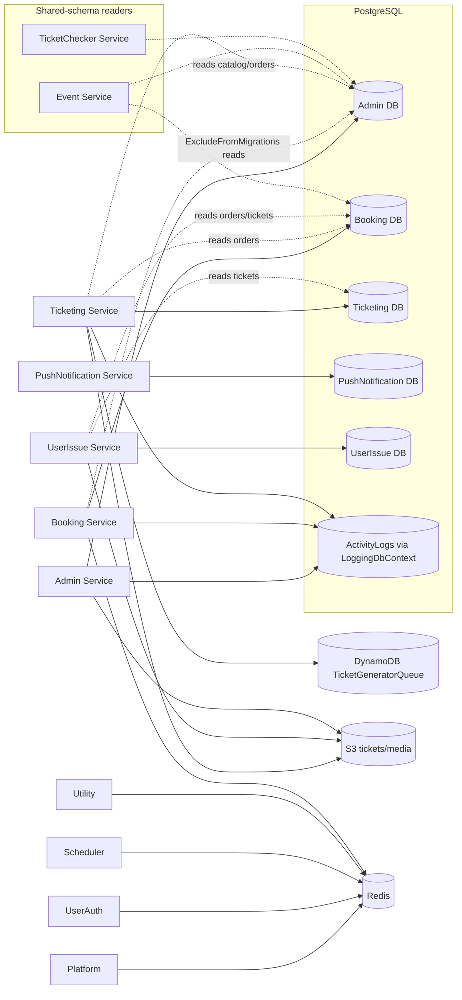

### 2.3 Logging / audit

| Component | Path | Entity |
|---|---|---|
| `LoggingDbContext` | `Core/ETP.Core.EntityFramework/LoggingDbContext.cs` | `ActivityLogs` → `ActivityLog` |
| Interceptor | `Core/ETP.Core.EntityFramework/Interceptors/ActivityLogInterceptor.cs` | Writes on EF SaveChanges |
| Migrations | `Core/ETP.Core.EntityFramework/Migrations/` (3) | Latest: `20251215120648_IncreaseActivityLogActionMaxLength` |

---

## 3. Per-Service Schema Reference

Authoritative column-level schema lives in each `*ModelSnapshot.cs`. Below: DbSets, ownership notes, and key ER diagrams.

---

### 3.1 Admin (primary catalog owner)

- **DbContext**: `Services/Admin/ETP.Admin.Storage/DbContexts/AdminDbContext.cs`
- **Connection**: `ConnectionStrings:Admin`
- **Schema**: `etp`
- **Migrations**: 78 — latest `20251022084417_Add_ExhibitionHall_TicketAttributes_DITF`
- **Snapshot**: `Services/Admin/ETP.Admin.Storage/Migrations/AdminDbContextModelSnapshot.cs`
- **Enums (Storage)**: `PaymentGateway` (`DgePay`, `SSLCommerz`)

#### DbSets (36)

| Aggregate | Entities |
|---|---|
| Promotions | `PromoCode`, `PromoCodeAssign`, `Discount`, `DiscountAssign` |
| Venue hierarchy | `Venue`, `VenueGallery`, `GalleryBlock`, `GalleryBlockEntryGates`, `BlockLevel`, `BlockLevelEntryGates`, `BlockLevelMiniGates` |
| Programs / events | `Program`, `ProgramVenue`, `ProgramVenueDetails`, `EventVenueDetails`, `Event`, `EventSegment`, `ProgramTeam`, `EventSettings` |
| Pricing / tickets config | `Currency`, `TicketPricing`, `TicketPricingAttribute`, `TicketLayoutConfig`, `TicketAttributes` |
| Settings / CMS | `ProgramSettings`, `SystemSettings`, `GeneralNotice`, `SocialMediaSettings`, `LandingPageImage`, `HeaderFooter` |
| Access control / scanning | `TicketCheckerGate`, `TicketCheckerGateUser`, `CheckedTicket` |
| Support / raffle | `UserIssue`, `UserIssueChatMessage`, `RaffleDraw` |

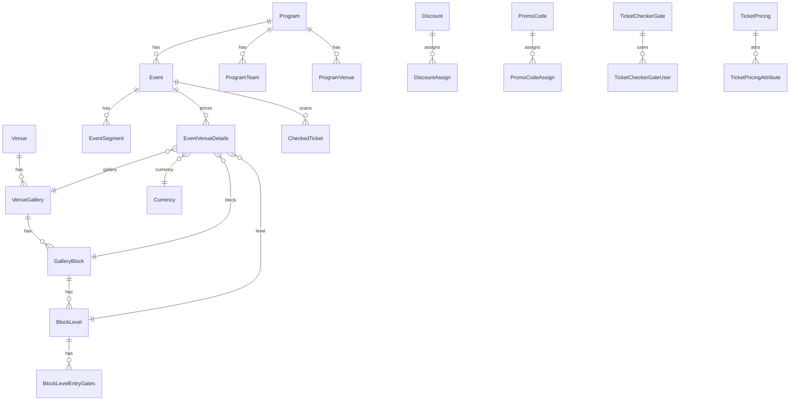

---

### 3.2 Booking (orders & capacity owner)

- **DbContext**: `Services/Booking/ETP.Booking.Storage/DbContexts/BookingDbContext.cs`
- **Connection**: `ConnectionStrings:Booking`
- **Schema**: `etp`
- **Migrations**: 32 — latest `20260409105407_addPreMergeNativeUserIDColumn`
- **Snapshot**: `Services/Booking/ETP.Booking.Storage/Migrations/BookingDbContextModelSnapshot.cs`
- **Owns**: `Capacity`, `SeatReservation`, `EventCapacityAdjustment`, `UserBookingOrder`, `BookedUserRecord`
- **Reads (ExcludeFromMigrations)**: `VenueGallery`, `GalleryBlock`, `BlockLevel`, `EventVenueDetails`, `Event`, `Currency`, `Discount`, `DiscountAssign`, `PromoCode`, `PromoCodeAssign`

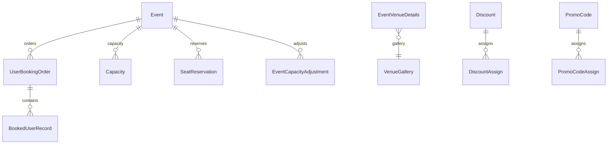

---

### 3.3 Event (read-only shared schema)

- **DbContext**: `Services/Event/ETP.Event.Storage/DbContexts/EventDbContext.cs`
- **Connection**: `ConnectionStrings:Event`
- **Migrations**: **none** — all entities `ExcludeFromMigrations(true)`
- **Maps**: venues, galleries, blocks, levels, gates, programs, events, segments, settings, capacities, seat reservations, CMS images, user issues, ticket-checker gates

> Schema changes for these tables must be made in **Admin** (catalog) or **Booking** (capacity/reservations), never via Event migrations.

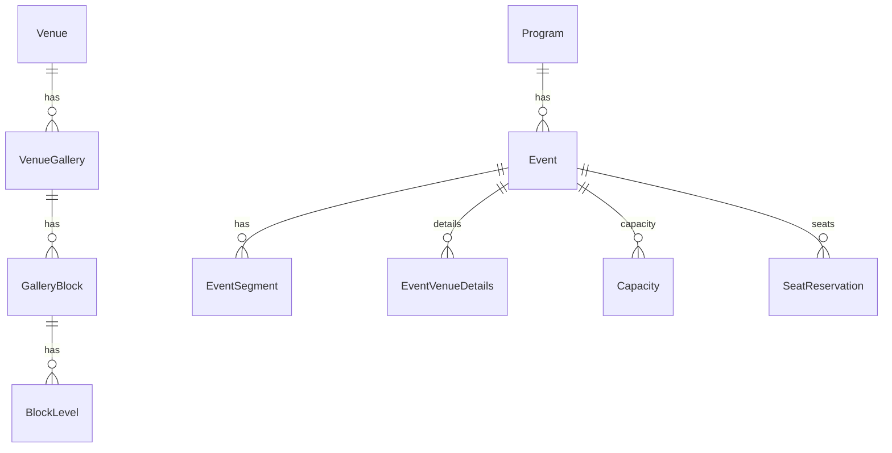

---

### 3.4 Ticketing

- **DbContext**: `Services/Ticketing/ETP.Ticketing.Storage/DbContexts/TicketingDbContext.cs`
- **Connection**: `ConnectionStrings:Ticketing`
- **Migrations**: 12 — latest `20260219112801_AddOneIdOrderSync`
- **Snapshot**: `Services/Ticketing/ETP.Ticketing.Storage/Migrations/TicketingDbContextModelSnapshot.cs`
- **Owns (typical)**: `Ticket`, `OfflineSoldTicket` (+ sync columns such as OneId)
- **Also maps**: `BlockLevel`, `BookedUserRecord`, `Currency`, `Discount*`, `Event`, `EventVenueDetails`, `GalleryBlock`, `ProgramTeam`, `TicketLayoutConfig`, `Venue`, `VenueGallery` (many shared / excluded from migrations)
- **Extra stores**: S3 ticket assets; DynamoDB `TicketGeneratorQueue`

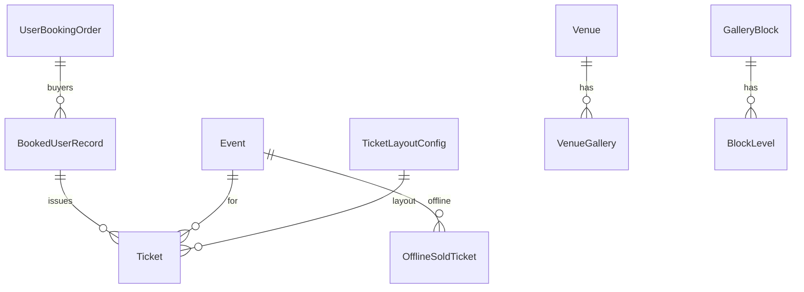

---

### 3.5 TicketChecker (read-only shared)

- **DbContext**: `Services/TicketChecker/ETP.TicketChecker.Storage/DbContexts/TicketCheckerDbContext.cs`
- **Connection**: `ConnectionStrings:TicketChecker`
- **Migrations**: **none**
- **DbSets**: `TicketCheckerGate`, `TicketCheckerGateUser`, `Event`, `BlockLevelEntryGates`

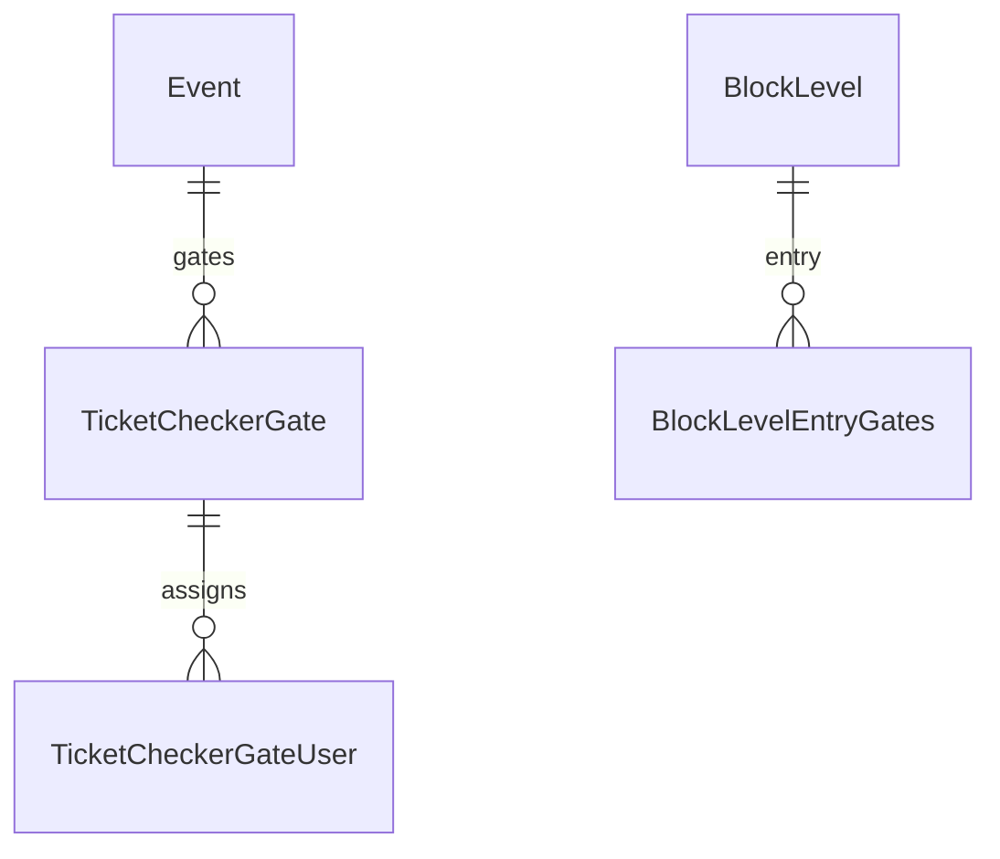

---

### 3.6 PushNotification

- **DbContext**: `Services/PushNotification/ETP.PushNotification.Storage/PushNotificationDbContext.cs`
- **Connection**: `ConnectionStrings:PushNotification`
- **Migrations**: 1 — `20250909114846_AddUserDeviceToken`
- **DbSets**: `UserDeviceToken`
- **Messaging**: `AWS:Queue:FirebaseNotification`

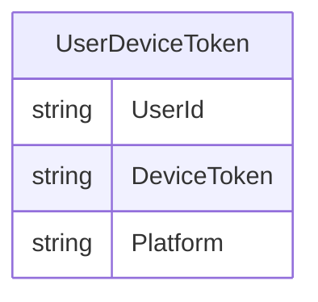

---

### 3.7 UserIssue

- **DbContext**: `Services/UserIssue/ETP.UserIssue.Storage/DbContexts/UserIssueDbContext.cs`
- **Connection**: `ConnectionStrings:UserIssue` (also present under Admin appsettings)
- **Migrations**: 3 — latest `20250910203315_MigrateUserIssueDataToReportedIssueFixed`
- **Owns**: `ReportedIssue`, `ReportedIssueChatMessage`
- **Reads**: `Ticket`, `UserBookingOrder` (orders excluded from migrations)
- **Files**: chat attachments via S3

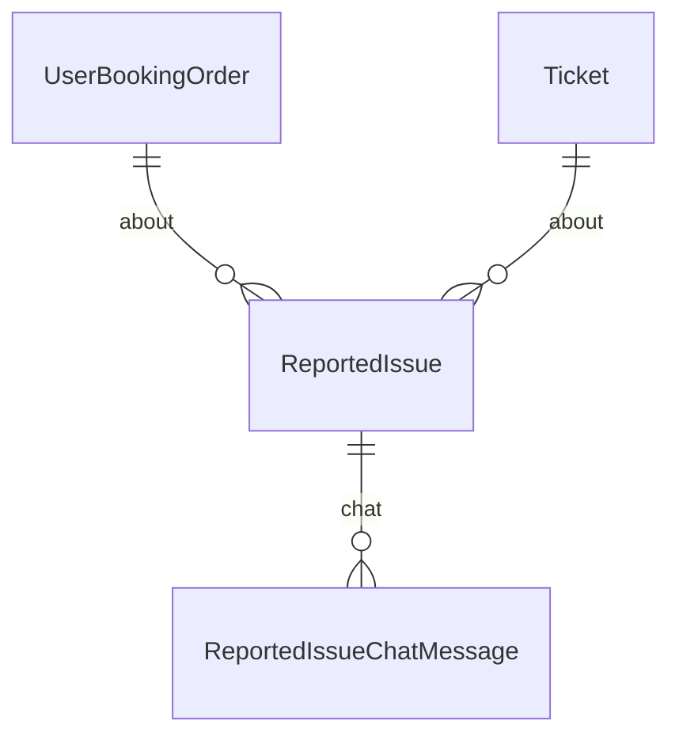

---

### 3.8 Platform / Scheduler / UserAuth / Utility

| Service | Storage project | Persistence |
|---|---|---|
| Platform | Empty stub (`ETP.Platform.Storage` csproj only) | Redis cache/locks |
| Scheduler | Empty stub | Redis + HTTP clients to Booking/Event/Ticketing/Admin/Notification |
| UserAuth | Empty stub | Redis + Cognito pools |
| Utility | **No Storage project** | Redis + SQS workers calling Admin/Booking/Ticketing |

---

### 3.9 Core LoggingDbContext

| Item | Value |
|---|---|
| DbSet | `ActivityLogs` → `ActivityLog` |
| Migrations | 3 |
| Latest | `20251215120648_IncreaseActivityLogActionMaxLength` |
| Snapshot | `Core/ETP.Core.EntityFramework/Migrations/LoggingDbContextModelSnapshot.cs` |

---

## 4. Migrations

### 4.1 Summary

| Project | Migrations (excl. snapshot/designer) | Latest | Owns schema? |
|---|---|---|---|
| Admin Storage | 78 | `20251022084417_Add_ExhibitionHall_TicketAttributes_DITF` | Yes |
| Booking Storage | 32 | `20260409105407_addPreMergeNativeUserIDColumn` | Partial |
| Ticketing Storage | 12 | `20260219112801_AddOneIdOrderSync` | Partial |
| UserIssue Storage | 3 | `20250910203315_MigrateUserIssueDataToReportedIssueFixed` | Partial |
| PushNotification Storage | 1 | `20250909114846_AddUserDeviceToken` | Yes |
| Core LoggingDbContext | 3 | `20251215120648_IncreaseActivityLogActionMaxLength` | Shared audit |
| Event / TicketChecker | 0 | — | Read-only shared |

### 4.2 EF Core commands

```bash
# Admin
dotnet ef migrations add MigrationName -p Services/Admin/ETP.Admin.Storage -s Services/Admin/ETP.Admin.Service
dotnet ef database update -p Services/Admin/ETP.Admin.Storage -s Services/Admin/ETP.Admin.Service

# Booking
dotnet ef migrations add MigrationName -p Services/Booking/ETP.Booking.Storage -s Services/Booking/ETP.Booking.Service
dotnet ef database update -p Services/Booking/ETP.Booking.Storage -s Services/Booking/ETP.Booking.Service

# Ticketing
dotnet ef migrations add MigrationName -p Services/Ticketing/ETP.Ticketing.Storage -s Services/Ticketing/ETP.Ticketing.Service
dotnet ef database update -p Services/Ticketing/ETP.Ticketing.Storage -s Services/Ticketing/ETP.Ticketing.Service

# PushNotification
dotnet ef migrations add MigrationName -p Services/PushNotification/ETP.PushNotification.Storage -s Services/PushNotification/ETP.PushNotification.Service
dotnet ef database update -p Services/PushNotification/ETP.PushNotification.Storage -s Services/PushNotification/ETP.PushNotification.Service

# UserIssue
dotnet ef migrations add MigrationName -p Services/UserIssue/ETP.UserIssue.Storage -s Services/UserIssue/ETP.UserIssue.Service
dotnet ef database update -p Services/UserIssue/ETP.UserIssue.Storage -s Services/UserIssue/ETP.UserIssue.Service
```

> Event and TicketChecker must **not** add migrations for shared tables. Change owner context (Admin/Booking) instead.

### 4.3 Conventions

- Prefer additive migrations; review drops/renames carefully against shared readers.
- Keep `ExcludeFromMigrations(true)` on entities owned by another service.
- After model changes, regenerate/commit the matching `*ModelSnapshot.cs`.
- Name migrations with timestamp + intent (`Add_…`, `Migrate…`, `add…Column`).

### 4.4 Migration workflow

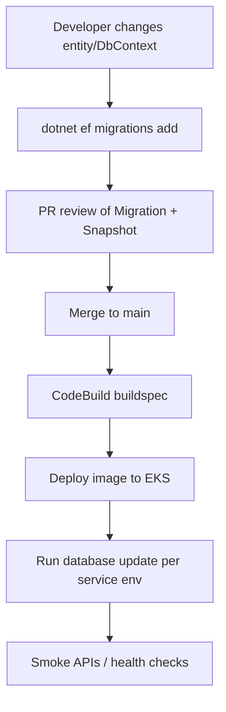

---

## 5. Reporting Structures

### 5.1 Ownership map

| Area | Service | Controllers | Managers | Data |
|---|---|---|---|---|
| Sales / revenue / dashboard | Booking | `ReportController`, `BookingReportController` | `BookingReportManager` | `UserBookingOrder` repos + `IEventClient` |
| Gate / duplicate scan | Admin | `TicketCheckerGateController` | `ITicketCheckerGateManager`, `ICheckedTicketManager` | Admin `CheckedTicket` / gate tables |
| Support tickets (user issues) | UserIssue | `ReportIssueController`, `ReportIssueChatController` | `ReportIssueManager`, `ReportIssueChatManager` | `ReportedIssue*` + Booking/Ticketing clients + S3 |

### 5.2 Booking report APIs (`api/v1/report` and `api/v1/dashboard`)

| Route | Purpose | Primary source |
|---|---|---|
| `GET admin/export-booking-orders` | Export order details | `IUserBookingOrderRepository` |
| `GET admin/revenue-report-list` | Revenue list by event datetime | `IUserBookingOrderManager` |
| `GET admin/booking-metrics` | Capacity / reservation metrics | Seat reservations, capacity adjustments, orders |
| `GET admin/event-revenue-summary` | Revenue summary | Orders |
| `GET admin/event-sales-summary` | Sales summary | Orders |
| `GET admin/event-sales-details` | Sales details report | Orders → `EventSalesDetailsReportData` |
| `GET admin/event-revenue-sales-details` | Revenue+sales details | Orders → `EventSalesRevenueDetailsReportData` |
| `GET admin/payment-discrepancy` | Payment discrepancy | Orders |
| `GET get-ticket-sales-summary` | Dashboard ticket sales | `IEventClient` + orders |
| `GET get-upcomming-seven-events` | Upcoming events widget | Event client + orders + venue details |
| `GET get-last-week-seats-sale-amount` | Weekly seats sold | Orders |
| `GET get-last-Month-seats-sale-amount` | Monthly seats sold | Orders |

**View / report models (Booking):**

- Domain: `BookingMetrics`, `RevenueReport`
- Storage: `EventRevenueSummary`, `EventSalesSummary`, `EventSalesDetailsReportData`, `EventSalesRevenueDetailsReportData`

### 5.3 Admin gate / duplicate-scan reports (`api/v1/ticket-checker-gate`)

| Route | Purpose | Model |
|---|---|---|
| `GET report/{eventId}` | Checker gate report | `TicketCheckerGateReportData` |
| `GET export/{eventId}` | Export checker report | same |
| `POST duplicate-tickets/{eventLongId}` | Duplicate scanned tickets | CheckedTicket manager |
| `GET reports/duplicate-entries` | Duplicate entries report | `DuplicateScannedReportData` |
| `GET reports/duplicate-entries/details` | Duplicate details | `DuplicateScannedDetailsReportData` |

### 5.4 UserIssue “report” APIs (support issues, not BI)

`api/v1/user-issue` and `api/v1/user-issue-chat` — CRUD/list/count for reported issues; chat with S3 attachments. Depends on Booking/Ticketing/Serverless HTTP clients for order/ticket enrichment.

### 5.5 Reporting data flow

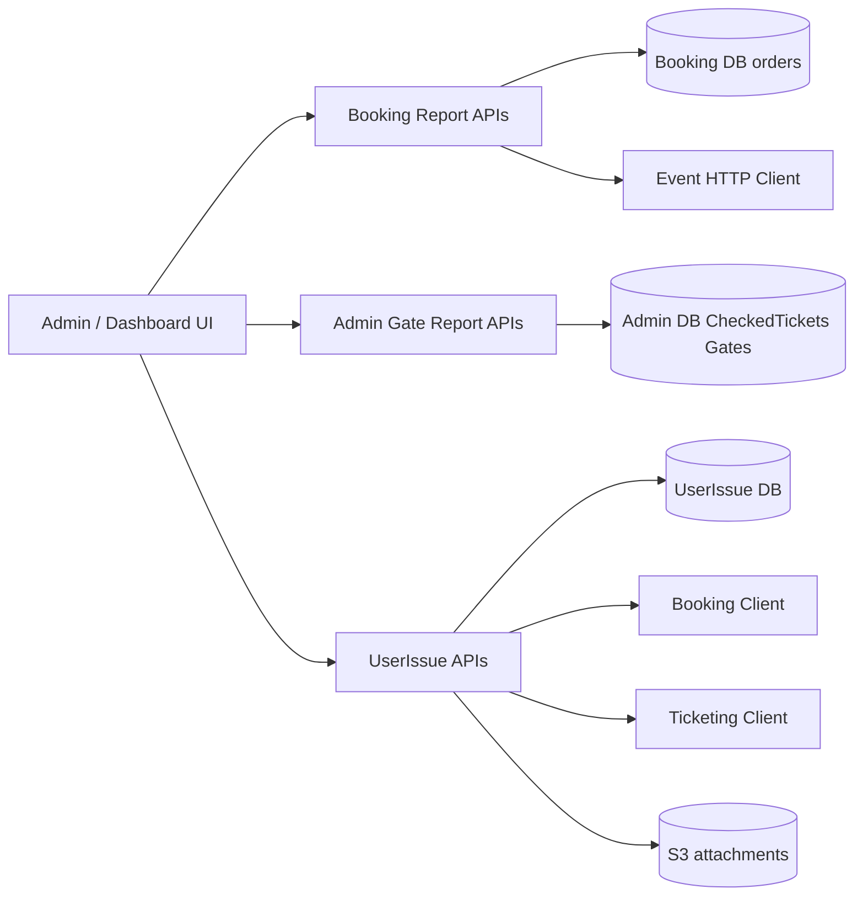

---

## 6. Backup and Recovery

> **Note:** The repository contains **no** dedicated backup/restore scripts. Procedures below are derived from infrastructure patterns (PostgreSQL/RDS via connection strings, S3, DynamoDB, Redis, SSM, EKS) and recommended operational practice.

### 6.1 What to back up

| Store | Criticality | Rebuildable? | Mechanism |
|---|---|---|---|
| PostgreSQL Admin | Critical (catalog, gates, scans) | No | RDS automated snapshots + PITR |
| PostgreSQL Booking | Critical (orders, capacity, money) | No | RDS snapshots + PITR |
| PostgreSQL Ticketing | Critical (tickets, offline sales) | Partial | RDS snapshots + PITR; S3 ticket PDFs separately |
| PostgreSQL UserIssue | High | Partial | RDS snapshots; S3 chat files |
| PostgreSQL PushNotification | Medium | Partial (re-register devices) | RDS snapshots |
| ActivityLogs | Medium | Prefer retain | Same DB family as configured LoggingDbContext |
| S3 buckets | Critical (media, tickets, chat) | No | Versioning + cross-region replication |
| DynamoDB ticket queue | Medium | Yes (re-queue) | DynamoDB PITR optional |
| Redis | Low | **Yes** | No backup required; warm from DB |
| Cognito | Critical (identity) | No | Cognito export / AWS Backup (ops-owned) |
| SSM Parameter Store | Critical (config/secrets) | Documented restore | Export parameters per env |

### 6.2 SSM configuration keys (secrets live here)

Pattern: `/rvl/{env}/{service}-service-appsettings`

| Env | Examples |
|---|---|
| prod | `/rvl/prod/admin-service-appsettings` … `/rvl/prod/userissue-service-appsettings` (11 services) |
| dev | `/rvl/dev/...` same service names |

Services covered: admin, booking, event, platform, scheduler, ticketchecker, ticketing, userauth, utility, pushnotification, userissue.

### 6.3 Recommended restore runbook (PostgreSQL service DB)

1. Identify blast radius (which connection string / RDS instance).
2. Freeze writers: scale the owning Deployment to 0 in the target namespace.
3. Restore RDS snapshot (or PITR) to a new instance **or** overwrite carefully after approval.
4. Point SSM/`ConnectionStrings:{Service}` at the restored endpoint (or promote restored instance).
5. Align schema: `dotnet ef database update` for that service’s Storage project (or run migration job in CI).
6. Validate: health checks, sample report queries, critical write path smoke test.
7. Scale Deployment back up; monitor error rates and SQS DLQs.
8. For shared-schema readers (Event, TicketChecker), restart pods after Admin/Booking DB restore so connection pools refresh.

### 6.4 S3 / DynamoDB / Redis

- **S3**: enable versioning; restore objects by version ID; verify CloudFront invalidation if CDN caches stale assets.
- **DynamoDB** (`TicketGeneratorQueue`): enable PITR if retention required; otherwise purge and re-enqueue ticket generation messages.
- **Redis**: flush or recreate; capacity locks will rebuild from Booking DB truth.

### 6.5 Backup / restore sequence

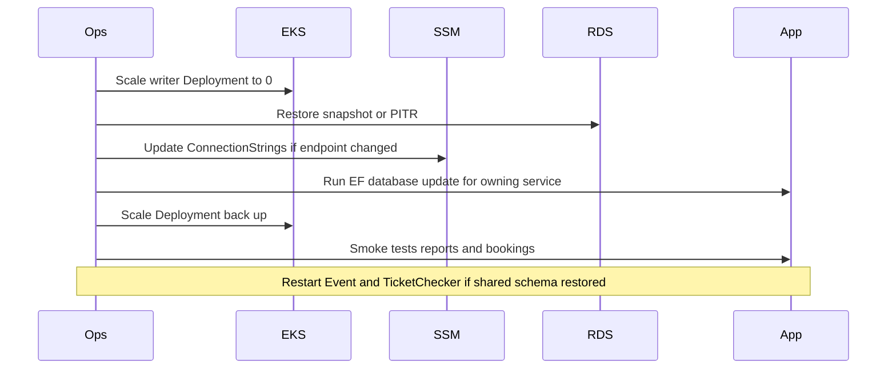

---

## 7. Data Dependencies (Cross-Service)

### 7.1 HTTP clients (primary integration path)

Most inter-service calls use `Core/ETP.Core/ServiceClient/*` (`AdminClient`, `BookingClient`, `EventClient`, `TicketingClient`, `NotificationClient`, `PushNotificationClient`, `ServerlessClient`, `UserClient`, `UserIssueClient`).

| Caller | Outbound HTTP clients |
|---|---|
| Admin | Event, Notification, PushNotification, Serverless, Booking, Ticketing, UserIssue (+ Admin.Integration Event/Auth/user providers) |
| Booking | Event, Ticketing, User, Serverless, Notification (+ payment gateways DgePay/SSLCommerz, NBR) |
| Event | Booking |
| Ticketing | Event, Booking, User, Serverless (+ TSP, OneId) |
| TicketChecker | Ticketing |
| Scheduler | Booking, Event, Ticketing, Admin, Notification |
| Utility | Admin, Booking, Ticketing |
| UserIssue | Booking, Serverless, Ticketing |

### 7.2 Client SDK ProjectReferences

| Consumer | References |
|---|---|
| Booking Service/Domain | `ETP.Event.Client` |
| Ticketing Service/Domain | `ETP.Event.Client` |
| Event Service | `ETP.Event.Client` (own) |
| Admin Domain | `ETP.Admin.Client` (own) |

Client SDKs that exist but are not widely ProjectReferenced: Booking, Ticketing, Scheduler, UserAuth, TicketChecker clients (HTTP goes through Core ServiceClient).

### 7.3 Messaging dependencies (SQS)

| Message | Typical publisher | Queue config key |
|---|---|---|
| `LevelCapacityUpdate` | Booking | `AWS:Queue:OrderSuccess` |
| `EventLiveCapacityUpdate` | Booking | `AWS:Queue:EventCapacity` |
| `VatChallanProcessing` | Booking | `AWS:Queue:VatChallanProcessing` |
| `TicketProcessingRequest` | Ticketing | `AWS:Queue:TicketProcessing` |
| `SignedTicketGeneration` | Ticketing | `AWS:Queue:TicketSigning` |
| `FirebaseNotificationRequest` / bulk | PushNotification | `AWS:Queue:FirebaseNotification` |

MassTransit EventBus is registered on Booking, Scheduler, TicketChecker, Utility. Defined event type includes `UserAccountConfirmation`; no `IConsumer` implementations were found in-repo (consumers may be incomplete or external).

### 7.4 Logical data dependency graph

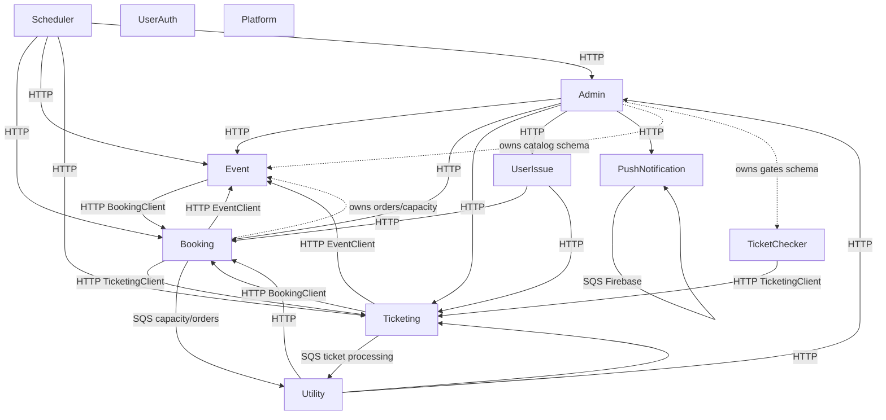

### 7.5 Shared-table dependency rules

1. **Admin owns** venue/program/event catalog, pricing config, gates, checked tickets, CMS.
2. **Booking owns** capacities, seat reservations, capacity adjustments, booking orders, booked user records.
3. **Ticketing owns** issued tickets / offline sold tickets (and DynamoDB generation queue).
4. **UserIssue owns** reported issues + chat messages.
5. **PushNotification owns** device tokens.
6. Readers must treat foreign tables as **immutable schema** (`ExcludeFromMigrations`).

---

## 8. Operational Runbook Snippets

### 8.1 Local ports (docker-compose)

| Service | Port |
|---|---|
| booking-service | 5001 |
| event-service | 5002 |
| scheduler-service | 5005 |
| ticketchecker-service | 5006 |
| ticketing-service | 5007 |
| admin-service | 5008 |
| utility-service | 5009 |
| pushnotification-service | 5010 |
| userissue-service | 5011 |

```bash
docker-compose build
docker-compose up
docker-compose up admin-service
```

### 8.2 Apply migrations (per env)

Use the commands in [§4.2](#42-ef-core-commands) against the environment connection string from User Secrets (local) or SSM (deployed).

Order suggestion when bootstrapping a fresh environment:

1. Admin (catalog)
2. Booking (orders/capacity)
3. Ticketing
4. UserIssue
5. PushNotification
6. LoggingDbContext (if separate database)
7. Restart Event + TicketChecker (no migrations; they consume shared schema)

### 8.3 Rotate secrets

1. Update `/rvl/{env}/{service}-service-appsettings` in AWS Systems Manager Parameter Store.
2. Redeploy or recreate the Kubernetes secret (buildspec already does `kubectl create secret generic … --dry-run=client | kubectl apply`).
3. Rolling restart the affected Deployment.

### 8.4 Key appsettings sections (placeholders only)

- `ConnectionStrings:{Admin|Booking|Event|Platform|Scheduler|TicketChecker|Ticketing|UserAuth|UserIssue|PushNotification}`
- `Services:{…}` peer base URLs
- `Cache:Redis`, `DistributedLock:Redis`
- `AWS:Region`, `AWS:Bucket`, `AWS:CognitoPool`, `AWS:Queue:*`
- Ticketing extras: `AWS:Ticket:*`, `TSP:*`, `OneIdSettings:*`

---

## 9. Appendix — File Index

### 9.1 DbContexts

| Service | Path |
|---|---|
| Admin | `Services/Admin/ETP.Admin.Storage/DbContexts/AdminDbContext.cs` |
| Booking | `Services/Booking/ETP.Booking.Storage/DbContexts/BookingDbContext.cs` |
| Event | `Services/Event/ETP.Event.Storage/DbContexts/EventDbContext.cs` |
| Ticketing | `Services/Ticketing/ETP.Ticketing.Storage/DbContexts/TicketingDbContext.cs` |
| TicketChecker | `Services/TicketChecker/ETP.TicketChecker.Storage/DbContexts/TicketCheckerDbContext.cs` |
| PushNotification | `Services/PushNotification/ETP.PushNotification.Storage/PushNotificationDbContext.cs` |
| UserIssue | `Services/UserIssue/ETP.UserIssue.Storage/DbContexts/UserIssueDbContext.cs` |
| Core audit | `Core/ETP.Core.EntityFramework/LoggingDbContext.cs` |

### 9.2 Model snapshots

| Service | Path |
|---|---|
| Admin | `Services/Admin/ETP.Admin.Storage/Migrations/AdminDbContextModelSnapshot.cs` |
| Booking | `Services/Booking/ETP.Booking.Storage/Migrations/BookingDbContextModelSnapshot.cs` |
| Ticketing | `Services/Ticketing/ETP.Ticketing.Storage/Migrations/TicketingDbContextModelSnapshot.cs` |
| PushNotification | `Services/PushNotification/ETP.PushNotification.Storage/Migrations/PushNotificationDbContextModelSnapshot.cs` |
| UserIssue | `Services/UserIssue/ETP.UserIssue.Storage/Migrations/UserIssueDbContextModelSnapshot.cs` |
| Logging | `Core/ETP.Core.EntityFramework/Migrations/LoggingDbContextModelSnapshot.cs` |

### 9.3 Reporting entry points

| File | Role |
|---|---|
| `Services/Booking/ETP.Booking.Service/Api/ReportController.cs` | Sales/revenue/metrics APIs |
| `Services/Booking/ETP.Booking.Service/Api/BookingReportController.cs` | Dashboard APIs |
| `Services/Booking/ETP.Booking.Domain/Managers/BookingReportManager.cs` | Report orchestration |
| `Services/Admin/ETP.Admin.Service/Api/TicketCheckerGateController.cs` | Gate/duplicate reports |
| `Services/UserIssue/ETP.UserIssue.Service/Api/ReportIssueController.cs` | Support issue CRUD |
| `Services/UserIssue/ETP.UserIssue.Service/Api/ReportIssueChatController.cs` | Issue chat + S3 |

### 9.4 Infra

| File | Role |
|---|---|
| `docker-compose.yaml` | Local/CI image ports |
| `buildspec-prod.yaml` / `buildspec-dev.yml` | SSM parameter names + EKS deploy |
| `deployment/k8s/**` | Per-env Kubernetes manifests |
| `Services/*/ETP.*.Service/appsettings.json` | Config keys (secrets via User Secrets / SSM) |

---

## Quick mental model

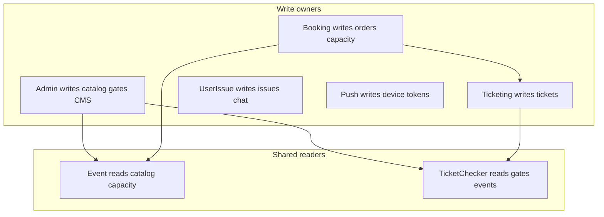

When in doubt:

1. Find the **DbSet** and whether `ExcludeFromMigrations` is set.
2. If excluded, change schema in the **owning** service only.
3. Use **model snapshots** for exact columns/indexes.
4. Treat Redis as disposable cache; treat PostgreSQL + S3 as source of truth.
