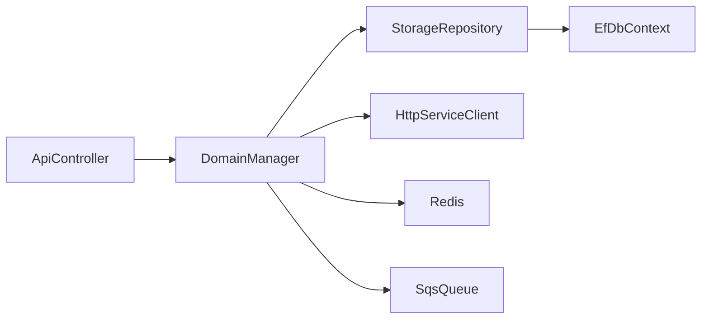
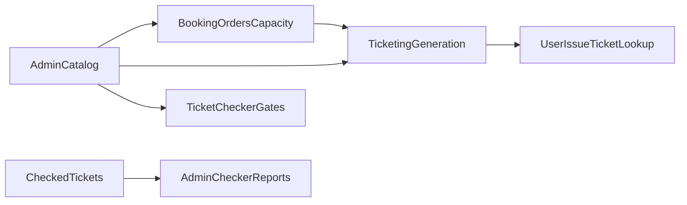
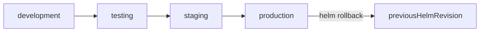

# ETP Backend - Internal Team Upskilling Context

**Generated:** 2026-07-10  
**Project:** Event Ticketing Platform (ETP) Backend (`rvl-ticketbangla-backend`)  
**Purpose:** Upskill internal teams on frameworks, business logic, testing methodologies, debugging approaches, deployment processes, and operational workflows.

---

## 1. Purpose and Audience

### Who this is for
- Backend engineers joining or rotating onto ETP services
- QA engineers writing/running API, unit, and integration tests
- DevOps / platform engineers deploying and rolling back releases
- Support / ops engineers triaging production incidents

### Expected outcomes
- Shared vocabulary for architecture, domain flows, and ownership boundaries
- Faster local setup and first productive PR
- Consistent debugging and incident triage steps
- Clear understanding of what is documented in-repo vs what needs external owner confirmation

### How to use this file
1. Read sections 2-3 for architecture and domain context.
2. Practice section 4-5 with local labs.
3. Complete section 6-7 before owning a release or on-call shift.
4. Follow the 30-60-90 path in section 8.

### Primary source documents
| Topic | Source |
|---|---|
| Setup / stack | `README.md` |
| Architecture / domain | `PROJECT_CONTEXT.md` |
| Storage / migrations / dependencies | `storage_schema_and_data_models.md` |
| Ticket generation deep dive | `ticket_generation_process_context.md` |
| Testing | `Tests/README.md`, `Tests/RUN_TESTS_AND_SEED_DATA.md` |
| CI tests | `.github/workflows/tests.yml` |
| Helm deploy / rollback | `deployment/helm/docs/MIGRATION_GUIDE.md`, `deployment/helm/deploy.sh` |
| Console service runs | `RUNNING_SERVICES_CONSOLE.md` |

---

## 2. Frameworks and Architecture Upskilling

### 2.1 Current source of truth (important)

| Topic | Treat as truth | Notes |
|---|---|---|
| Primary RDBMS | **PostgreSQL 15** | Confirmed by `docker-compose.local.yml`, `env.template`, EF Npgsql usage, and `PROJECT_CONTEXT.md` |
| README "SQL Server" wording | Outdated / conflicting | Prefer PostgreSQL for local and documented runtime |
| Mapping library | **Mapster** | `PROJECT_CONTEXT.md` notes Mapster replacing AutoMapper |
| ORM | EF Core 8 + Npgsql | Per-service Storage projects and migrations |
| Runtime | .NET 8 / ASP.NET Core Web API | All microservices |

### 2.2 Technology stack to learn

**Core**
- .NET 8, C#, ASP.NET Core Web API
- Entity Framework Core 8
- Mapster, Serilog, Swagger/OpenAPI
- Polly (retry / circuit breaker)

**Data / infra**
- PostgreSQL (transactional data)
- Redis (cache, locks, batch status)
- AWS S3 (ticket PDFs / media)
- AWS DynamoDB (activity / audit style storage)
- AWS SQS (async jobs)
- AWS Cognito (auth user pools)
- AWS EKS + Helm (deployment)
- AWS SSM Parameter Store (prod config/secrets)

### 2.3 Service architecture pattern

Each microservice follows:

```
Service/
├── Domain/       # Managers, interfaces, business rules
├── Service/      # Controllers, Program.cs, DI, workers
├── Storage/      # DbContext, repositories, migrations, models
├── Integration/  # External integrations (notably Admin)
└── Client/       # Typed HTTP clients for other services
```

**Dependency rule:** Service -> Domain -> Storage. Domain defines interfaces; Storage implements them.



### 2.4 Microservices map

| Service | Local port (docs) | Primary responsibility |
|---|---|---|
| Admin | 5008 | Catalog, venues, programs, events, gates, discounts, admin users |
| Booking | 5001 | Orders, capacity, reservations, payments |
| Event | 5002 | Event read/query surface |
| Ticketing | 5007 | Ticket/PDF generation, batches, POS print |
| TicketChecker | 5006 | Gate scan / pass validation |
| UserAuth | 5003 | End-user auth |
| Scheduler | 5005 | Background jobs / cleanup |
| Utility | 5009 | PDF merge / file utilities |
| PushNotification | 5010 | Device tokens / push |
| UserIssue | 5011 | Reported/public issues + chat |
| Platform | - | Platform utilities (storage project currently empty) |

### 2.5 Hands-on lab (frameworks)

1. Start infra: `docker-compose -f docker-compose.local.yml up -d`
2. Copy env: `cp env.template .env`
3. Run migrations: `./scripts/run-all-migrations.sh`
4. Run Admin: `dotnet run --project Services/Admin/ETP.Admin.Service`
5. Open Swagger: `http://localhost:5008/swagger`
6. Trace one endpoint: Controller -> Manager -> Repository -> DbContext

**Checkpoint:** Explain Clean Architecture dependency direction and name the Storage project for Admin.

---

## 3. Business Logic Upskilling

### 3.1 Domain vocabulary

- **Program**: multi-tenant organizer boundary (`ProgramId`)
- **Event**: sellable event under a program
- **Venue hierarchy**: Venue -> VenueGallery -> GalleryBlock -> BlockLevel (+ gates)
- **Capacity**: available seats/slots per event/gallery/block/level
- **UserBookingOrder**: customer order lifecycle (Pending -> Paid/Failed/Cancelled/Requested/Generated)
- **SeatReservation**: partner/complimentary reservation batches
- **Ticket / TicketBatch**: generated tickets and POS assignment batches
- **CheckedTicket**: gate entry record
- **ReportedIssue / PublicIssue**: support intake (UserIssue service; distinct from Admin `UserIssues`)

### 3.2 Core workflow A - Booking and payment

**Primary code**
- `Services/Booking/ETP.Booking.Domain/Managers/UserBookingOrderManager.cs`
- `Services/Booking/ETP.Booking.Domain/Managers/CapacityManager.cs`
- `Services/Booking/ETP.Booking.Domain/Managers/DgePayPaymentManager.cs`
- `Services/Booking/ETP.Booking.Domain/Managers/SSLCommerzPaymentManager.cs`

**Flow**
1. User selects event/level seats.
2. Capacity is validated/locked (Redis distributed lock + DB capacity).
3. Order created as Pending with pricing/VAT/discount/promo.
4. Payment initiated (DgePay or SSLCommerz).
5. Callback updates order status.
6. On Paid/Requested path, ticket generation is triggered (async/queue).
7. On failure/cancel, locked capacity is released.

**Status filter used by many reports:** Paid(2), Requested(4), Generated(5).

### 3.3 Core workflow B - Ticket generation

**Primary code / docs**
- `Services/Ticketing/ETP.Ticketing.Domain/Managers/TicketManager.cs`
- `Services/Ticketing/ETP.Ticketing.Domain/Managers/TicketBatchManager.cs`
- `ticket_generation_process_context.md`
- workflow context files under `workflow/`

**Flow**
1. Booking/reservation confirms generation request.
2. Ticketing fetches event/layout/reservation data.
3. Ticket numbers generated; PDF rendered (PdfSharpCore) with QR.
4. PDF uploaded to S3; ticket row updated (`Tickets`).
5. Optional batch assignment for counter/POS printing (`TicketBatches`).
6. Redis keys may be set for checker validation.

### 3.4 Core workflow C - Ticket checking

**Primary code**
- `Services/TicketChecker/ETP.TicketChecker.Domain/Managers/TicketsManager.cs`
- `Services/TicketChecker/ETP.TicketChecker.Domain/Managers/PassCheckerScanInfoManager.cs`
- Admin gate/report managers for `CheckedTickets`

**Flow**
1. Checker scans QR / pass.
2. Validate authenticity, expiry, gate permissions, duplicate/limit rules.
3. Persist/check entry (`CheckedTickets` owned by Admin path; pass info in TicketChecker `PassCheckerInfos`).
4. Admin reports aggregate gate/duplicate/manual entry metrics.

### 3.5 Core workflow D - User issues

**Primary code**
- `Services/UserIssue/ETP.UserIssue.Domain/Managers/ReportIssueManager.cs`
- `Services/UserIssue/ETP.UserIssue.Domain/Managers/PublicIssueManager.cs`
- Storage entities under `Services/UserIssue/ETP.UserIssue.Storage/Entities/`

**Flow**
1. User/public submits issue tied to order context (`PublicOrderId`).
2. Issue stored in `ReportedIssues` or `PublicIssues`.
3. Chat messages stored in `ReportedIssueChatMessage`.
4. Ticket lookup may read Ticketing-owned `Tickets` (ExcludeFromMigrations in UserIssue).

### 3.6 Ownership boundaries (must memorize)

From `storage_schema_and_data_models.md`:

| Write owner | Owns |
|---|---|
| Admin | Catalog/config, gates, CheckedTickets |
| Booking | Capacities, SeatReservations, UserBookingOrders, BookedUserRecords |
| Ticketing | Tickets, TicketBatches |
| TicketChecker | PassCheckerInfos |
| UserIssue | ReportedIssues, PublicIssues, chat messages |
| Event | No owned migrations (consumer context) |



### 3.7 Hands-on lab (business logic)

1. Create/inspect an event and venue hierarchy in Admin Swagger.
2. Place a booking and inspect `UserBookingOrders` / capacity changes.
3. Follow ticket generation status to `Tickets`.
4. Scan/check a ticket path and inspect report endpoints.
5. Create a UserIssue against an order and confirm ticket correlation fields.

**Checkpoint:** Draw the Booking -> Ticketing -> TicketChecker handoff from memory.

---

## 4. Testing Methodologies Upskilling

### 4.1 Test pyramid in this repo

| Type | Location | Purpose |
|---|---|---|
| Unit | `Tests/ETP.Tests.Unit.Admin`, `Tests/ETP.Tests.Unit.Booking` | Manager/business logic with mocks (xUnit + Moq) |
| API | `Tests/ETP.Tests.Playwright` | HTTP endpoint contracts via Playwright |
| Integration | `Tests/ETP.Tests.Integration` | Service pipeline / persistence style tests |
| Smoke | filter `Category=Smoke` | Fast confidence checks |
| Data seeder | `Tests/ETP.Tests.DataSeeder` | Demo/realistic seed data |

Coverage goals from `Tests/README.md`: unit >80%, critical flows covered by integration/API.

### 4.2 Standard commands

```bash
# All tests
dotnet test

# By project
dotnet test Tests/ETP.Tests.Playwright/ETP.Tests.Playwright.csproj
dotnet test Tests/ETP.Tests.Unit.Admin/ETP.Tests.Unit.Admin.csproj
dotnet test Tests/ETP.Tests.Unit.Booking/ETP.Tests.Unit.Booking.csproj
dotnet test Tests/ETP.Tests.Integration/ETP.Tests.Integration.csproj

# Filters
dotnet test --filter "Category=Smoke"
dotnet test --filter "Category=API"
dotnet test --filter "Service=Admin"

# Coverage
dotnet test /p:CollectCoverage=true /p:CoverletOutputFormat=opencover
```

### 4.3 Local test prerequisites

```bash
docker-compose -f docker-compose.local.yml up -d
./scripts/run-all-migrations.sh
# start services (console helper or individual dotnet run)
./scripts/run-tests-and-seed.sh   # if available in your environment
```

Playwright first-time setup:

```bash
cd Tests/ETP.Tests.Playwright
dotnet build
pwsh bin/Debug/net8.0/playwright.ps1 install
```

### 4.4 CI workflow notes (`.github/workflows/tests.yml`)

**Explicit**
- Manual trigger (`workflow_dispatch`)
- Spins up Postgres 15 + Redis 7
- Builds solution, installs Playwright, runs unit/API/integration tests
- Uploads TRX results, coverage, screenshots on failure

**Gap**
- Migration step is a placeholder (`# Add your migration commands here`)
- Treat CI as partially complete for DB bootstrap until that step is filled

### 4.5 Testing conventions to teach

- AAA pattern (Arrange / Act / Assert)
- Naming: `Method_Scenario_Expected`
- Categories/traits for filtering
- Prefer generators over hardcoded fixtures
- Always await async APIs (no `.Result`)

### 4.6 Hands-on lab (testing)

1. Run smoke tests and capture pass/fail.
2. Add or modify one unit test in Booking/Admin managers.
3. Run one Playwright API test against a live local service.
4. Seed demo data and verify via Swagger counts.

**Checkpoint:** Explain when to choose unit vs API vs integration for a capacity bug.

---

## 5. Debugging Approaches Upskilling

### 5.1 Local IDE debugging (Visual Studio, Rider, VS Code)

Before attaching a debugger, start local infra (`docker-compose -f docker-compose.local.yml up -d`), ensure `.env` / connection strings are set, and prefer debugging **one service at a time** first.

Common breakpoint targets:
- API controller action for the failing endpoint
- Domain manager method (e.g. `UserBookingOrderManager`, `TicketManager`, `TicketsManager`)
- Repository / raw SQL report methods
- Payment callback handlers
- Background workers under `*/Workers/`

#### Visual Studio 2022

1. Open `RVL-ETP.BackEnd.sln`.
2. Right-click the target service project (example: `ETP.Booking.Service`) -> **Set as Startup Project**.
3. Confirm launch profile (Project / `http` / `https`) and port match docs (Booking `5001`, Admin `5008`, etc.).
4. Set breakpoints in Controller/Manager code.
5. Press **F5** (Debug) or **Ctrl+F5** (run without debugger).
6. Hit the endpoint via Swagger or Postman; step with **F10** / **F11**.
7. Use **Debug > Windows > Locals / Watch / Call Stack / Exception Settings**.
8. For multiple services: **Solution Properties > Startup Project > Multiple startup projects** (set several to Start). Keep this limited; too many debug processes are hard to reason about.
9. To debug a test: Test Explorer -> right-click test -> **Debug**.

Tips:
- Enable **Just My Code** initially; disable it when stepping into EF/Polly internals is required.
- If config is missing, use **Manage User Secrets** on the Service project or load `.env` values into launch environment variables.
- Attach to an already-running `dotnet` process via **Debug > Attach to Process** if the service was started from console.

#### JetBrains Rider

1. Open `RVL-ETP.BackEnd.sln` in Rider.
2. Create/select a **.NET Project** run configuration for the Service `.csproj` (example: `Services/Admin/ETP.Admin.Service/ETP.Admin.Service.csproj`).
3. Set environment variables in the run configuration (`ConnectionStrings__*`, Redis, AWS/LocalStack endpoints) to match `env.template`.
4. Set breakpoints; start with the bug icon / **Shift+F9** (Debug).
5. Use **Debugger** tool window: Frames, Variables, Watches, Evaluate Expression.
6. For compound debugging: **Run > Edit Configurations > + > Compound**, add multiple service configs (Admin + Booking, etc.).
7. Debug tests from the Unit Tests tool window (gutter icon or right-click -> Debug).
8. Attach to a running process: **Run > Attach to Process**.

Tips:
- Rider NuGet restore + solution-wide analysis help catch DI/config issues before runtime.
- Use **Break on exception** for unhandled exceptions while investigating payment/ticket generation failures.

#### VS Code

Prerequisites: **C# Dev Kit** (or C# + .NET extensions), solution opened at repo root.

1. Ensure infra is up and the service builds: `dotnet build Services/Booking/ETP.Booking.Service`.
2. Create `.vscode/launch.json` (repo currently has no checked-in launch config). Example for Booking:

```json
{
  "version": "0.2.0",
  "configurations": [
    {
      "name": "Debug Booking Service",
      "type": "coreclr",
      "request": "launch",
      "preLaunchTask": "build",
      "program": "${workspaceFolder}/Services/Booking/ETP.Booking.Service/bin/Debug/net8.0/ETP.Booking.Service.dll",
      "args": [],
      "cwd": "${workspaceFolder}/Services/Booking/ETP.Booking.Service",
      "envFile": "${workspaceFolder}/.env",
      "console": "internalConsole",
      "logging": { "moduleLoad": false }
    },
    {
      "name": "Attach to .NET Process",
      "type": "coreclr",
      "request": "attach"
    }
  ]
}
```

3. Add a build task in `.vscode/tasks.json` if needed (`dotnet build` on the service/solution).
4. Set breakpoints; start **Run and Debug** (`F5`) with the service configuration.
5. Call Swagger/Postman; use the Debug sidebar for variables/call stack.
6. Debug tests via Testing view, or filter a test then use the C# testing UI **Debug Test**.

Tips:
- Prefer `envFile` pointing at repo `.env` so connection strings match Docker Compose.
- For multi-service local debugging in VS Code, run one service under `F5` and others via `dotnet run` / console scripts, then attach only when needed.
- If breakpoints show hollow/unbound, confirm `Debug` build and matching PDB paths.

#### Shared IDE debugging habits for this codebase

- Break in Domain managers first; controllers are usually thin.
- When debugging Booking capacity, also watch Redis keys and `Capacities.RowVersion`.
- When debugging Ticketing, confirm whether the path is sync API vs SQS background worker (`*/Workers/`).
- Keep Program/auth headers in the request if the endpoint is tenant-protected.
- Never commit secrets into `launch.json` / run configs; use `.env` or user-secrets.

### 5.2 Local startup failures

Checklist:
1. Docker infra up: `docker-compose -f docker-compose.local.yml ps`
2. Postgres reachable: `docker exec -it etp-postgres-local psql -U etp_user -d etp_admin_db`
3. Redis reachable: `docker exec -it etp-redis-local redis-cli ping`
4. Port free (example Admin 5008)
5. `.env` / connection strings present
6. Service health: `curl http://localhost:5008/health`

Console multi-service logs: see `RUNNING_SERVICES_CONSOLE.md` (`./scripts/start-all-services-console.sh`).

### 5.3 Migration failures

```bash
# Install/update tools
dotnet tool install --global dotnet-ef
dotnet tool update --global dotnet-ef

# Per-service update
dotnet ef database update -p Services/Admin/ETP.Admin.Storage -s Services/Admin/ETP.Admin.Service
dotnet ef database update -p Services/Booking/ETP.Booking.Storage -s Services/Booking/ETP.Booking.Service
dotnet ef database update -p Services/Ticketing/ETP.Ticketing.Storage -s Services/Ticketing/ETP.Ticketing.Service
```

Also remember:
- Most services auto-migrate on startup via `MigratePendingDatabase()`
- Event/TicketChecker initial migrations can be empty (consumer contexts)
- `scripts/run-all-migrations.sh` currently omits UserIssue and PushNotification

### 5.4 Runtime / business-flow debugging

| Symptom | First places to inspect |
|---|---|
| Oversell / capacity mismatch | Redis locks + `Capacities` + `CapacityManager` |
| Payment stuck Pending | payment callback handlers in Booking managers + `PaymentInfo` JSON |
| Tickets not generated | SQS workers, `TicketManager`, S3 credentials, reservation status |
| Checker rejects valid ticket | QR payload, gate mapping, `CheckedTickets`, pass limits/Redis |
| Issue cannot find order/ticket | `PublicOrderId` correlation + Ticketing `Tickets` mapping |

Use Serilog structured logs; never log secrets/tokens/PII.

### 5.5 Test failure debugging

```bash
# Playwright headed + trace
HEADLESS=false ENABLE_TRACE=true dotnet test Tests/ETP.Tests.Playwright/
pwsh bin/Debug/net8.0/playwright.ps1 show-trace test-results/traces/trace.zip
```

Also check:
- screenshots under `test-results/screenshots/`
- TRX under `TestResults/`
- whether target services were healthy before API tests

### 5.6 Debugging checklist (printable)

- [ ] Reproduce locally with one service first
- [ ] Choose IDE debugger (Visual Studio / Rider / VS Code) and set breakpoints in Domain managers
- [ ] Confirm infra (Postgres/Redis/LocalStack) healthy
- [ ] Confirm migrations applied for that service DB
- [ ] Confirm auth/program headers if endpoint is protected
- [ ] Inspect manager logs around the failing operation
- [ ] Verify cross-service dependency ownership (who writes the table?)
- [ ] Capture request id / order number / ticket number for correlation
- [ ] If test-only failure: isolate with filter and enable trace

---

## 6. Deployment Process Upskilling

### 6.1 What deployment covers vs does not

**Covers (in-repo)**
- Containerized services
- Helm chart deploy/upgrade/status/template/diff
- Application release rollback via Helm history
- Environment values files (development/testing/staging/production)

**Does not cover (Gap - needs external owners)**
- Database backup/restore runbooks
- RPO/RTO targets
- Production DB hosting specifics beyond SSM-stored connection strings
- Full secrets recovery procedures

### 6.2 Environment flow



### 6.3 Helm deploy script

Script: `deployment/helm/deploy.sh`

```bash
cd deployment/helm

export AWS_ACCOUNT_ID="..."
export AWS_REGION="..."
export ECR_REPO_PREFIX="..."
export IMAGE_TAG_SUFFIX="..."

./validate.sh
./deploy.sh development install
./deploy.sh staging upgrade
./deploy.sh production upgrade
./deploy.sh production status
./deploy.sh production template
```

### 6.4 Rollback

From `deployment/helm/docs/MIGRATION_GUIDE.md`:

```bash
helm history ticketbangla-prod -n ticketbangla-production
helm rollback ticketbangla-prod -n ticketbangla-production
helm rollback ticketbangla-prod 2 -n ticketbangla-production
```

Note: this rolls back **application release**, not PostgreSQL data.

### 6.5 Config and secrets

- Local: `env.template` / `.env` / user-secrets
- Deployed: service `appsettings` expected as Kubernetes secrets (often sourced from AWS SSM in pipelines)
- Chart expects secrets to exist before healthy startup

### 6.6 Deployment checklist

- [ ] Image tag is explicit (prefer commit SHA / semver, not only `latest`)
- [ ] Chart validated (`./validate.sh`)
- [ ] Lower environment verified first
- [ ] Required secrets present in target namespace
- [ ] Post-deploy health checks pass for each service
- [ ] Known migration order considered (Admin catalog before Booking/Ticketing consumers)
- [ ] Rollback command and previous revision known before prod upgrade

---

## 7. Operational Workflows Upskilling

### 7.1 Day-2 operator map

| Workflow | Entry point | Success signal |
|---|---|---|
| Local infra up | `docker-compose.local.yml` | containers healthy |
| Schema migrate | `run-all-migrations.sh` / EF update / startup migrate | no pending migrations; APIs respond |
| Seed demo data | `Tests/ETP.Tests.DataSeeder` | expected entity counts in Swagger |
| Release | Helm deploy script | pods ready + health OK |
| App rollback | `helm rollback` | previous revision healthy |
| Report verification | Booking/Admin report APIs | expected aggregates for event |

### 7.2 Schema change coordination workflow

Because of shared-table consumption (`ExcludeFromMigrations`):

1. Identify write-owner service for the table (`storage_schema_and_data_models.md`).
2. Add migration only in owner Storage project.
3. Update consumer mappings if shape changed.
4. Deploy owner first, then consumers.
5. Verify critical flows: booking, ticket generation, checker, reports.

High-risk chains:
- Admin catalog fan-out to Booking/Event/Ticketing/TicketChecker
- Booking reservations/orders to Ticketing tickets
- Ticketing tickets to UserIssue lookups

### 7.3 Incident triage entry points

| Incident type | First checks |
|---|---|
| Service down | pod/logs/health; recent Helm revision |
| Migration failed on startup | pending migrations, DB connectivity, owner vs consumer mismatch |
| Booking failures | Redis lock/capacity, payment callback, order status |
| Missing tickets | queue workers, TicketManager errors, S3 upload |
| Gate scan failures | QR/pass validation, CheckedTickets, gate config |
| Data loss suspicion | **Gap**: no in-repo DB restore runbook; escalate to platform/DB owner |

### 7.4 Operational gaps requiring owner handoff

Documented as Gap in `storage_schema_and_data_models.md`:
1. Production DB topology confirmation (shared vs DB-per-service in real envs)
2. Backup schedule, retention, RPO/RTO, restore drills
3. Redis/S3/DynamoDB recovery procedures
4. Why `run-all-migrations.sh` excludes UserIssue/PushNotification
5. DDL ownership for `OfflineSoldTickets`
6. Confirm `EventSegment` vs `EventSegments` physical naming
7. On-call contacts and escalation path

### 7.5 Ops checklist (printable)

- [ ] Know write-owner for any table you are changing
- [ ] Know which services consume that table
- [ ] Have rollback plan for app release
- [ ] Have verification queries/endpoints for orders, tickets, capacity
- [ ] Know where logs/traces/screenshots land
- [ ] Escalate early for data-restore needs (not covered in-repo)

---

## 8. 30-60-90 Day Upskilling Path

### Days 0-30: Foundations

**Goals**
- Local environment fluency
- Architecture literacy
- One service deep dive

**Tasks**
- Complete frameworks lab (section 2.5)
- Read `PROJECT_CONTEXT.md` + this file sections 2-3
- Own one service (recommended: Booking or Admin)
- Trace one API end-to-end and document findings
- Run smoke tests successfully

**Exit criteria**
- Can start infra + one service without help
- Can explain Program/Event/Capacity/Order/Ticket relationships
- Can point to Storage DbContext and migrations for their service

### Days 31-60: Domain + Quality

**Goals**
- Business flow ownership
- Testing and debugging competence

**Tasks**
- Complete business labs for booking, ticketing, checking, issues
- Write/extend at least one unit test and one API test
- Debug a deliberate failure (bad connection string, failed migration, failing Playwright test)
- Read `storage_schema_and_data_models.md` dependency matrix and present coupling risks

**Exit criteria**
- Can diagnose a booking/ticket generation failure with evidence
- Can choose correct test type for a bug class
- Can explain ExcludeFromMigrations ownership implications

### Days 61-90: Release + Operations

**Goals**
- Deployment readiness
- Incident readiness

**Tasks**
- Walk Helm validate/template/status in non-prod
- Rehearse rollback commands (non-prod)
- Draft an incident timeline for a simulated outage
- Identify and list remaining external gaps (backup/RPO/RTO) with owners

**Exit criteria**
- Can deploy/verify/rollback an app release in lower env
- Can lead first-pass triage using section 7 checklists
- Knows what must be escalated outside the repository

### Role emphasis

| Role | Heavier focus |
|---|---|
| Backend engineer | Sections 2, 3, 4, 5 |
| QA | Sections 4, 5, plus business flows in 3 |
| DevOps | Sections 6, 7, plus migration ownership in 3/7 |
| Support/ops | Sections 3, 5, 7 |

---

## 9. Quick Reference Commands

```bash
# Infra
docker-compose -f docker-compose.local.yml up -d
docker-compose -f docker-compose.local.yml ps
docker-compose -f docker-compose.local.yml down -v   # destroys data

# Migrations
./scripts/run-all-migrations.sh

# Run service
dotnet run --project Services/Admin/ETP.Admin.Service
./scripts/run-service-console.sh booking
./scripts/start-all-services-console.sh

# Tests
dotnet test --filter "Category=Smoke"
dotnet test Tests/ETP.Tests.Playwright/ETP.Tests.Playwright.csproj

# Helm
cd deployment/helm
./validate.sh
./deploy.sh development status
helm history ticketbangla-prod -n ticketbangla-production
helm rollback ticketbangla-prod -n ticketbangla-production
```

---

## 10. Related Context Files

- `PROJECT_CONTEXT.md` - broad architecture and domain encyclopedia
- `storage_schema_and_data_models.md` - schemas, migrations, reports, dependencies, backup gaps
- `ticket_generation_process_context.md` - reservation ticket generation pipeline
- `workflow/*_context.md` - focused workflow deep dives
- `Tests/README.md` - testing suite guide
- `deployment/helm/docs/MIGRATION_GUIDE.md` - Helm migration and rollback

---

## 11. Maintenance Notes

- Keep this file aligned when service ports, ownership, or deploy scripts change.
- When docs conflict, prefer runtime evidence (`env.template`, compose files, Storage migrations, deploy scripts) over older narrative text.
- Mark unresolved operational items as **Gap** until platform/DB owners confirm.

**Maintained for:** RVL ETP internal engineering / QA / DevOps upskilling  
**Companion requirement covered:** frameworks, business logic, testing methodologies, debugging approaches, deployment processes, operational workflows
